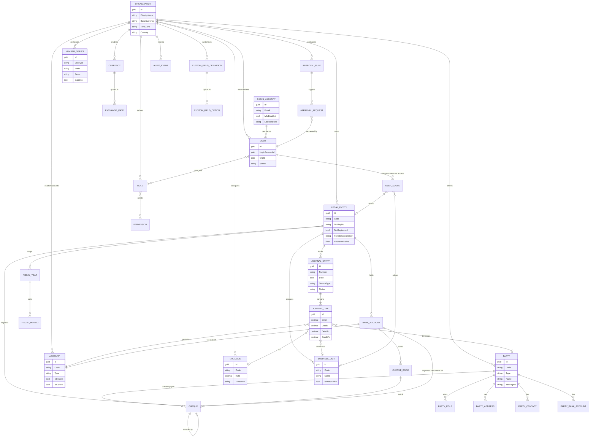
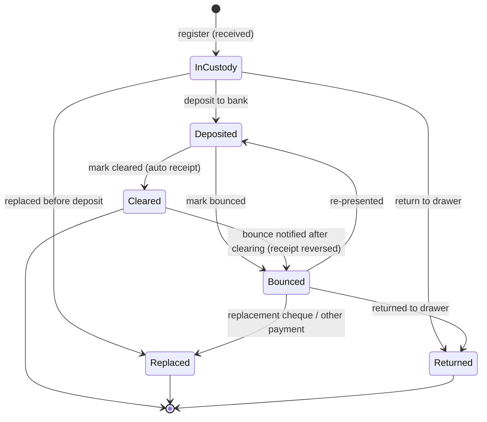

# Core Domain: Business Model and Shared Rules

| | |
|---|---|
| Document | Core domain (industry-agnostic) |
| Product | The ERP (general-purpose, multi-tenant, pluggable industry modules) |
| Author | Business Analyst, sprint 0 |
| Date | 22 Oct 2026 |
| Source | Build spec (`/workspace/erp-team/spec.txt`), sections 2, 4.3, 4.4, 4.17–4.19, 4.25–4.27, 5.8–5.10, 7, 10.3–10.7, 11 |
| Stack | ASP.NET Core 8, EF Core, SQL Server, Angular + ng-zorro |
| Companion docs | `user-stories-sprint1-2.md`, `real-estate-module.md` |

**How to read this document**

- **[Spec]** means the rule comes from the build spec, either observed in the reference app or recommended in the spec's sections 9–13. Spec section numbers are given as `§x.y`.
- **[Assumption]** means the spec doesn't cover it and the rule follows standard ERP practice. These need Muhammad's confirmation (see Section 11, Open questions).
- **Decision (accepted)** means Muhammad accepted the BA proposal on 22 Oct 2026: Business unit is a reporting dimension; Party is a single record with roles; multi-currency is in the core; lease income is recognised straight-line; invoices, bills, receipts, payments and cheques (incoming and outgoing) are core finance; outgoing PDCs use a PDC payable account; cheque legal follow-up is core.
- References to this document's own sections are written "Section n".
- **[BA suggestion]** is a design recommendation for the dev team. It isn't a business rule.
- Account codes such as `1100` and `2100` are the spec's sample chart (§4.17). They're shipped as a **template**. They aren't hard-coded.

---

## 1. Scope and design principles

The spec describes one vertical product, a UAE property manager with finance and payroll. The ERP generalises it into a **shared core** that every industry uses, plus **industry modules** that plug into the core.

| Principle | Meaning |
|---|---|
| P1. Core owns money and identity | Organisations, legal entities, users and roles, parties, the ledger, sales invoices, purchase bills, receipts and payments, cheques, tax, currency, numbering, approvals, audit, documents and custom fields all live in the core. Modules never keep their own ledger or user store. |
| P2. Modules post through the core | A module raises business events such as `LeaseActivated` or `InvoiceIssued`. The core posting service turns each event into a balanced journal (§5.10 "documents never write journal lines directly"). [Spec] |
| P3. The legal entity is the accounting boundary | Books, tax invoices, number series, period locks, VAT registration and payroll employer all belong to one legal entity (§2.2, §10.3). [Spec] |
| P4. Shared masters, scoped transactions | Chart of accounts, parties, settings, users and roles are shared across the organisation. Every transaction belongs to exactly one legal entity (§2.2). [Spec] |
| P5. Configuration over code | Tax codes, numbering formats, approval thresholds, chart templates, document templates and custom fields are tenant data. Country rules come from a "localisation pack" (§9, Pakistan pack). [Spec + Assumption] |
| P6. Immutable postings | Posted journals are never edited or deleted. Corrections are reversals (§10.5). [Spec] |

---

## 2. Core entities

### 2.1 Entity catalogue (business-level fields)

Every business record carries the spec's common columns: `Id` (sequential GUID), `OrgId`, `CreatedAt/By`, `UpdatedAt/By`, `IsDeleted` (master data only) and `RowVersion` (§11.1). Entity-scoped records also carry `LegalEntityId`. These columns aren't repeated below.

#### Tenancy and structure

| Entity | Key business fields | Notes |
|---|---|---|
| **Organization** (the tenant) | Display name, group legal name, contact email, plan, country (ISO-2), base/reporting currency, time zone, default language, enabled industry modules, localisation pack, status (Trial/Active/Suspended/Closed) | §4.25, §11.2. The spec keeps settings on the Organization row (VAT rate, thresholds, alert days, payroll rules). The ERP moves them to `OrgSetting` key/value per module [Assumption]. |
| **LegalEntity** | Code (`ENT-0001`), legal name, country, region/state (the emirate for the UAE), trade/commercial licence no. and expiry, tax registration no. (TRN in the UAE, 15 digits), tax-registered flag, functional currency, registered address, phone, email, fiscal-year pattern, "books locked to" date, status, payroll employer ids (e.g. MOHRE establishment id, employer routing code) | §4.4. The licence expiry raises an alert. A legal entity must be tax-registered before it can issue standard-rated lines (§4.4). [Spec] Functional currency is an [Assumption]: the spec only has AED. |
| **Business unit** | Code, name, legal entity, address, phone, manager (user), is-head-office flag, status, optional default warehouse/cost centre | Decision (accepted). The spec has no business unit level. It's needed for retail stores, warehouses, service offices and HR locations. A business unit (called "branch" in earlier drafts; renamed by Decision, 22 Oct 2026) is an operational and reporting dimension under one legal entity, with permissions `core.businessunits.*`. **It is never an accounting boundary.** |

#### Identity and access

| Entity | Key business fields | Notes |
|---|---|---|
| **LoginAccount** (platform-wide) | Email (sign-in, unique platform-wide, can't be changed after creation), password hash, MFA enabled + secret, recovery codes, lockout state, failed-attempt count, last sign-in, last used workspace | Decision (accepted, 22 Oct 2026): one login for all workspaces; no org code at sign-in (BR-TEN-05). Not tenant-scoped. |
| **User** (workspace membership) | Login account, organisation, full name, phone, status (Invited/Active/Disabled), preferred language, user type (Staff / External portal), last sign-in in this workspace | §4.26, §11.2. Tenant-scoped by `OrgId` like all business rows. |
| **Role** | Name, description, built-in flag, permission set | 9 built-in roles (§2.3). Custom roles are a "Should" in §9 and are brought into the core here. |
| **Permission** | Key `<module>.<resource>.<action>`, e.g. `finance.invoices.issue`, `core.approvals.decide`, `core.users.manage`, `core.customfields.manage` | §7.1. Modules register their own keys. |
| **UserRole** | User, role | Many-to-many |
| **UserScope** | User, legal entity access (All / Selected list), business unit access (All / Selected list) | Entity access comes from §4.26. Business unit access is a Decision (accepted). |
| **RefreshToken** | Login account, selected workspace (org) and membership, hashed token, device, issued, expires, revoked | §10.4 |

#### Parties (business partners)

| Entity | Key business fields | Notes |
|---|---|---|
| **Party** | Code, type (Individual/Company), legal/full name, display name, tax registration no., national id / passport / trade licence (type + number + expiry), nationality, email, phone, default currency, status, notes | Generalises the spec's separate Customer (§4.8) and Vendor (§4.13) records Decision (accepted). Shared across legal entities (§2.2). |
| **PartyRole** | Party, role (Customer, Supplier, Tenant, Owner, Employee-link, Agent, Broker client …), role code (e.g. `CUS-0001`, `VEN-0001`), role-specific terms (payment terms days, credit limit, default income/expense account, withholding flag) | One party can be both customer and supplier. Modules add roles (real estate adds Tenant and Owner). |
| **PartyAddress** | Party, type (Billing/Shipping/Registered), lines, city, region, country, postcode | [Assumption] |
| **PartyContact** | Party, name, role, email, phone, is-primary | [Assumption] |
| **PartyBankAccount** | Party, bank name, IBAN (validated per country, e.g. AE = 23 chars), account no., routing code, currency, is-default | §4.13 (vendor IBAN), §4.21 |

#### Finance

| Entity | Key business fields | Notes |
|---|---|---|
| **Currency** | ISO code, name, symbol, decimal places, active | Decision (accepted). Multi-currency is a "Could" in §9 and is brought into the core. |
| **ExchangeRate** | From currency, to currency, rate date, rate (`decimal(18,8)`), rate type (Spot/Average/Closing/Custom), source (Manual/Feed) | Decision (accepted) |
| **Account** (chart of accounts) | Code (4 digits in the default template, unique per org), name, type (Asset/Liability/Equity/Income/Expense), reporting group, normal balance, is-system, is-bank, is-control (AR/AP), allow manual posting, currency (blank = any), active, description | §4.17, §11.2. Shared by every legal entity. Balances follow the entity scope. |
| **FiscalYear** | Legal entity, name, start date, end date, status (Open/Closing/Closed) | [Assumption]. The spec only has a lock date (§5.9) and calendar-year numbering (§11.4). |
| **FiscalPeriod** | Fiscal year, period no., start, end, status (Open/Soft-locked/Locked) | [Assumption]. Works alongside "books locked to". |
| **JournalEntry** | Legal entity, number (`JV-YYYY-NNNNNN`), date, source type, source id/number, memo, reference, transaction currency, exchange rate, status (Draft/Submitted/Posted/Reversed), posted at/by, reversal-of | §4.19, §10.5 |
| **JournalLine** | Entry, seq, account, debit, credit (transaction currency and functional currency), description, dimensions (business unit, party, cost centre, project, plus module dimensions such as property/unit/lease), tax code | §10.5. Business unit dimension: Decision (accepted). Cost centre: [Assumption]. |
| **BankAccount** | Legal entity, name, bank, account no., IBAN, currency, GL account (one each), opening balance and date, active | §4.18. Each bank account gets its own GL account. |
| **SalesInvoice / CreditNote / Receipt** | Legal entity, customer, number, dates, currency, lines with tax codes, status, balance, allocations, source link | Section 10. Core finance (§4.11, §4.12). |
| **VendorBill / VendorPayment** | Legal entity, vendor, vendor invoice no., lines, status, approval, allocations | Section 10. Core finance (§4.14, §4.15). |
| **Cheque** | Direction (Incoming/Outgoing), register no., legal entity, party, cheque no., drawee bank and branch, account holder, amount, currency, cheque date, received/issued on, custodian, purpose, status, bank account (deposited into / drawn on), cheque book + leaf, deposited/cleared/bounced on, bounce reason, linked receipt/payment, replaced-by, source link (module, record type, id) | Section 8. Generalised from the spec's PDC register (§4.10, §5.2) |
| **ChequeBook** | Bank account, first and last leaf no., next leaf, status (Active/Exhausted/Cancelled) | Section 8 [Assumption] |
| **TaxCode** | Code (e.g. `STD5`, `ZERO`, `EXEMPT`, `OOS`, `RC5`), name, tax type (Output/Input/Both), rate %, treatment (Standard/Zero/Exempt/OutOfScope/ReverseCharge), output GL account, input GL account, recoverable by default, return-box mapping, effective from/to | §11.5 `VatCode`, §6.5 VAT201 mapping |
| **TaxRegime** (localisation pack) | Country, tax name (VAT/GST/Sales tax), registration-number format, return form definition, rounding rule, invoice wording rules | [Assumption] from §9 "Localization layer" |
| **NumberSeries** | Document type, legal entity (blank = org-wide), business unit (optional), prefix, format pattern (e.g. `{PREFIX}-{YYYY}-{######}`), reset policy (Never/Yearly/Fiscal-yearly), next value, gapless flag | §11.4 |

#### Workflow and platform

| Entity | Key business fields | Notes |
|---|---|---|
| **ApprovalRule** | Document type, legal entity (optional), condition (amount > threshold, always, never), approver role(s), levels | §4.25, §5.8. Multi-level rules are a "Should" in §9. |
| **ApprovalRequest** | Type (General/VendorBill/VendorPayment/PayrollRun/ManualJournal/module types), document id, subject, justification, legal entity, amount, currency, requested by/at, status (Pending/Approved/Rejected/Withdrawn), decided by/at, comment | §4.3, §11.2 |
| **AuditEvent** | When (UTC), user, IP, action (Created/Updated/Deleted/Posted/Approved …), record type, record id, changed fields, before JSON, after JSON, correlation id | §4.27, §10.7. Append-only. |
| **Document** (attachment) | Owner type and id, file name, content type, size, blob key, uploaded by/at, tags, expiry date | §10.7. 10 MB default limit (§4.25). |
| **Notification** | User, type, severity, title, body, link, read at | §4.29, §10.7 |
| **OrgSetting** | Module, key, value, value type | [Assumption] |
| **IndustryTemplate** | Industry, version, contents (COA, tax codes, roles, numbering, document templates, custom-field pack, settings) | [Assumption]. Drives onboarding (Section 4). |
| **CustomFieldDefinition / CustomFieldOption** | See Section 9, Customization | Added in response to the custom-fields requirement |

### 2.2 Key relationships

- **Organization 1–N** LegalEntity, User, Role, Party, Account, Currency (enabled), TaxCode, NumberSeries, ApprovalRule, CustomFieldDefinition (§11.3 + Assumption).
- **LegalEntity 1–N** Business unit, BankAccount, FiscalYear, JournalEntry, every transactional document, and payroll runs (§11.3).
- **LoginAccount 1–N User** (one membership per workspace).
- **User N–M Role**. User 1–N UserScope rows (entities and business units).
- **Party 1–N** PartyRole, PartyAddress, PartyContact, PartyBankAccount.
- **JournalEntry 1–N JournalLine N–1 Account**. Every posted business document has 0..1 JournalEntry (§11.3).
- **ApprovalRequest 0..1 → document** (polymorphic by type + id).
- **AuditEvent / Document / CustomFieldValue → any record** (polymorphic owner type + id).

### 2.3 ER diagram (core)

---

## 3. Business rules that apply to every industry

Rule IDs use the form `BR-<area>-nn`. Industry modules may add rules. They may not weaken these.

### 3.1 Multi-tenancy and data isolation

| ID | Rule | Source |
|---|---|---|
| BR-TEN-01 | One organisation = one tenant = one **workspace** (the user-facing term). Every business row carries `OrgId`, and no query may return rows from another org. | §7.3, §10.3 [Spec] |
| BR-TEN-02 | The org is resolved from the authenticated token (`org` claim), which is set only when the user selects a workspace they're an active member of (BR-TEN-05). It is **never** taken from the request body, query string or URL. | §10.3 [Spec] |
| BR-TEN-03 | EF Core global query filters apply `OrgId == current`. For entity-scoped tables they also apply `LegalEntityId ∈ allowed entities`, plus the header entity switcher if one is set. | §7.3 [Spec] |
| BR-TEN-04 | Unique indexes include `OrgId`, so codes such as `ENT-0001` can repeat across tenants. | §7.3 [Spec] |
| BR-TEN-05 | **No organisation or tenant code at sign-in.** Users sign in with email + password on one login page. After the password (and MFA, if enabled) succeeds, the user's active workspaces are looked up: exactly one is selected automatically; two or more show a **workspace picker**. Before the password succeeds, no response reveals any workspace (names, ids or count). The picker uses a short-lived selection token that can't call business endpoints. Users can switch workspace from the avatar menu. | Decision (accepted, 22 Oct 2026); replaces the spec's org-code login (§10.3) |
| BR-TEN-06 | Storage model: single database, shared schema. Database-per-tenant is a later option for large clients, and the business rules must not depend on which model is used. | §10.3 [Spec] |
| BR-TEN-07 | Platform support staff can access tenant data only through an audited "support session" that the org admin grants for a set time. | [Assumption] |
| BR-TEN-08 | A suspended org can sign in read-only (export allowed). A closed org's data is retained for the statutory period (UAE: 5 years for tax records, configurable per pack), then purged. | [Assumption] |

### 3.2 Organisation, legal entity and business unit hierarchy

| ID | Rule | Source |
|---|---|---|
| BR-ORG-01 | Hierarchy: **Organization → Legal entity (1..N) → Business unit (0..N)**. Each org has at least one legal entity. | §2.2 + Decision (accepted) for business unit |
| BR-ORG-02 | Each legal entity issues its own tax invoices, keeps its own books and runs its own payroll. | §2.2 [Spec] |
| BR-ORG-03 | Every transactional document belongs to exactly one legal entity, and that can't change after posting. Business unit is optional on documents and can be made mandatory per document type in settings. | §2.2 [Spec] + Decision (accepted) for business unit |
| BR-ORG-04 | Shared at org level: chart of accounts, parties, settings, users, roles, tax codes, currencies and custom-field definitions. | §2.2 [Spec] |
| BR-ORG-05 | A legal entity can be deactivated only when it has no open documents (unpaid invoices or bills, active contracts, draft journals). History stays visible. | [Assumption] |
| BR-ORG-06 | Licence expiry drives an alert (default 60 days ahead, configurable). | §4.2, §4.4 [Spec] |
| BR-ORG-07 | Inter-company transactions between legal entities post a due-to/due-from pair in each entity's books. Consolidated reports eliminate them. Planned for a later phase. | [Assumption] |
| BR-ORG-08 | The header **entity switcher** narrows every list, KPI and report to one entity, within the user's allowed set. It's sent as `X-Entity-Id`. A **business unit filter** works the same way within an entity. | §4.30 [Spec] + Decision (accepted) for business unit |

### 3.3 Role-based access control and permissions

| ID | Rule | Source |
|---|---|---|
| BR-SEC-01 | **Permission key format is `<module>.<resource>.<action>`** in lower case, e.g. `finance.invoices.issue`, `realestate.leases.activate`, `core.customfields.manage`. The spec's `<area>.read/write` keys (§7.1) are mapped to this format (table below). | §7.1 [Spec] + Decision (accepted) |
| BR-SEC-01a | Standard actions: `read`, `create`, `edit`, `delete`, `manage` (= read + create + edit + delete on a master-data resource), `export`. Keys are all lower case; there is no `view` action. Workflow actions are named after the verb (`post`, `issue`, `void`, `decide`, `lock`, `reopen`, `deposit`, `clear`, `bounce` …). Any action on a resource implies its `.read` (e.g. `core.audit.read`). | [Assumption] |
| BR-SEC-02 | A user's effective permissions = the union of their roles' permissions. No deny rules in v1. | §7.2 [Spec] + [Assumption] |
| BR-SEC-03 | Data scope = permissions ∩ legal-entity access ∩ business unit access. A user with `finance.invoices.create` but access only to entity A can't see entity B's invoices. | §2.2, §7.3 [Spec] |
| BR-SEC-04 | Built-in roles (Org admin, Finance manager, Accountant, Viewer, Approver, plus module roles) are seeded per industry template. They can be cloned but not edited or deleted. Custom roles are built from permission keys. | §2.3, §8 #7, §9 [Spec] |
| BR-SEC-05 | At least one active user must hold Org admin at all times. Removing the last one is blocked. | [Assumption] |
| BR-SEC-06 | Permission changes take effect on the next token refresh. The token carries a permission-version (`ver`) claim, and a version change forces refresh. | §10.4 [Spec] |
| BR-SEC-07 | Both the API (policy attribute such as `[HasPermission("finance.invoices.issue")]`, plus MediatR behaviour) and the UI (route guards, `*hasPermission`) enforce permissions. The UI only hides what the API would refuse anyway. | §7.3 [Spec] |
| BR-SEC-08 | Sensitive fields (national ID, passport, IBAN, salary) are masked for users without `core.sensitivedata.read` (module packs may add narrower keys, e.g. `hr.salaries.read`). | §7.3 [Spec] |
| BR-SEC-09 | Modules register their permission keys under their own module prefix at install time (e.g. `realestate.*`, `inventory.*`, `hr.*`). Disabling a module hides its permissions without deleting the grants. | [Assumption] |

**Core and finance permission catalogue** (modules add their own; the Real Estate module's keys are in `real-estate-module.md` Section 9):

| Module | Resource | Actions | Covers |
|---|---|---|---|
| `core` | `organization` | read, manage | Organisation profile |
| `core` | `legalentities` | read, manage | Legal entities |
| `core` | `businessunits` | read, manage | Business units (reporting dimension under a legal entity) |
| `core` | `users` | read, manage | Users, invitations, password reset, unlock |
| `core` | `roles` | read, manage | Roles and permission grants |
| `core` | `settings` | read, manage | Organisation and module settings |
| `core` | `audit` | read | Audit log |
| `core` | `approvals` | request, decide | Raise general requests / approve or reject |
| `core` | `parties` | read, manage, export | Parties and party roles |
| `core` | `numberseries` | read, manage | Number series |
| `core` | `customfields` | read, manage | Custom field definitions (Section 9) |
| `core` | `sensitivedata` | read | Unmasked sensitive fields |
| `finance` | `currencies` | read, manage | Currencies |
| `finance` | `exchangerates` | read, manage, override | Rates; override the rate on a document |
| `finance` | `taxcodes` | read, manage, override | Tax codes; override the default tax code on a line |
| `finance` | `accounts` | read, manage | Chart of accounts |
| `finance` | `fiscalyears` | read, manage | Fiscal years and periods |
| `finance` | `periods` | lock, reopen, postsoftlocked | Books-locked-to date; posting into a soft-locked period |
| `finance` | `journals` | read, create, post, reverse | Manual journals |
| `finance` | `bankaccounts` | read, manage | Bank and cash accounts |
| `finance` | `invoices` | read, create, issue, void, credit | Sales invoices and credit notes, billing runs |
| `finance` | `receipts` | read, create, allocate, void | Receipts |
| `finance` | `bills` | read, create, submit, void | Vendor bills |
| `finance` | `payments` | read, create, cancel | Vendor payments |
| `finance` | `cheques` | read, create, edit, delete, deposit, clear, bounce, replace, return, issue, stop, void, followup | Cheque register (Section 8) |
| `finance` | `reports` | read, export | Financial reports |

**Mapping from the spec's keys (§7.1, §7.2)** used to seed built-in roles: `accounting.read/write` → `finance.accounts.*`, `finance.journals.*`, `finance.bankaccounts.*`, `finance.fiscalyears.*`; `billing.read/write` → `finance.invoices.*`, `finance.receipts.*` (+ `finance.cheques.read/create/deposit/clear/bounce/replace/return`); `payables.read/write` → `finance.bills.*`, `finance.payments.*` (+ `finance.cheques.issue/stop/void`); `portfolio.read/write` → `core.legalentities.*` + `realestate.properties.*`, `realestate.units.*`; `leasing.read/write` → `realestate.leases.*`, `realestate.deposits.*`, `realestate.registrations.*`, `core.parties.*`; `investment` → `realestate.acquisitions.*`; `facilities` → `realestate.workorders.*`; `hr` → `hr.*`; `brokerage` → `realestate.deals.*`; `reports.read` → `finance.reports.read` + each module's `*.reports.read`; `approvals.decide` → `core.approvals.decide`; `admin.audit` → `core.audit.read`; `admin.settings` → `core.settings.manage`; `admin.users` → `core.users.manage` + `core.roles.manage`. Read maps to `read`; write maps to every action of the resource.

### 3.4 Numbering sequences

| ID | Rule | Source |
|---|---|---|
| BR-NUM-01 | Master-data codes use `PREFIX-0000` (e.g. `ENT-0001`, `CUS-0012`) and never reset. Transactional documents use `PREFIX-YYYY-000000` and reset yearly. | §11.4 [Spec] |
| BR-NUM-02 | A "leave blank to auto-number" code field accepts a manual code if it's unique. Otherwise the next number is taken from the series. | §4.4 [Spec] |
| BR-NUM-03 | Numbers for **tax invoices and credit notes** are allocated inside the posting transaction (row lock `UPDLOCK`). Drafts stay unnumbered or carry a `DRAFT-` id, so issued numbers are **gapless and sequential**, as the tax authority expects. | §5.3, §11.4 [Spec] |
| BR-NUM-04 | Series can be org-wide or per legal entity (and optionally per business unit). The default template has per-entity series for tax documents and org-wide series for masters. | §10.3 [Spec] + [Assumption] |
| BR-NUM-05 | A series' format can be changed only before its first use in a period. A number can never be re-used, even after a void. | [Assumption] |
| BR-NUM-06 | Default prefixes (core): ENT, BU (business unit), CUS/VEN (party roles), JV, INV, CN, RCT, BILL, PAY, APR (approval), CHQ (incoming cheque register), CHO (outgoing cheque register). Modules add their own (e.g. LSE, WO, PROP) and templates may rename core prefixes (the real estate template sets CHQ → PDC, as in §11.4). | §11.4 [Spec] |

### 3.5 Fiscal periods and posting rules

| ID | Rule | Source |
|---|---|---|
| BR-FIS-01 | Each legal entity has fiscal years (default: calendar year, to match the spec's yearly numbering) split into monthly periods. | [Assumption] |
| BR-FIS-02 | **Books locked to**: a date per legal entity. Any journal, automatic or manual, dated on or before it is rejected. That includes voids and credit notes. The user is told to date the correction in an open period. | §4.4, §5.9 [Spec] |
| BR-FIS-03 | Reopening a locked period needs `finance.periods.reopen` and a reason, and writes an audit event. | §5.9 [Spec] |
| BR-FIS-04 | The lock is enforced in the posting service, with a SQL trigger as a backstop. | §7.3 [Spec] |
| BR-FIS-05 | A posting date must fall inside an existing, non-closed fiscal year of the entity. | [Assumption] |
| BR-FIS-06 | Year-end close wizard: posts the closing journal (income and expense to retained earnings, account `3100` in the template), then locks the year. Until then the balance sheet shows "current-year earnings" as a computed equity line. | §5.9, §6.2 [Spec] |
| BR-FIS-07 | Optional soft lock per period: only users with `finance.periods.postsoftlocked` can post into it. Used during month-end. | [Assumption] |

### 3.6 Double-entry ledger

| ID | Rule | Source |
|---|---|---|
| BR-GL-01 | Every journal has ≥ 2 lines, and Σ debit = Σ credit in both transaction and functional currency. Each line has a debit **or** a credit > 0, never both. | §4.19, §10.5 [Spec] |
| BR-GL-02 | Posted journals are immutable. Corrections are reversal journals (`ReversalOf`) or adjusting entries. | §10.5 [Spec] |
| BR-GL-03 | Business documents never write journal lines directly. They raise a domain event, and `IPostingService` maps it through a **posting rule table** to line templates in the same database transaction. The journal id is stored on the document ("View journal"). | §5.10 [Spec] |
| BR-GL-04 | Posting rules are data, keyed by event and configurable per org (default accounts per rule), so each industry ships its own defaults. | §5.10 [Spec] + [Assumption] for configurability |
| BR-GL-05 | Control accounts (AR `1100`, AP `2000`, tax accounts) accept postings only from their subledger. Manual journals to them are blocked unless the account allows manual posting. A nightly check makes sure subledger totals = control account. | §10.5 [Spec] |
| BR-GL-06 | System accounts can't be deleted or retyped. An account with postings can't change type and can only be deactivated. | §4.17 [Spec] + [Assumption] |
| BR-GL-07 | Each bank account has its own GL account, created automatically. An opening balance posts against `3900` Opening balance equity. | §4.18, §5.10 [Spec] |
| BR-GL-08 | Manual journals: Draft → (Submit → Approval if the setting is on) → Posted. Approval is "off" by default. | §4.19, §4.25 [Spec] |
| BR-GL-09 | Money is `decimal(18,2)` and rates are `decimal(9,4)` (exchange rates `decimal(18,8)`). Rounding is half away from zero, and an instalment rounding remainder goes to the last line. | §10.5 [Spec] |
| BR-GL-10 | Dimensions on lines: business unit, party, cost centre, project (core), plus module dimensions (property/unit/lease, warehouse/item, employee). Reports can filter by any dimension. | §10.5 [Spec] + [Assumption] |

### 3.7 Parties (business partners)

| ID | Rule | Source |
|---|---|---|
| BR-PTY-01 | A Party is shared across all legal entities of the org. Balances and statements are computed per entity. | §2.2 [Spec] |
| BR-PTY-02 | One party can hold several roles (Customer, Supplier, Tenant, Owner …). Each role has its own code series and terms. | Decision (accepted) |
| BR-PTY-03 | Tax registration no. is validated by the localisation pack's format (UAE TRN = exactly 15 digits). It's mandatory on the party if the party is flagged tax-registered. | §2.1, §4.8 [Spec] |
| BR-PTY-04 | Duplicate warning (not a block) when the name + tax no. or the email/phone matches an existing party. | [Assumption] |
| BR-PTY-05 | A party with documents can't be hard-deleted. It can only be set Inactive. Inactive parties can't be picked on new documents. | §4.5 recommendation [Spec] + [Assumption] |
| BR-PTY-06 | Supplier invoice no. is unique per supplier (duplicate check). | §4.14 [Spec] |
| BR-PTY-07 | Payment terms default from the party role (supplier default 30 days, customer from org default 15 days). | §4.13, §4.25 [Spec] |

### 3.8 Approvals (maker-checker)

| ID | Rule | Source |
|---|---|---|
| BR-APR-01 | **Approvers can never approve their own requests**, whatever their role. | §2.1, §5.8, §7.3 [Spec] |
| BR-APR-02 | Threshold semantics per document type: an amount above the threshold needs approval. `0` = always, `−1` = never. Defaults: vendor bill AED 10,000, vendor payment AED 25,000, payroll on, manual journal off. | §4.25, §5.8 [Spec] |
| BR-APR-03 | On approve, the document posts (for example, a bill becomes payable or a payment credits the bank). On reject, it returns to Draft (or Cancelled for payments). The requester can withdraw while it's Pending. | §4.3, §5.8 [Spec] |
| BR-APR-04 | Every decision stores the decider, time and comment, and appears in the record's History tab and the audit log. | §5.8 [Spec] |
| BR-APR-05 | Deciding needs `core.approvals.decide` **and** access to the document's legal entity. | §5.8 [Spec] + [Assumption] |
| BR-APR-06 | General requests (e.g. purchase order approval) can be raised manually with subject, entity, amount and justification. | §4.3 [Spec] |
| BR-APR-07 | Later phase: multi-level rules (amount bands, entity, document type), delegation during leave, SLA reminders, approve from email/mobile. | §5.8, §9 [Spec] |
| BR-APR-08 | Thresholds are evaluated in the **functional currency** of the legal entity. | [Assumption] |

### 3.9 Tax configuration

| ID | Rule | Source |
|---|---|---|
| BR-TAX-01 | Tax is driven by **tax codes** with treatment Standard / Zero-rated / Exempt / Out-of-scope / Reverse-charge, a rate, and output/input GL accounts. | §11.5 [Spec] |
| BR-TAX-02 | The localisation pack sets the tax name, default codes, registration-number format, return form and box mapping (UAE: VAT 5%, VAT201 boxes 1a–14). | §6.5, §9 [Spec] |
| BR-TAX-03 | Only a tax-registered legal entity can issue documents with standard-rated or zero-rated lines. | §4.4, §4.11 [Spec] |
| BR-TAX-04 | Input tax on purchase lines is **recoverable** or **blocked**. Blocked tax is added to the expense. Only recoverable tax feeds the return. | §2.1, §4.14 [Spec] |
| BR-TAX-05 | Tax rate changes are effective-dated. A document uses the rate valid on its tax point date. | [Assumption] |
| BR-TAX-06 | The default tax code on a line comes from the module's rule (e.g. real estate: unit usage), then the item/service, then the party, then the org default. Users may override it with `finance.taxcodes.override`. Overrides are audited. | §4.9 [Spec] + [Assumption] |
| BR-TAX-07 | Return settlement: Dr output tax / Cr input tax / Cr Bank for the net amount, after filing. | §5.10 [Spec] |
| BR-TAX-08 | Tax amounts are rounded per line, half away from zero, to 2 dp. Header tax = Σ line tax. | [Assumption]. Confirm with tax advisor. |
| BR-TAX-09 | The tax invoice print layout and mandatory fields come from the pack (UAE: "Tax Invoice" title, supplier and customer TRN, sequential number, date, tax per line and total in AED). | §4.11 [Spec] |
| BR-TAX-10 | The UAE pack must plan for **mandatory e-invoicing** through an Accredited Service Provider. It's phased: businesses with revenue ≥ AED 50M go live 1 Jan 2027, < AED 50M on 1 Jul 2027. B2C is excluded for now (Ministerial Decision 244/2025, amended). Design the invoice model so it can be exported to the e-invoice data format. | External research, 22 Oct 2026 |

### 3.10 Multi-currency and exchange rates

| ID | Rule | Source |
|---|---|---|
| BR-FX-01 | Each legal entity has a **functional currency** (default = org base currency, AED for UAE tenants). The org has a **reporting currency** for consolidated reports. | §9 "Could" brought into the core: Decision (accepted) |
| BR-FX-02 | Documents carry a transaction currency and an exchange rate to the functional currency. Journal lines store both amounts. | §9 [Spec] |
| BR-FX-03 | The rate defaults to the latest rate on or before the document date (type Spot). The user can override it if allowed, and the override is audited. A missing rate blocks posting with a clear message. | Decision (accepted) |
| BR-FX-04 | Realised gain/loss is posted at settlement (receipt/payment allocation) to FX gain/loss accounts. | Decision (accepted) |
| BR-FX-05 | Unrealised revaluation of open AR/AP and foreign bank balances runs at period end (closing rate) and auto-reverses on day 1 of the next period. Later phase. | §9 [Spec] |
| BR-FX-06 | A bank account has one currency, and receipts/payments through it must be in that currency (or carry an explicit conversion). | §4.18 [Spec] + Decision (accepted) |
| BR-FX-07 | The tax amount on a tax invoice must also be shown in the tax currency of the country (AED in the UAE) when the invoice is in a foreign currency. | [Assumption]. Confirm with tax advisor. |

### 3.11 Audit trail

| ID | Rule | Source |
|---|---|---|
| BR-AUD-01 | Every create, update and delete across the org is recorded with before/after values, user, time (UTC) and IP. | §4.27, §7.3 [Spec] |
| BR-AUD-02 | Audit rows are append-only. They're written by the persistence layer (EF `SaveChanges` interceptor), not by feature code. | §4.27, §10.7 [Spec] |
| BR-AUD-03 | Business events (Posted, Approved, Rejected, Locked, Reopened, Login success/failure, Password reset, Role change) are audited as named actions. | §5.8, §5.9 [Spec] + [Assumption] |
| BR-AUD-04 | Each record's History tab shows its audit timeline (e.g. "Created by System · 18 Oct 2026, 08:48"). | §3.3 [Spec] |
| BR-AUD-05 | Reading the audit log needs `core.audit.read`. Sensitive values are masked in the diff for users without the owning sensitive permission. | §7.1 [Spec] + [Assumption] |
| BR-AUD-06 | Retention: audit kept ≥ the statutory record period (UAE tax: 5 years). The table is partitioned by month. | §10.7 [Spec] + [Assumption] |

### 3.12 Soft delete and record lifecycle

| ID | Rule | Source |
|---|---|---|
| BR-DEL-01 | **Master data** (parties, accounts, business units, module masters such as properties and items) uses soft delete (`IsDeleted`) and/or an Active/Inactive status. | §11.1 [Spec] |
| BR-DEL-02 | Delete is blocked when dependent records or postings exist. The user is offered "Deactivate" instead. | §4.5 [Spec] |
| BR-DEL-03 | **Transactional documents** can be deleted only while Draft and unnumbered. After that they can only be voided, reversed or cancelled. | §5.3 [Spec] + [Assumption] |
| BR-DEL-04 | Soft-deleted rows are excluded by the global query filter, can be restored by an admin within 30 days, and are always kept for audit. | [Assumption] |
| BR-DEL-05 | Optimistic concurrency: updates send `If-Match` (RowVersion), and a conflict returns 412 with "This record was changed by someone else". | §12 [Spec] |

### 3.13 Documents, notifications and alerts (shared services)

- Every detail page has **Documents** and **History** tabs (§4 global conventions). Max upload size is from settings (default 10 MB), with a virus scan and signed URLs valid for 5 minutes (§10.7). [Spec]
- An **alerts builder** job runs hourly and produces notifications. Each module registers alert types (e.g. licence expiry and cheques due for deposit in the core; lease expiry in real estate) with category, urgency and link (§4.2, §10.6). [Spec]
- The notification bell shows pending approvals plus alerts, in real time over SignalR (§4.29, §9). [Spec]

---

## 4. Industry onboarding flow

### 4.1 Tenant onboarding wizard (step by step)

The wizard runs once at signup and can be resumed. Each step is saved, so the admin can leave and return. **[Assumption]**: the spec has no signup flow. It only describes the result (org, entities, settings, seeded roles and chart).

| Step | Screen | What the admin enters/chooses | What the system does |
|---|---|---|---|
| 0 | **Sign up** | Name, work email, password (or SSO later), company name, country, phone; accepts terms | Creates a pending org + first user (Org admin) and sends an email verification link (24 h expiry) |
| 1 | **Verify email** | Clicks the link | Activates the user and starts the wizard |
| 2 | **Organisation profile** | Display name, group legal name, logo (shown in the workspace picker), time zone, base currency, language | Saves org settings |
| 3 | **Choose industry** | One primary industry: Real estate / Retail / Inventory & distribution / Services / Manufacturing / HR-only. Optional add-on modules (e.g. HR & payroll) | Selects the `IndustryTemplate` (see Section 4.2 below) |
| 4 | **Localisation** | Country pack (UAE first; others "coming soon"); tax regime confirmation (e.g. UAE VAT 5%) | Loads tax codes, ID validators, return mapping, invoice wording |
| 5 | **First legal entity** | Legal name, code (auto), region (emirate), licence no. + expiry, tax-registered? + TRN, address, fiscal-year start month, functional currency | Creates the legal entity, fiscal year and periods, and per-entity number series |
| 6 | **Business units** (optional) | Head office + more business units (name, address) | Creates business units. Can be skipped; a default head office is created automatically |
| 7 | **Chart of accounts** | Accept the industry template / upload own (CSV) / start minimal | Seeds accounts incl. system accounts (AR, AP, tax, opening balance equity, retained earnings) and the posting-rule defaults |
| 8 | **Bank accounts** | Bank, name, IBAN, currency, opening balance + date | Creates the bank account + GL account and posts the opening balance to `3900` |
| 9 | **Users and roles** | Invite teammates (email, role, entity access) | Seeds the template's roles and sends invitations |
| 10 | **Approvals and numbering** | Review default thresholds and prefixes | Saves approval rules and number series |
| 11 | **Import data** (optional) | Upload templates: parties, opening balances, plus module masters (e.g. properties/units/leases) | Runs the import wizard: map → validate → dry run → import (§9 "Data import wizards") |
| 12 | **Finish** | — | Marks the org Active, shows the "Getting started" checklist on the dashboard |

**Wizard rules**

- WIZ-01: Steps 2, 3, 4, 5 and 7 are mandatory before the first posting. The others can be done later from Settings.
- WIZ-02: The industry template is applied **once** and is versioned. Template items become ordinary tenant data, so later edits don't change the template. A later template update is offered as a "diff" that the admin accepts or declines.
- WIZ-03: Adding a second industry module later (e.g. a real estate group adds Retail) runs steps 3, 7 (merge accounts by code, no duplicates), 9 (merge roles) and 10 only.
- WIZ-04: Trial orgs get demo data on request (the spec's appendix seed for real estate, §14.1) in a separate sandbox legal entity that can be deleted in one action.

### 4.2 Industry × template matrix

Legend: ● included by default, ○ optional add-on, — not applicable.

**Modules**

| Module | Real estate | Retail | Inventory / distribution | HR (HR-only tenants) | Manufacturing | Services |
|---|---|---|---|---|---|---|
| Core (org, users, parties, GL, tax, FX, approvals, audit, custom fields) | ● | ● | ● | ● | ● | ● |
| **Core finance**: sales invoices and credit notes, purchase bills, receipts, payments, bank and cash (Section 10) | ● | ● | ● | ● | ● | ● |
| **Core finance**: cheques, incoming and outgoing (Section 8) | ● | ● | ● | ● | ● | ● |
| Real estate (properties, units, leases, lease cheque links, registration, **work orders** (maintenance/facilities) and **deals** (sales/lease, brokerage commissions)) | ● | — | — | — | — | — |
| Investment & funding (acquisitions, loans) | ● | — | — | — | ○ | — |
| Inventory (items, warehouses, stock moves) | — | ● | ● | — | ● | ○ |
| Point of sale | — | ● | — | — | — | — |
| Purchasing (PO, GRN) | ○ | ● | ● | — | ● | ○ |
| Sales orders / delivery | — | ○ | ● | — | ● | ○ |
| Manufacturing (BOM, work orders, routing) | — | — | — | — | ● | — |
| Projects & timesheets | — | — | — | — | ○ | ● |
| HR & payroll (WPS, gratuity in UAE) | ○ | ○ | ○ | ● | ○ | ○ |
| CRM (leads, pipeline) | ○ | ○ | ○ | — | ○ | ● |

**Templates per industry**

| Template | Real estate | Retail | Inventory / distribution | HR | Manufacturing | Services |
|---|---|---|---|---|---|---|
| **Chart of accounts highlights** (on top of a common base: banks 1010s, AR 1100, input tax 1200, AP 2000, output tax 2100, salaries payable 2300, opening equity 3900, retained earnings 3100) | Investment property 1500, tenant deposits held 2200, property financing 2600, rental income 4000, brokerage income 4200, property opex 5000–5600 (maintenance, security, cleaning, landscaping, utilities, insurance, PM fees), finance costs 7000 (§4.17) | Inventory 1400, POS clearing 1050, card receivables 1060, sales 4000, sales returns 4050, COGS 5000, shrinkage 5050, store rent 6200 | Inventory 1400, goods in transit 1410, GRNI 2050, sales 4000, COGS 5000, freight-in 5100, warehouse costs 6300 | Salaries 6000, allowances 6010, gratuity expense 6050, gratuity provision 2500, employee advances 1250 | Raw materials 1410, WIP 1420, finished goods 1430, production variance 5200, factory overhead 5300, depreciation 6800 | Unbilled revenue 1150, deferred revenue 2150, service revenue 4000, subcontractor cost 5000, reimbursable expenses 5100 |
| **Tax templates (UAE pack)** | STD5 (commercial rent, commission, services), EXEMPT (residential rent, bare land), ZERO (first residential supply ≤ 3 yrs from completion), OOS (deposits), input recoverable/blocked | STD5, ZERO (exports), OOS, RC (imports) | STD5, ZERO (exports, GCC rules), RC (imports), OOS | OOS for payroll | STD5, ZERO (exports), RC (imports) | STD5, ZERO (exported services), RC (imported services) |
| **Roles** (plus core Org admin, Finance manager, Accountant, Approver, Viewer) | Leasing manager, Facilities manager and Brokerage manager (all Real Estate module roles: work orders and deals are inside the module), HR manager (§2.3) | Store manager, Cashier, Purchasing officer, Inventory clerk | Warehouse manager, Purchasing officer, Sales officer, Dispatcher | HR manager, Payroll officer, Employee self-service | Production planner, Shop-floor supervisor, Quality inspector, Purchasing, Warehouse | Project manager, Consultant (timesheets), Billing officer |
| **Numbering** (plus core JV, INV, CN, RCT, BILL, PAY, CHQ, CHO) | PROP, UNIT, LSE, WO, ACQ, DEAL; CHQ renamed PDC (§11.4) | POS, SR (sales return), PO, GRN, ITM | SO, DN (delivery), PO, GRN, TRF (transfer), ITM | EMP, PR (payroll run), LV (leave) | BOM, MO (manufacturing order), PO, GRN, QC | PRJ, TS (timesheet), QT (quotation), SO |
| **Document templates** | Tax invoice (rent/commission), receipt, customer statement, tenancy contract, renewal letter, PDC acknowledgement, deposit settlement statement, payment voucher | Tax invoice / simplified tax invoice (POS), receipt, return note, PO | Tax invoice, delivery note, packing list, PO, GRN | Payslip, salary certificate, WPS SIF | Tax invoice, PO, GRN, job card, BOM sheet | Quotation, tax invoice, timesheet report, statement |
| **Default approval rules** | Bill > 10,000; payment > 25,000; payroll on; journal off (§4.25) | Bill > 10,000; payment > 25,000; price override; stock adjustment | PO > 25,000; stock adjustment; payment > 25,000 | Payroll run on; leave per policy | PO > 25,000; BOM change; scrap above tolerance | Quotation discount > 15%; bill > 10,000 |
| **Custom-field pack** (Section 9.8) | Unit view, parking bays, chiller account no., balcony, furnishing | Loyalty tier on customer | Shelf-life days on item | Visa expiry, labour card no. | Machine capacity | Engagement partner |

Core and core-finance rows are always on and can't be disabled. A tenant can only hide menus it doesn't use (e.g. an HR-only tenant hides Receivables). Work orders and deals are part of the Real Estate module (Decision, 22 Oct 2026). There are no separate facilities or brokerage modules. The real estate column comes from the spec. The other industries are **[Assumption]**: standard ERP practice, to be confirmed before each module's sprint 0.

---

## 5. Settings model (core)

Settings moved off the Organization row into module-scoped settings. Defaults come from §4.25. [Spec]

| Module | Setting | Default | Scope |
|---|---|---|---|
| core | Standard tax rate | 5.00 % (UAE pack) | Org |
| core | Default customer payment terms | 15 days | Org |
| core | Invoice footer | — (max 1000 chars) | Org, overridable per legal entity [Assumption] |
| core | Vendor bill approval threshold | 10,000 (0 = always, −1 = never) | Org, overridable per legal entity [Assumption] |
| core | Vendor payment approval threshold | 25,000 | Org |
| core | Manual journals require approval | Off | Org |
| core | Max attachment size | 10 MB | Org |
| core | Licence expiry alert | 60 days | Org [Assumption] |
| hr | Payroll runs require approval; day basis 30; OT multiplier 1.25; hours/day 8 | as listed | Org |
| finance | **Cheque-due alert days** (incoming cheques due for deposit, outgoing post-dated cheques due to be presented) | 7 days (§4.25) | **Per legal entity**: org default, each legal entity can override |
| finance | Deposited-not-cleared alert 5 days; bounced-unresolved escalation 7 days; stale period (pack: UAE 6 months); cheques-in-transit memo posting off | as listed [Assumption] | Org |
| finance | Post-dated cheques payable account (outgoing PDCs, BR-CHQ-11) | 2080* | Org (template account; always used, Decision accepted) |
| realestate | Lease expiry alert 60 days | as listed | Org |

---

## 6. Non-functional business expectations (core)

| ID | Expectation | Source |
|---|---|---|
| NFR-01 | List pages < 500 ms p95, reports < 2 s (long reports run as jobs with a download link) | §13.2 [Spec] |
| NFR-02 | Every list: search, filters, CSV export, 25 rows per page, record count | §4 conventions [Spec] |
| NFR-03 | Hard reload of a deep URL keeps the session (silent refresh) and returns to the same page | §8 #1 [Spec] |
| NFR-04 | Light/dark mode. Arabic RTL comes later (design must not block it) | §3.5, §9 [Spec] |
| NFR-05 | Data residency option: UAE region hosting | §13.3 [Spec] |
| NFR-06 | All timestamps stored in UTC and shown in the org time zone | §11.1 [Spec] |

---

## 7. Module extension points

Module-specific domain models live in their own documents (first: `real-estate-module.md`, see its Section 9 "How the module plugs into the core"). Every module plugs in through the same extension points:

**Module manifest standard** (Decision, 22 Oct 2026): every module declares a lower-case **module key** (e.g. `realestate`), a UI route prefix (e.g. `/real-estate/`), an API prefix **`/api/v1/m/<module key>/`** (e.g. `/api/v1/m/realestate/properties`), its own database schema (e.g. `re`), and permission keys `<module key>.<resource>.<action>` using the standard actions of BR-SEC-01a (`read`, never `view`). Core and core-finance APIs stay at `/api/v1/<resource>`.

| Extension point | What a module provides |
|---|---|
| Permission keys | `<module>.<resource>.<action>` keys (lower case) + built-in roles |
| Posting rules | Event → account mapping defaults |
| Number series | Prefixes and formats |
| Tax defaulting | Rule for the default tax code on its documents |
| Dimensions | Extra journal-line dimensions |
| Party roles | e.g. Tenant, Owner |
| Alerts and jobs | Alert types and background jobs |
| Reports | Report definitions registered in the reports hub |
| Custom-field pack | Optional predefined custom fields (Section 9.8) |
| Cheque source link | Hooks and purposes for cheques linked to module records (Section 8.7) |
| Industry template content | COA, roles, tax codes, documents |

---

## 8. Finance: Cheques

Cheques are a **core finance payment instrument**. Any module can use them. They cover **incoming** cheques received from parties (current-dated and post-dated, "PDC") and **outgoing** cheques the legal entity issues (current-dated and post-dated). This section is country-agnostic, and country rules live in the localisation pack (Section 8.9). It generalises the spec's PDC register (§4.10, §5.2, §5.10). Modules link cheques to their own records through the source-link hook (Section 8.7). For example, the Real Estate module links cheques to leases and rent instalments (`real-estate-module.md` Section 3.7).

### 8.1 Data model

| Entity | Key business fields |
|---|---|
| **Cheque** | Direction (Incoming / Outgoing); register no. (`CHQ-YYYY-000000` incoming, `CHO-YYYY-000000` outgoing; templates may rename); legal entity; party (drawer for incoming, payee for outgoing); cheque no.; drawee bank + branch (incoming) or bank account + cheque book leaf (outgoing); account holder name; amount; currency; cheque date; received on / issued on; custodian (incoming); purpose (Receivable settlement / Deposit / Advance / Payable settlement / Other; modules add purposes); status; deposited on + deposit bank account; cleared on; bounced on + reason code + bank return memo document; linked receipt or payment; replaced-by cheque; **source links** (0..N rows: module, record type, record id, amount); notes |
| **ChequeBook** | Bank account, first leaf no., last leaf no., next leaf no., received on, status (Active / Exhausted / Cancelled) [Assumption] |
| **ChequeEvent** | Cheque, event (Registered, CustodyTransferred, Deposited, Cleared, Bounced, RePresented, Replaced, Returned, Issued, Matured, Stopped, Voided, Stale, LegalFollowUp), date, user, from/to custodian, comment. Feeds the History tab [Assumption] |
| **ChequeLegalFollowUp** | Cheque, step status (core list: None / Reminder sent / Legal action / Settled / Written off; the localisation pack can rename steps and add its own), step date, next action date, notes, responsible user, documents (via the core Document service). Decision (accepted, 22 Oct 2026) |
| **ChequeBounceReason** | Code, description, "replaceable" flag, "may re-present" flag. Seeded by the localisation pack [Assumption] |

### 8.2 Incoming cheque lifecycle

The statuses InCustody, Deposited, Cleared, Bounced, Replaced and Returned are from the spec (§11.5). Re-presentation (Bounced → Deposited) is an [Assumption].

### 8.3 Outgoing cheque lifecycle

Decision (accepted, 22 Oct 2026): outgoing cheques are core, like incoming ones. The lifecycle details are [Assumption].

| From → To | Trigger | Effect |
|---|---|---|
| (new) → Issued | A vendor payment (or another payment document) with method Cheque is approved/posted; the next leaf of the chosen cheque book is assigned and the cheque is printed | Payment posts (Section 8.6) |
| Issued (post-dated) → Issued, matured | Daily job on the cheque date | Dr 2080* PDC payable / Cr Bank (BR-CHQ-11). Status stays Issued |
| Issued → Cleared | Bank statement / manual "Mark presented" on or after the cheque date | No further posting (the bank was credited on issue or at maturity); marks the bank line reconciled |
| Issued → Stopped | Stop-payment instruction to the bank (lost, dispute) | Before the cheque date: Dr 2080* / Cr 2000. After: Dr Bank / Cr 2000. The payable reopens |
| Issued → Voided | Spoiled or cancelled leaf before handover | Reverses the payment posting if any (same rule as Stopped); the leaf is kept as Voided (never re-used) |
| Issued → Bounced | Our own cheque returned unpaid | Reverses the payment; the payable reopens; alert to Finance manager |
| Issued → Stale | Not presented within the pack's validity period | Alert; the user chooses Re-issue (new leaf) or Void |
| Issued → Replaced | Re-issued with a new leaf | Old leaf Replaced; new cheque linked |

### 8.4 Functional requirements

| ID | Requirement | Pri | Source |
|---|---|---|---|
| FIN-CHQ-FR-01 | **Register incoming cheques**, singly or as a numbered series in bulk (start cheque no. + count + first date + interval + amount per cheque). Status In custody. No ledger entry. Modules can pre-fill the series from their own schedule (e.g. one cheque per rent instalment). | M | §4.10, §5.2 |
| FIN-CHQ-FR-02 | **Cheque register** list with KPI cards: In custody (amount, count), Due within the legal entity's cheque-due alert days (default 7), Deposited awaiting clearance, Bounced awaiting resolution; Issued not yet presented (outgoing). Segmented To deposit / Incoming / Outgoing / All. Filters: status, party, bank, cheque-date range, entity, source module. Bulk selection. | M | §4.10 |
| FIN-CHQ-FR-03 | **Deposit to bank** (single or bulk): deposit date + bank account of the cheque's legal entity. Status Deposited. Optional deposit slip PDF listing the cheques. | M | §5.2 |
| FIN-CHQ-FR-04 | **Mark cleared**: cleared date. Automatically creates a **receipt** (method Cheque, reference "Cheque <no> · <bank>") and allocates it using the source link (the module's allocation hook), else oldest-first to the party's open invoices of that entity, else On account. Status Cleared. Partial clearing (bank pays part) is supported when the localisation pack enables it. | M | §4.10, §5.2 + [Assumption] for partial |
| FIN-CHQ-FR-05 | **Mark bounced**: bounce date, reason code, bank return memo (attachment). Reverses the receipt if one existed. Raises an alert. Notifies the source module (consequences are module-specific). Optional bounce-charge hook (module or org setting). | M | §4.10, §5.2 |
| FIN-CHQ-FR-06 | **Re-present** a bounced cheque (if the reason allows): status back to Deposited with a new deposit date. | S | [Assumption] |
| FIN-CHQ-FR-07 | **Replace**: one bounced or in-custody cheque can be replaced by one or more new cheques and/or another receipt (transfer, cash, card). The amounts must sum to the replaced amount, unless the difference is confirmed with a reason. The replacements inherit the source links in proportion (modules may re-map them). The old cheque → Replaced. | M | §5.2 |
| FIN-CHQ-FR-08 | **Return to drawer**: status Returned, date, collected by. No ledger effect. | M | §5.2 |
| FIN-CHQ-FR-09 | **Edit / Delete** only while In custody (incoming) and never after a receipt exists. | M | §5.2 |
| FIN-CHQ-FR-10 | **Custody**: custodian required at registration. Custody transfers are logged as ChequeEvents. "Custody report" by custodian. | M | §2.1, §4.10 + [Assumption] |
| FIN-CHQ-FR-11 | **Cheque books** per bank account: register a book (leaf range), assign leaves automatically on issue, and show leaves used, voided and remaining. | M | [Assumption] |
| FIN-CHQ-FR-12 | **Issue outgoing cheques** from a payment with method Cheque: choose the bank account and book; the leaf is assigned at approval/posting; the cheque date may be future (post-dated). Print on the pack's cheque layout with the amount in words. Print once; reprints are audited. | M | §4.15 + [Assumption] |
| FIN-CHQ-FR-13 | **Outgoing cheque actions**: Mark presented/cleared, Stop, Void (spoiled), Re-issue, Mark stale (Section 8.3). | M | [Assumption] |
| FIN-CHQ-FR-14 | **Reminders and alerts** (hourly alerts job): incoming cheques due for deposit within the legal entity's **cheque-due alert days** (Section 5, default 7); deposited cheques not cleared after N days; bounced cheques unresolved after N days (escalation to the Finance manager); outgoing post-dated cheques maturing within N days (cash planning); stale cheques. Daily digest to users holding `finance.cheques.deposit` for the entity. | M | §4.2, §10.6 |
| FIN-CHQ-FR-15 | Cheques in custody (incoming, by cheque date) and post-dated cheques issued (outgoing, by cheque date) feed the **cash forecast**. | M | §6.13 |
| FIN-CHQ-FR-16 | Cheque detail page: actions per status and permission, info grid, source links, linked receipt/payment ("View journal"), Documents (cheque scan, bank memo) and History. | M | §4.10 |
| FIN-CHQ-FR-17 | Reports: cheque register by status, PDC maturity (weekly buckets), bounced cheques (reason, days outstanding, resolution), custody report, outgoing cheques issued and not presented. | S | §4.10 + [Assumption] |
| FIN-CHQ-FR-19 | **Legal follow-up** on bounced incoming cheques: status (core list, pack-extendable), notes, step dates, next-action date with reminder, documents; listed in the bounced-cheques report (BR-CHQ-12). | M | Decision (accepted) |
| FIN-CHQ-FR-18 | API: `/api/v1/cheques` (list, CRUD), `/cheques/{id}/deposit`, `/clear`, `/bounce`, `/re-present`, `/replace`, `/return`, `/issue`, `/stop`, `/void`, `/cheques/bulk-register`, `/cheques/bulk-deposit`, `/cheque-books`. | M | §12 |

### 8.5 Business rules

| ID | Rule | Source |
|---|---|---|
| BR-CHQ-01 | Incoming cheques are **off balance sheet** while In custody or Deposited. An optional org setting posts a memo "cheques in transit" on deposit. | §2.1, §4.10, §5.2 |
| BR-CHQ-02 | Cheque no. + drawee bank + account holder must be unique among non-returned incoming cheques of the org (duplicate check). Outgoing leaf numbers are unique per cheque book, and voided leaves are never re-used. | [Assumption] |
| BR-CHQ-03 | Clearing creates exactly one receipt per cheque (idempotent). A second clear is rejected. | §4.10 |
| BR-CHQ-04 | A bounce after clearing reverses the receipt with a reversal dated in an open period (core BR-FIS-02). The original receipt is never deleted. | §5.2 |
| BR-CHQ-05 | Depositing a cheque before its cheque date is blocked unless overridden with a reason (audited). | [Assumption] |
| BR-CHQ-06 | The deposit bank account (incoming) and the drawn-on bank account (outgoing) must belong to the cheque's legal entity, and their currency must equal the cheque currency. | §2.2, BR-FX-06 |
| BR-CHQ-07 | Cheque status changes are only allowed along the lifecycles in Sections 8.2–8.3. Every change writes a ChequeEvent and an audit event. | §5.2 |
| BR-CHQ-08 | A replacement keeps the full chain (replaced-by / replaces), so the history of a debt can be traced from the first cheque to its final settlement. | §5.2 |
| BR-CHQ-09 | Outgoing cheques above the payment approval threshold follow the payment's approval (core BR-APR-02). The leaf is assigned only after approval. | §5.4 |
| BR-CHQ-11 | **Outgoing post-dated cheques** post Dr 2000 AP / Cr 2080* Post-dated cheques payable when the payment posts. On the cheque date, a daily job posts Dr 2080* / Cr Bank exactly once (source "Cheque maturity", idempotent). Current-dated cheques credit the bank directly. The 2080* balance is always the total of issued, unmatured post-dated cheques. Decision (accepted, 22 Oct 2026). | Decision (accepted) |
| BR-CHQ-12 | **Legal follow-up** on bounced incoming cheques is core: a status from the follow-up list plus notes, dates and documents per step (ChequeLegalFollowUp), set with `finance.cheques.followup`. It has no ledger effect. Moving to Settled requires the cheque to be Replaced, Re-presented and Cleared, or the debt settled by another receipt. Moving to Written off needs a reason and, if a balance remains, a write-off journal through the normal approval rules. Country-specific legal rules live in the localisation pack (Section 8.9). Decision (accepted, 22 Oct 2026). | Decision (accepted) |
| BR-CHQ-10 | The purpose sets the credit side on clearing. Receivable settlement → AR via receipt allocation. Deposit → the deposit liability account supplied by the module (e.g. tenant deposits held). Advance → customer advance / On account. | §5.10 |

### 8.6 Postings

| Event | Debit | Credit | Notes |
|---|---|---|---|
| Incoming cheque registered / in custody | — | — | Off balance sheet (§5.10) |
| Incoming cheque deposited | — (optional memo: Dr Cheques in transit* / Cr PDC clearing*) | | Org setting |
| Incoming cheque cleared (auto receipt) | Bank GL | AR control (1100), or the account for the purpose (BR-CHQ-10) | §5.2, §5.10 |
| Incoming cheque bounced **after** clearing | AR control (or the purpose account) | Bank GL | Reversal (§5.10) |
| Incoming cheque bounced before clearing / returned / replaced | — | — | Status only |
| Partial clearing (pack option) | Bank GL (paid part) | AR (paid part) | Rest stays Bounced for the unpaid balance |
| Outgoing current-dated cheque issued (payment posted) | AP control (2000) | Bank GL | §5.4 (payment posting); reconciled when presented |
| Outgoing **post-dated** cheque issued | AP control (2000) | 2080* Post-dated cheques payable | Decision (accepted): keeps the bank balance correct until the cheque date (BR-CHQ-11) |
| Outgoing PDC reaches its cheque date (daily job) | 2080* | Bank GL | Once per cheque (BR-CHQ-11) |
| Outgoing cheque presented / cleared | — | — | Reconciliation only |
| Outgoing PDC stopped / voided / bounced **before** its cheque date | 2080* | AP control (2000) | Payable reopens |
| Outgoing cheque stopped / voided / bounced **on or after** its cheque date (or current-dated) | Bank GL | AP control (2000) | Payable reopens |

\* Proposed template accounts, not in the spec's demo chart.

### 8.7 Module integration (source-link hook)

A module that uses cheques implements a **cheque source** contract [BA suggestion]:

| Hook | Purpose | Real estate example |
|---|---|---|
| `DescribeSource` | Label and link shown on the cheque ("Lease LSE-2026-000003 · instalment 4/12") | Lease + instalment |
| `AllocateOnClear` | Which open documents the auto receipt allocates to | The instalment's invoice; if not yet invoiced, prompt to issue it |
| `OnBounced` | Module consequences | Tenant risk flag, renewal warning, optional bounce charge |
| `OnReplaced` | Re-map source links to the replacement(s) | Map to the same instalment(s) |
| `OnReturned` | Module consequences | Termination: instalment cancelled |
| Purposes | Extra purposes and their credit accounts | Security deposit → 2200 |

Events emitted by the core: `ChequeRegistered`, `ChequeDeposited`, `ChequeCleared`, `ChequeBounced`, `ChequeRePresented`, `ChequeReplaced`, `ChequeReturned`, `ChequeIssued`, `ChequeStopped`, `ChequeVoided`, `ChequeMatured` (outgoing PDC reached its date), `ChequeLegalFollowUpChanged`.

### 8.8 Permissions

| Key | Allows |
|---|---|
| `finance.cheques.read` | See the register, cheque details and reports |
| `finance.cheques.create` | Register incoming cheques (single/bulk), register cheque books |
| `finance.cheques.edit` | Edit details while In custody; transfer custody |
| `finance.cheques.delete` | Delete an in-custody cheque with no receipt |
| `finance.cheques.deposit` | Deposit (single/bulk), re-present |
| `finance.cheques.clear` | Mark cleared (creates the receipt; also needs access to the entity) |
| `finance.cheques.bounce` | Mark bounced, record the reason and bank memo |
| `finance.cheques.replace` | Replace a cheque |
| `finance.cheques.return` | Return to drawer |
| `finance.cheques.issue` | Issue and print outgoing cheques |
| `finance.cheques.stop` | Record a stop-payment, mark stale |
| `finance.cheques.void` | Void a spoiled outgoing leaf |
| `finance.cheques.followup` | Record legal follow-up steps, notes and documents on bounced cheques |

Default grants [Assumption]: Finance manager = all; Accountant = all except `delete`, `stop` and `followup`; Leasing manager (real estate) = read, create, edit, deposit, replace, return; Approver and Viewer = read.

### 8.9 Country pack notes: UAE [Verify all]

- Post-dated cheques are a common way to pay rent and trade credit in the UAE, so the UAE pack turns the cheque register on by default.
- **Bounced cheques (legal handling)**: since the Commercial Transactions Law and Penal Code amendments in force from 2 January 2022, most bounced cheques for insufficient funds are no longer a criminal offence. Criminal liability remains for cases such as bad faith/fraud. The holder can instead enforce a returned cheque directly as an **executory instrument** through the execution court, and banks must pay **partially** when the account has insufficient funds. The pack therefore (a) enables partial clearing (FIN-CHQ-FR-04), (b) requires the bank's return memo/certificate as an attachment on bounce, and (c) configures the **core legal follow-up** (BR-CHQ-12) with UAE steps: None → Notice sent → Filed for execution (executory instrument) → Settled / Written off. "Filed for execution" requires the bank return memo/certificate to be attached. The ERP records the process. It doesn't give legal advice.
- **Validity**: cheques must be presented within the legal validity period (commonly 6 months from the cheque date). The pack sets the stale period to 6 months.
- **Bounce reason codes**: seeded from the UAE clearing return reasons (insufficient funds, signature mismatch, account closed, payment stopped, post-dated/stale, amount mismatch, technical). The exact list is to be confirmed with the client's banks.
- Cheque print layout: UAE bank cheque format, amount in words in English (Arabic with RTL later), AED.

---

## 9. Customization: custom fields

Tenants must be able to add their own fields to records without a code change. This section is industry-agnostic, and every module's main records support it.

### 9.1 Reference products (what each does, briefly)

| Product | What it offers (from vendor documentation, checked 22 Oct 2026) | What we take from it |
|---|---|---|
| **Odoo Studio** | Drag a *New Field* onto a form or list view. The label generates a technical name, prefixed `x_studio_` by default (all custom fields need an `x_` prefix). The technical name can be edited only while the field is being configured. Later it can only be changed in technical settings, after the field is removed from all views. Fields are saved on the model and can be reused in other views. Source: odoo.com/documentation/19.0/applications/studio/fields.html | Visual placement on forms and lists; a reserved prefix to avoid clashes with standard fields; name fixed after creation |
| **Dynamics 365 / Dataverse custom columns** | A column has a display name (changeable and localisable) and a schema/logical name that **can't be changed after creation**. The name is prefixed with the solution publisher's customisation prefix. **The data type can't be changed after saving** (the one exception is text → autonumber). Columns have Required, Searchable, column security, auditing and calculated/rollup behaviour options, and are packaged in *solutions*. Source: learn.microsoft.com/power-apps/maker/data-platform/create-edit-field-portal | Immutable API name, type lock, per-field searchable/audit/security flags, packaging fields as a deployable unit (module field packs) |
| **ERPNext Custom Field / Customize Form** | Add a custom field to any DocType with label, field type, *Insert After* (placement), mandatory, default value, description, read-only, *Depends On* (conditional display), permission level (which roles can edit), print hide, and *Options* (option list for Select, target DocType for Link). Field names get a `custom_` prefix to avoid clashes. Apps ship custom fields as fixtures. Source: docs.frappe.io/erpnext/custom-field | Insert-after placement, permission level per role, conditional visibility, link-to-entity type, modules shipping fields as fixtures |

### 9.2 Who can manage custom fields

| ID | Rule |
|---|---|
| CF-SEC-01 | A dedicated permission **`core.customfields.manage`** (UI label "Customization – Manage fields") allows creating, editing, reordering, deactivating and deleting custom field definitions. It isn't included in any role except Org admin by default. It can be added to custom roles. |
| CF-SEC-02 | A read permission **`core.customfields.read`** lets a user see definitions (e.g. for building reports and imports). It's included in Org admin, Finance manager and Accountant. |
| CF-SEC-03 | Definitions are **tenant-scoped** (OrgId) by default: one definition applies to every legal entity. |
| CF-SEC-04 | A definition may optionally be **restricted to selected legal entities** ("Applies to: All entities / Selected entities"). On records of other entities the field is hidden and not validated. For shared masters such as Party, the restriction controls only visibility on forms opened under that entity scope. Stored values are kept. |
| CF-SEC-05 | Managing fields for a target record type also needs read access to that type's module (e.g. adding a field to Lease needs `realestate.leases.read`). |
| CF-SEC-06 | Every change to a definition is audited (Created/Updated/Deactivated/Deleted with before/after). |

### 9.3 Supported field types

| Type | Stored value | Type-specific options | Phase |
|---|---|---|---|
| Text (single line) | string ≤ 255 (configurable max length) | max length, regex, placeholder | v1 |
| Long text | string ≤ 4,000 | max length, rows | v1 |
| Integer | 64-bit integer | min, max | v1 |
| Decimal | decimal(18,6) | precision (0–6), min, max | v1 |
| Currency (money) | decimal(18,2) + currency code | fixed currency or "follow record currency" | v1 |
| Percent | decimal(9,4) | min, max | v1 |
| Date | date | min/max date, "not in past" | v1 |
| Date-time | datetime2 (UTC; shown in org time zone) | — | v1 |
| Boolean (Yes/No) | bit | default | v1 |
| Single select | option key | option list (key, label, colour, active, sort order) | v1 |
| Multi select | array of option keys | option list, max selections | v1 |
| Lookup / reference | id of a record of a target type (Party, Legal entity, Business unit, Account, User, or a module type such as Property, Item, Employee) | target type, optional filter (e.g. Party role = Supplier) | v1 |
| Email | string, validated | — | v1 |
| Phone | string, E.164 normalised | default country | v1 |
| URL | string, http/https only | — | v1 |
| Attachment | Document id(s) via the core Document service | max files, allowed file types; size limit from settings | v1.x (needs a Document-service hook) |
| Computed / formula | derived, read-only | expression over standard + custom fields (arithmetic, date diff, IF) | **Later phase** |
| Rollup (sum/count of child records) | derived | child type, aggregate | **Later phase** |
| Table (child rows) | — | — | **Out of scope** (use a module feature instead) |

### 9.4 Supported record types (v1)

Core: Party, Legal entity, Business unit, Account, Bank account, Cheque, Journal entry (header), Invoice (header), Bill (header), Receipt, Payment, Approval request (General).
Modules declare which of their records are "customisable". Real estate (v1): Property, Unit, Lease, Work order, Deal. **Document lines** (invoice/bill/journal lines) are a later phase because they make grids, imports and posting more complicated.

### 9.5 Where custom fields appear

| Surface | Behaviour |
|---|---|
| **Forms** (create/edit modals and full pages) | Placed in a chosen **section**: an existing standard section with "insert after <field>", or a "Custom fields" section/tab (default). The admin sets the order with drag-and-drop or a sort number. Width: half/full row. Help text appears in grey under the field, matching the spec's form style (§3.3). Optional **conditional visibility** ("show when <field> = <value>") is v1.x. |
| **Detail pages** | Shown in the info grid of the chosen section (label/value). |
| **List columns** | Each field has a "Show in list" flag (default off). Users can add or remove the column through the list's column chooser. Sorting is allowed for scalar types flagged **Sortable** (an indexed flag, CF-LIM-01a). |
| **Filters and search** | "Filterable" flag adds the field to list filters: equality and IN for select/lookup/boolean, ranges for number/date. "Searchable" flag (text, email, phone) includes the field in the list search box and in global search (§4.28). Searchable, Filterable, Sortable and Unique fields all count towards the limit of 10 indexed fields per record type (CF-LIM-01a). |
| **Reports** | Custom fields of the report's base record are available as extra columns/filters in operational list-style reports (rent roll, ageing by party, etc.) and in CSV exports. Financial statements are unaffected. A later report builder can group by them. |
| **Import / export templates** | The import wizard's template includes active custom fields as columns, headed by **API key** with the label as a second header row. Validation runs in the dry run. CSV export of any list includes the visible custom columns. |
| **Print / document templates** | "Show on print" flag (default off), so they don't appear on tax invoices unless chosen. |
| **REST API** | Exposed in DTOs under a `customFields` object keyed by API key: `"customFields": { "cf_parking_bays": 2, "cf_view": "sea" }`. GET returns active fields the caller may see. POST/PUT/PATCH accept the same object. Unknown keys → 400 ProblemDetails. List endpoints accept `?cf.cf_view=sea` and `sort=cf.cf_parking_bays`. Definitions are discoverable at `GET /api/v1/custom-fields?recordType=Unit` so clients (and the OpenAPI document) can describe them. [BA suggestion: namespaced object rather than flattening into top-level properties, so a custom key can never collide with a future standard property.] |
| **Webhooks / events** | Domain events and webhook payloads include `customFields` (later phase, with the public API, §9). |
| **Audit trail** | Changes to values are audited like standard fields: the changed-fields list shows `customFields.cf_view` with before/after values. Definition changes are audited separately (CF-SEC-06). |

### 9.6 Rules

**Validation**

| ID | Rule |
|---|---|
| CF-VAL-01 | Supported validators: required, min/max (number, date, length), regex (text), unique (per org, or per legal entity for entity-scoped records), allowed file types (attachment), and allowed lookup filter. Validation runs on the server for every channel (UI, API, import). The UI repeats it for feedback. |
| CF-VAL-02 | **Default value**, applied on create only (static value, "today", or "current user" for user lookups). Existing records aren't back-filled unless the admin runs "apply default to empty records" (audited bulk update). |
| CF-VAL-03 | Making an existing field **required** is allowed. Existing records without a value aren't blocked from viewing, but must be filled on their next edit. The admin sees a count of affected records before saving. |
| CF-VAL-04 | Adding **unique** to an existing field is blocked while duplicates exist. The system lists them. |
| CF-VAL-05 | Required custom fields never block **system** operations (billing runs, auto-posting, nightly jobs). They're enforced only on user create/edit and on import. |
| CF-VAL-06 | A field may be marked **read-only after posting/approval** (like ERPNext's "allow on submit" in reverse). By default custom fields stay editable on posted documents, because they don't change the ledger. |

**Naming and immutability**

| ID | Rule |
|---|---|
| CF-NAM-01 | Each field has a **label** (changeable, translatable for Arabic later) and an **API key** generated from the label: lower snake case with a reserved prefix `cf_` (module packs use `cf_<module>_`, e.g. `cf_re_parking_bays`). Every key **must match the regex `^cf_[a-z0-9_]{1,60}$`** (so 4–63 characters, only lower-case letters, digits and underscores after `cf_`). Keys that don't match are rejected in the UI, the API, imports and field packs. The admin can edit the key until the first save. |
| CF-NAM-02 | The API key is **immutable** after creation and unique per record type within the org. It's what imports, exports, API clients and reports depend on (as in Dataverse). |
| CF-NAM-03 | API keys of deleted fields are reserved for 90 days to stop old integrations from silently writing to a new field with the same key. |

**Versioning**

| ID | Rule |
|---|---|
| CF-VER-01 | Each definition has a version number that increases on every change. The change log (who, when, what changed) is visible on the definition. |
| CF-VER-02 | API responses carry a `customFieldsVersion` per record type, so clients can refresh cached schemas. The Angular app reloads definitions when it changes. |
| CF-VER-03 | Values aren't re-validated retroactively when rules tighten (see CF-VAL-03). |

**Deactivation vs deletion**

| ID | Rule |
|---|---|
| CF-LIF-01 | **Deactivate** (the default action) hides the field from forms, lists, filters, imports and the API write path. **Values are kept** and still appear in the audit history and in an "inactive fields" read-only panel for admins. It can be reactivated with no data loss. |
| CF-LIF-02 | **Delete** is allowed only for fields that are deactivated, and requires typing the API key to confirm. Values are soft-deleted and purged after 30 days. The deletion is audited. Fields from a module pack can't be deleted, only deactivated. |
| CF-LIF-03 | Option-list items can be deactivated (they stay on existing records, but can't be picked). An option in use can't be deleted. Option keys are immutable. Labels can be changed. |

**Type change restrictions**

| ID | Rule |
|---|---|
| CF-TYP-01 | The data type **can't be changed** after creation (as in Dataverse). The admin creates a new field and uses "copy values from" (a guided bulk migration). |
| CF-TYP-02 | Allowed exceptions, which are lossless widenings only: Text → Long text; Integer → Decimal; Single select → Multi select. Each widening is audited and bumps the version. |
| CF-TYP-03 | Lookup target type can't change. |

**Limits**

| ID | Rule |
|---|---|
| CF-LIM-01 | Max **50 custom fields per record type** per org (active and inactive count; deleted fields don't). Creating a 51st is blocked. Decision (accepted, 22 Oct 2026). |
| CF-LIM-01a | Of those, max **10 searchable/indexed fields per record type**. A field is "indexed" if it's flagged Searchable, Filterable, Sortable or Unique (it's kept in `CustomFieldIndex`, Section 9.7). Turning on an 11th is blocked with the limit message. Field-pack fields count towards both limits. Decision (accepted, 22 Oct 2026). |
| CF-LIM-01b | Max 200 options per select field. [Assumption] |
| CF-LIM-02 | Text values ≤ 4,000 chars. Multi-select ≤ 50 values. |

**Permission and visibility per role**

| ID | Rule |
|---|---|
| CF-PRM-01 | Each field has **visibility**: All users who can see the record (default) / Selected roles only. Each field has **edit rights**: All users who can edit the record / Selected roles / Read-only for everyone (set only via API/import by admins). |
| CF-PRM-02 | A field marked **sensitive** is masked (`••••`) for roles without permission, in UI, API, exports and audit diff (same principle as BR-SEC-08). |
| CF-PRM-03 | Visibility rules are enforced on the server when the DTO is built, not just hidden in the UI. |

**Module field packs**

| ID | Rule |
|---|---|
| CF-PCK-01 | A module (or an industry template) can ship a **field pack**: a versioned set of custom field definitions with keys prefixed `cf_<module>_`, installed during onboarding or when the module is enabled (like ERPNext fixtures or Dataverse solutions). |
| CF-PCK-02 | Pack fields are marked `Source = Pack:<module>@<version>`. Tenants may relabel them, reorder them, change visibility and deactivate them, but not delete them or change their type or key. |
| CF-PCK-03 | A pack upgrade adds new fields and updates labels/help text only where the tenant hasn't changed them. It never removes fields. Fields dropped from the pack are deactivated with a notice. |
| CF-PCK-04 | Standard fields that are important to the business logic (e.g. Ejari no., unit usage) are **never** custom fields. Packs are for optional, descriptive data. |

### 9.7 Storage approach (note for the dev team)

| Option | How | Pros | Cons |
|---|---|---|---|
| A. EAV table | `CustomFieldValue(OrgId, RecordType, RecordId, FieldId, ValueString, ValueNumber, ValueDate, ValueBool, ValueRef)` | Strong typing per column; easy indexes on value columns; simple audit per value | Many joins for lists/reports; pivoting is slow at scale; complex filtering in EF |
| B. JSON column per table | `CustomFields nvarchar(max)` with `ISJSON` check on each customisable table; SQL Server `JSON_VALUE` + computed columns for indexing | One read per record; travels with the row (audit before/after JSON already captures it); easy DTO mapping; EF Core 8 supports JSON columns / `JSON_VALUE` queries | Indexing needs a persisted computed column per searchable field (DDL at runtime) or a side index table; type safety is in the app layer |
| C. Sparse columns | Pre-created `Custom01…Custom50` sparse columns per type, or runtime `ALTER TABLE` | Native typing and indexes | Runtime DDL in a multi-tenant shared schema is risky (locks, migrations drift); per-tenant column meaning is confusing; column caps |

**BA suggestion (recommended): a hybrid of B + a small index table.**

1. Store values in a **JSON column `CustomFields`** on each customisable table (single source of truth, read with the row, included automatically in the audit interceptor's before/after JSON).
2. For **indexed** fields (flagged searchable/filterable/sortable/unique, at most 10 per record type, CF-LIM-01a), keep a narrow **`CustomFieldIndex`** side table `(OrgId, RecordType, FieldId, RecordId, ValueString(450), ValueNumber, ValueDate)` with indexes on `(OrgId, FieldId, Value*)`. It's maintained in the same transaction by the save pipeline. This avoids runtime DDL and gives indexed filters, uniqueness checks and sorting.
3. Definitions in `CustomFieldDefinition` / `CustomFieldOption`, cached per org (invalidated on `customFieldsVersion` change).
4. Avoid option C (runtime DDL) in the shared-schema model.

The dev and DB teammates should check this against the load targets in NFR-01 (e.g. 100k units, 50 fields, 10 indexed).

### 9.8 Example field pack: Real Estate module (`cf_re_`)

| Key | Label | Type | Record |
|---|---|---|---|
| `cf_re_view` | View | Single select (Sea, Marina, City, Community, Garden) | Unit |
| `cf_re_parking_bays` | Parking bays | Integer (0–10) | Unit |
| `cf_re_chiller_account` | Chiller / district cooling account no. | Text | Unit |
| `cf_re_balcony` | Balcony | Boolean | Unit |
| `cf_re_furnished` | Furnishing | Single select (Unfurnished, Semi, Fully) | Unit |
| `cf_re_emergency_contact` | Emergency contact | Phone | Party (Tenant role) |

---

## 10. Finance: sales invoices, purchase bills, receipts and payments

**Decision (accepted, 22 Oct 2026):** sales invoices (with credit notes), purchase (vendor) bills, receipts and payments are **core finance**. They aren't optional modules. Every tenant has them, whatever its industry. Industry modules create these documents through the core document services, never their own copies. For example, the Real Estate billing run issues core sales invoices, and a facilities work order raises a core vendor bill. This section generalises the spec's §4.11–§4.15, §5.3, §5.4 and §5.10. Cheques as a payment method are in Section 8.

### 10.1 Data model

| Entity | Key business fields |
|---|---|
| **SalesInvoice** | Legal entity, business unit (dimension), customer (party with the Customer role or a module role such as Tenant), number `INV-YYYY-000000` (allocated on issue, BR-NUM-03), issue date, tax point date, due date (from payment terms), currency + rate, status, totals (net, tax, gross), balance, credited amount, source link (module, record type, record id; e.g. lease + instalment), notes, custom fields |
| **SalesInvoiceLine** | Description, item/charge code, quantity, unit price, discount, income account, tax code, tax amount, line dimensions (business unit, cost centre, and module dimensions such as property/unit) |
| **CreditNote** | Number `CN-YYYY-000000`, original invoice (required in v1), date, reason, lines (as invoice lines), status (Draft / Issued / Void) |
| **Receipt** | Legal entity, customer, number `RCT-YYYY-000000`, date, method (Bank transfer / Cash / Card / Cheque), bank or cash account, amount, currency + rate, reference, cheque link (Section 8, method Cheque), status (Posted / Void), unallocated (On account) amount |
| **ReceiptAllocation** | Receipt, invoice, amount, allocated on/by, realised FX difference |
| **VendorBill** | Legal entity, business unit, vendor (Supplier role), number `BILL-YYYY-000000`, vendor invoice no. (unique per vendor, BR-PTY-06), bill date, due date, currency + rate, status, totals, balance, source link (e.g. work order), attachments, custom fields |
| **VendorBillLine** | Description, expense or asset account, quantity, unit cost, tax code (input recoverable / blocked / reverse charge), tax amount, dimensions |
| **VendorPayment** | Legal entity, vendor, number `PAY-YYYY-000000`, date, method (Bank transfer / Cash / Cheque), bank account, amount, currency + rate, outgoing cheque link (Section 8), status (Draft / Pending approval / Posted / Cancelled / Void) |
| **PaymentAllocation** | Payment, bill, amount, realised FX difference |

### 10.2 Document lifecycles

| Document | Statuses and transitions | Source |
|---|---|---|
| Sales invoice | Draft → **Issued** (numbered and posted) → Partly paid → Paid. **Overdue** is derived nightly (balance > 0 and due date < today). **Void** only with no allocations (full reversal). Credit notes reduce the balance and show as "Credited". | §5.3 [Spec] |
| Credit note | Draft → Issued (posted) → Void (only if not refunded or allocated) | §5.3 [Spec] + [Assumption] |
| Vendor bill | Draft → Submitted → **Approved** (posted at once if the total is ≤ the approval threshold, otherwise Pending approval) → Partly paid → Paid. Rejected → back to Draft. Withdraw while pending. Void only with no payments. | §5.4, §5.8 [Spec] |
| Receipt | Posted on save → Void (reverses it; allocations are removed). | §4.12 [Spec] |
| Vendor payment | Draft → Posted (≤ threshold) or Pending approval → Posted / Cancelled. Void reverses it. | §5.4 [Spec] |

### 10.3 Functional requirements

| ID | Requirement | Pri | Source |
|---|---|---|---|
| FIN-DOC-FR-01 | **Sales invoices**: list (status tags, overdue days, filters, CSV), create (lines with tax defaulting), save draft, **issue** (number, post, PDF in the pack's tax-invoice layout), email to customer, void, print. | M | §4.11 |
| FIN-DOC-FR-02 | **Credit notes** against an issued invoice (full or partial, by line), with reason. They're posted as a reversal of the selected lines. | M | §4.11, §5.3 |
| FIN-DOC-FR-03 | **Receipts**: record a receipt for a customer with method, bank/cash account and amount. Allocate oldest-first automatically (switch) or manually per invoice. The remainder is On account. Later allocation of on-account money creates an allocation record only. | M | §4.12, §5.3 |
| FIN-DOC-FR-04 | **Vendor bills**: create with vendor invoice no. (duplicate check), lines with expense account and input tax, attachments, save draft / save & submit; approval by threshold. | M | §4.14, §5.4 |
| FIN-DOC-FR-05 | **Vendor payments**: choose paying entity → vendor → bank account → allocate to approved unpaid bills ("Record payment of AED x"); approval by threshold; print payment voucher. Method Cheque issues an outgoing cheque (Section 8.3). | M | §4.15, §5.4 |
| FIN-DOC-FR-06 | Customer and vendor **statements** and **ageing** (receivables / payables, with "Unapplied credit"). | M | §6.6, §6.7 |
| FIN-DOC-FR-07 | **Module integration**: modules create invoices and bills through the core service with a source link and line defaults (account, tax code, dimensions). The source module is notified on issue, payment, credit and void (`InvoiceIssued`, `InvoicePaid`, `InvoiceCredited`, `InvoiceVoided`, `BillApproved`, `BillPaid`). | M | P2 + [Assumption] |
| FIN-DOC-FR-08 | **Recurring invoices** (simple template + schedule) for tenants without a module schedule. | C | [Assumption] |
| FIN-DOC-FR-09 | E-invoicing readiness (UAE pack): store the structured invoice data and the ASP submission status (BR-TAX-10). | S | [Assumption] |

### 10.4 Business rules

| ID | Rule | Source |
|---|---|---|
| BR-DOC-01 | Invoice and credit-note numbers are gapless per legal entity and year, allocated on issue inside the posting transaction (BR-NUM-03). Drafts stay unnumbered. | §5.3, §11.4 [Spec] |
| BR-DOC-02 | Issued documents can't be edited. Corrections are credit notes or voids (P6). | §5.3 [Spec] |
| BR-DOC-03 | Void only with no allocations. It posts a full reversal in an open period. | §5.3 [Spec] |
| BR-DOC-04 | Σ allocations ≤ receipt (or payment) amount, and an allocation ≤ the document's open balance. | §5.3 [Spec] |
| BR-DOC-05 | A document, its allocations and its bank/cash account all belong to the same legal entity. | §2.2 [Spec] |
| BR-DOC-06 | Bills and payments above the approval thresholds (Section 5) need approval (`core.approvals.decide`), and the maker can't approve their own document (BR-APR-*). | §5.8 [Spec] |
| BR-DOC-07 | Vendor invoice no. is unique per vendor (BR-PTY-06). | §4.14 [Spec] |
| BR-DOC-08 | Realised FX gain/loss is posted at allocation (BR-FX-04). | Decision (accepted) |
| BR-DOC-09 | Posting dates must fall in an open period (BR-FIS-*). | §5.9 [Spec] |

### 10.5 Postings (through the core posting service)

| Event | Debit | Credit | Source |
|---|---|---|---|
| Sales invoice issued | 1100 AR (gross) | Income account per line (or the module's rule, e.g. 2150* Unearned rent in the Real Estate module); 2100 Output VAT | §5.10 [Spec] |
| Credit note issued | Income account(s); 2100 | 1100 AR | §5.3 [Spec] |
| Receipt posted | Bank / cash GL | 1100 AR (including the on-account part) | §5.10 [Spec] |
| Vendor bill approved | Expense / asset account; 1200 Input VAT (recoverable part) | 2000 AP | §5.4 [Spec] |
| Vendor payment posted | 2000 AP | Bank GL (or 2080* PDC payable for a post-dated cheque until its cheque date, BR-CHQ-11) | §5.4 [Spec] + Decision (accepted) |
| Void (any document) | Reversal of the original entry | | §5.3 [Spec] |

### 10.6 Permissions

| Key | Allows |
|---|---|
| `finance.invoices.read` / `.create` / `.issue` / `.void` / `.credit` | See / draft / issue (number and post) / void sales invoices; issue credit notes |
| `finance.receipts.read` / `.create` / `.allocate` / `.void` | See / record / allocate on-account money / void receipts |
| `finance.bills.read` / `.create` / `.submit` / `.void` | See / draft / submit for approval / void vendor bills |
| `finance.payments.read` / `.create` / `.cancel` | See / record / cancel pending vendor payments |

Approval decisions use `core.approvals.decide`. Default grants [Assumption]: Finance manager = all; Accountant = all except `void`; Approver and Viewer = `.read`. Module roles get what they need (e.g. the Leasing manager gets `finance.invoices.read/create` and `finance.receipts.read/create`).

---

## 11. Open questions (core)

Resolved on 22 Oct 2026 and removed: Q-C1 (Business unit → reporting dimension), Q-C2 (Party with roles), Q-C3 (multi-currency in the core), Q-C11 (outgoing PDCs post to 2080 PDC payable until the cheque date, then to bank: BR-CHQ-11), Q-C12 (outgoing cheques are core in v1), Q-C13 (legal follow-up is core: BR-CHQ-12; UAE steps in Section 8.9). See the "Decision (accepted)" tags.

| # | Question | Why it matters | BA default if unanswered |
|---|---|---|---|
| Q-C4 | Fiscal year: calendar year only, or configurable start month? | UAE companies often use Jan–Dec, but not always | Configurable start month, default January |
| Q-C5 | Self-service **tenant signup** (public) or sales-led provisioning by the platform owner? | Changes Sprint 1 scope (verification email, captcha, plans/billing) | Both: platform admin can provision; public signup behind a feature flag |
| Q-C6 | Custom roles in v1 (the spec says "Should")? | Affects the Users & Roles epic | Yes, in sprint 3 (USR-05) |
| Q-C7 | Which localisation packs after UAE (Pakistan is mentioned in §9)? | Tax engine abstraction depth | UAE now; design TaxRegime for a second country |
| Q-C8 | Plan-based limits (users, entities) and billing of tenants? Custom-field limits are fixed at 50 / 10 indexed per record type (CF-LIM-01). | Licensing model | User and entity limits configurable per plan, no billing in v1 |
| Q-C9 | Custom fields on **document lines** in v1? | Raises grid, import and posting complexity | Later phase |
| Q-C10 | E-invoicing (UAE, from 2027): which Accredited Service Provider, and is it in the v1 scope? | Legal deadline for larger clients | Keep the data model ready; ASP integration as a separate epic |
