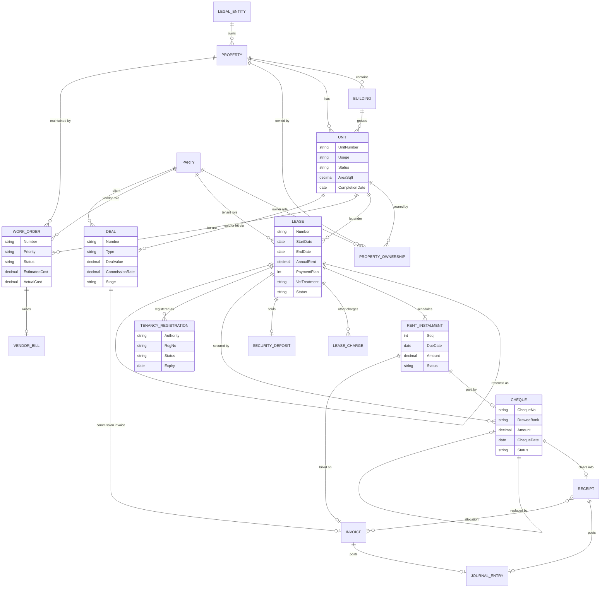
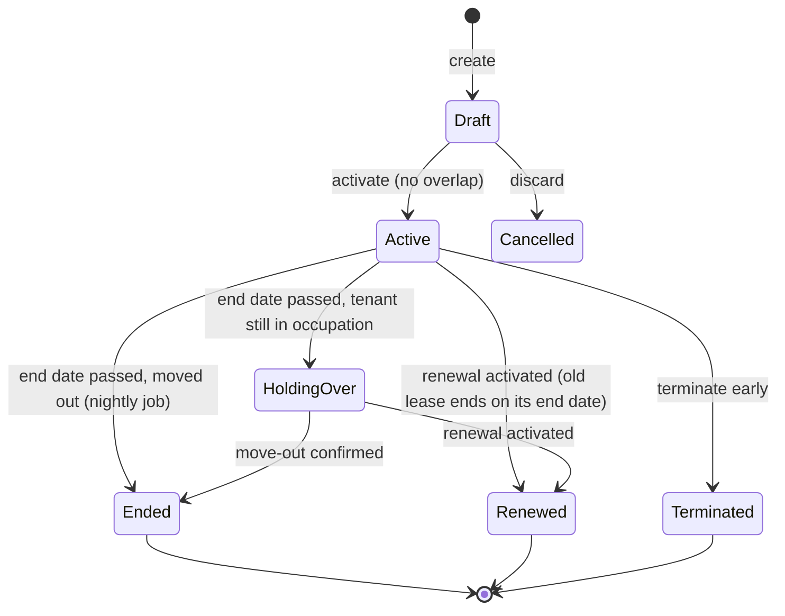

# Real Estate Module: Requirements

| | |
|---|---|
| Module | Real Estate module (first industry module of the ERP) |
| Market | UAE first (Dubai, Abu Dhabi, other emirates), built on the ERP localisation pack |
| Author | Business Analyst, sprint 0 |
| Date | 22 Oct 2026 |
| Grounding | Build spec §2.1 glossary, §4.5–4.12, §5.1–5.3, §5.10, §6.5, §6.8–6.11, §11.2–11.5, §14.1 |
| Depends on | `core-domain.md` (rules `BR-*`; **Finance: Cheques**, Section 8; custom fields, Section 9; **Finance: invoices, bills, receipts and payments**, Section 10), `user-stories-sprint1-2.md` |
| Module identifiers | Module key **`realestate`** · UI route prefix **`/real-estate/`** · API prefix **`/api/v1/m/realestate/`** · database schema **`re`** · permission keys **`realestate.<resource>.<action>`** · custom-field pack prefix `cf_re_` |

**Markers**: **[Spec]** = from the build spec (`§x.y`). **Decision (accepted)** = confirmed by Muhammad on 22 Oct 2026. **[Assumption]** = the spec doesn't cover it; standard ERP / UAE practice, to be confirmed. **[Verify]** = a regulatory point to confirm with a UAE tax adviser or the relevant authority before go-live. The BA is not giving legal or tax advice.

### Module identifiers (Decision, 22 Oct 2026)

| Identifier | Value | Rule |
|---|---|---|
| Module key | `realestate` | Used in module registration, settings scope (`realestate`), feature flags, field-pack id (`realestate@1.0`) and events metadata. |
| UI route prefix | `/real-estate/` | All module screens are lazy-loaded under it: `/real-estate/properties`, `/real-estate/units`, `/real-estate/leases`, `/real-estate/billing-runs`, `/real-estate/registrations`, `/real-estate/work-orders`, `/real-estate/deals`, `/real-estate/reports`. Tenants and owners are core parties (`/parties`, filtered by role), and cheques use the core Finance route `/finance/cheques`. |
| API prefix | `/api/v1/m/realestate/` | Every module endpoint lives under it, e.g. `/api/v1/m/realestate/properties`, `/api/v1/m/realestate/leases/{id}/activate`. Core resources (parties, invoices, receipts, cheques, custom fields) keep their core `/api/v1/...` paths. |
| Database schema | `re` | Every module-owned table lives in schema `re` (e.g. `re.Properties`, `re.Units`, `re.Leases`, `re.RentInstalments`, `re.LeaseChequeLinks`, `re.SecurityDeposits`, `re.TenancyRegistrations`, `re.WorkOrders`, `re.Deals`). Core tables (parties, invoices, receipts, cheques, journals) stay in the core schemas. The module refers to them by id and never writes them directly; it goes through the core services. Every `re` table carries `OrgId` and the core global filters (core BR-TEN-*). |
| Permission keys | `realestate.<resource>.<action>` | Full list in Section 9.1 (core BR-SEC-01). |

---

## 1. Scope

| In scope (this document) | Covered elsewhere / later |
|---|---|
| Properties and buildings, units (types, statuses, lifecycle) | Acquisitions and funding (§4.7) |
| Tenants and owners (party roles) | Tenant portal, online payments, reminders by WhatsApp (§9, later phase) |
| Leases: creation, activation, rent schedule, renewal, termination, security deposits, lifecycle | Bank reconciliation (§9) |
| PDCs: how core cheques link to leases and rent schedules (allocation, lease-specific bounce consequences, replacement mapping) | Cheque register and lifecycle (core `core-domain.md` Section 8); invoices, bills, receipts and payments (core finance, `core-domain.md` Section 10); payroll (HR module) |
| Tenancy registration: Ejari (Dubai), Tawtheeq (Abu Dhabi), other emirates | |
| UAE VAT on rent and tax invoices; billing run; receipts and allocation (lease view) | |
| **Work orders** (maintenance / facilities) and **deals** (sales and lease deals, brokerage commissions), later module phases (Sections 3.10–3.11) | |
| Accounting postings for each event | |
| Real estate reports | |
| How the module plugs into the core | |

Work orders and deals are part of this module (Decision, 22 Oct 2026). There are no separate facilities or brokerage modules. Out-of-scope items keep the spec's design and get their own requirement documents when they're scheduled.

---

## 2. Domain model

### 2.1 Entities

| Entity | Key business fields | Source |
|---|---|---|
| **Property** | Code `PROP-0001`, name, owning legal entity, business unit (optional), type (Residential building, Villa compound, Commercial building, Mixed-use, Retail centre, Warehouse/Industrial, Land), region (emirate), community/area, address, plot no., Makani no. (Dubai), title deed no., year built, total lettable units, indicative value, ownership model (Owned / Managed for third-party owner), status (Active/Inactive), notes | §4.5, §11.2. Types beyond Residential/Villa/Commercial, title deed, Makani and ownership model are an [Assumption] (§8.1 says the type list wasn't fully seen). |
| **Building / Block** (optional level) | Property, code, name, floors, completion date | [Assumption]: needed for compounds with several towers. The spec goes straight from Property to Unit. |
| **Unit** | Property, building (opt.), unit number (unique per property), unit type (Studio, 1–5 Bedroom, Penthouse, Villa, Office, Retail, Warehouse, Parking, Storage …), **usage** (Residential / Commercial), floor, bedrooms, bathrooms *[Assumption]*, area (sq ft), annual asking rent, status, DEWA/ADDC premise no., **completion date** (for the 3-year zero-rating test) *[Assumption]*, notes | §4.6, §11.2 |
| **Party role: Tenant** | Party (Individual/Company) + tenant code; Emirates ID / passport + visa expiry (individual) or trade licence + expiry (company); nationality; TRN (if VAT-registered); emergency contact | §4.8. The ERP uses a Party with roles (core BR-PTY-02). The spec's customer code `CUS-0001` maps to the tenant role code. |
| **Party role: Owner** | Party + owner code; bank account for remittances; management agreement reference | [Assumption]: the spec's "owner/investor" persona (§2.3, §9 owner portal). |
| **PropertyOwnership** | Property or unit, owner party, share %, from/to dates, management fee % and basis (collected rent / billed rent / fixed), remittance frequency | [Assumption]. The data model is needed now. Owner statements are a later phase (§9 "Should"). |
| **Lease** | Number `LSE-YYYY-000000`, legal entity (from the property), unit, tenant, start date, end date, annual rent (excl. VAT), payment plan (1/2/4/6/12), security deposit agreed, VAT treatment (derived/override), registration no. (Ejari/Tawtheeq), status, activated at, terminated on, termination reason, renewal-of lease, renewed-as lease, grace/rent-free days *[Assumption]*, notice period days *[Assumption]*, notes | §4.9, §11.2 |
| **LeaseCharge** (other recurring charges) | Lease, charge type (Chiller, Service charge, Parking, Maintenance fee, Other), amount per period or per year, VAT code, income account | [Assumption]: common in UAE leases. The spec only bills rent, with "Other income invoice" (§5.10). |
| **RentInstalment** | Lease, seq, period from/to, due date, amount (excl. VAT), VAT code, VAT amount, status (Scheduled/Invoiced/Cancelled), invoice id, linked cheque(s) through the core source link | §4.9, §11.2 |
| **SecurityDeposit** (ledger of a lease's deposit) | Lease, agreed amount, received amount, method (Cash/Transfer/Cheque), receipts, deductions, refunds, forfeits, transfers (renewal), balance held | §4.9, §5.1 #8/#12 [Spec + Assumption for the explicit ledger] |
| **Lease cheque link** (core Cheque source link) | Core Cheque (`core-domain.md` Section 8.1), lease, rent instalment(s) with amount per instalment, purpose (Rent / Security deposit / Other charge) | §4.10, §11.2. The cheque itself is a core record. The module stores only the link. |
| **WorkOrder** | Number `WO-YYYY-000000`, property, unit (blank = common area), issue, category, priority, status, reported on/by, vendor (Supplier party) or technician, scheduled, estimated cost, actual cost, completion date, resolution notes, vendor bill link (core) | §4.16 |
| **Deal** | Number `DEAL-YYYY-000000`, brokerage legal entity, type (Sale/Lease), property/unit or listing ref, client (party), agent, team lead, deal date, value, commission rate, VAT code, agent %, team lead %, stage, lost reason, commission invoice link (core), agent payout journal link | §4.24 |
| **TenancyRegistration** | Lease, authority (Ejari / Tawtheeq / Other emirate), registration no., status, submitted on, registered on, certificate expiry, cancelled on, fee paid, certificate document, rejection reason | [Assumption]: the spec has only the single field "Ejari / Tawtheeq no." (§4.9). |

Invoices, receipts, allocations, credit notes, vendor bills, payments and journals are **core finance** documents (`core-domain.md` Section 10). The module links them to lease, instalment, property and unit dimensions.

### 2.2 ER diagram (module, with core touch-points)

---

## 3. Functional requirements

Priorities: **M** Must (MVP), **S** Should (v1), **C** Could (later). IDs are stable references for stories and tests.

### 3.1 Properties and buildings

| ID | Requirement | Pri | Source |
|---|---|---|---|
| RE-PROP-01 | Create, edit and list properties with the fields in Section 2.1. The code is auto-numbered when left blank. The owning legal entity is required and can't change once leases or postings exist. | M | §4.5 |
| RE-PROP-02 | The property list shows Code, Property (+ community), Entity, Type, Region, Units (registered / total), Occupancy bar %, Contracted rent, Indicative value and Status. Filters: Type, Region, Status, Entity. Search by name or code. | M | §4.5 |
| RE-PROP-03 | Property detail: KPI cards (Units registered x / total · n occupied; Occupancy % of registered units; Contracted annual rent of active leases; Gross yield = contracted rent ÷ indicative value), info grid, tabs Units, Leases, Invoices, Documents, History. | M | §4.5 |
| RE-PROP-04 | Total lettable units must be ≥ registered units. A warning shows when registered < total ("6 of 64 registered"). | M | §4.5 |
| RE-PROP-05 | Delete is blocked when units, leases or postings exist. Deactivate instead (BR-DEL-02). | M | §4.5 |
| RE-PROP-06 | Optional Building/Block level under a property. Units can be grouped by building, and reports can be filtered by building. | S | [Assumption] |
| RE-PROP-07 | Ownership model "Managed for owner": the property (or individual units) links to owner parties with share % (total = 100% per property/unit at any date) and management-fee terms. | S | [Assumption] |
| RE-PROP-08 | A property's region drives the registration authority default for its leases (Dubai → Ejari, Abu Dhabi → Tawtheeq, others → "Other") and the VAT201 emirate box. | M | §2.1, §6.5 |

### 3.2 Units

| ID | Requirement | Pri | Source |
|---|---|---|---|
| RE-UNIT-01 | Create, edit and list units with the fields in Section 2.1. Unit number is unique per property. | M | §4.6 |
| RE-UNIT-02 | Usage (Residential / Commercial) is required. It drives the default VAT treatment of leases (Section 6). | M | §4.6 |
| RE-UNIT-03 | Unit list columns: Unit (+ type), Property, Usage, Floor, Area, Asking rent, Status, Tenant, Current rent, Lease ends. Filters: Property, Status, Usage. | M | §4.6 |
| RE-UNIT-04 | Bulk create units for a property (e.g. floors 1–20 × units 01–08 with a type pattern) and bulk import from CSV. | S | §9 import wizards + [Assumption] |
| RE-UNIT-05 | The unit status lifecycle is enforced as in Section 4.1. Occupied can be set only by lease activation. | M | §4.6 |
| RE-UNIT-06 | Vacancy tracking: the date the unit became vacant is stored, and "days vacant" shows on lists and the occupancy report. | S | [Assumption] (§9 AI rent pricing uses days vacant) |

### 3.3 Tenants and owners

| ID | Requirement | Pri | Source |
|---|---|---|---|
| RE-PTY-01 | Tenant is a role on a core Party. Creating a tenant from the lease form (quick create) is allowed. | M | §4.8 + core |
| RE-PTY-02 | Tenant detail: KPI Balance due (open invoices less unapplied payments), Active leases; contact card; tabs Statement of account, Leases, Invoices, Receipts, Cheques, Deposits, Documents, History. A "New ▾" menu offers New lease, New invoice, Record receipt. | M | §4.8 |
| RE-PTY-03 | Statement of account for a date range: opening balance, then Date, Document, Description, Debit, Credit, Balance, then the closing balance. It can be printed and saved as PDF. | M | §4.8 |
| RE-PTY-04 | ID documents (Emirates ID, passport, visa, trade licence) are stored with expiry dates. An expiry within 30 days *[Assumption]* raises an alert, because it's needed for registration and renewal. | S | §9 document vault + [Assumption] |
| RE-PTY-05 | Owner role: bank details for remittance, linked properties/units, and owner statement (rent collected, expenses, management fee, net remittance). Statements are a later phase. | C | §9 |
| RE-PTY-06 | Sensitive identifiers (Emirates ID, passport, IBAN) are masked for users without the sensitive permission. | M | §7.3 |

### 3.4 Leases

| ID | Requirement | Pri | Source |
|---|---|---|---|
| RE-LSE-01 | New lease form: Unit (only Vacant or Reserved units are listed), Tenant, Start date, End date (> start), Annual rent excl. VAT (> 0), Payment plan (Annual 1 / Semi-annual 2 / Quarterly 4 / Bi-monthly 6 / Monthly 12; default Quarterly), Security deposit, VAT on rent (blank = derive from usage), Registration no., Notes, "Activate now". | M | §4.9, §5.1 #1 |
| RE-LSE-02 | Save creates a **Draft**. Number `LSE-YYYY-000000` is allocated on save. | M | §5.1, §11.4 |
| RE-LSE-03 | **Activate**: blocked if another Active (or Holding-over) lease overlaps the unit for the period. On success the unit → Occupied, the rent schedule is fixed, and `LeaseActivated` is raised. Only one active lease per unit (filtered unique index). | M | §5.1 #2, §11.3 |
| RE-LSE-04 | **Rent schedule** generation: see business rules RE-BR-SCH-01…06. Shown on the lease's Rent schedule tab (#, Period, Due, Rent excl. VAT, VAT, Status, Invoice + paid tag, Cheque + status, Total scheduled). | M | §4.9, §5.1 #3 |
| RE-LSE-05 | Lease detail KPI cards: Annual rent (+ plan), Rent for term (prorated), Invoiced (incl. VAT, net of credit notes), Collected (allocated receipts), Outstanding, Deposit held (vs agreed). | M | §4.9 |
| RE-LSE-06 | Lease detail Actions: Activate, Renew lease, Record security deposit, Record rent payment, Register cheques, Terminate early (red), Mark vacating *[Assumption]*, Edit (Draft only). | M | §4.9 |
| RE-LSE-07 | Editing an **Active** lease's commercial terms (rent, dates, plan) isn't allowed. Changes are made through an **amendment** that cancels un-invoiced future instalments and regenerates them from an effective date. Amendments are audited, and they're blocked for instalments already invoiced. | S | [Assumption] |
| RE-LSE-08 | **Renew**: creates a new Draft lease for the next term (start = old end + 1 day) with the same unit and tenant, the proposed new rent and plan, and links "Renewal of / Renewed as". Activating the renewal sets the old lease to **Renewed** on its end date. The deposit can roll over (Section 3.6). | M | §5.1 #10 |
| RE-LSE-09 | **Renewals workbench**: leases due within the alert window (default 60 days, configurable; spec §9 suggests 90/60/30 reminders) go through Due → Offer sent → Accepted → Renewed / Vacating, with a rent-increase suggestion and a field for the official rental index reference. | S | §9 |
| RE-LSE-10 | **Terminate early**: choose the termination date and reason. The system (a) cancels instalments starting after the date, (b) issues a credit note for rent already invoiced beyond the date (pro rata), (c) sets un-deposited PDCs for later instalments to Returned, (d) starts deposit settlement, (e) prompts to cancel the registration, (f) sets the unit → Vacant (or Unavailable if work orders are pending), (g) sets the lease → Terminated. A penalty (e.g. N months' rent per contract) can be charged as an "early termination fee" invoice line. | M | §5.1 #11 + [Assumption] for penalty |
| RE-LSE-11 | **Auto-expire** job (daily 00:30 org time zone): leases past their end date and not renewed → **Ended**, unit → Vacant. If the tenant is still in occupation (flag "Holding over" or unsettled move-out), → **HoldingOver**, the unit stays Occupied, and the alert "renew or close it" is raised. | M | §5.1 #13, §8 #2, §10.6 |
| RE-LSE-12 | Lease list: segmented All / Expiring in N days; filters Status, Property, Entity; columns Lease (+ registration no.), Tenant, Property, Unit, Start, End (+ "n days left" amber / "Ended n days ago" red), Annual rent, Payments, Deposit, Status. | M | §4.9 |
| RE-LSE-13 | Grace / rent-free period: the first N days are free. The schedule starts billing after the free period, and the rent for term is reduced. | S | [Assumption] |
| RE-LSE-14 | Other recurring charges (LeaseCharge) are billed with the instalment, as separate invoice lines with their own VAT code. | S | [Assumption] |
| RE-LSE-15 | Contract print: a tenancy contract template (bilingual later), filled from the lease, for signature and registration. | S | §9 e-sign, [Assumption] |

### 3.5 Billing and collection (lease view of core receivables)

| ID | Requirement | Pri | Source |
|---|---|---|---|
| RE-BIL-01 | **Billing run**: "Bill instalments due up to <date>" (default today) across the entities the user can access. One invoice per due, un-invoiced instalment, with VAT per the lease's treatment. Option "Issue and post" (default on) or save as drafts. Progress over SignalR. Results summary (created, skipped with reasons). Needs `realestate.billingrun.execute` + `finance.invoices.issue`. | M | §4.11, §5.1 #5 |
| RE-BIL-02 | An invoice created from an instalment carries the lease, property, unit and service period (period from/to), and the description "Rent <period> – <unit>". The instalment becomes Invoiced and links to the invoice. | M | §4.11 |
| RE-BIL-03 | The billing run is idempotent: running it twice for the same date never double-bills an instalment. | M | [Assumption] |
| RE-BIL-04 | Optional scheduled billing run (daily 06:00 per org), off by default. | S | §10.6 |
| RE-BIL-05 | Invoice lead time: an org setting "Bill N days before due date" (default 0), so tenants receive invoices ahead of the cheque date. | S | [Assumption] |
| RE-BIL-06 | Receipts: Record rent payment from the lease pre-fills tenant, entity and lease, with oldest-first automatic allocation. The remainder stays On account. Cheque payments are recorded only through the core cheque register (`core-domain.md` Section 8). | M | §4.12, §5.3 |
| RE-BIL-07 | Overdue is derived nightly (balance > 0 and due < today). Lists show "n days overdue". | M | §5.3 |

### 3.6 Security deposits

| ID | Requirement | Pri | Source |
|---|---|---|---|
| RE-DEP-01 | **Record security deposit** from the lease creates a receipt with purpose Security deposit (Dr Bank / Cr 2200 Tenant security deposits held). It's never allocated to invoices. A deposit by cheque is registered as a PDC with purpose Security deposit. | M | §4.9, §4.12, §5.1 #8 |
| RE-DEP-02 | The lease shows Deposit held vs agreed. An activation warning (not a block, configurable) appears when the agreed deposit isn't received. | M | §4.9 + [Assumption] |
| RE-DEP-03 | **Deposit settlement** on move-out: list of deductions (damages, arrears, utilities, cleaning) each with an amount and target (apply to open invoice → Cr 1100, or charge as income → Cr income account with VAT where applicable), refund amount (Dr 2200 / Cr Bank), and a printable settlement statement. | M | §5.1 #12 |
| RE-DEP-04 | **Forfeit** (e.g. on early termination per contract): Dr 2200 / Cr 4900 Other income. The VAT treatment follows RE-BR-VAT-08. | S | §5.10 (spec "Deposit forfeited") |
| RE-DEP-05 | **Roll-over on renewal**: transfer the held deposit to the renewal lease with no cash movement. The difference is topped up or refunded. | S | §5.1 #10 |
| RE-DEP-06 | Deposit register report: lease, tenant, unit, agreed, held, last movement. The total must equal the GL 2200 balance (nightly check). | S | [Assumption] |

### 3.7 Cheques linked to leases (PDCs)

The cheque register, its lifecycle, postings, permissions (`finance.cheques.*`) and reminders are **core** (`core-domain.md` Section 8). The real estate template renames the incoming register prefix to `PDC-YYYY-000000` (§11.4). This section covers only how cheques link to leases and rent schedules. The module implements the core cheque source-link hooks (core Section 8.7).

| ID | Requirement | Pri | Source |
|---|---|---|---|
| RE-PDC-01 | **Register lease cheques**: the lease action "Register cheques" opens the core bulk registration (FIN-CHQ-FR-01), pre-filled with one cheque per instalment. Amount = instalment incl. VAT (+ lease charges billed with it), cheque date = due date, purpose Rent, source link = lease + instalment. The user enters the cheque numbers (auto-increment), drawee bank and custodian. | M | §4.10, §5.1 #4 |
| RE-PDC-02 | **Security deposit by cheque**: purpose Security deposit, source link = lease. On clearing, the receipt credits 2200 Tenant security deposits held (core BR-CHQ-10). | M | §4.9, §5.1 #8 |
| RE-PDC-03 | **Lease view of cheques**: the Rent schedule tab shows each instalment's cheque no. + core status. The Cheques tab lists all linked cheques. A KPI shows **cheque coverage** (instalments with an active cheque ÷ instalments not yet paid). Activation warns when coverage < 100% for a cheque-paid plan (configurable, default warn). | M | §4.9 |
| RE-PDC-04 | **Allocation on clearing** (`AllocateOnClear`): allocate the auto receipt to the invoice(s) of the linked instalment(s). If an instalment isn't invoiced yet: for a standard-rated or zero-rated lease, issue its tax invoice first (RE-BR-VAT-06), then allocate; for an exempt lease, hold the amount On account against the lease and allocate automatically when the invoice is issued. | M | §4.10, §5.2 |
| RE-PDC-05 | **Lease-specific bounce consequences** (`OnBounced`): the instalment shows "Payment bounced"; alert to the property's Leasing manager; tenant risk rule RE-BR-PDC-07; optional bounce-charge invoice (RE-BR-PDC-06); the renewals workbench and renewal activation show "bounced cheque unresolved"; a shortcut to start termination for non-payment (manual decision). | M | §5.2 + [Assumption] |
| RE-PDC-06 | **Replacement-to-schedule mapping** (`OnReplaced`): replacement cheques or receipts map to the same instalment(s) as the replaced cheque. When one cheque is replaced by several (or by cheque + transfer), the user assigns the amount per instalment, and the amounts must sum to the replaced amount. The rent schedule shows the chain (old → new). | M | §5.2 |
| RE-PDC-07 | **Termination and renewal**: termination returns (core Return) in-custody cheques linked to cancelled instalments and lists deposited ones for follow-up. Cheques for a renewal are registered against the new lease. Cheques of the old lease are unaffected. | M | §5.1 #11 |
| RE-PDC-08 | **Amendment**: when instalments are regenerated (RE-LSE-07), cheques linked to cancelled instalments must be re-mapped to new instalments or returned before the amendment can be saved. | S | [Assumption] |
| RE-PDC-09 | **Hold / postpone request** from the tenant: new planned deposit date + reason on the linked cheque, audited. The cheque date is unchanged. | S | [Assumption] |
| RE-PDC-10 | **Reminder recipients**: core cheque reminders (FIN-CHQ-FR-14) for lease cheques also go to the property's Leasing manager. | M | §4.2 |
| RE-PDC-11 | OCR scanning of cheques (core feature later) pre-fills the lease's cheque series. | C | §9 |

### 3.8 Tenancy registration (Ejari / Tawtheeq)

| ID | Requirement | Pri | Source |
|---|---|---|---|
| RE-REG-01 | Each lease has a Registration panel: authority (defaulted from the property region), registration no., status, dates, fee, certificate document. Dubai numbers look like `EJ-2026-0901377` and Abu Dhabi like `TW-2026-…` in the reference data, but the real formats differ, so only basic format checks apply. | M | §2.1, §4.9 + [Assumption] |
| RE-REG-02 | Registration statuses: Not required → Pending data → Ready to submit → Submitted → Registered → (Renewal due) → Cancelled; also Rejected (with reason). See Section 4.4. | M | [Assumption] |
| RE-REG-03 | **Readiness checklist** before "Ready to submit" (Dubai/Ejari). Required data: [Assumption] [Verify] the current DLD list: |  M | [Assumption] |
| | • Lease: start/end dates, annual rent, payment method and number of cheques, security deposit, property usage, contract signed copy. | | |
| | • Landlord: legal entity name, trade licence (or owner's Emirates ID/passport if individual), title deed no. (or initial sale contract for off-plan units), power of attorney if signing for an owner. | | |
| | • Property/unit: property name, plot no., Makani no., unit no., unit type, area, DEWA premise no. | | |
| | • Tenant (individual): name, nationality, Emirates ID (or passport + residence visa), mobile, email. Tenant (company): trade licence no. + expiry, authorised signatory's Emirates ID. | | |
| RE-REG-04 | An Active lease in Dubai or Abu Dhabi without status Registered after N days *[Assumption: 14]* raises an alert "registration pending". | S | [Assumption] |
| RE-REG-05 | Termination or non-renewal prompts **cancellation** of the registration (needed so the unit can be registered for the next tenant and utilities can move). The lease can't reach Ended/Terminated → "closed" without registration status Cancelled or "Not required" (soft rule, with override and reason). | S | [Assumption] |
| RE-REG-06 | A registration certificate expiry tracks the lease end. Renewing the lease creates a new registration record (renewal) linked to the previous one. | S | [Assumption] |
| RE-REG-07 | **Integration adapters** (later phase): an interface `ITenancyRegistrationGateway` with Register, Renew, Cancel and GetStatus, implemented per authority when API access exists (through authorised typing centres or partners, per spec §9). Until then the process is manual with data export (PDF/CSV of the checklist data). | C | §9 |
| RE-REG-08 | Other emirates: generic authority "Other (municipal attestation)" with free-text number and document upload. | M | [Assumption] |

### 3.9 VAT and tax invoices

| ID | Requirement | Pri | Source |
|---|---|---|---|
| RE-VAT-01 | The VAT treatment of each lease is derived per RE-BR-VAT-01…05 and stored on the lease. Override needs `finance.taxcodes.override` + a reason, and is audited. | M | §4.9 |
| RE-VAT-02 | Billing produces **tax invoices** for standard-rated and zero-rated lines, with the mandatory content of RE-BR-VAT-10. | M | §4.11 |
| RE-VAT-03 | Standard-rated (and zero-rated) lines are blocked if the issuing legal entity isn't VAT-registered. | M | §4.4, §4.11 |
| RE-VAT-04 | Credit notes (`CN-YYYY-000000`) reference the original invoice and reverse income and VAT. They're used for termination pro-rata and corrections. | M | §5.3, §11.4 |
| RE-VAT-05 | VAT201 support: invoice lines map to boxes by VAT code and by the **emirate of the property** (1a–1g); exempt residential rent → box 5; zero-rated → box 4; recoverable input VAT on bills → box 9. Blocked VAT is excluded. | M | §6.5 |
| RE-VAT-06 | Input VAT on costs: bills for **residential-only** properties default to "blocked" (not recoverable). Commercial properties default to recoverable. **Mixed-use** properties use apportionment (later phase; default manual flag per line). | S | §2.1, §4.14 + [Assumption] |
| RE-VAT-07 | E-invoicing readiness: invoices carry the fields needed for the UAE e-invoicing data model (buyer TRN, line VAT category, etc.) so the core ASP integration can transmit B2B commercial-rent invoices. | S | core BR-TAX-10 |

### 3.10 Work orders (maintenance and facilities)

Work orders are part of the **Real Estate module** (Decision, 22 Oct 2026). There's no separate facilities module. Planned for a later module phase (spec roadmap sprint 10). Grounded in §4.16 and §5.5.

| ID | Requirement | Pri | Source |
|---|---|---|---|
| RE-WO-01 | **Report a work order** `WO-YYYY-000000`: issue, property (required), unit (blank = common area), category (combo: HVAC, Elevators, Fire & life safety, Plumbing, Pools, Turnover …), priority (Low / Normal / High / Critical), reported on/by, assigned vendor (core party with the Supplier role) or in-house technician, scheduled date, estimated cost, details. | M | §4.16 |
| RE-WO-02 | **Lifecycle** New/Open → Assigned → In progress → Completed → Closed, with On hold / resume and Cancel at any open stage. Shown as a stepper. Completion records the completion date, resolution notes and actual cost. | M | §4.16, §5.5 |
| RE-WO-03 | **Raise vendor bill**: creates a **core** draft vendor bill (`core-domain.md` Section 10) pre-filled with the vendor, property/unit dimensions and the work-order source link. Its approval posts the expense to the property. The actual cost comes from the approved bill. | M | §4.16, §5.5 |
| RE-WO-04 | List with status tabs (Open jobs, New, Assigned, In progress, On hold, Completed, Closed, Cancelled, All), search, Priority and Property filters, and columns Order, Issue, Property, Unit/"Common area", Category, Priority tag, Status, Assigned to, Reported, Age, Estimate, Actual, Bill. | M | §4.16 |
| RE-WO-05 | Critical open orders raise an Overview alert. Photos and documents on the order use the core Document service. | M | §4.16 |
| RE-WO-06 | Maintenance costs report: estimates vs actuals by property, category and vendor. | S | §5.5, §6.14 |

### 3.11 Deals (sales and lease deals, brokerage)

Sales and lease deals and brokerage commissions are part of the **Real Estate module** (Decision, 22 Oct 2026). There's no separate brokerage module. Planned for a later module phase (spec roadmap sprint 13). Grounded in §4.24 and §5.7.

| ID | Requirement | Pri | Source |
|---|---|---|---|
| RE-DEAL-01 | **Create a deal** `DEAL-YYYY-000000`: brokerage legal entity, type (Sale / Lease), property/unit (if managed) or listing reference, client (existing party or new), closing agent (employee or external), team lead, deal date, deal value, commission rate (default 2%), VAT on commission (default standard 5%), agent share (35%), team lead share (10%), notes. A live preview shows commission, VAT, agent, team lead and company amounts. | M | §4.24 |
| RE-DEAL-02 | **Pipeline** Lead → Viewing → Negotiation → Agreed → Invoiced → Collected → Agent paid, and Lost (with reason) from any open stage. The list shows stage cards with counts and commission totals. | M | §4.24, §5.7 |
| RE-DEAL-03 | **Commission maths**: gross = value × rate; agent = gross × agent %; team lead = gross × lead %; company = gross − agent − lead; VAT = gross × 5%. Example DEAL-2026-000002: 4,800,000 × 2% = 96,000; agent 33,600; lead 9,600; company 52,800; VAT 4,800. | M | §5.7 |
| RE-DEAL-04 | **Raise the commission invoice** (stage Invoiced) as a core sales invoice through the core document service: Dr 1100 / Cr 4200 Brokerage commission income / Cr 2100. | M | §5.7, §5.10 |
| RE-DEAL-05 | **Pay agent**: allowed only once the commission invoice is fully paid (stage Collected). It pays the agent and team lead amounts from a bank account: Dr 6100 Brokerage commission expense / Cr Bank, memo "Commission payout DEAL-… – <agent>". Stage Agent paid. | M | §4.24, §5.7 |
| RE-DEAL-06 | Brokerage commissions report: by agent, team lead and stage, with paid and unpaid splits. | S | §6.15 |

---

## 4. Lifecycles

### 4.1 Unit status

| From → To | Trigger | Rule |
|---|---|---|
| (new) → Vacant | Unit created | Default status. Spec §4.6 |
| Vacant → Reserved | User reserves the unit (e.g. offer accepted, holding deposit) | Optional reservation expiry date *[Assumption]* |
| Reserved → Vacant | Reservation cancelled or expired | Nightly job for expiry *[Assumption]* |
| Vacant/Reserved → Occupied | **Lease activated** | Only by the system. Spec §4.6 |
| Occupied → Vacant | Lease Ended/Terminated (move-out confirmed) | System. Spec §4.6, §5.1 #11/#13 |
| Occupied → Occupied | Lease renewed (renewal activated) | No gap |
| Any (not Occupied) → Unavailable | Under renovation, owner use, legal hold | Spec §11.5 enum. Reason required *[Assumption]* |
| Unavailable → Vacant | Work done | — |

Occupancy = Occupied ÷ registered units (§4.2, §6.9). Unavailable units count as "Other" in the occupancy report (§6.9).

### 4.2 Lease lifecycle

Statuses Draft, Active, Ended, Renewed, Terminated and HoldingOver are from spec §11.5. **Cancelled** (a discarded draft) is an [Assumption]. Hard-deleting a numbered draft would leave a gap. That's allowed for leases (they aren't tax documents), but a Cancelled status keeps the trail clearer.

Instalment status: Scheduled → Invoiced; Scheduled → Cancelled (termination/amendment) (§11.5).

### 4.3 Cheque lifecycle (lease effect)

The cheque lifecycle is core (`core-domain.md` Section 8.2). The lease effect of each core status:

| Core cheque status | Effect on the lease / rent schedule |
|---|---|
| InCustody | Instalment shows "Cheque held"; counts toward cheque coverage |
| Deposited | No change |
| Cleared | Instalment paid through the invoice allocation (RE-PDC-04) |
| Bounced | Instalment "Payment bounced"; lease consequences (RE-PDC-05) |
| Replaced | Link moves to the replacement(s) (RE-PDC-06) |
| Returned | If the instalment was cancelled (termination/amendment): nothing. Otherwise the instalment needs another payment, and coverage drops |

### 4.4 Tenancy registration lifecycle

Not required (e.g. internal/staff housing) · Pending data → Ready to submit (checklist complete) → Submitted → Registered → Cancelled. Rejected → Pending data (fix and resubmit). [Assumption]

---

## 5. Business rules

### 5.1 Lease and schedule

| ID | Rule | Source |
|---|---|---|
| RE-BR-LSE-01 | Only Vacant or Reserved units can be chosen for a new lease. A renewal is the exception: it targets the currently occupied unit with the same tenant. | §4.6, §5.1 |
| RE-BR-LSE-02 | One Active (or HoldingOver) lease per unit at any time. Draft leases may overlap, but activation checks. | §5.1 #2, §11.3 |
| RE-BR-LSE-03 | The lease's legal entity = the property's owning entity. All its invoices, receipts, cheques and journals use that entity. | §2.2 |
| RE-BR-LSE-04 | End date > start date. A typical term is 12 months, and other terms are allowed (warning if > 5 years or < 1 month *[Assumption]*). | §4.9 |
| RE-BR-LSE-05 | An Active lease can't be deleted. A Draft lease can be cancelled. | [Assumption] |
| RE-BR-LSE-06 | Dubai rent increases on renewal are capped by the official rental index (RERA calculator). The renewal form stores the index reference and warns if the increase exceeds the user-entered allowed %. No automatic calculation in v1. | §9 + [Verify] |
| RE-BR-LSE-07 | Notice of changes to renewal terms: the lease stores "notice period days" (default 90 *[Verify]*: Dubai tenancy law requires 90 days' notice before expiry to change terms). The renewals workbench alerts before that date. | [Assumption] [Verify] |
| RE-BR-SCH-01 | Number of instalments = payment plan count (1/2/4/6/12) for a 12-month term. Period length = 12 ÷ count months. | §5.1 #3 |
| RE-BR-SCH-02 | Each instalment is **due on the first day of its period**. | §4.9, §5.1 #3 |
| RE-BR-SCH-03 | A **short final period is prorated**. Proration method: [Assumption] **actual days ÷ 365 × annual rent** (366 in a leap year when the period covers 29 Feb). Confirm the convention (Q-RE3). | §5.1 #3 |
| RE-BR-SCH-04 | Instalment amounts are rounded to 2 dp (half away from zero), and the **rounding remainder goes to the last instalment**, so the total equals the rent for term exactly (e.g. 12 × 8,166.67 with the last at 8,166.63 = 98,000). | §4.9, §5.1 #3, §10.5 |
| RE-BR-SCH-05 | Terms other than 12 months: periods follow the plan's period length from the start date. The number of instalments = ceil(term ÷ period length). The final one is prorated. | [Assumption] |
| RE-BR-SCH-06 | The schedule is fixed at activation. Later changes only through amendment (RE-LSE-07) or termination. | §5.1 #2 |
| RE-BR-TRM-01 | Termination pro-rata: credit = rent invoiced for the days after the termination date in the invoiced period, using the same day basis as RE-BR-SCH-03. VAT is reversed at the original rate. | §5.1 #11 + [Assumption] |
| RE-BR-TRM-02 | Termination can't be dated in a locked period (core BR-FIS-02). Credit notes are dated in an open period. | §5.9 |

### 5.2 Lease cheques

Generic cheque rules are core (`core-domain.md` BR-CHQ-01…10). The old IDs RE-BR-PDC-01, 03, 04, 05, 08, 09 and 10 are retired and replaced by BR-CHQ-01, 02, 03, 04, 10 (custody, now FIN-CHQ-FR-10), 05 and 06 respectively.

| ID | Rule | Source |
|---|---|---|
| RE-BR-PDC-02 | The cheque amount should equal the linked instalment amount **including VAT** (plus charges billed with it). A difference shows a warning and needs a confirmation. | [Assumption] |
| RE-BR-PDC-06 | **Bounce charges**: optional, configurable fixed amount per bounced lease cheque (setting, default off), invoiced to the tenant as "Returned cheque charges". Whether it's standard-rated or outside the scope of VAT is to be confirmed (Q-RE6). | §5.2 (spec "optional bounce fee invoice") + [Verify] |
| RE-BR-PDC-07 | A tenant with ≥ 2 bounced cheques within 12 months *[Assumption]* is flagged "high risk" on the tenant and lease (a later AI risk score extends this, §9). | [Assumption] |
| RE-BR-PDC-11 | An instalment has at most one **active** cheque (not Returned/Replaced). One cheque may cover several instalments (e.g. two quarters in one cheque) with the amount split per instalment. | [Assumption] |
| RE-BR-PDC-12 | A lease cheque's legal entity is the lease's legal entity (core BR-CHQ-06 then requires a deposit bank account of the same entity). | §2.2 |
| RE-BR-PDC-13 | Renewal activation warns (doesn't block) while the tenant has unresolved bounced cheques. | [Assumption] |

### 5.3 VAT (UAE) [Verify all with a tax adviser]

| ID | Rule | Source |
|---|---|---|
| RE-BR-VAT-01 | **Commercial** units (offices, retail, warehouses, commercial land use) → **standard-rated 5%**. | §2.1, §4.6, §4.9 |
| RE-BR-VAT-02 | **Residential** units → **exempt**. | §2.1, §4.6, §4.9 |
| RE-BR-VAT-03 | **First supply of a residential building within 3 years of its completion** (including the first lease) → **zero-rated**. The lease form suggests ZERO when unit completion date + 3 years > lease start and the unit has never been let. User confirmation required. | [Assumption] [Verify] (UAE VAT Executive Regulation, zero-rating of the first residential supply) |
| RE-BR-VAT-04 | Serviced apartments / hotel-type accommodation → **standard-rated** (treated as commercial use). Bare land → exempt. These are handled by Unit usage = Commercial or a "VAT override" with reason. | [Assumption] [Verify] |
| RE-BR-VAT-05 | Other charges follow their own codes: chiller/service charge re-billed on a commercial unit → standard; on a residential unit → follows the principal supply *[Verify]*; parking let separately → standard *[Verify]*. | [Assumption] |
| RE-BR-VAT-06 | **Tax point for periodic rent**: the date of supply is the **earliest** of (a) tax invoice issue, (b) payment due date, (c) receipt of payment. So a cleared PDC or advance payment for a commercial lease before invoicing creates a VAT obligation. The system therefore (i) issues the invoice no later than the due date (billing run), and (ii) when a payment for an un-invoiced commercial instalment is received, prompts to issue the tax invoice immediately. A tax invoice must be issued within **14 days** of the date of supply. | [Assumption] [Verify] |
| RE-BR-VAT-07 | **Security deposits** are outside the scope of VAT when received (refundable, not consideration). | §5.10 (credited to liability 2200) + [Verify] |
| RE-BR-VAT-08 | A **forfeited deposit or deduction** that's kept as consideration for a commercial supply (e.g. damage charges, early termination) may attract VAT at 5%. The settlement screen applies the lease's VAT treatment to deductions charged as income, with override. | [Assumption] [Verify] |
| RE-BR-VAT-09 | Input VAT on costs of exempt residential supplies is **blocked** (not recoverable) and expensed. Mixed buildings use apportionment. | §2.1, §4.14 |
| RE-BR-VAT-10 | **Tax invoice content**: the words "Tax Invoice"; supplier name, address and TRN (the legal entity); sequential invoice number (gapless, core BR-NUM-03); issue date; date of supply if different (service period); recipient name and address, and recipient TRN when registered; description of the supply (unit and period); quantity / unit price; VAT rate and VAT amount per line; totals excl. VAT, VAT and total in AED. Spec print layout §4.11. | §4.11 + [Verify] |
| RE-BR-VAT-11 | **Exempt-only invoices** (residential rent) are printed with the title "Invoice" (not "Tax Invoice") and show VAT "Exempt". The spec prints "TAX INVOICE" for all invoices. Confirm (Q-RE5). | [Assumption] |
| RE-BR-VAT-12 | A simplified tax invoice is allowed where the law permits (e.g. recipient not VAT-registered). v1 always issues full tax invoices, which is always compliant. | [Assumption] |
| RE-BR-VAT-13 | VAT rate changes are effective-dated (core BR-TAX-05). Instalments use the rate valid on their tax point. | core |

---

## 6. VAT treatment decision table (lease default)

| Unit usage | Special condition | Default VAT code | Invoice title |
|---|---|---|---|
| Commercial | — | STD5 (5%) | Tax Invoice |
| Commercial | Serviced/hotel apartment set as commercial | STD5 | Tax Invoice |
| Residential | First supply ≤ 3 years from completion (confirmed) | ZERO | Tax Invoice |
| Residential | Otherwise | EXEMPT | Invoice (Q-RE5) |
| Any | User override (reason, audited) | as chosen | per code |

---

## 7. Accounting postings

All postings go through the core posting service from domain events (core BR-GL-03). Account codes are from the template (§4.17). Accounts marked * aren't in the spec's demo chart and are proposed. Every line carries property, unit, lease and party dimensions where known.

| # | Event (domain event) | Debit | Credit | Notes / source |
|---|---|---|---|---|
| 1 | Lease created / activated (`LeaseActivated`) | — | — | No ledger effect. The schedule is fixed. §5.1 |
| 2 | Lease cheque registered / in custody / deposited | — | — | Core cheque postings (`core-domain.md` Section 8.6): off balance sheet. |
| 3 | Rent invoice issued, **residential exempt** (`InvoiceIssued`) | 1100 AR (total) | 2150* Unearned rent | Income recognised straight-line (row 25). §5.10 |
| 4 | Rent invoice issued, **commercial 5%** | 1100 AR (gross) | 2150* Unearned rent (net); 2100 VAT payable (5%) | Income recognised straight-line (row 25). §5.10 |
| 5 | Rent invoice issued, **zero-rated** | 1100 AR | 2150* Unearned rent | Income recognised straight-line (row 25). VAT 0, box 4. |
| 6 | Other lease charge invoiced (chiller, service charge, parking) | 1100 | 4100* Service charge / recharge income; 2100 if standard-rated | [Assumption] |
| 7 | Receipt, rent by transfer / cash / card (`ReceiptPosted`) | Bank GL | 1100 AR | The unallocated part also credits 1100 (customer credit). §5.10 |
| 8 | Lease cheque cleared (core `ChequeCleared` → auto receipt, allocated per RE-PDC-04) | Bank GL | 1100 AR | `core-domain.md` Section 8.6. §5.2 |
| 9 | Lease cheque bounced **after** clearing (core `ChequeBounced`) | 1100 AR | Bank GL | Core reversal (`core-domain.md` Section 8.6). §5.2 |
| 10 | Lease cheque bounced before clearing | — | — | Status change only (core). Lease consequences RE-PDC-05. |
| 11 | Bounce charge invoiced | 1100 AR | 4900* Other income (+ 2100 if standard-rated, Q-RE6) | [Assumption] |
| 12 | Security deposit received (`DepositReceived`) | Bank GL | 2200 Tenant security deposits held | §5.1 #8 |
| 13 | Security deposit received by cheque, on clearing | Bank GL | 2200 | Core BR-CHQ-10 with purpose Security deposit |
| 14 | Deposit applied to arrears (settlement) | 2200 | 1100 AR | §5.1 #12 |
| 15 | Deposit deduction charged as income (damages, cleaning) | 2200 | Income account (e.g. 4900*) + 2100 if VAT applies | §5.1 #12, RE-BR-VAT-08 |
| 16 | Deposit refunded | 2200 | Bank GL | §5.1 #12 |
| 17 | Deposit forfeited | 2200 | 4900* Other income (+ 2100 if applicable) | §5.10 |
| 18 | Deposit rolled over to renewal | 2200 (old lease dim.) | 2200 (new lease dim.) | Dimension transfer only. [Assumption] |
| 19 | Credit note (termination pro-rata, correction) | 2150* (part not yet recognised) / 4000 (part already recognised), and 4100*; 2100 | 1100 AR | §5.3, §5.10 |
| 20 | Invoice void (no allocations) | Reverse of the issue entry | | §5.3 |
| 21 | Early termination fee invoiced | 1100 | 4900* (+ 2100 commercial) | [Assumption] |
| 22 | Later allocation of on-account money | — | — | Allocation record only. §5.3 |
| 23 | Owner management fee (managed properties, later phase) | 2700* Due to owners | 4300* Management fee income (+ 2100) | [Assumption] |
| 24 | Rent collected on behalf of a third-party owner (agency model, later phase) | Bank GL (owner/trust account) | 2700* Due to owners (owner's share); the management fee is then taken per row 23 | [Assumption]. Agency vs principal model to be decided (Q-RE1, Q-RE8) |
| 25 | Monthly straight-line rent recognition (job) | 2150* Unearned rent | 4000 Rental income | Per day of each invoiced period. Decision (accepted) |
| 26 | Work-order vendor bill approved (core bill, RE-WO-03) | Expense account, e.g. 5000 Maintenance & repairs (net + blocked VAT); 1200 (recoverable VAT) | 2000 AP | Property/unit dimensions. §5.5, §5.10 |
| 27 | Deal commission invoice issued (core invoice, RE-DEAL-04) | 1100 AR | 4200 Brokerage commission income; 2100 VAT | §5.7, §5.10 |
| 28 | Agent commission payout (RE-DEAL-05) | 6100 Brokerage commission expense | Bank GL | Source "Commission payout". §5.7, §5.10 |

**Revenue recognition: Decision (accepted, 22 Oct 2026).** Rental income is recognised **straight-line** over the lease term (IFRS 16, lessor operating leases). Invoices credit 2150* Unearned rent, and a monthly job moves the earned part to 4000 Rental income per day of the period (row 25). The spec's method (full income on invoice) is kept only as an org setting "Recognise rent on invoice" (off by default) for migration and for reproducing the spec's demo totals in tests.

---

## 8. Reports

| Report | Purpose / columns | Source |
|---|---|---|
| Rent roll | Active leases as of a date: Property, Unit, Type, Area, Tenant, Lease, Start, Expiry, Days left, Annual rent, Rent/sq ft, VAT status, PDCs held, Outstanding. Filter: properties | §6.8 |
| Occupancy | Per property: Total units, Registered, Occupied, Vacant, Other, Occupancy %, Contracted rent, Vacant asking rent. KPIs | §6.9 |
| Portfolio performance | Value, Occupancy, Income, Operating expenses, NOI, Annualised yield, Billed, Collected, Collection rate | §6.10 |
| Lease expiries | Leases by month of expiry for the next 12 months + "Past end date". Annual rent at risk | §6.11 |
| Receivables ageing (tenant view) | Current / 1–30 / 31–60 / 61–90 / 90+ / Unapplied credit, by tenant or document | §6.6 |
| Tenant statement | Per tenant, date range, printable | §4.8 |
| PDC register / maturity | Core cheque reports (core FIN-CHQ-FR-17), filterable by property and lease | §4.10 |
| Lease cheque coverage | Leases and instalments without an active cheque; cheques due vs instalments due | [Assumption] |
| Bounced cheques | Core report plus lease, unit and the tenant risk flag | [Assumption] |
| Deposits held | Deposit register reconciled to GL 2200 | [Assumption] |
| Registration compliance | Leases by registration status. Active leases not registered. Registrations to cancel | [Assumption] |
| Vacancy loss | Asking rent × vacant days per unit in the period | [Assumption] |
| Collections | Billed vs collected by month, property and entity (dashboard chart as a report) | §4.2 |
| Maintenance costs | Work-order estimates vs actuals by property, category and vendor (RE-WO-06) | §6.14 |
| Brokerage commissions | Deals by agent, team lead and stage; commission paid/unpaid (RE-DEAL-06) | §6.15 |
| VAT201 (core) | Real estate lines mapped by emirate and code | §6.5 |
| Cash forecast (core) | Includes cheques in custody by cheque date | §6.13 |

All reports respect the header entity scope and permissions, export to CSV and print (§4.20).

**Dashboard KPIs and alerts contributed by the module** (§4.2): Portfolio value, Occupancy, Receivables / overdue, Collected this month, NOI YTD, PDCs in custody, Leases expiring, Contracted annual rent. Alerts: lease ended (renew or close), lease expiring within N days, cheque bounced (arrange replacement), cheque due for deposit, registration pending.

---

## 9. How the module plugs into the core

| Extension point (core) | Real Estate module contribution |
|---|---|
| **Module registration** | Module key `realestate`, route prefix `/real-estate/`, DB schema `re`, version; dependencies: core finance (invoices, receipts, bank & cash, cheques; always present), Approvals |
| **Permission keys** | `realestate.*` keys (Section 9.1). Uses core `core.parties.*` (tenants, owners), `finance.invoices.*`, `finance.receipts.*` and `finance.cheques.*` |
| **Party roles** | Tenant, Owner |
| **Number series** | PROP (`PROP-0000`), LSE (`LSE-YYYY-000000`), WO (`WO-YYYY-000000`), DEAL (`DEAL-YYYY-000000`); sets the core incoming cheque prefix CHQ → PDC (`PDC-YYYY-000000`); uses core INV, CN, RCT |
| **Journal dimensions** | PropertyId, UnitId, LeaseId (on JournalLine, §10.5) |
| **Posting rules** | Events in Section 7 mapped to template accounts 1100, 2100, 2150*, 2200, 4000, 4100*, 4900* |
| **Cheque source link** | Implements the core hooks (core Section 8.7): DescribeSource, AllocateOnClear (RE-PDC-04), OnBounced (RE-PDC-05), OnReplaced (RE-PDC-06), OnReturned (RE-PDC-07); adds purpose Security deposit → 2200 |
| **Tax defaulting** | Lease VAT treatment rule (Section 6) supplies the default tax code for instalment invoice lines |
| **Industry template** | Real estate COA, tax codes, roles, number series, document templates (core `core-domain.md` Section 4.2) |
| **Background jobs** | Billing run (on demand + optional daily), Lease status (daily 00:30), Alerts builder (hourly), Overdue flags (daily), Deferred rent recognition (monthly, if on) (§10.6) |
| **Alerts** | Lease expiry (60 d), lease ended, bounced lease cheque escalation to the Leasing manager (the base cheque alerts are core), registration pending, tenant ID expiry |
| **Reports** | Section 8 reports registered in the reports hub under "Portfolio" and "Leasing" |
| **Settings** | Lease expiry alert days (60), bill N days before due (0), deposit warning on activation (on), cheque coverage warning on activation (on), bounce charge amount (off), recognise rent on invoice (off; straight-line is the default, Decision accepted). Cheque-due alert days (core finance, per legal entity) and the in-transit memo are core settings |
| **Custom-field pack** | `cf_re_*` fields (core Section 9.8): view, parking bays, chiller account, balcony, furnishing, emergency contact. Customisable record types: Property, Unit, Lease, Work order, Deal (Cheque is customisable in the core) |
| **Search** | Properties, units, leases, work orders and deals registered with global search (cheques are searchable from the core) |
| **Events emitted** | `LeaseActivated`, `LeaseRenewed`, `LeaseTerminated`, `LeaseEnded`, `DepositReceived`, `DepositSettled`, `WorkOrderCompleted`, `DealStageChanged`, `DealAgentPaid` (also future webhooks, §9) |
| **Events consumed** | `InvoiceIssued`/`InvoiceVoided` (update instalment status), `ReceiptPosted` (lease collected KPI), core cheque events through the source-link hooks (`ChequeCleared`, `ChequeBounced`, `ChequeReplaced`, `ChequeReturned`), `PeriodLocked` |
| **API** | Module APIs live under **`/api/v1/m/realestate/`** (Decision, 22 Oct 2026): `/api/v1/m/realestate/properties`, `/api/v1/m/realestate/units`, `/api/v1/m/realestate/leases` (+ `/{id}/activate`, `/{id}/renew`, `/{id}/terminate`, `/{id}/schedule`, `/{id}/cheques` = bulk registration through the core cheque service), `/api/v1/m/realestate/billing-runs`, `/api/v1/m/realestate/registrations`, `/api/v1/m/realestate/work-orders`, `/api/v1/m/realestate/deals`, `/api/v1/m/realestate/reports/{slug}` (§12 paths re-based). Core resources keep core paths, e.g. cheque actions use `/api/v1/cheques` and invoices `/api/v1/invoices` |
| **UI** | Lazy-loaded Angular feature module under `/real-estate/` (`/real-estate/properties`, `/units`, `/leases`, `/billing-runs`, `/registrations`, `/work-orders`, `/deals`, `/reports`), with the shared components. Tenants are core parties (`/parties?role=tenant`). The cheque register is the core route `/finance/cheques` (§10.2) |

### 9.1 Real Estate permission keys

Format `<module>.<resource>.<action>` (core BR-SEC-01).

| Key | Allows |
|---|---|
| `realestate.properties.read` / `.manage` | Properties and buildings |
| `realestate.units.read` / `.manage` / `.reserve` | Units; reserve and release units |
| `realestate.ownership.read` / `.manage` | Owners and ownership shares |
| `realestate.leases.read` / `.create` / `.edit` | Leases (edit = Draft only) |
| `realestate.leases.activate` / `.renew` / `.terminate` / `.amend` | Lease workflow actions |
| `realestate.deposits.read` / `.receive` / `.settle` / `.refund` | Security deposits |
| `realestate.registrations.read` / `.manage` | Ejari / Tawtheeq registrations |
| `realestate.billingrun.execute` | Run the rent billing run |
| `realestate.workorders.read` / `.create` / `.edit` / `.assign` / `.complete` / `.close` / `.cancel` / `.raisebill` | Work orders (maintenance / facilities) |
| `realestate.deals.read` / `.create` / `.edit` / `.invoice` / `.payagent` / `.lose` | Sales and lease deals, brokerage commissions |
| `realestate.reports.read` / `.export` | Real estate reports |

**Built-in role Leasing manager** (spec §7.2, mapped): all `realestate.*` except `realestate.ownership.manage`, `realestate.deals.*` and the work-order actions beyond `realestate.workorders.read/create`; `core.parties.manage`; `finance.invoices.read/create/issue`; `finance.receipts.read/create/allocate`; `finance.cheques.read/create/edit/deposit/replace/return`; `finance.reports.read`.

**Built-in role Facilities manager** (module role): `realestate.workorders.*`, `realestate.properties.read`, `realestate.units.read`, `finance.bills.read/create/submit`, `core.parties.read`, `realestate.reports.read`.

**Built-in role Brokerage manager** (module role): `realestate.deals.*`, `realestate.properties.read`, `realestate.units.read`, `core.parties.manage`, `finance.invoices.read`, `realestate.reports.read`. The payout itself also needs a bank account the role may use.

Finance manager and Accountant get `realestate.*.read`, plus `realestate.billingrun.execute`, `realestate.deposits.*` and `realestate.deals.payagent`.

Rule: the module **never** writes journal lines, numbers or audit rows itself. It always goes through the core services (`IPostingService`, `INumberingService`, the audit interceptor).

---

## 10. Non-functional notes (module)

- Seed and test data: the spec's appendix (§14.1) is the acceptance dataset, run with "Recognise rent on invoice" on so the P&L matches the spec. Integration tests must reproduce the key totals: receivables 155,362.50, PDCs in custody 440,562.47 (16), contracted rent 1,918,000, occupancy 50.0%.
- Schedule maths unit tests: all plans, leap years, short final periods, rounding to the last instalment (§13.2).
- The billing run for 10,000 instalments completes in < 2 minutes with progress feedback. *[Assumption]*

---

## 11. Open questions for Muhammad

Resolved on 22 Oct 2026 and removed: Q-RE7 (rental income is recognised straight-line, Decision accepted).

| # | Question | Why it matters | BA default |
|---|---|---|---|
| Q-RE1 | Is **third-party owner management** (owner statements, management fees, remittances) part of v1, or only owned portfolios as in the reference app? | Changes the accounting model (agency vs principal) and adds the Owner role and postings 23–24 | Model ownership now; owner statements in a later phase |
| Q-RE2 | Do we need the **Building/Block** level under Property? | Compounds with several towers | Optional level, off by default |
| Q-RE3 | **Proration convention** for short periods and terminations: actual days/365, 30/360, or monthly 12ths? | Changes instalment and credit amounts | Actual/365 |
| Q-RE4 | Should **other charges** (chiller, service charge, parking) be billed on the lease in v1? | Common in UAE towers; affects schedule and VAT | Yes (Should) |
| Q-RE5 | Exempt-only residential invoices: print as "Invoice" (proposed) or "Tax Invoice" as in the reference app? | Compliance and presentation | "Invoice" for exempt-only; confirm with tax adviser |
| Q-RE6 | **Bounced cheque charges**: charge them? Fixed amount? VAT treatment? | Policy plus VAT | Off by default; VAT treatment configurable, to confirm |
| Q-RE8 | Is the business **landlord-only** (owned properties) or also a **property management company** collecting for owners (trust/escrow bank accounts)? | Bank account segregation and liabilities | Landlord-only in v1 |
| Q-RE9 | Ejari/Tawtheeq: will users register through typing centres/portals manually (v1), and is there any partner API access planned? | Integration effort (L in §9) | Manual + checklist + document storage in v1 |
| Q-RE10 | Are **commercial tenants' VAT invoices** expected to go through UAE e-invoicing from 2027 (clients with revenue ≥ AED 50M from 1 Jan 2027)? | ASP integration timing | Data-model ready in v1; integration epic before Jan 2027 if any client qualifies |
| Q-RE11 | Minimum lease data for registration: should activation be **blocked** until the registration checklist is complete, or only warned? | Process strictness | Warn only |
| Q-RE12 | Do you want **reservations** with holding deposits (Vacant → Reserved with expiry)? | Unit lifecycle and deposit postings | Reserved status with optional expiry; holding deposit as a deposit receipt |
| Q-RE13 | Multiple tenants on one lease (co-tenants) or one unit per lease only? | Data model | One tenant party per lease; co-tenants as contacts |
| Q-RE14 | Should one lease cover **several units** (e.g. office + parking bays)? | Data model and schedule | One unit per lease in v1; parking as a charge |
