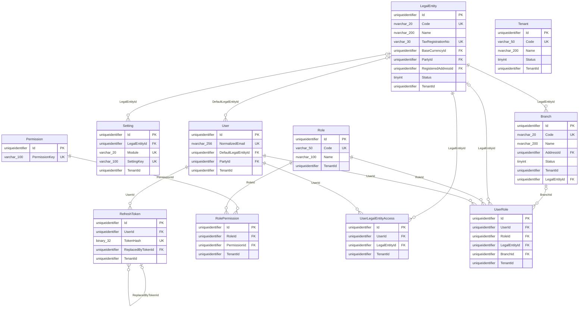
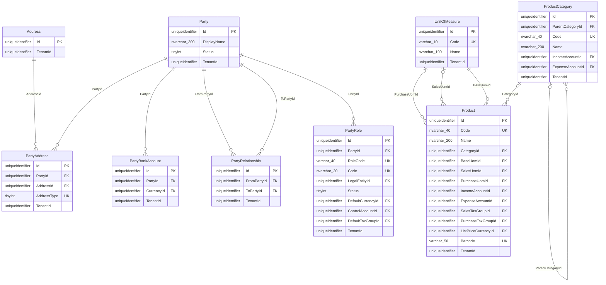
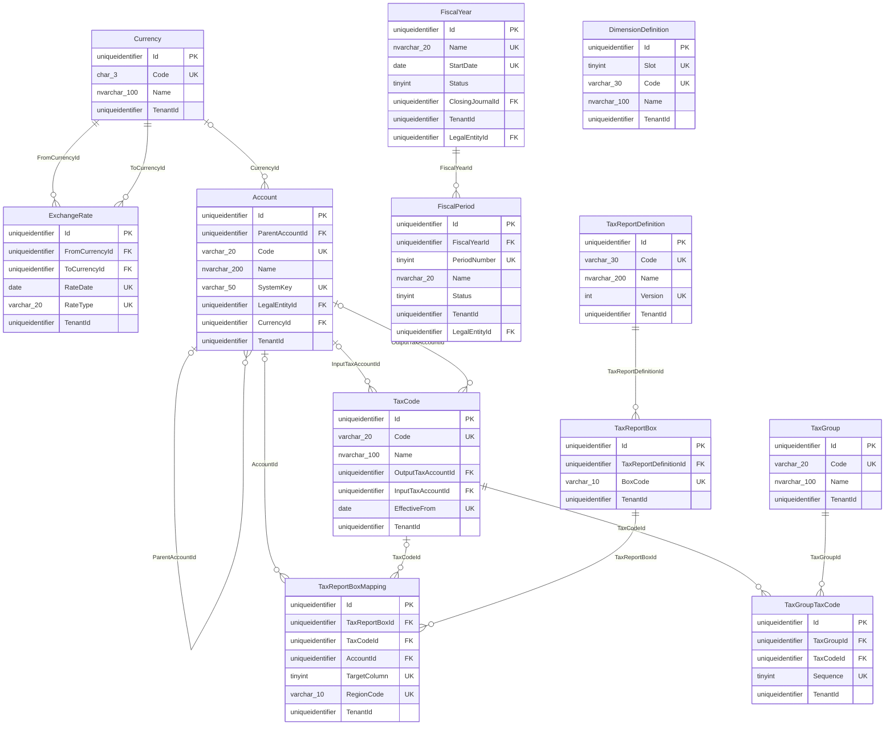
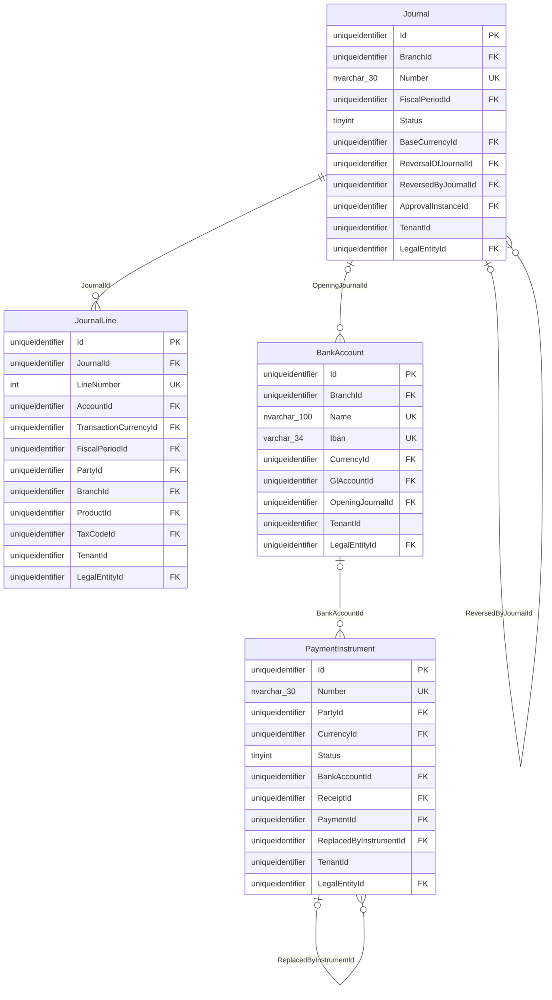
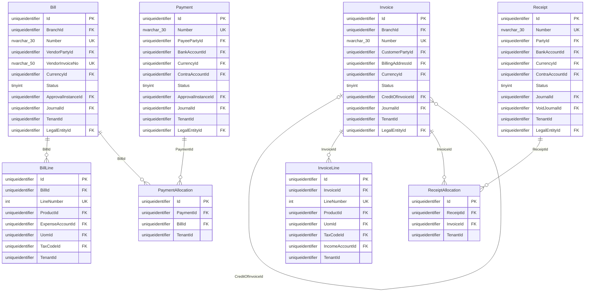
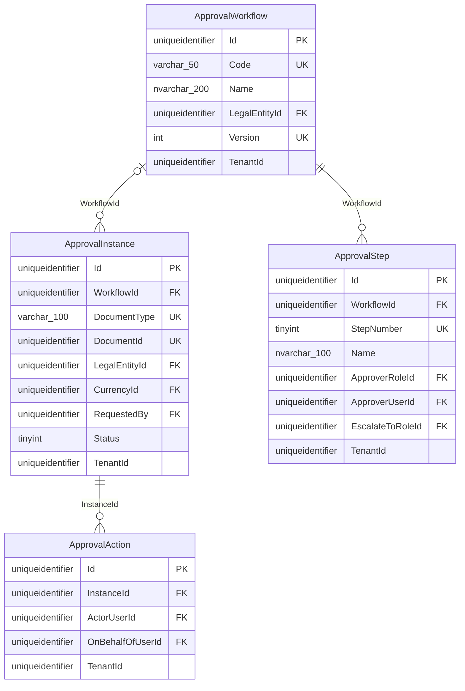
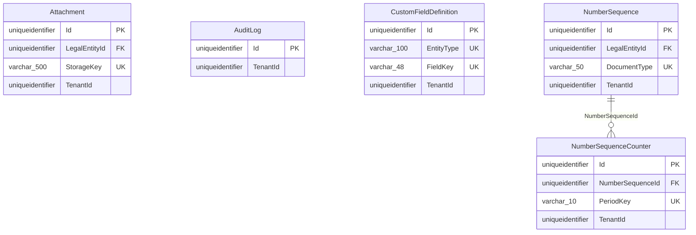
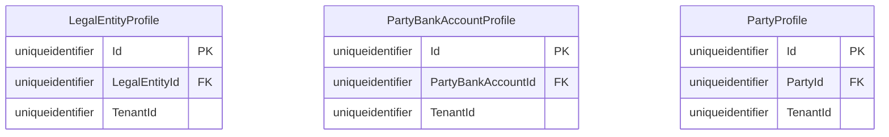

# ERP core schema (SQL Server, EF Core 8)

Owner: DB Expert · Status: proposal for review · Companion docs: [architecture.md](architecture.md) (indexing, tenancy, RLS, interceptors, module plug-in, migrations), [real-estate-schema.md](real-estate-schema.md) (first module), [sql/README.md](sql/README.md) (DDL scripts).

The table sections in this file are generated from the database that `sql/001…010` builds, with notes taken from the C# entity comments (`tools/DocGen`). The C# configurations, the SQL scripts and these tables come from one model, so they cannot disagree. If a hand-written sentence contradicts a generated table, the table is right.

---

## 0. Assumptions and conflicts

| # | Topic | Spec / brief says | This design | Why |
|---|---|---|---|---|
| A1 | Spec scope | The spec ("the reference demo") covers UAE **property management and leasing**, plus acquisitions, brokerage and payroll. | Core is generic. Real estate is a module (`re`). UAE specifics are a country pack (`ae`). | The brief asks for a reusable multi-module core. |
| A2 | Tenant column name | Spec 10.3 uses `OrgId` and `UpdatedAt`. | `TenantId` and `ModifiedAt`. | The brief's names win. |
| A3 | "Tenant" | The spec uses "tenant" both for the SaaS customer and for the lessee. | SaaS customer = `org.Tenant`/`TenantId`. Lessee = `LesseePartyId` (a `mdm.Party` with role `re.Lessee`). | Avoids ambiguity in SQL and code. |
| A4 | Soft delete | Spec soft-deletes master data only. | **Every** table has the soft-delete columns (brief). Posted or issued financial documents can never be soft-deleted, enforced by CHECK (`CK_Journal_OnlyDraftDeleted`, `CK_Invoice_OnlyDraftDeleted`, `CK_Receipt_OnlyDraftDeleted`, `CK_Bill_OnlyUnapprovedDeleted`, `CK_Payment_OnlyUnpostedDeleted`, and in RE `CK_Lease_OnlyDraftDeleted`, `CK_Acquisition_OnlyDraftDeleted`) and by the ledger triggers. | Brief, plus accounting immutability. |
| A5 | Money precision | Spec 10.5: `decimal(18,2)` amounts, `decimal(9,4)` rates. | Money `decimal(19,4)`, exchange rates `decimal(28,10)`, percentages `decimal(9,4)`, quantities `decimal(18,4)`, UoM factors `decimal(28,10)`, area `decimal(10,2)`. | Brief. 4 decimals hold sub-fils allocation and FX rounding before the document total is rounded to the currency's `DecimalPlaces`. |
| A6 | Identity | Spec 10.4: ASP.NET Core Identity. | `sec.User`/`sec.Role` are our own tenant-scoped tables with Identity-compatible columns (NormalizedEmail as the sign-in name, PasswordHash, SecurityStamp, lockout, 2FA), wired in through a custom `IUserStore`/`IRoleStore`. **Not** the stock `IdentityDbContext` tables. | The stock tables have no TenantId, their user names and role names are globally unique, and their keys are `string`. **Open question Q1.** |
| A7 | Ledger amounts | Spec: `Debit`/`Credit` per line. | Each line has `DebitTxn`/`CreditTxn` (transaction currency) and `DebitBase`/`CreditBase` (legal entity's functional currency), plus `ExchangeRate`. The header is balanced in **base** currency. | Brief (multi-currency). |
| A8 | Dimensions | Spec: property/unit "dimensions" on expense lines. | Core has generic analysis slots `Dim1Id…Dim6Id` on `fin.JournalLine`, described per tenant in `fin.DimensionDefinition` (slot → entity type). Modules register their own dimensions as seed data (RE: Property, Unit, Lease). Typed core dimensions: PartyId, BranchId, ProductId, TaxCodeId. | Core cannot reference module tables (no core→module dependency). |
| A9 | VAT201 | Spec 6.5: the UAE VAT201 return. | Core has a generic `fin.TaxReportDefinition` / `TaxReportBox` / `TaxReportBoxMapping`. VAT201 is seed data in the UAE pack (`ae.usp_SeedTenant`). | Steer 2. |
| A10 | WPS, MOHRE, Emirates ID | Spec: payroll WPS file, Emirates ID on people. | Not in core. The UAE pack adds extension tables (`ae.LegalEntityProfile`, `ae.PartyProfile`, `ae.PartyBankAccountProfile`). | Steer 2. |
| A11 | PDCs | Spec 4.10 / 5.2: a PDC register under leases. | Core `fin.PaymentInstrument` is a generic cheque/instrument register with no lease or property columns. RE links it to leases and instalments through `re.LeaseCheque`. | Steer 2. Payables cheques (issued PDCs) use the same table. |
| A12 | AR/AP placement | Spec: invoices, receipts, bills and payments are screens of one app. | Generic AR/AP is in core (`ar`, `ap` schemas). Modules create invoices and bills and keep their own link rows. | Every module needs them. Placing them in a module would force module→module dependencies. **Q6.** |
| A13 | Custom fields | Brief: EAV or JSON. | Steer 1: Odoo-Studio-style metadata (`core.CustomFieldDefinition`) plus a `CustomFields` JSON column with ISJSON CHECK, and on-demand indexed computed columns. | Steer 1. |
| A14 | Table naming | Spec 11.2 shows singular PascalCase. | Singular PascalCase table names, PascalCase columns, schemas per bounded context. See §1.3. | Matches the spec and EF defaults (no pluralizer). |
| A15 | Customers and vendors per entity | Spec 2.2: customers and vendors are shared across legal entities. | A `mdm.Party` belongs to the tenant. A `mdm.PartyRole` can be global (`LegalEntityId NULL`) or entity-specific. | Supports both. |
| A16 | Payroll / HR | Spec 4.21–4.23, 6.16. | Out of core scope. Employees are Parties with role `Employee`. HR/payroll should be a module (`hr`) plus UAE pack tables. **Q7.** | Brief lists core areas only. |

---

## 1. Conventions

### 1.1 Base columns (every table)

| Column | SQL type | Null | Default | Notes |
|---|---|---|---|---|
| Id | `uniqueidentifier` | NOT NULL | `NEWSEQUENTIALID()` | PK, **clustered**. Set by the app with `SequentialGuid.NewGuid()` (`ValueGeneratedNever`). The default only serves raw SQL inserts. See §1.2. |
| TenantId | `uniqueidentifier` | NOT NULL | – | Leading column of almost every index. Enforced three ways: EF filter, interceptor stamp, and RLS. There is no FK to `org.Tenant`, because it would add a check to every insert in every table and the tenant row is never deleted. On `org.Tenant` itself, `TenantId = Id` (CHECK). |
| CreatedAt | `datetime2(3)` | NOT NULL | `SYSUTCDATETIME()` | UTC. The interceptor sets it, and the DB default covers raw SQL. |
| CreatedBy | `uniqueidentifier` | NOT NULL | – | `sec.User.Id`, or `SystemIds.SystemUser` (`…0001`) for jobs. No FK: platform users and system users span tenants, and audit columns must never block a write. |
| ModifiedAt / ModifiedBy | `datetime2(3)` / `uniqueidentifier` | NULL | – | NULL until the first update. |
| IsDeleted | `bit` | NOT NULL | `0` | Soft delete. Every unique index is filtered `WHERE [IsDeleted] = 0`. |
| DeletedAt / DeletedBy | `datetime2(3)` / `uniqueidentifier` | NULL | – | Set by the interceptor when a Remove() is converted into a soft delete. |
| RowVersion | `rowversion` | NOT NULL | – | Optimistic concurrency token (`IsRowVersion()`). |

Legal-entity-scoped tables (`LegalEntityScopedEntity`) add `LegalEntityId uniqueidentifier NOT NULL` (FK `org.LegalEntity`). The legal-entity part of the global query filter uses it. Platform tables (`PlatformEntity`, currently only `sec.Permission`) have no TenantId.

### 1.2 Why sequential GUIDs, generated in the app

* **GUID rather than int/bigint.** Keys are created offline and in the app before SaveChanges, so aggregates and their children can be built and linked in memory (journal plus lines, invoice plus lines plus approval). They are safe to merge or move between databases, which supports the per-tenant DB option, imports and country packs. They don't reveal row counts in URLs. They work identically across the core and module DbContexts without identity round trips.
* **Sequential rather than random.** A random `NEWID()` clustered key splits pages everywhere, causing fragmentation, about 2× the log, and low page density. SQL Server sorts `uniqueidentifier` by bytes 10–15 first, then 8–9, 6–7, 4–5 and 0–3. `SequentialGuid` writes a 48-bit millisecond timestamp into bytes 10–15 and a per-process counter into bytes 8–9, so inserts are append-mostly. With several app servers the keys interleave by millisecond, which is still near-sequential.
* **Not `Guid.CreateVersion7()`** (.NET 9). It is time-ordered in byte/string order, not in SQL Server's order.
* **Not `NEWSEQUENTIALID()` as the primary generator.** EF would have to read the key back after every insert (an OUTPUT clause, and no client-side graph wiring), and the value restarts its range after a server reboot. It stays as the column default for hand-written SQL.
* **Cost.** 16-byte keys make every nonclustered index wider than with `int`. This is acceptable at ERP volumes. The hot ledger indexes use INCLUDE columns so they don't need key lookups (architecture.md §1).

### 1.3 Naming

| Object | Pattern | Example |
|---|---|---|
| Schema | lower-case bounded context, at most 4 chars | `org`, `sec`, `mdm`, `fin`, `ar`, `ap`, `wf`, `core`, `rls`, modules `re`, country packs `ae` |
| Table | Singular PascalCase | `fin.JournalLine` |
| Column | PascalCase. FK = `{Role}{Entity}Id` | `CustomerPartyId`, `ReversalOfJournalId` |
| Primary key | `PK_{Table}` | `PK_Journal` |
| Foreign key | `FK_{Table}_{Principal}_{Column}` (EF default) | `FK_JournalLine_Journal_JournalId` |
| Unique index | `UX_{Table}_{Purpose}`, always filtered `[IsDeleted]=0` | `UX_Journal_Entity_Number` |
| Non-unique index | `IX_{Table}_{Purpose or columns}`, TenantId-leading | `IX_JournalLine_Account_Period` |
| Check | `CK_{Table}_{Rule}` | `CK_JournalLine_OneSideBase` |
| Custom-field column / index | `cf_{key}_{s\|i\|n\|d\|t\|b\|g}` / `IX_{Table}_cf_{key}_{t}` | `cf_region_s` |
| Trigger / proc / function | `TR_{Table}_{Purpose}` / `usp_{Verb}{Noun}` / `fn_{Noun}` | `fin.TR_Journal_Integrity`, `core.usp_NextNumber` |

Why: singular names map 1:1 to C# entity names (no pluralizer, so a grep finds both). Schemas give ownership boundaries for permissions, RLS policies and per-module migration history. `sys` is avoided because it is reserved, so the platform schema is `core`. Enums are `tinyint` with a `CK_*` range check. Small open code lists (RoleCode, DocumentType, SourceType) are `varchar` with documented conventions (`{module}.{Name}`).

### 1.4 Types

| Kind | SQL type | EF |
|---|---|---|
| Money | `decimal(19,4)` | Model-wide `decimal` default (`ConfigureErpConventions`) |
| FX rate, UoM factor | `decimal(28,10)` | `.IsExchangeRate()` |
| Percent | `decimal(9,4)` (5.0000 = 5 %) | `.IsPercent()` |
| Quantity | `decimal(18,4)` | `.IsQuantity()` |
| Dates / instants | `date` / `datetime2(3)` UTC | `DateOnly` / `DateTime` with a UTC converter |
| Codes (ASCII) | `varchar(n)` / `char(n)` (ISO) | `.IsUnicode(false)` |
| Human text | `nvarchar(n)`. Default length 200. `nvarchar(max)` only for notes and JSON | `.IsMaxText()` |
| JSON | `nvarchar(max)` plus `CK_*_IsJson` | `.IsJsonColumn()`. Native `json` is a SQL Server 2025 option (§9.7). |
| Hashes | `binary(32)` | `RefreshToken.TokenHash` (SHA-256) |

---

## 2. Organization and security (`org`, `sec`)

Hierarchy: **Tenant** (SaaS customer, isolation boundary) → **LegalEntity** (company with its own books, base currency and tax registration) → **Branch** (operating site or cost centre within an entity). Settings are a key/value JSON store per tenant, optionally per entity.

Authorization is RBAC with **scoped** assignments. `sec.UserRole` grants a role to a user tenant-wide (`ScopeType` 0), for one legal entity (1) or for one branch (2) — `CK_UserRole_Scope` enforces the matching LegalEntityId/BranchId combination, with optional validity dates. Permissions are a code-owned global catalog (`sec.Permission`, e.g. `fin.journal.post`). `sec.RolePermission` maps tenant roles to permission keys. `sec.UserLegalEntityAccess` holds the materialized list of legal entities a user can see, and feeds the legal-entity query filter (`User.LegalEntityAccess` = 1 All or 2 Selected). `User.PermissionVersion` increments on every grant change so cached JWT permission sets can be invalidated.

<!-- BEGIN GEN erd schemas=org,sec -->


References outside this diagram: `fin.Currency`, `mdm.Address`, `mdm.Party`. Diagrams show the key, FK, unique and headline columns only; the full column list is in the table sections.
<!-- END GEN -->

<!-- BEGIN GEN tables schemas=org,sec -->
#### `org.Branch`

an operating site / office of a legal entity.

| Column | SQL type | Null | Default / computed | FK → | Notes |
|---|---|---|---|---|---|
| Id | uniqueidentifier | NOT NULL | (newsequentialid()) |  | PK, clustered. Sequential GUID set by the app; NEWSEQUENTIALID() default for raw inserts. |
| Code | nvarchar(20) | NOT NULL |  |  |  |
| Name | nvarchar(200) | NOT NULL |  |  |  |
| AddressId | uniqueidentifier | NULL |  | mdm.Address |  |
| Phone | nvarchar(30) | NULL |  |  |  |
| Email | nvarchar(256) | NULL |  |  |  |
| IsHeadOffice | bit | NOT NULL |  |  |  |
| Status | tinyint | NOT NULL |  |  | enum RecordStatus: 1 Active, 2 Inactive |
| CustomFields | nvarchar(max) | NULL |  |  |  |
| LegalEntityId | uniqueidentifier | NOT NULL |  | org.LegalEntity |  |
| *base columns* | | | | | TenantId, CreatedAt, CreatedBy, ModifiedAt, ModifiedBy, IsDeleted, DeletedAt, DeletedBy, RowVersion (see §Base columns) |

Indexes: `IX_Branch_AddressId` (TenantId, AddressId); `UX_Branch_HeadOffice` UNIQUE (TenantId, LegalEntityId) WHERE ([IsDeleted]=(0) AND [IsHeadOffice]=(1)); `UX_Branch_Tenant_Entity_Code` UNIQUE (TenantId, LegalEntityId, Code) WHERE ([IsDeleted]=(0)).

Checks: `CK_Branch_CustomFields_IsJson` ([CustomFields] IS NULL OR isjson([CustomFields])=(1)); `CK_Branch_Status` ([Status]=(2) OR [Status]=(1)).

#### `org.LegalEntity`

a registered company with its own books, tax invoices and payroll.

| Column | SQL type | Null | Default / computed | FK → | Notes |
|---|---|---|---|---|---|
| Id | uniqueidentifier | NOT NULL | (newsequentialid()) |  | PK, clustered. Sequential GUID set by the app; NEWSEQUENTIALID() default for raw inserts. |
| Code | nvarchar(20) | NOT NULL |  |  | e.g. ENT-0001 |
| Name | nvarchar(200) | NOT NULL |  |  |  |
| LegalName | nvarchar(300) | NULL |  |  |  |
| CountryCode | char(2) | NOT NULL |  |  |  |
| Region | nvarchar(100) | NULL |  |  | state / province / emirate (country-pack code list) |
| RegistrationNo | nvarchar(50) | NULL |  |  | commercial registration / licence no. |
| RegistrationExpiry | date | NULL |  |  | drives the licence-expiry alert |
| TaxRegistrationNo | varchar(30) | NULL |  |  | VAT / GST / sales-tax registration no. (format validated by the country pack) |
| IsTaxRegistered | bit | NOT NULL |  |  |  |
| BaseCurrencyId | uniqueidentifier | NOT NULL |  | fin.Currency | functional currency (fin.Currency) |
| PartyId | uniqueidentifier | NULL |  | mdm.Party | the entity as a party (intercompany AR/AP) |
| RegisteredAddressId | uniqueidentifier | NULL |  | mdm.Address |  |
| Phone | nvarchar(30) | NULL |  |  |  |
| Email | nvarchar(256) | NULL |  |  |  |
| BooksLockedTo | date | NULL |  |  | "Books locked to": no posting dated on or before this date. |
| Status | tinyint | NOT NULL |  |  | enum RecordStatus: 1 Active, 2 Inactive |
| CustomFields | nvarchar(max) | NULL |  |  |  |
| *base columns* | | | | | TenantId, CreatedAt, CreatedBy, ModifiedAt, ModifiedBy, IsDeleted, DeletedAt, DeletedBy, RowVersion (see §Base columns) |

Indexes: `IX_LegalEntity_PartyId` (TenantId, PartyId); `IX_LegalEntity_RegisteredAddressId` (TenantId, RegisteredAddressId); `UX_LegalEntity_Tenant_Code` UNIQUE (TenantId, Code) WHERE ([IsDeleted]=(0)); `UX_LegalEntity_Tenant_Trn` UNIQUE (TenantId, TaxRegistrationNo) WHERE ([IsDeleted]=(0) AND [TaxRegistrationNo] IS NOT NULL).

Checks: `CK_LegalEntity_CustomFields_IsJson` ([CustomFields] IS NULL OR isjson([CustomFields])=(1)); `CK_LegalEntity_Status` ([Status]=(2) OR [Status]=(1)).

#### `org.Setting`

typed-by-convention settings per tenant (LegalEntityId NULL) or per legal entity, grouped by module ("core", "fin", or a module / country-pack code). ValueJson is validated by the owning module. Replaces a wide settings table so modules can add settings without core DDL.

| Column | SQL type | Null | Default / computed | FK → | Notes |
|---|---|---|---|---|---|
| Id | uniqueidentifier | NOT NULL | (newsequentialid()) |  | PK, clustered. Sequential GUID set by the app; NEWSEQUENTIALID() default for raw inserts. |
| LegalEntityId | uniqueidentifier | NULL |  | org.LegalEntity |  |
| Module | varchar(20) | NOT NULL |  |  |  |
| SettingKey | varchar(100) | NOT NULL |  |  |  |
| ValueJson | nvarchar(max) | NOT NULL |  |  |  |
| *base columns* | | | | | TenantId, CreatedAt, CreatedBy, ModifiedAt, ModifiedBy, IsDeleted, DeletedAt, DeletedBy, RowVersion (see §Base columns) |

Indexes: `UX_Setting_Key` UNIQUE (TenantId, Module, SettingKey, LegalEntityId) WHERE ([IsDeleted]=(0)).

Checks: `CK_Setting_ValueJson_IsJson` (isjson([ValueJson])=(1)).

#### `org.Tenant`

the SaaS customer account ("Organization" in the spec). TenantId == Id (CHECK), which keeps the base columns, the EF filter and the RLS predicate uniform for this table too.

| Column | SQL type | Null | Default / computed | FK → | Notes |
|---|---|---|---|---|---|
| Id | uniqueidentifier | NOT NULL | (newsequentialid()) |  | PK, clustered. Sequential GUID set by the app; NEWSEQUENTIALID() default for raw inserts. |
| Code | varchar(50) | NOT NULL |  |  | Sign-in key / subdomain, e.g. "demo". Globally unique. |
| Name | nvarchar(200) | NOT NULL |  |  |  |
| LegalName | nvarchar(300) | NULL |  |  |  |
| ContactEmail | nvarchar(256) | NULL |  |  |  |
| Plan | nvarchar(50) | NOT NULL |  |  |  |
| CountryCode | char(2) | NOT NULL |  |  | ISO 3166-1 alpha-2; selects the country pack (e.g. "AE" → ae.*) |
| DefaultCurrencyCode | char(3) | NOT NULL |  |  | ISO 4217; fin.Currency rows are seeded from it |
| TimeZoneId | varchar(64) | NOT NULL |  |  | IANA id |
| DefaultLocale | varchar(10) | NOT NULL |  |  |  |
| Status | tinyint | NOT NULL |  |  | enum TenantStatus: 0 Provisioning, 1 Active, 2 Suspended, 3 Closed |
| IsolationMode | tinyint | NOT NULL |  |  | enum TenantIsolationMode: 1 SharedDatabase, 2 DedicatedDatabase |
| ConnectionStringName | varchar(100) | NULL |  |  | Name of a connection string / Key Vault secret when IsolationMode = DedicatedDatabase. Never the secret itself. |
| *base columns* | | | | | TenantId, CreatedAt, CreatedBy, ModifiedAt, ModifiedBy, IsDeleted, DeletedAt, DeletedBy, RowVersion (see §Base columns) |

Indexes: `IX_Tenant_TenantId` (TenantId); `UX_Tenant_Code` UNIQUE (Code) WHERE ([IsDeleted]=(0)).

Checks: `CK_Tenant_IsolationMode` ([IsolationMode]=(2) OR [IsolationMode]=(1)); `CK_Tenant_Status` ([Status]>=(0) AND [Status]<=(3)); `CK_Tenant_TenantId_Self` ([TenantId]=[Id]).

#### `sec.Permission`

platform catalog of permission keys (code-owned, NO TenantId).

| Column | SQL type | Null | Default / computed | FK → | Notes |
|---|---|---|---|---|---|
| Id | uniqueidentifier | NOT NULL | (newsequentialid()) |  | PK, clustered. Sequential GUID set by the app; NEWSEQUENTIALID() default for raw inserts. |
| PermissionKey | varchar(100) | NOT NULL |  |  | "billing.write", "approvals.decide" |
| Module | varchar(20) | NOT NULL |  |  | core, re, hr... |
| Area | varchar(50) | NOT NULL |  |  | billing |
| Action | varchar(20) | NOT NULL |  |  | read / write / decide |
| Description | nvarchar(500) | NULL |  |  |  |
| CreatedAt | datetime2(3) | NOT NULL | (sysutcdatetime()) |  |  |
| CreatedBy | uniqueidentifier | NOT NULL |  |  |  |
| ModifiedAt | datetime2(3) | NULL |  |  |  |
| ModifiedBy | uniqueidentifier | NULL |  |  |  |
| IsDeleted | bit | NOT NULL | (CONVERT([bit],(0))) |  |  |
| DeletedAt | datetime2(3) | NULL |  |  |  |
| DeletedBy | uniqueidentifier | NULL |  |  |  |
| RowVersion | rowversion | NOT NULL |  |  |  |
| | | | | | Platform table: no TenantId (global catalog). |

Indexes: `UX_Permission_Key` UNIQUE (PermissionKey) WHERE ([IsDeleted]=(0)).

#### `sec.RefreshToken`

rotating refresh tokens (only the SHA-256 hash is stored).

| Column | SQL type | Null | Default / computed | FK → | Notes |
|---|---|---|---|---|---|
| Id | uniqueidentifier | NOT NULL | (newsequentialid()) |  | PK, clustered. Sequential GUID set by the app; NEWSEQUENTIALID() default for raw inserts. |
| UserId | uniqueidentifier | NOT NULL |  | sec.User |  |
| TokenHash | binary(32) | NOT NULL |  |  |  |
| ExpiresAt | datetime2(3) | NOT NULL |  |  |  |
| CreatedByIp | varchar(45) | NULL |  |  |  |
| DeviceInfo | nvarchar(400) | NULL |  |  |  |
| RevokedAt | datetime2(3) | NULL |  |  |  |
| ReplacedByTokenId | uniqueidentifier | NULL |  | sec.RefreshToken |  |
| *base columns* | | | | | TenantId, CreatedAt, CreatedBy, ModifiedAt, ModifiedBy, IsDeleted, DeletedAt, DeletedBy, RowVersion (see §Base columns) |

Indexes: `IX_RefreshToken_ReplacedByTokenId` (TenantId, ReplacedByTokenId); `IX_RefreshToken_User` (TenantId, UserId, ExpiresAt) WHERE ([RevokedAt] IS NULL); `UX_RefreshToken_TokenHash` UNIQUE (TokenHash).

#### `sec.Role`

built-in (seeded, IsBuiltIn) or custom role composed of permission keys.

| Column | SQL type | Null | Default / computed | FK → | Notes |
|---|---|---|---|---|---|
| Id | uniqueidentifier | NOT NULL | (newsequentialid()) |  | PK, clustered. Sequential GUID set by the app; NEWSEQUENTIALID() default for raw inserts. |
| Code | varchar(50) | NOT NULL |  |  | org-admin, finance-manager... |
| Name | nvarchar(100) | NOT NULL |  |  |  |
| Description | nvarchar(500) | NULL |  |  |  |
| IsBuiltIn | bit | NOT NULL |  |  |  |
| IsActive | bit | NOT NULL |  |  |  |
| *base columns* | | | | | TenantId, CreatedAt, CreatedBy, ModifiedAt, ModifiedBy, IsDeleted, DeletedAt, DeletedBy, RowVersion (see §Base columns) |

Indexes: `UX_Role_Tenant_Code` UNIQUE (TenantId, Code) WHERE ([IsDeleted]=(0)).

#### `sec.RolePermission`

sec.RolePermission.

| Column | SQL type | Null | Default / computed | FK → | Notes |
|---|---|---|---|---|---|
| Id | uniqueidentifier | NOT NULL | (newsequentialid()) |  | PK, clustered. Sequential GUID set by the app; NEWSEQUENTIALID() default for raw inserts. |
| RoleId | uniqueidentifier | NOT NULL |  | sec.Role |  |
| PermissionId | uniqueidentifier | NOT NULL |  | sec.Permission |  |
| *base columns* | | | | | TenantId, CreatedAt, CreatedBy, ModifiedAt, ModifiedBy, IsDeleted, DeletedAt, DeletedBy, RowVersion (see §Base columns) |

Indexes: `IX_RolePermission_PermissionId` (TenantId, PermissionId); `UX_RolePermission` UNIQUE (TenantId, RoleId, PermissionId) WHERE ([IsDeleted]=(0)).

#### `sec.User`

sec.User. One row per (tenant, login). Credentials are handled with ASP.NET Core Identity's UserManager over a custom IUserStore (or PasswordHasher only) — the stock IdentityDbContext tables are NOT used because they have no TenantId and globally-unique user names.

| Column | SQL type | Null | Default / computed | FK → | Notes |
|---|---|---|---|---|---|
| Id | uniqueidentifier | NOT NULL | (newsequentialid()) |  | PK, clustered. Sequential GUID set by the app; NEWSEQUENTIALID() default for raw inserts. |
| Email | nvarchar(256) | NOT NULL |  |  |  |
| NormalizedEmail | nvarchar(256) | NOT NULL |  |  |  |
| FullName | nvarchar(200) | NOT NULL |  |  |  |
| PasswordHash | varchar(500) | NULL |  |  | sensitive (masked in audit) |
| SecurityStamp | varchar(64) | NOT NULL |  |  | sensitive (masked in audit) |
| PhoneNumber | nvarchar(30) | NULL |  |  |  |
| UserType | tinyint | NOT NULL |  |  | enum UserType: 1 Staff, 2 Portal, 3 ApiClient |
| IsActive | bit | NOT NULL |  |  |  |
| EmailConfirmed | bit | NOT NULL |  |  |  |
| TwoFactorEnabled | bit | NOT NULL |  |  |  |
| LockoutEnd | datetimeoffset(3) | NULL |  |  |  |
| AccessFailedCount | int | NOT NULL |  |  |  |
| LastSignInAt | datetime2(3) | NULL |  |  |  |
| LegalEntityAccess | tinyint | NOT NULL |  |  | enum LegalEntityAccessMode: 1 All, 2 Selected |
| DefaultLegalEntityId | uniqueidentifier | NULL |  | org.LegalEntity |  |
| PartyId | uniqueidentifier | NULL |  | mdm.Party | Linked person (employee / contact / portal customer). |
| PermissionVersion | int | NOT NULL |  |  | JWT "ver" claim; bump on role/permission change to force token refresh. |
| Locale | varchar(10) | NULL |  |  |  |
| TimeZoneId | varchar(64) | NULL |  |  |  |
| CustomFields | nvarchar(max) | NULL |  |  |  |
| *base columns* | | | | | TenantId, CreatedAt, CreatedBy, ModifiedAt, ModifiedBy, IsDeleted, DeletedAt, DeletedBy, RowVersion (see §Base columns) |

Indexes: `IX_User_Tenant_Party` (TenantId, PartyId) WHERE ([IsDeleted]=(0) AND [PartyId] IS NOT NULL); `UX_User_Tenant_NormalizedEmail` UNIQUE (TenantId, NormalizedEmail) WHERE ([IsDeleted]=(0)).

Checks: `CK_User_AccessFailedCount` ([AccessFailedCount]>=(0)); `CK_User_CustomFields_IsJson` ([CustomFields] IS NULL OR isjson([CustomFields])=(1)); `CK_User_LegalEntityAccess` ([LegalEntityAccess]=(2) OR [LegalEntityAccess]=(1)); `CK_User_UserType` ([UserType]>=(1) AND [UserType]<=(3)).

#### `sec.UserLegalEntityAccess`

data visibility when User.LegalEntityAccess = Selected.

| Column | SQL type | Null | Default / computed | FK → | Notes |
|---|---|---|---|---|---|
| Id | uniqueidentifier | NOT NULL | (newsequentialid()) |  | PK, clustered. Sequential GUID set by the app; NEWSEQUENTIALID() default for raw inserts. |
| UserId | uniqueidentifier | NOT NULL |  | sec.User |  |
| LegalEntityId | uniqueidentifier | NOT NULL |  | org.LegalEntity |  |
| IsDefault | bit | NOT NULL |  |  |  |
| *base columns* | | | | | TenantId, CreatedAt, CreatedBy, ModifiedAt, ModifiedBy, IsDeleted, DeletedAt, DeletedBy, RowVersion (see §Base columns) |

Indexes: `UX_UserLegalEntityAccess` UNIQUE (TenantId, UserId, LegalEntityId) WHERE ([IsDeleted]=(0)).

#### `sec.UserRole`

role grant, optionally scoped to one legal entity or one branch.

| Column | SQL type | Null | Default / computed | FK → | Notes |
|---|---|---|---|---|---|
| Id | uniqueidentifier | NOT NULL | (newsequentialid()) |  | PK, clustered. Sequential GUID set by the app; NEWSEQUENTIALID() default for raw inserts. |
| UserId | uniqueidentifier | NOT NULL |  | sec.User |  |
| RoleId | uniqueidentifier | NOT NULL |  | sec.Role |  |
| ScopeType | tinyint | NOT NULL |  |  | enum RoleScopeType: 0 Tenant, 1 LegalEntity, 2 Branch |
| LegalEntityId | uniqueidentifier | NULL |  | org.LegalEntity |  |
| BranchId | uniqueidentifier | NULL |  | org.Branch |  |
| ValidFrom | date | NULL |  |  |  |
| ValidTo | date | NULL |  |  |  |
| *base columns* | | | | | TenantId, CreatedAt, CreatedBy, ModifiedAt, ModifiedBy, IsDeleted, DeletedAt, DeletedBy, RowVersion (see §Base columns) |

Indexes: `IX_UserRole_Tenant_Role` (TenantId, RoleId) WHERE ([IsDeleted]=(0)); `UX_UserRole` UNIQUE (TenantId, UserId, RoleId, LegalEntityId, BranchId) WHERE ([IsDeleted]=(0)).

Checks: `CK_UserRole_Scope` ([ScopeType]=(0) AND [LegalEntityId] IS NULL AND [BranchId] IS NULL OR [ScopeType]=(1) AND [LegalEntityId] IS NOT NULL AND [BranchId] IS NULL OR [ScopeType]=(2) AND [LegalEntityId] IS NOT NULL AND [BranchId] IS NOT NULL); `CK_UserRole_Validity` ([ValidTo] IS NULL OR [ValidFrom] IS NULL OR [ValidTo]>=[ValidFrom]).
<!-- END GEN -->

---

## 3. Master data (`mdm`): party-role model, addresses, products, UoM

A **Party** is any person or organization. **PartyRole** rows say what the party is to us (Customer, Vendor, Employee, Contact, or module roles such as `re.Lessee` and `re.Owner`), each with its own code (CUS-0001), terms, credit limit and control-account override, optionally per legal entity. The same company can be customer and vendor with one master record and one set of addresses and bank accounts. **PartyRelationship** links parties (contact-of, employee-of, guarantor-of) with validity dates. Addresses are reusable through **PartyAddress** (type, default flag). **PartyBankAccount** holds IBAN/SWIFT. Country-specific bank routing data lives in country-pack extension tables (UAE: `ae.PartyBankAccountProfile`). Products have a category tree, a base UoM and optional sales/purchase UoMs, default income/expense accounts and tax groups. UoM conversion is `FactorToBase` against the base unit of the same `Category` (e.g. Length, Area, Time).

<!-- BEGIN GEN erd schemas=mdm -->


References outside this diagram: `fin.Account`, `fin.Currency`, `fin.TaxGroup`, `org.LegalEntity`. Diagrams show the key, FK, unique and headline columns only; the full column list is in the table sections.
<!-- END GEN -->

<!-- BEGIN GEN tables schemas=mdm -->
#### `mdm.Address`

standalone address row, shared by parties, legal entities, branches and module entities.

| Column | SQL type | Null | Default / computed | FK → | Notes |
|---|---|---|---|---|---|
| Id | uniqueidentifier | NOT NULL | (newsequentialid()) |  | PK, clustered. Sequential GUID set by the app; NEWSEQUENTIALID() default for raw inserts. |
| Line1 | nvarchar(200) | NOT NULL |  |  |  |
| Line2 | nvarchar(200) | NULL |  |  |  |
| City | nvarchar(100) | NULL |  |  |  |
| Region | nvarchar(100) | NULL |  |  |  |
| PostalCode | nvarchar(20) | NULL |  |  |  |
| CountryCode | char(2) | NOT NULL |  |  |  |
| Latitude | decimal(9,6) | NULL |  |  |  |
| Longitude | decimal(9,6) | NULL |  |  |  |
| *base columns* | | | | | TenantId, CreatedAt, CreatedBy, ModifiedAt, ModifiedBy, IsDeleted, DeletedAt, DeletedBy, RowVersion (see §Base columns) |

Indexes: `IX_Address_TenantId` (TenantId).

#### `mdm.Party`

any person or organization the tenant deals with. Roles say what it is to us.

| Column | SQL type | Null | Default / computed | FK → | Notes |
|---|---|---|---|---|---|
| Id | uniqueidentifier | NOT NULL | (newsequentialid()) |  | PK, clustered. Sequential GUID set by the app; NEWSEQUENTIALID() default for raw inserts. |
| PartyType | tinyint | NOT NULL |  |  | enum PartyType: 1 Person, 2 Organization |
| DisplayName | nvarchar(300) | NOT NULL |  |  |  |
| LegalName | nvarchar(300) | NULL |  |  |  |
| FirstName | nvarchar(100) | NULL |  |  |  |
| LastName | nvarchar(100) | NULL |  |  |  |
| TaxRegistrationNo | varchar(30) | NULL |  |  |  |
| IdentificationType | varchar(30) | NULL |  |  | NationalId, Passport, CompanyRegistration (code list from the country pack) |
| IdentificationNo | nvarchar(50) | NULL |  |  | sensitive (masked in audit) |
| IdentificationExpiry | date | NULL |  |  |  |
| NationalityCode | char(2) | NULL |  |  | ISO alpha-2 |
| Email | nvarchar(256) | NULL |  |  |  |
| Phone | nvarchar(30) | NULL |  |  |  |
| Mobile | nvarchar(30) | NULL |  |  |  |
| PreferredLanguage | varchar(10) | NULL |  |  |  |
| Status | tinyint | NOT NULL |  |  | enum RecordStatus: 1 Active, 2 Inactive |
| Notes | nvarchar(2000) | NULL |  |  |  |
| CustomFields | nvarchar(max) | NULL |  |  |  |
| *base columns* | | | | | TenantId, CreatedAt, CreatedBy, ModifiedAt, ModifiedBy, IsDeleted, DeletedAt, DeletedBy, RowVersion (see §Base columns) |

Indexes: `IX_Party_Tenant_DisplayName` (TenantId, DisplayName) WHERE ([IsDeleted]=(0)); `IX_Party_Tenant_Email` (TenantId, Email) WHERE ([IsDeleted]=(0) AND [Email] IS NOT NULL); `IX_Party_Tenant_Trn` (TenantId, TaxRegistrationNo) WHERE ([IsDeleted]=(0) AND [TaxRegistrationNo] IS NOT NULL).

Checks: `CK_Party_CustomFields_IsJson` ([CustomFields] IS NULL OR isjson([CustomFields])=(1)); `CK_Party_PartyType` ([PartyType]=(2) OR [PartyType]=(1)); `CK_Party_Status` ([Status]=(2) OR [Status]=(1)).

#### `mdm.PartyAddress`

party ↔ address with a type.

| Column | SQL type | Null | Default / computed | FK → | Notes |
|---|---|---|---|---|---|
| Id | uniqueidentifier | NOT NULL | (newsequentialid()) |  | PK, clustered. Sequential GUID set by the app; NEWSEQUENTIALID() default for raw inserts. |
| PartyId | uniqueidentifier | NOT NULL |  | mdm.Party |  |
| AddressId | uniqueidentifier | NOT NULL |  | mdm.Address |  |
| AddressType | tinyint | NOT NULL |  |  | enum AddressType: 1 Registered, 2 Billing, 3 Shipping, 4 Home, 5 Mailing, 6 Site |
| IsPrimary | bit | NOT NULL |  |  |  |
| *base columns* | | | | | TenantId, CreatedAt, CreatedBy, ModifiedAt, ModifiedBy, IsDeleted, DeletedAt, DeletedBy, RowVersion (see §Base columns) |

Indexes: `IX_PartyAddress_AddressId` (TenantId, AddressId); `UX_PartyAddress` UNIQUE (TenantId, PartyId, AddressId, AddressType) WHERE ([IsDeleted]=(0)); `UX_PartyAddress_Primary` UNIQUE (TenantId, PartyId, AddressType) WHERE ([IsDeleted]=(0) AND [IsPrimary]=(1)).

Checks: `CK_PartyAddress_Type` ([AddressType]>=(1) AND [AddressType]<=(6)).

#### `mdm.PartyBankAccount`

payee / payer bank details (IBAN validated per country). Country-specific payroll identifiers (e.g. UAE WPS routing code) live in the country pack (ae.PartyBankAccountProfile).

| Column | SQL type | Null | Default / computed | FK → | Notes |
|---|---|---|---|---|---|
| Id | uniqueidentifier | NOT NULL | (newsequentialid()) |  | PK, clustered. Sequential GUID set by the app; NEWSEQUENTIALID() default for raw inserts. |
| PartyId | uniqueidentifier | NOT NULL |  | mdm.Party |  |
| BankName | nvarchar(100) | NOT NULL |  |  |  |
| AccountName | nvarchar(200) | NULL |  |  |  |
| AccountNumber | varchar(50) | NULL |  |  | sensitive (masked in audit) |
| Iban | varchar(34) | NULL |  |  | sensitive (masked in audit) |
| SwiftBic | varchar(11) | NULL |  |  |  |
| CurrencyId | uniqueidentifier | NULL |  | fin.Currency |  |
| IsPrimary | bit | NOT NULL |  |  |  |
| *base columns* | | | | | TenantId, CreatedAt, CreatedBy, ModifiedAt, ModifiedBy, IsDeleted, DeletedAt, DeletedBy, RowVersion (see §Base columns) |

Indexes: `IX_PartyBankAccount_Party` (TenantId, PartyId) WHERE ([IsDeleted]=(0)); `UX_PartyBankAccount_Primary` UNIQUE (TenantId, PartyId) WHERE ([IsDeleted]=(0) AND [IsPrimary]=(1)).

#### `mdm.PartyRelationship`

e.g. person X is ContactOf company Y, GuarantorOf, EmployeeOf.

| Column | SQL type | Null | Default / computed | FK → | Notes |
|---|---|---|---|---|---|
| Id | uniqueidentifier | NOT NULL | (newsequentialid()) |  | PK, clustered. Sequential GUID set by the app; NEWSEQUENTIALID() default for raw inserts. |
| FromPartyId | uniqueidentifier | NOT NULL |  | mdm.Party | the person / subordinate side |
| ToPartyId | uniqueidentifier | NOT NULL |  | mdm.Party | the organization / principal side |
| RelationshipType | varchar(40) | NOT NULL |  |  | ContactOf, GuarantorOf, EmployeeOf, AgentOf |
| JobTitle | nvarchar(100) | NULL |  |  |  |
| IsPrimary | bit | NOT NULL |  |  |  |
| ValidFrom | date | NULL |  |  |  |
| ValidTo | date | NULL |  |  |  |
| *base columns* | | | | | TenantId, CreatedAt, CreatedBy, ModifiedAt, ModifiedBy, IsDeleted, DeletedAt, DeletedBy, RowVersion (see §Base columns) |

Indexes: `IX_PartyRelationship_From` (TenantId, FromPartyId) WHERE ([IsDeleted]=(0)); `IX_PartyRelationship_To` (TenantId, ToPartyId, RelationshipType) WHERE ([IsDeleted]=(0)).

Checks: `CK_PartyRelationship_NotSelf` ([FromPartyId]<>[ToPartyId]); `CK_PartyRelationship_Validity` ([ValidTo] IS NULL OR [ValidFrom] IS NULL OR [ValidTo]>=[ValidFrom]).

#### `mdm.PartyRole`

Customer / Vendor / Employee / Contact / module roles. Carries the role-specific code (e.g. CUS-0001, VEN-0001, EMP-0001), category, terms and control-account overrides.

| Column | SQL type | Null | Default / computed | FK → | Notes |
|---|---|---|---|---|---|
| Id | uniqueidentifier | NOT NULL | (newsequentialid()) |  | PK, clustered. Sequential GUID set by the app; NEWSEQUENTIALID() default for raw inserts. |
| PartyId | uniqueidentifier | NOT NULL |  | mdm.Party |  |
| RoleCode | varchar(40) | NOT NULL |  |  |  |
| Code | nvarchar(20) | NOT NULL |  |  |  |
| LegalEntityId | uniqueidentifier | NULL |  | org.LegalEntity | NULL = role valid for every legal entity of the tenant (spec: customers/vendors are shared). |
| Category | nvarchar(50) | NULL |  |  | free classification, e.g. Retail, Wholesale, Maintenance |
| Status | tinyint | NOT NULL |  |  | enum RecordStatus: 1 Active, 2 Inactive |
| PaymentTermsDays | int | NULL |  |  |  |
| CreditLimit | decimal(19,4) | NULL |  |  |  |
| DefaultCurrencyId | uniqueidentifier | NULL |  | fin.Currency |  |
| ControlAccountId | uniqueidentifier | NULL |  | fin.Account | AR/AP control override (default from settings) |
| DefaultTaxGroupId | uniqueidentifier | NULL |  | fin.TaxGroup |  |
| CustomFields | nvarchar(max) | NULL |  |  |  |
| *base columns* | | | | | TenantId, CreatedAt, CreatedBy, ModifiedAt, ModifiedBy, IsDeleted, DeletedAt, DeletedBy, RowVersion (see §Base columns) |

Indexes: `IX_PartyRole_ControlAccountId` (TenantId, ControlAccountId); `UX_PartyRole_Party_Role_Entity` UNIQUE (TenantId, PartyId, RoleCode, LegalEntityId) WHERE ([IsDeleted]=(0)); `UX_PartyRole_Tenant_Role_Code` UNIQUE (TenantId, RoleCode, Code) WHERE ([IsDeleted]=(0)).

Checks: `CK_PartyRole_CreditLimit` ([CreditLimit] IS NULL OR [CreditLimit]>=(0)); `CK_PartyRole_CustomFields_IsJson` ([CustomFields] IS NULL OR isjson([CustomFields])=(1)); `CK_PartyRole_PaymentTerms` ([PaymentTermsDays] IS NULL OR [PaymentTermsDays]>=(0) AND [PaymentTermsDays]<=(365)); `CK_PartyRole_Status` ([Status]=(2) OR [Status]=(1)).

#### `mdm.Product`

goods and services that can be sold or purchased (stock items, non-stock items, services).

| Column | SQL type | Null | Default / computed | FK → | Notes |
|---|---|---|---|---|---|
| Id | uniqueidentifier | NOT NULL | (newsequentialid()) |  | PK, clustered. Sequential GUID set by the app; NEWSEQUENTIALID() default for raw inserts. |
| Code | nvarchar(40) | NOT NULL |  |  | SKU |
| Name | nvarchar(200) | NOT NULL |  |  |  |
| Description | nvarchar(2000) | NULL |  |  |  |
| ProductType | tinyint | NOT NULL |  |  | enum ProductType: 1 Stock, 2 NonStock, 3 Service |
| CategoryId | uniqueidentifier | NULL |  | mdm.ProductCategory |  |
| BaseUomId | uniqueidentifier | NOT NULL |  | mdm.UnitOfMeasure |  |
| SalesUomId | uniqueidentifier | NULL |  | mdm.UnitOfMeasure |  |
| PurchaseUomId | uniqueidentifier | NULL |  | mdm.UnitOfMeasure |  |
| IncomeAccountId | uniqueidentifier | NULL |  | fin.Account |  |
| ExpenseAccountId | uniqueidentifier | NULL |  | fin.Account |  |
| SalesTaxGroupId | uniqueidentifier | NULL |  | fin.TaxGroup |  |
| PurchaseTaxGroupId | uniqueidentifier | NULL |  | fin.TaxGroup |  |
| ListPrice | decimal(19,4) | NULL |  |  |  |
| ListPriceCurrencyId | uniqueidentifier | NULL |  | fin.Currency |  |
| Barcode | varchar(50) | NULL |  |  |  |
| IsSellable | bit | NOT NULL |  |  |  |
| IsPurchasable | bit | NOT NULL |  |  |  |
| IsActive | bit | NOT NULL |  |  |  |
| CustomFields | nvarchar(max) | NULL |  |  |  |
| *base columns* | | | | | TenantId, CreatedAt, CreatedBy, ModifiedAt, ModifiedBy, IsDeleted, DeletedAt, DeletedBy, RowVersion (see §Base columns) |

Indexes: `IX_Product_ExpenseAccountId` (TenantId, ExpenseAccountId); `IX_Product_IncomeAccountId` (TenantId, IncomeAccountId); `IX_Product_Tenant_Name` (TenantId, Name) WHERE ([IsDeleted]=(0)); `UX_Product_Tenant_Barcode` UNIQUE (TenantId, Barcode) WHERE ([IsDeleted]=(0) AND [Barcode] IS NOT NULL); `UX_Product_Tenant_Code` UNIQUE (TenantId, Code) WHERE ([IsDeleted]=(0)).

Checks: `CK_Product_CustomFields_IsJson` ([CustomFields] IS NULL OR isjson([CustomFields])=(1)); `CK_Product_ListPrice` ([ListPrice] IS NULL OR [ListPrice]>=(0)); `CK_Product_Type` ([ProductType]>=(1) AND [ProductType]<=(3)).

#### `mdm.ProductCategory`

hierarchical, with default accounts.

| Column | SQL type | Null | Default / computed | FK → | Notes |
|---|---|---|---|---|---|
| Id | uniqueidentifier | NOT NULL | (newsequentialid()) |  | PK, clustered. Sequential GUID set by the app; NEWSEQUENTIALID() default for raw inserts. |
| ParentCategoryId | uniqueidentifier | NULL |  | mdm.ProductCategory |  |
| Code | nvarchar(40) | NOT NULL |  |  |  |
| Name | nvarchar(200) | NOT NULL |  |  |  |
| IncomeAccountId | uniqueidentifier | NULL |  | fin.Account |  |
| ExpenseAccountId | uniqueidentifier | NULL |  | fin.Account |  |
| *base columns* | | | | | TenantId, CreatedAt, CreatedBy, ModifiedAt, ModifiedBy, IsDeleted, DeletedAt, DeletedBy, RowVersion (see §Base columns) |

Indexes: `IX_ProductCategory_ExpenseAccountId` (TenantId, ExpenseAccountId); `IX_ProductCategory_IncomeAccountId` (TenantId, IncomeAccountId); `UX_ProductCategory_Tenant_Code` UNIQUE (TenantId, Code) WHERE ([IsDeleted]=(0)).

Checks: `CK_ProductCategory_NotSelfParent` ([ParentCategoryId] IS NULL OR [ParentCategoryId]<>[Id]).

#### `mdm.UnitOfMeasure`

conversion within a category = FactorToBase(a) / FactorToBase(b).

| Column | SQL type | Null | Default / computed | FK → | Notes |
|---|---|---|---|---|---|
| Id | uniqueidentifier | NOT NULL | (newsequentialid()) |  | PK, clustered. Sequential GUID set by the app; NEWSEQUENTIALID() default for raw inserts. |
| Code | varchar(10) | NOT NULL |  |  | EA, HR, KG, M2, MONTH |
| Name | nvarchar(100) | NOT NULL |  |  |  |
| Category | varchar(20) | NOT NULL |  |  | Count, Time, Area, Length, Mass, Volume |
| FactorToBase | decimal(28,10) | NOT NULL |  |  | decimal(28,10) |
| DecimalPlaces | tinyint | NOT NULL |  |  |  |
| IsActive | bit | NOT NULL |  |  |  |
| *base columns* | | | | | TenantId, CreatedAt, CreatedBy, ModifiedAt, ModifiedBy, IsDeleted, DeletedAt, DeletedBy, RowVersion (see §Base columns) |

Indexes: `UX_UnitOfMeasure_Tenant_Code` UNIQUE (TenantId, Code) WHERE ([IsDeleted]=(0)).

Checks: `CK_UnitOfMeasure_Factor` ([FactorToBase]>(0)).
<!-- END GEN -->

---

## 4. Finance setup (`fin`): currencies, tax, chart of accounts, fiscal calendar, dimensions, tax reports

* **Currency and ExchangeRate.** Currencies are per tenant. Rates are `decimal(28,10)` per (from, to, date, rate type), with `RateType` values such as `Spot`, `Month-end` and `Budget`. Lookup takes the latest `RateDate <= document date`. Each legal entity has a `BaseCurrencyId` (functional currency), and journal lines carry the rate used.
* **TaxCode and TaxGroup.** A tax code has a treatment (standard, zero, exempt, out of scope, reverse charge), a direction, a rate, output and input GL accounts, a recoverability flag, and effective dates. A rate change means a new row with a new `EffectiveFrom`, so documents keep the historical code. A tax group bundles several codes for compound or multi-tax regimes, and products and party roles default to a group.
* **Account (chart of accounts).**
  * The chart is hierarchical through `ParentAccountId`, with a materialized `HierarchyPath` (`/1000/1010/`) and `Depth`, so subtree roll-ups are a single `LIKE '/1000/%'` range seek on `IX_Account_Tenant_Path`.
  * Only leaf accounts with `IsPostable = 1` accept lines.
  * Accounts are tenant-wide by default. `LegalEntityId` restricts an account to one entity.
  * `SystemKey` tags accounts that posting rules look up (`ar.control`, `vat.output`).
  * `IsControlAccount` blocks manual journals to subledger control accounts.
* **FiscalYear and FiscalPeriod.** These are per legal entity. Period status: 1 Open, 2 SoftClosed (only users holding a dedicated permission, e.g. `fin.period.post-soft-closed`), 3 Closed. An optional period 13 handles adjustments. `LegalEntity.BooksLockedTo` is the hard lock date (spec 5.9), checked by `fin.usp_PostJournal` and the journal trigger.
* **DimensionDefinition.** Maps analysis slots 1–6 to an entity type per tenant (for example slot 1 = `re.Property`, slot 2 = `re.Unit`, or Project, CostCenter, Department). This keeps `fin.JournalLine` free of module FKs. Values are validated in the posting service against the referenced table through the module's registry.
* **TaxReportDefinition, Box and BoxMapping** (generic tax returns):
  * A *definition* is a versioned return layout per country and frequency.
  * *Boxes* are either `Aggregated` (sums of mapped tax-code or account movements into the Amount and/or Tax column) or `Computed` (a `Formula` over other boxes, e.g. `[12]-[13]`).
  * A *mapping* links a box to a tax code and/or an account, a target column, a sign, and an optional `RegionCode` matched against the supplying entity's region. VAT201 uses this for the per-emirate boxes 1a–1g.
  * Country packs seed the definitions. Core knows no box numbers.

<!-- BEGIN GEN erd tables=fin.Currency,fin.ExchangeRate,fin.TaxCode,fin.TaxGroup,fin.TaxGroupTaxCode,fin.Account,fin.FiscalYear,fin.FiscalPeriod,fin.DimensionDefinition,fin.TaxReportDefinition,fin.TaxReportBox,fin.TaxReportBoxMapping -->


References outside this diagram: `fin.Journal`, `org.LegalEntity`. Diagrams show the key, FK, unique and headline columns only; the full column list is in the table sections.
<!-- END GEN -->

<!-- BEGIN GEN tables tables=fin.Currency,fin.ExchangeRate,fin.TaxCode,fin.TaxGroup,fin.TaxGroupTaxCode,fin.Account,fin.FiscalYear,fin.FiscalPeriod,fin.DimensionDefinition,fin.TaxReportDefinition,fin.TaxReportBox,fin.TaxReportBoxMapping -->
#### `fin.Currency`

per tenant, seeded from ISO 4217 at provisioning.

| Column | SQL type | Null | Default / computed | FK → | Notes |
|---|---|---|---|---|---|
| Id | uniqueidentifier | NOT NULL | (newsequentialid()) |  | PK, clustered. Sequential GUID set by the app; NEWSEQUENTIALID() default for raw inserts. |
| Code | char(3) | NOT NULL |  |  | char(3) |
| Name | nvarchar(100) | NOT NULL |  |  |  |
| Symbol | nvarchar(10) | NULL |  |  |  |
| DecimalPlaces | tinyint | NOT NULL |  |  |  |
| IsActive | bit | NOT NULL |  |  |  |
| *base columns* | | | | | TenantId, CreatedAt, CreatedBy, ModifiedAt, ModifiedBy, IsDeleted, DeletedAt, DeletedBy, RowVersion (see §Base columns) |

Indexes: `UX_Currency_Tenant_Code` UNIQUE (TenantId, Code) WHERE ([IsDeleted]=(0)).

Checks: `CK_Currency_DecimalPlaces` ([DecimalPlaces]>=(0) AND [DecimalPlaces]<=(4)).

#### `fin.ExchangeRate`

1 FromCurrency = Rate ToCurrency on RateDate.

| Column | SQL type | Null | Default / computed | FK → | Notes |
|---|---|---|---|---|---|
| Id | uniqueidentifier | NOT NULL | (newsequentialid()) |  | PK, clustered. Sequential GUID set by the app; NEWSEQUENTIALID() default for raw inserts. |
| FromCurrencyId | uniqueidentifier | NOT NULL |  | fin.Currency |  |
| ToCurrencyId | uniqueidentifier | NOT NULL |  | fin.Currency |  |
| RateDate | date | NOT NULL |  |  |  |
| RateType | varchar(20) | NOT NULL |  |  | Spot, Average, Closing, Budget |
| Rate | decimal(28,10) | NOT NULL |  |  | decimal(28,10) |
| Source | nvarchar(50) | NULL |  |  |  |
| *base columns* | | | | | TenantId, CreatedAt, CreatedBy, ModifiedAt, ModifiedBy, IsDeleted, DeletedAt, DeletedBy, RowVersion (see §Base columns) |

Indexes: `UX_ExchangeRate` UNIQUE (TenantId, FromCurrencyId, ToCurrencyId, RateType, RateDate DESC) INCLUDE (Rate) WHERE ([IsDeleted]=(0)).

Checks: `CK_ExchangeRate_DifferentCurrencies` ([FromCurrencyId]<>[ToCurrencyId]); `CK_ExchangeRate_Positive` ([Rate]>(0)).

#### `fin.TaxCode`

versioned by EffectiveFrom; documents snapshot the rate on the line.

| Column | SQL type | Null | Default / computed | FK → | Notes |
|---|---|---|---|---|---|
| Id | uniqueidentifier | NOT NULL | (newsequentialid()) |  | PK, clustered. Sequential GUID set by the app; NEWSEQUENTIALID() default for raw inserts. |
| Code | varchar(20) | NOT NULL |  |  | e.g. STD, ZERO, EXEMPT, OOS, RC |
| Name | nvarchar(100) | NOT NULL |  |  |  |
| Treatment | tinyint | NOT NULL |  |  | enum TaxTreatment: 1 Standard, 2 ZeroRated, 3 Exempt, 4 OutOfScope, 5 ReverseCharge |
| Direction | tinyint | NOT NULL |  |  | enum TaxDirection: 1 Output, 2 Input, 3 Both |
| RatePercent | decimal(9,4) | NOT NULL |  |  | decimal(9,4), 5.0000 = 5 % |
| CountryCode | char(2) | NULL |  |  |  |
| OutputTaxAccountId | uniqueidentifier | NULL |  | fin.Account | output tax payable |
| InputTaxAccountId | uniqueidentifier | NULL |  | fin.Account | input tax recoverable |
| IsRecoverable | bit | NOT NULL |  |  |  |
| EffectiveFrom | date | NOT NULL |  |  |  |
| EffectiveTo | date | NULL |  |  |  |
| IsActive | bit | NOT NULL |  |  |  |
| *base columns* | | | | | TenantId, CreatedAt, CreatedBy, ModifiedAt, ModifiedBy, IsDeleted, DeletedAt, DeletedBy, RowVersion (see §Base columns) |

Indexes: `IX_TaxCode_InputTaxAccountId` (TenantId, InputTaxAccountId); `IX_TaxCode_OutputTaxAccountId` (TenantId, OutputTaxAccountId); `UX_TaxCode_Tenant_Code_From` UNIQUE (TenantId, Code, EffectiveFrom) WHERE ([IsDeleted]=(0)).

Checks: `CK_TaxCode_Direction` ([Direction]>=(1) AND [Direction]<=(3)); `CK_TaxCode_Effective` ([EffectiveTo] IS NULL OR [EffectiveTo]>=[EffectiveFrom]); `CK_TaxCode_Rate` ([RatePercent]>=(0) AND [RatePercent]<=(100)); `CK_TaxCode_Treatment` ([Treatment]>=(1) AND [Treatment]<=(5)); `CK_TaxCode_ZeroRateTreatments` ([Treatment]=(5) OR [Treatment]=(1) OR [RatePercent]=(0)).

#### `fin.TaxGroup`

a named set of tax codes applied together (e.g. "Domestic standard").

| Column | SQL type | Null | Default / computed | FK → | Notes |
|---|---|---|---|---|---|
| Id | uniqueidentifier | NOT NULL | (newsequentialid()) |  | PK, clustered. Sequential GUID set by the app; NEWSEQUENTIALID() default for raw inserts. |
| Code | varchar(20) | NOT NULL |  |  |  |
| Name | nvarchar(100) | NOT NULL |  |  |  |
| Description | nvarchar(500) | NULL |  |  |  |
| *base columns* | | | | | TenantId, CreatedAt, CreatedBy, ModifiedAt, ModifiedBy, IsDeleted, DeletedAt, DeletedBy, RowVersion (see §Base columns) |

Indexes: `UX_TaxGroup_Tenant_Code` UNIQUE (TenantId, Code) WHERE ([IsDeleted]=(0)).

#### `fin.TaxGroupTaxCode`

member of a tax group, in calculation order.

| Column | SQL type | Null | Default / computed | FK → | Notes |
|---|---|---|---|---|---|
| Id | uniqueidentifier | NOT NULL | (newsequentialid()) |  | PK, clustered. Sequential GUID set by the app; NEWSEQUENTIALID() default for raw inserts. |
| TaxGroupId | uniqueidentifier | NOT NULL |  | fin.TaxGroup |  |
| TaxCodeId | uniqueidentifier | NOT NULL |  | fin.TaxCode |  |
| Sequence | tinyint | NOT NULL |  |  |  |
| IsCompound | bit | NOT NULL |  |  | computed on net + previous taxes |
| *base columns* | | | | | TenantId, CreatedAt, CreatedBy, ModifiedAt, ModifiedBy, IsDeleted, DeletedAt, DeletedBy, RowVersion (see §Base columns) |

Indexes: `UX_TaxGroupTaxCode` UNIQUE (TenantId, TaxGroupId, TaxCodeId) WHERE ([IsDeleted]=(0)); `UX_TaxGroupTaxCode_Sequence` UNIQUE (TenantId, TaxGroupId, Sequence) WHERE ([IsDeleted]=(0)).

#### `fin.Account`

hierarchical chart of accounts shared by the tenant's legal entities.

| Column | SQL type | Null | Default / computed | FK → | Notes |
|---|---|---|---|---|---|
| Id | uniqueidentifier | NOT NULL | (newsequentialid()) |  | PK, clustered. Sequential GUID set by the app; NEWSEQUENTIALID() default for raw inserts. |
| ParentAccountId | uniqueidentifier | NULL |  | fin.Account |  |
| Code | varchar(20) | NOT NULL |  |  | "1100" |
| Name | nvarchar(200) | NOT NULL |  |  |  |
| AccountType | tinyint | NOT NULL |  |  | enum AccountType: 1 Asset, 2 Liability, 3 Equity, 4 Income, 5 Expense |
| ReportingGroup | nvarchar(100) | NULL |  |  | e.g. "Operating expenses" |
| Description | nvarchar(500) | NULL |  |  |  |
| HierarchyPath | varchar(400) | NOT NULL |  |  |  |
| Depth | tinyint | NOT NULL |  |  |  |
| IsPostable | bit | NOT NULL |  |  | false for header/group accounts |
| IsSystem | bit | NOT NULL |  |  | cannot be deleted or retyped |
| SystemKey | varchar(50) | NULL |  |  | Stable key used by posting rules instead of codes ("AR_CONTROL", "AP_CONTROL", "TAX_OUTPUT", "DEPOSITS_HELD"). |
| IsControlAccount | bit | NOT NULL |  |  | AR/AP control: subledger only, no manual lines |
| IsBank | bit | NOT NULL |  |  |  |
| LegalEntityId | uniqueidentifier | NULL |  | org.LegalEntity | NULL = shared by all legal entities; set = only that entity may post (e.g. its bank GL). |
| CurrencyId | uniqueidentifier | NULL |  | fin.Currency | restrict postings to one transaction currency |
| IsActive | bit | NOT NULL |  |  |  |
| CustomFields | nvarchar(max) | NULL |  |  |  |
| *base columns* | | | | | TenantId, CreatedAt, CreatedBy, ModifiedAt, ModifiedBy, IsDeleted, DeletedAt, DeletedBy, RowVersion (see §Base columns) |

Indexes: `IX_Account_Tenant_Parent` (TenantId, ParentAccountId) WHERE ([IsDeleted]=(0)); `IX_Account_Tenant_Path` (TenantId, HierarchyPath) WHERE ([IsDeleted]=(0)); `UX_Account_Tenant_Code` UNIQUE (TenantId, Code) WHERE ([IsDeleted]=(0)); `UX_Account_Tenant_SystemKey` UNIQUE (TenantId, SystemKey) WHERE ([IsDeleted]=(0) AND [SystemKey] IS NOT NULL).

Checks: `CK_Account_BankIsAsset` ([IsBank]=(0) OR [AccountType]=(1) AND [IsPostable]=(1)); `CK_Account_CustomFields_IsJson` ([CustomFields] IS NULL OR isjson([CustomFields])=(1)); `CK_Account_NotSelfParent` ([ParentAccountId] IS NULL OR [ParentAccountId]<>[Id]); `CK_Account_Type` ([AccountType]>=(1) AND [AccountType]<=(5)).

#### `fin.FiscalYear`

per legal entity.

| Column | SQL type | Null | Default / computed | FK → | Notes |
|---|---|---|---|---|---|
| Id | uniqueidentifier | NOT NULL | (newsequentialid()) |  | PK, clustered. Sequential GUID set by the app; NEWSEQUENTIALID() default for raw inserts. |
| Name | nvarchar(20) | NOT NULL |  |  | FY2026 |
| StartDate | date | NOT NULL |  |  |  |
| EndDate | date | NOT NULL |  |  |  |
| Status | tinyint | NOT NULL |  |  | enum FiscalStatus: 1 Open, 2 SoftClosed, 3 Closed |
| ClosedAt | datetime2(3) | NULL |  |  |  |
| ClosedBy | uniqueidentifier | NULL |  |  |  |
| ClosingJournalId | uniqueidentifier | NULL |  | fin.Journal |  |
| LegalEntityId | uniqueidentifier | NOT NULL |  | org.LegalEntity |  |
| *base columns* | | | | | TenantId, CreatedAt, CreatedBy, ModifiedAt, ModifiedBy, IsDeleted, DeletedAt, DeletedBy, RowVersion (see §Base columns) |

Indexes: `IX_FiscalYear_ClosingJournalId` (TenantId, ClosingJournalId); `UX_FiscalYear_Entity_Name` UNIQUE (TenantId, LegalEntityId, Name) WHERE ([IsDeleted]=(0)); `UX_FiscalYear_Entity_Start` UNIQUE (TenantId, LegalEntityId, StartDate) WHERE ([IsDeleted]=(0)).

Checks: `CK_FiscalYear_Dates` ([EndDate]>[StartDate]); `CK_FiscalYear_Status` ([Status]>=(1) AND [Status]<=(3)).

#### `fin.FiscalPeriod`

usually 12 monthly periods + optional 13th adjustment period.

| Column | SQL type | Null | Default / computed | FK → | Notes |
|---|---|---|---|---|---|
| Id | uniqueidentifier | NOT NULL | (newsequentialid()) |  | PK, clustered. Sequential GUID set by the app; NEWSEQUENTIALID() default for raw inserts. |
| FiscalYearId | uniqueidentifier | NOT NULL |  | fin.FiscalYear |  |
| PeriodNumber | tinyint | NOT NULL |  |  |  |
| Name | nvarchar(20) | NOT NULL |  |  | 2026-10 |
| StartDate | date | NOT NULL |  |  |  |
| EndDate | date | NOT NULL |  |  |  |
| IsAdjustment | bit | NOT NULL |  |  |  |
| Status | tinyint | NOT NULL |  |  | enum FiscalStatus: 1 Open, 2 SoftClosed, 3 Closed |
| LegalEntityId | uniqueidentifier | NOT NULL |  | org.LegalEntity |  |
| *base columns* | | | | | TenantId, CreatedAt, CreatedBy, ModifiedAt, ModifiedBy, IsDeleted, DeletedAt, DeletedBy, RowVersion (see §Base columns) |

Indexes: `IX_FiscalPeriod_Entity_Dates` (TenantId, LegalEntityId, StartDate, EndDate) INCLUDE (Status) WHERE ([IsDeleted]=(0) AND [IsAdjustment]=(0)); `UX_FiscalPeriod_Year_Number` UNIQUE (TenantId, FiscalYearId, PeriodNumber) WHERE ([IsDeleted]=(0)).

Checks: `CK_FiscalPeriod_Dates` ([EndDate]>=[StartDate]); `CK_FiscalPeriod_Number` ([PeriodNumber]>=(1) AND [PeriodNumber]<=(13)); `CK_FiscalPeriod_Status` ([Status]>=(1) AND [Status]<=(3)).

#### `fin.DimensionDefinition`

maps generic JournalLine dimension slots (Dim1Id..Dim6Id) to an entity type. Lets tenants and modules add analysis dimensions (e.g. Project, CostCenter, Department) without core knowing their tables.

| Column | SQL type | Null | Default / computed | FK → | Notes |
|---|---|---|---|---|---|
| Id | uniqueidentifier | NOT NULL | (newsequentialid()) |  | PK, clustered. Sequential GUID set by the app; NEWSEQUENTIALID() default for raw inserts. |
| Slot | tinyint | NOT NULL |  |  | 1..6 |
| Code | varchar(30) | NOT NULL |  |  | PROJECT, COSTCENTER, DEPARTMENT |
| Name | nvarchar(100) | NOT NULL |  |  |  |
| SourceModule | varchar(20) | NOT NULL |  |  | owning module code, e.g. "core" or "pm" |
| SourceEntityType | varchar(100) | NOT NULL |  |  | "{schema}.{table}" holding the dimension values |
| IsActive | bit | NOT NULL |  |  |  |
| *base columns* | | | | | TenantId, CreatedAt, CreatedBy, ModifiedAt, ModifiedBy, IsDeleted, DeletedAt, DeletedBy, RowVersion (see §Base columns) |

Indexes: `UX_DimensionDefinition_Code` UNIQUE (TenantId, Code) WHERE ([IsDeleted]=(0)); `UX_DimensionDefinition_Slot` UNIQUE (TenantId, Slot) WHERE ([IsDeleted]=(0)).

Checks: `CK_DimensionDefinition_Slot` ([Slot]>=(1) AND [Slot]<=(6)).

#### `fin.TaxReportDefinition`

a statutory tax return layout (seeded by a country pack, e.g. UAE VAT201).

| Column | SQL type | Null | Default / computed | FK → | Notes |
|---|---|---|---|---|---|
| Id | uniqueidentifier | NOT NULL | (newsequentialid()) |  | PK, clustered. Sequential GUID set by the app; NEWSEQUENTIALID() default for raw inserts. |
| Code | varchar(30) | NOT NULL |  |  | e.g. "AE-VAT201" |
| Name | nvarchar(200) | NOT NULL |  |  |  |
| CountryCode | char(2) | NOT NULL |  |  |  |
| Frequency | varchar(20) | NULL |  |  | Monthly, Quarterly |
| Version | int | NOT NULL |  |  |  |
| EffectiveFrom | date | NOT NULL |  |  |  |
| EffectiveTo | date | NULL |  |  |  |
| SourcePack | varchar(10) | NULL |  |  | country pack that owns the seed, e.g. "ae" |
| IsActive | bit | NOT NULL |  |  |  |
| *base columns* | | | | | TenantId, CreatedAt, CreatedBy, ModifiedAt, ModifiedBy, IsDeleted, DeletedAt, DeletedBy, RowVersion (see §Base columns) |

Indexes: `UX_TaxReportDefinition_Code_Version` UNIQUE (TenantId, Code, Version) WHERE ([IsDeleted]=(0)).

Checks: `CK_TaxReportDefinition_Effective` ([EffectiveTo] IS NULL OR [EffectiveTo]>=[EffectiveFrom]).

#### `fin.TaxReportBox`

one box/line of a tax return; either aggregated from mappings or computed from other boxes.

| Column | SQL type | Null | Default / computed | FK → | Notes |
|---|---|---|---|---|---|
| Id | uniqueidentifier | NOT NULL | (newsequentialid()) |  | PK, clustered. Sequential GUID set by the app; NEWSEQUENTIALID() default for raw inserts. |
| TaxReportDefinitionId | uniqueidentifier | NOT NULL |  | fin.TaxReportDefinition |  |
| BoxCode | varchar(10) | NOT NULL |  |  | "1a", "8", "14" |
| Label | nvarchar(300) | NOT NULL |  |  |  |
| Sequence | smallint | NOT NULL |  |  |  |
| BoxKind | tinyint | NOT NULL |  |  | enum TaxReportBoxKind: 1 Aggregated, 2 Computed |
| Formula | varchar(400) | NULL |  |  | For Computed boxes: expression over other box codes, e.g. "[1a]+[1b]+[2]" or "[12]-[13]". |
| HasAmountColumn | bit | NOT NULL |  |  |  |
| HasTaxColumn | bit | NOT NULL |  |  |  |
| *base columns* | | | | | TenantId, CreatedAt, CreatedBy, ModifiedAt, ModifiedBy, IsDeleted, DeletedAt, DeletedBy, RowVersion (see §Base columns) |

Indexes: `UX_TaxReportBox_Definition_Code` UNIQUE (TenantId, TaxReportDefinitionId, BoxCode) WHERE ([IsDeleted]=(0)).

Checks: `CK_TaxReportBox_Columns` ([HasAmountColumn]=(1) OR [HasTaxColumn]=(1)); `CK_TaxReportBox_Formula` ([BoxKind]=(1) OR [Formula] IS NOT NULL); `CK_TaxReportBox_Kind` ([BoxKind]=(2) OR [BoxKind]=(1)).

#### `fin.TaxReportBoxMapping`

feeds a box column from tax-coded document lines and/or GL accounts, optionally restricted to a region (e.g. the emirate of the supplying establishment).

| Column | SQL type | Null | Default / computed | FK → | Notes |
|---|---|---|---|---|---|
| Id | uniqueidentifier | NOT NULL | (newsequentialid()) |  | PK, clustered. Sequential GUID set by the app; NEWSEQUENTIALID() default for raw inserts. |
| TaxReportBoxId | uniqueidentifier | NOT NULL |  | fin.TaxReportBox |  |
| TaxCodeId | uniqueidentifier | NULL |  | fin.TaxCode |  |
| AccountId | uniqueidentifier | NULL |  | fin.Account |  |
| TargetColumn | tinyint | NOT NULL |  |  | Amount ← net, Tax ← tax amount; enum TaxReportColumn: 1 Amount, 2 Tax |
| Sign | smallint | NOT NULL |  |  | +1 / -1 (credit notes, adjustments) |
| RegionCode | varchar(10) | NULL |  |  | NULL = any region |
| *base columns* | | | | | TenantId, CreatedAt, CreatedBy, ModifiedAt, ModifiedBy, IsDeleted, DeletedAt, DeletedBy, RowVersion (see §Base columns) |

Indexes: `IX_TaxReportBoxMapping_AccountId` (TenantId, AccountId); `IX_TaxReportBoxMapping_TaxCode` (TenantId, TaxCodeId) WHERE ([IsDeleted]=(0) AND [TaxCodeId] IS NOT NULL); `UX_TaxReportBoxMapping` UNIQUE (TenantId, TaxReportBoxId, TargetColumn, TaxCodeId, AccountId, RegionCode) WHERE ([IsDeleted]=(0)).

Checks: `CK_TaxReportBoxMapping_Column` ([TargetColumn]=(2) OR [TargetColumn]=(1)); `CK_TaxReportBoxMapping_Sign` ([Sign]=(1) OR [Sign]=(-1)); `CK_TaxReportBoxMapping_Source` ([TaxCodeId] IS NOT NULL OR [AccountId] IS NOT NULL).
<!-- END GEN -->

---

## 5. General ledger, bank and payment instruments (`fin`)

### 5.1 Journal model

* **Header and lines.** `fin.Journal` is the header: entity, date, period, status, base currency, control totals, source document (`SourceModule`/`SourceType`/`SourceId`/`SourceNumber`), approval instance, and reversal links. `fin.JournalLine` is one debit **or** credit per line in both the transaction and base currency, with the rate, the account, and dimensions (Party, Branch, Product, TaxCode, Dim1–6).
* **Lifecycle.** `0 Draft → 1 Submitted (approval) → 2 Posted → 3 Reversed`.
  * The `Number` stays NULL until posting. It is allocated gaplessly inside the posting transaction (`core.usp_NextNumber`).
  * Corrections are never edits. A reversal journal (`JournalType` 9, `ReversalOfJournalId` = original) is posted, and the original flips to Reversed with `ReversedByJournalId` set. At most one reversal per journal (`UX_Journal_ReversalOf`).
* **Integrity in depth** (tested in `sql/tests/smoke_test.sql`):
  * **Row CHECKs.** Amounts are non-negative. One side per line in each currency (`CK_JournalLine_OneSide*`), the same side in transaction and base currency (`CK_JournalLine_SameSide`), non-zero, rate > 0. A posted header has equal totals and is stamped (`CK_Journal_PostedBalanced`, `CK_Journal_PostedStamped`). Only drafts can be soft-deleted.
  * **`fin.usp_PostJournal`.** Checks at least 2 lines, a balanced total in base currency, the period is open and contains the date, the date is after `BooksLockedTo`, and accounts are postable, active and belong to the entity. It then allocates the number, flags the lines, flips the status, and links any reversal. It is the only path to Posted.
  * **`fin.TR_Journal_Integrity`.** Rejects inserts directly as Posted, rejects deleting posted journals, rejects changes to posted headers (except Posted→Reversed with a link), and on the transition to Posted verifies that lines exist, balance and match the header totals, plus the period lock.
  * **`fin.TR_JournalLine_Immutable`.** Rejects inserting, changing or deleting lines of a posted or reversed journal, and requires the line's tenant and entity to match the header.
* **Denormalized line columns.** `JournalDate`, `FiscalPeriodId` and `IsPosted` are copied onto the lines so that the trial balance, GL and account-statement indexes (`IX_JournalLine_Account_Period`, `…_Account_Date`, `…_Party`, `…_Dim1`, all `WHERE IsPosted = 1` with INCLUDEs) answer without joining the header.
* **Bank accounts.** `fin.BankAccount` is the tenant's own bank or cash account, mapped to one GL account (`IsBank` accounts, `CK_Account_BankIsAsset`). Opening balances post through a journal (`OpeningJournalId`).

### 5.2 Payment instruments (cheques, PDCs): generic core register

`fin.PaymentInstrument` is the register of cheques, demand drafts and promissory notes, both received (`Direction` 1) and issued (2). It has no lease, unit or property columns. Lifecycle (`Status`): `0 Held → 1 Presented → 2 Cleared`, or `3 Bounced → 4 Replaced (ReplacedByInstrumentId) | 5 Returned`, or `6 Cancelled`. Each instrument gets a register number (`Number`, `UX_PaymentInstrument_Entity_Number`).

* **Off-balance-sheet while held** (spec 5.10). Receiving or depositing a PDC creates no journal.
* **Clearing.** On clearing, the AR module creates an `ar.Receipt` (`ReceiptId`) or, for issued cheques, links the `ap.Payment` (`PaymentId`). That receipt or payment posts Dr Bank / Cr AR (or Dr AP / Cr Bank).
* **Bounce after clearing.** This voids the receipt (reversal journal, `Receipt.VoidJournalId`) and stamps `Bounce*`.
* **Maturity planning.** `IX_PaymentInstrument_Maturity` (TenantId, LegalEntityId, Direction, Status, MaturityDate) drives the "cheques due this week" and deposit-planning lists. `IX_PaymentInstrument_Party_No` (TenantId, PartyId, InstrumentNo) supports the duplicate-capture warning and cheque look-ups. It is deliberately *not* unique, because a returned cheque can legitimately be re-received.
* **Module linkage.** Modules attach context through link tables. RE uses `re.LeaseCheque` (lease plus instalment). The FK direction is always module → core.

<!-- BEGIN GEN erd tables=fin.Journal,fin.JournalLine,fin.BankAccount,fin.PaymentInstrument -->


References outside this diagram: `ap.Payment`, `ar.Receipt`, `fin.Account`, `fin.Currency`, `fin.FiscalPeriod`, `fin.TaxCode`, `mdm.Party`, `mdm.Product`, `org.Branch`, `org.LegalEntity`, `wf.ApprovalInstance`. Diagrams show the key, FK, unique and headline columns only; the full column list is in the table sections.
<!-- END GEN -->

<!-- BEGIN GEN tables tables=fin.Journal,fin.JournalLine,fin.BankAccount,fin.PaymentInstrument -->
#### `fin.Journal`

journal entry header. Double entry, balanced in base currency.

| Column | SQL type | Null | Default / computed | FK → | Notes |
|---|---|---|---|---|---|
| Id | uniqueidentifier | NOT NULL | (newsequentialid()) |  | PK, clustered. Sequential GUID set by the app; NEWSEQUENTIALID() default for raw inserts. |
| BranchId | uniqueidentifier | NULL |  | org.Branch |  |
| Number | nvarchar(30) | NULL |  |  | e.g. JV-2026-000099; allocated on posting (gapless), NULL while Draft. |
| JournalType | tinyint | NOT NULL |  |  | enum JournalType: 1 General, 2 Sales, 3 Purchase, 4 CashBank, 5 Payroll, 6 Opening, 7 Closing, 8 Revaluation, 9 Reversal |
| JournalDate | date | NOT NULL |  |  |  |
| FiscalPeriodId | uniqueidentifier | NOT NULL |  | fin.FiscalPeriod |  |
| Status | tinyint | NOT NULL |  |  | enum JournalStatus: 0 Draft, 1 Submitted, 2 Posted, 3 Reversed |
| BaseCurrencyId | uniqueidentifier | NOT NULL |  | fin.Currency | legal entity's functional currency, snapshotted |
| TotalDebitBase | decimal(19,4) | NOT NULL |  |  | Control totals in base currency, set by the posting service; trigger verifies them against lines. |
| TotalCreditBase | decimal(19,4) | NOT NULL |  |  |  |
| SourceModule | varchar(20) | NOT NULL |  |  | owning module code |
| SourceType | varchar(50) | NOT NULL |  |  | Manual, ar.Invoice, ar.Receipt, ap.Bill, or a module document |
| SourceId | uniqueidentifier | NULL |  |  |  |
| SourceNumber | nvarchar(30) | NULL |  |  |  |
| Memo | nvarchar(500) | NULL |  |  |  |
| Reference | nvarchar(100) | NULL |  |  |  |
| IsAutoGenerated | bit | NOT NULL |  |  |  |
| PostedAt | datetime2(3) | NULL |  |  |  |
| PostedBy | uniqueidentifier | NULL |  |  |  |
| ReversalOfJournalId | uniqueidentifier | NULL |  | fin.Journal |  |
| ReversedByJournalId | uniqueidentifier | NULL |  | fin.Journal |  |
| ReversalReason | nvarchar(500) | NULL |  |  |  |
| ApprovalInstanceId | uniqueidentifier | NULL |  | wf.ApprovalInstance |  |
| CustomFields | nvarchar(max) | NULL |  |  |  |
| LegalEntityId | uniqueidentifier | NOT NULL |  | org.LegalEntity |  |
| *base columns* | | | | | TenantId, CreatedAt, CreatedBy, ModifiedAt, ModifiedBy, IsDeleted, DeletedAt, DeletedBy, RowVersion (see §Base columns) |

Indexes: `IX_Journal_ApprovalInstanceId` (TenantId, ApprovalInstanceId); `IX_Journal_Entity_Date` (TenantId, LegalEntityId, JournalDate) INCLUDE (Number, SourceType, Status) WHERE ([IsDeleted]=(0)); `IX_Journal_ReversedByJournalId` (TenantId, ReversedByJournalId); `IX_Journal_Source` (TenantId, SourceType, SourceId) WHERE ([IsDeleted]=(0) AND [SourceId] IS NOT NULL); `UX_Journal_Entity_Number` UNIQUE (TenantId, LegalEntityId, Number) WHERE ([IsDeleted]=(0) AND [Number] IS NOT NULL); `UX_Journal_ReversalOf` UNIQUE (TenantId, ReversalOfJournalId) WHERE ([IsDeleted]=(0) AND [ReversalOfJournalId] IS NOT NULL).

Checks: `CK_Journal_CustomFields_IsJson` ([CustomFields] IS NULL OR isjson([CustomFields])=(1)); `CK_Journal_NotSelfReversal` (([ReversalOfJournalId] IS NULL OR [ReversalOfJournalId]<>[Id]) AND ([ReversedByJournalId] IS NULL OR [ReversedByJournalId]<>[Id])); `CK_Journal_OnlyDraftDeleted` ([IsDeleted]=(0) OR ([Status]=(1) OR [Status]=(0))); `CK_Journal_PostedBalanced` (NOT ([Status]=(3) OR [Status]=(2)) OR [TotalDebitBase]=[TotalCreditBase]); `CK_Journal_PostedStamped` (NOT ([Status]=(3) OR [Status]=(2)) OR [Number] IS NOT NULL AND [PostedAt] IS NOT NULL AND [PostedBy] IS NOT NULL); `CK_Journal_ReversedHasLink` ([Status]<>(3) OR [ReversedByJournalId] IS NOT NULL); `CK_Journal_Status` ([Status]>=(0) AND [Status]<=(3)); `CK_Journal_Totals` ([TotalDebitBase]>=(0) AND [TotalCreditBase]>=(0)); `CK_Journal_Type` ([JournalType]>=(1) AND [JournalType]<=(9)).

#### `fin.JournalLine`

one debit OR credit, in transaction and base currency, with dimensions.

| Column | SQL type | Null | Default / computed | FK → | Notes |
|---|---|---|---|---|---|
| Id | uniqueidentifier | NOT NULL | (newsequentialid()) |  | PK, clustered. Sequential GUID set by the app; NEWSEQUENTIALID() default for raw inserts. |
| JournalId | uniqueidentifier | NOT NULL |  | fin.Journal |  |
| LineNumber | int | NOT NULL |  |  |  |
| AccountId | uniqueidentifier | NOT NULL |  | fin.Account |  |
| Description | nvarchar(500) | NULL |  |  |  |
| TransactionCurrencyId | uniqueidentifier | NOT NULL |  | fin.Currency |  |
| ExchangeRate | decimal(28,10) | NOT NULL |  |  | decimal(28,10): base = txn × rate |
| DebitTxn | decimal(19,4) | NOT NULL |  |  |  |
| CreditTxn | decimal(19,4) | NOT NULL |  |  |  |
| DebitBase | decimal(19,4) | NOT NULL |  |  |  |
| CreditBase | decimal(19,4) | NOT NULL |  |  |  |
| JournalDate | date | NOT NULL |  |  |  |
| FiscalPeriodId | uniqueidentifier | NOT NULL |  | fin.FiscalPeriod |  |
| IsPosted | bit | NOT NULL |  |  |  |
| PartyId | uniqueidentifier | NULL |  | mdm.Party | customer / vendor / employee subledger |
| BranchId | uniqueidentifier | NULL |  | org.Branch |  |
| ProductId | uniqueidentifier | NULL |  | mdm.Product |  |
| TaxCodeId | uniqueidentifier | NULL |  | fin.TaxCode |  |
| Dim1Id | uniqueidentifier | NULL |  |  |  |
| Dim2Id | uniqueidentifier | NULL |  |  |  |
| Dim3Id | uniqueidentifier | NULL |  |  |  |
| Dim4Id | uniqueidentifier | NULL |  |  |  |
| Dim5Id | uniqueidentifier | NULL |  |  |  |
| Dim6Id | uniqueidentifier | NULL |  |  |  |
| LegalEntityId | uniqueidentifier | NOT NULL |  | org.LegalEntity |  |
| *base columns* | | | | | TenantId, CreatedAt, CreatedBy, ModifiedAt, ModifiedBy, IsDeleted, DeletedAt, DeletedBy, RowVersion (see §Base columns) |

Indexes: `IX_JournalLine_Account_Date` (TenantId, LegalEntityId, AccountId, JournalDate) INCLUDE (CreditBase, DebitBase, JournalId, PartyId) WHERE ([IsDeleted]=(0) AND [IsPosted]=(1)); `IX_JournalLine_Account_Period` (TenantId, LegalEntityId, AccountId, FiscalPeriodId) INCLUDE (CreditBase, CreditTxn, DebitBase, DebitTxn, TransactionCurrencyId) WHERE ([IsDeleted]=(0) AND [IsPosted]=(1)); `IX_JournalLine_AccountId` (TenantId, AccountId); `IX_JournalLine_Dim1` (TenantId, Dim1Id, AccountId, JournalDate) INCLUDE (CreditBase, DebitBase) WHERE ([IsDeleted]=(0) AND [IsPosted]=(1) AND [Dim1Id] IS NOT NULL); `IX_JournalLine_Party` (TenantId, PartyId, AccountId, JournalDate) INCLUDE (CreditBase, DebitBase, JournalId) WHERE ([IsDeleted]=(0) AND [IsPosted]=(1) AND [PartyId] IS NOT NULL); `IX_JournalLine_ProductId` (TenantId, ProductId); `UX_JournalLine_Journal_Line` UNIQUE (TenantId, JournalId, LineNumber) WHERE ([IsDeleted]=(0)).

Checks: `CK_JournalLine_NonNegative` ([DebitTxn]>=(0) AND [CreditTxn]>=(0) AND [DebitBase]>=(0) AND [CreditBase]>=(0)); `CK_JournalLine_NonZero` (((([DebitTxn]+[CreditTxn])+[DebitBase])+[CreditBase])>(0)); `CK_JournalLine_OneSideBase` (NOT ([DebitBase]>(0) AND [CreditBase]>(0))); `CK_JournalLine_OneSideTxn` (NOT ([DebitTxn]>(0) AND [CreditTxn]>(0))); `CK_JournalLine_Rate` ([ExchangeRate]>(0)); `CK_JournalLine_SameSide` (NOT ([DebitTxn]>(0) AND [CreditBase]>(0)) AND NOT ([CreditTxn]>(0) AND [DebitBase]>(0))).

#### `fin.BankAccount`

each bank account has its own postable GL account.

| Column | SQL type | Null | Default / computed | FK → | Notes |
|---|---|---|---|---|---|
| Id | uniqueidentifier | NOT NULL | (newsequentialid()) |  | PK, clustered. Sequential GUID set by the app; NEWSEQUENTIALID() default for raw inserts. |
| BranchId | uniqueidentifier | NULL |  | org.Branch |  |
| Name | nvarchar(100) | NOT NULL |  |  |  |
| BankName | nvarchar(100) | NOT NULL |  |  |  |
| AccountNumber | varchar(50) | NULL |  |  | sensitive (masked in audit) |
| Iban | varchar(34) | NULL |  |  | sensitive (masked in audit) |
| SwiftBic | varchar(11) | NULL |  |  |  |
| CurrencyId | uniqueidentifier | NOT NULL |  | fin.Currency |  |
| GlAccountId | uniqueidentifier | NOT NULL |  | fin.Account |  |
| OpeningBalance | decimal(19,4) | NOT NULL |  |  |  |
| OpeningDate | date | NOT NULL |  |  |  |
| OpeningJournalId | uniqueidentifier | NULL |  | fin.Journal |  |
| IsActive | bit | NOT NULL |  |  |  |
| CustomFields | nvarchar(max) | NULL |  |  |  |
| LegalEntityId | uniqueidentifier | NOT NULL |  | org.LegalEntity |  |
| *base columns* | | | | | TenantId, CreatedAt, CreatedBy, ModifiedAt, ModifiedBy, IsDeleted, DeletedAt, DeletedBy, RowVersion (see §Base columns) |

Indexes: `IX_BankAccount_OpeningJournalId` (TenantId, OpeningJournalId); `UX_BankAccount_Entity_Name` UNIQUE (TenantId, LegalEntityId, Name) WHERE ([IsDeleted]=(0)); `UX_BankAccount_GlAccount` UNIQUE (TenantId, GlAccountId) WHERE ([IsDeleted]=(0)); `UX_BankAccount_Iban` UNIQUE (TenantId, Iban) WHERE ([IsDeleted]=(0) AND [Iban] IS NOT NULL).

Checks: `CK_BankAccount_CustomFields_IsJson` ([CustomFields] IS NULL OR isjson([CustomFields])=(1)).

#### `fin.PaymentInstrument`

cheque register (received or issued), including post-dated cheques: a received instrument is held in custody and stays off balance sheet until it clears on/after its MaturityDate; clearing creates an ar.Receipt (received) or settles an ap.Payment (issued). Modules link to it by FK from their own tables; it never references module tables (SourceType/SourceId is an untyped back-pointer).

| Column | SQL type | Null | Default / computed | FK → | Notes |
|---|---|---|---|---|---|
| Id | uniqueidentifier | NOT NULL | (newsequentialid()) |  | PK, clustered. Sequential GUID set by the app; NEWSEQUENTIALID() default for raw inserts. |
| Number | nvarchar(30) | NULL |  |  | register no., e.g. CHQ-2026-000001 |
| InstrumentType | tinyint | NOT NULL |  |  | enum InstrumentType: 1 Cheque, 2 DemandDraft, 3 PromissoryNote |
| Direction | tinyint | NOT NULL |  |  | enum InstrumentDirection: 1 Received, 2 Issued |
| InstrumentNo | nvarchar(30) | NOT NULL |  |  | cheque number printed on the instrument |
| DraweeBank | nvarchar(100) | NULL |  |  | bank the instrument is drawn on |
| PartyId | uniqueidentifier | NOT NULL |  | mdm.Party | drawer (received) or payee (issued) |
| Amount | decimal(19,4) | NOT NULL |  |  |  |
| CurrencyId | uniqueidentifier | NOT NULL |  | fin.Currency |  |
| IssueDate | date | NULL |  |  |  |
| MaturityDate | date | NOT NULL |  |  | Date from which the instrument can be presented (the cheque date; later than today = post-dated). |
| ReceivedOrIssuedOn | date | NOT NULL |  |  |  |
| Custodian | nvarchar(100) | NULL |  |  | physical safekeeping location / person |
| Status | tinyint | NOT NULL |  |  | enum InstrumentStatus: 0 Held, 1 Presented, 2 Cleared, 3 Bounced, 4 Replaced, 5 Returned, 6 Cancelled |
| PresentedOn | date | NULL |  |  |  |
| BankAccountId | uniqueidentifier | NULL |  | fin.BankAccount | deposited into (received) or drawn on (issued) |
| ClearedOn | date | NULL |  |  |  |
| ReceiptId | uniqueidentifier | NULL |  | ar.Receipt | created on clearing (received) |
| PaymentId | uniqueidentifier | NULL |  | ap.Payment | settled on clearing (issued) |
| BouncedOn | date | NULL |  |  |  |
| BounceReason | nvarchar(300) | NULL |  |  |  |
| ReplacedByInstrumentId | uniqueidentifier | NULL |  | fin.PaymentInstrument |  |
| ReturnedOn | date | NULL |  |  |  |
| SourceModule | varchar(20) | NOT NULL |  |  |  |
| SourceType | varchar(50) | NULL |  |  |  |
| SourceId | uniqueidentifier | NULL |  |  |  |
| Notes | nvarchar(2000) | NULL |  |  |  |
| CustomFields | nvarchar(max) | NULL |  |  |  |
| LegalEntityId | uniqueidentifier | NOT NULL |  | org.LegalEntity |  |
| *base columns* | | | | | TenantId, CreatedAt, CreatedBy, ModifiedAt, ModifiedBy, IsDeleted, DeletedAt, DeletedBy, RowVersion (see §Base columns) |

Indexes: `IX_PaymentInstrument_BankAccountId` (TenantId, BankAccountId); `IX_PaymentInstrument_Maturity` (TenantId, LegalEntityId, Direction, Status, MaturityDate) INCLUDE (Amount, InstrumentNo, PartyId) WHERE ([IsDeleted]=(0)); `IX_PaymentInstrument_Party_No` (TenantId, PartyId, InstrumentNo) WHERE ([IsDeleted]=(0)); `IX_PaymentInstrument_PaymentId` (TenantId, PaymentId); `IX_PaymentInstrument_ReceiptId` (TenantId, ReceiptId); `IX_PaymentInstrument_ReplacedByInstrumentId` (TenantId, ReplacedByInstrumentId); `IX_PaymentInstrument_Source` (TenantId, SourceType, SourceId) WHERE ([IsDeleted]=(0) AND [SourceId] IS NOT NULL); `UX_PaymentInstrument_Entity_Number` UNIQUE (TenantId, LegalEntityId, Number) WHERE ([IsDeleted]=(0) AND [Number] IS NOT NULL).

Checks: `CK_PaymentInstrument_Amount` ([Amount]>(0)); `CK_PaymentInstrument_Bounced` ([Status]<>(3) OR [BouncedOn] IS NOT NULL); `CK_PaymentInstrument_Cleared` ([Status]<>(2) OR [ClearedOn] IS NOT NULL AND ([Direction]=(1) AND [ReceiptId] IS NOT NULL OR [Direction]=(2) AND [PaymentId] IS NOT NULL)); `CK_PaymentInstrument_CustomFields_IsJson` ([CustomFields] IS NULL OR isjson([CustomFields])=(1)); `CK_PaymentInstrument_Direction` ([Direction]=(2) OR [Direction]=(1)); `CK_PaymentInstrument_NotSelfReplace` ([ReplacedByInstrumentId] IS NULL OR [ReplacedByInstrumentId]<>[Id]); `CK_PaymentInstrument_PresentedHasBank` (NOT ([Status]=(3) OR [Status]=(2) OR [Status]=(1)) OR [BankAccountId] IS NOT NULL); `CK_PaymentInstrument_Replaced` ([Status]<>(4) OR [ReplacedByInstrumentId] IS NOT NULL); `CK_PaymentInstrument_Status` ([Status]>=(0) AND [Status]<=(6)); `CK_PaymentInstrument_Type` ([InstrumentType]>=(1) AND [InstrumentType]<=(3)).
<!-- END GEN -->

---

## 6. Receivables and payables (`ar`, `ap`)

Generic subledgers that any module uses:

* **Invoices and bills.**
  * `ar.Invoice` and `ap.Bill` each have lines carrying a product, account, quantity, price, tax code and dimensions.
  * `BalanceAmount` is a **persisted computed column** (`Total − Allocated`), so ageing reports filter on it directly.
  * A credit or debit note is an invoice row with `Kind` = 2 CreditNote or 3 DebitNote and `CreditOfInvoiceId` set. `CreditedAmount` on the original reduces its balance.
  * Bills keep the vendor's invoice number. A filtered unique index (`UX_Bill_Vendor_InvoiceNo`, excluding void bills, Status 6) blocks duplicate entry of the same vendor invoice.
  * `BillLine.TaxRecoverable` splits recoverable from blocked input VAT (spec 5.10: blocked VAT goes to expense).
* **Receipts and payments.**
  * `ar.Receipt` and `ap.Payment` carry the bank account or contra account (`ContraAccountId`) and a `Purpose` (e.g. a security-deposit receipt credits a liability instead of AR).
  * `UnallocatedAmount` is a persisted computed column (customer credit / vendor advance).
* **Allocations.** `ar.ReceiptAllocation` and `ap.PaymentAllocation` are many-to-many settlements with amount and date. The application service updates `AllocatedAmount` on both sides in the same transaction, protected by `RowVersion`.
* **Posting.** Each document posts through the posting service into `fin.Journal` (`JournalId`, `SourceType` = `ar.Invoice` and so on). Voids post reversals.

<!-- BEGIN GEN erd schemas=ar,ap -->


References outside this diagram: `fin.Account`, `fin.BankAccount`, `fin.Currency`, `fin.Journal`, `fin.TaxCode`, `mdm.Address`, `mdm.Party`, `mdm.Product`, `mdm.UnitOfMeasure`, `org.Branch`, `org.LegalEntity`, `wf.ApprovalInstance`. Diagrams show the key, FK, unique and headline columns only; the full column list is in the table sections.
<!-- END GEN -->

<!-- BEGIN GEN tables schemas=ar,ap -->
#### `ap.Bill`

supplier invoice; posts on approval.

| Column | SQL type | Null | Default / computed | FK → | Notes |
|---|---|---|---|---|---|
| Id | uniqueidentifier | NOT NULL | (newsequentialid()) |  | PK, clustered. Sequential GUID set by the app; NEWSEQUENTIALID() default for raw inserts. |
| BranchId | uniqueidentifier | NULL |  | org.Branch |  |
| Number | nvarchar(30) | NULL |  |  |  |
| VendorPartyId | uniqueidentifier | NOT NULL |  | mdm.Party |  |
| VendorInvoiceNo | nvarchar(50) | NULL |  |  | unique per vendor (duplicate check) |
| BillDate | date | NOT NULL |  |  |  |
| DueDate | date | NOT NULL |  |  |  |
| CurrencyId | uniqueidentifier | NOT NULL |  | fin.Currency |  |
| ExchangeRate | decimal(28,10) | NOT NULL |  |  |  |
| NetAmount | decimal(19,4) | NOT NULL |  |  |  |
| TaxAmount | decimal(19,4) | NOT NULL |  |  |  |
| TotalAmount | decimal(19,4) | NOT NULL |  |  |  |
| PaidAmount | decimal(19,4) | NOT NULL |  |  |  |
| BalanceAmount | decimal(20,4) | NULL | AS ([TotalAmount]-[PaidAmount]) PERSISTED |  | computed persisted |
| TotalAmountBase | decimal(19,4) | NOT NULL |  |  |  |
| Status | tinyint | NOT NULL |  |  | enum BillStatus: 0 Draft, 1 PendingApproval, 2 Approved, 3 PartlyPaid, 4 Paid, 5 Rejected, 6 Void |
| ApprovalInstanceId | uniqueidentifier | NULL |  | wf.ApprovalInstance |  |
| JournalId | uniqueidentifier | NULL |  | fin.Journal |  |
| SourceModule | varchar(20) | NOT NULL |  |  |  |
| SourceType | varchar(50) | NULL |  |  | originating document "{schema}.{table}" |
| SourceId | uniqueidentifier | NULL |  |  |  |
| Notes | nvarchar(2000) | NULL |  |  |  |
| CustomFields | nvarchar(max) | NULL |  |  |  |
| LegalEntityId | uniqueidentifier | NOT NULL |  | org.LegalEntity |  |
| *base columns* | | | | | TenantId, CreatedAt, CreatedBy, ModifiedAt, ModifiedBy, IsDeleted, DeletedAt, DeletedBy, RowVersion (see §Base columns) |

Indexes: `IX_Bill_ApprovalInstanceId` (TenantId, ApprovalInstanceId); `IX_Bill_JournalId` (TenantId, JournalId); `IX_Bill_Source` (TenantId, SourceType, SourceId) WHERE ([IsDeleted]=(0) AND [SourceId] IS NOT NULL); `IX_Bill_Vendor_Open` (TenantId, LegalEntityId, VendorPartyId, DueDate) INCLUDE (BalanceAmount, Number, TotalAmount) WHERE ([IsDeleted]=(0) AND ([Status] IN ((2), (3)))); `UX_Bill_Entity_Number` UNIQUE (TenantId, LegalEntityId, Number) WHERE ([IsDeleted]=(0) AND [Number] IS NOT NULL); `UX_Bill_Vendor_InvoiceNo` UNIQUE (TenantId, VendorPartyId, VendorInvoiceNo) WHERE ([IsDeleted]=(0) AND [VendorInvoiceNo] IS NOT NULL AND [Status]<>(6)).

Checks: `CK_Bill_Amounts` ([NetAmount]>=(0) AND [TaxAmount]>=(0) AND [PaidAmount]>=(0) AND [TotalAmount]=([NetAmount]+[TaxAmount]) AND [PaidAmount]<=[TotalAmount]); `CK_Bill_CustomFields_IsJson` ([CustomFields] IS NULL OR isjson([CustomFields])=(1)); `CK_Bill_Dates` ([DueDate]>=[BillDate]); `CK_Bill_Rate` ([ExchangeRate]>(0)); `CK_Bill_Status` ([Status]>=(0) AND [Status]<=(6)).

#### `ap.BillLine`

expense line with recoverable / blocked input VAT.

| Column | SQL type | Null | Default / computed | FK → | Notes |
|---|---|---|---|---|---|
| Id | uniqueidentifier | NOT NULL | (newsequentialid()) |  | PK, clustered. Sequential GUID set by the app; NEWSEQUENTIALID() default for raw inserts. |
| BillId | uniqueidentifier | NOT NULL |  | ap.Bill |  |
| LineNumber | int | NOT NULL |  |  |  |
| ProductId | uniqueidentifier | NULL |  | mdm.Product |  |
| Description | nvarchar(500) | NOT NULL |  |  |  |
| ExpenseAccountId | uniqueidentifier | NOT NULL |  | fin.Account |  |
| Quantity | decimal(18,4) | NOT NULL |  |  |  |
| UomId | uniqueidentifier | NULL |  | mdm.UnitOfMeasure |  |
| UnitPrice | decimal(19,4) | NOT NULL |  |  |  |
| NetAmount | decimal(19,4) | NOT NULL |  |  |  |
| TaxCodeId | uniqueidentifier | NULL |  | fin.TaxCode |  |
| TaxRatePercent | decimal(9,4) | NOT NULL |  |  |  |
| TaxAmount | decimal(19,4) | NOT NULL |  |  |  |
| TaxRecoverable | bit | NOT NULL |  |  |  |
| TotalAmount | decimal(19,4) | NOT NULL |  |  |  |
| Dim1Id | uniqueidentifier | NULL |  |  |  |
| Dim2Id | uniqueidentifier | NULL |  |  |  |
| Dim3Id | uniqueidentifier | NULL |  |  |  |
| Dim4Id | uniqueidentifier | NULL |  |  |  |
| Dim5Id | uniqueidentifier | NULL |  |  |  |
| Dim6Id | uniqueidentifier | NULL |  |  |  |
| *base columns* | | | | | TenantId, CreatedAt, CreatedBy, ModifiedAt, ModifiedBy, IsDeleted, DeletedAt, DeletedBy, RowVersion (see §Base columns) |

Indexes: `IX_BillLine_ExpenseAccountId` (TenantId, ExpenseAccountId); `IX_BillLine_ProductId` (TenantId, ProductId); `UX_BillLine_Bill_Line` UNIQUE (TenantId, BillId, LineNumber) WHERE ([IsDeleted]=(0)).

Checks: `CK_BillLine_Amounts` ([UnitPrice]>=(0) AND [NetAmount]>=(0) AND [TaxAmount]>=(0) AND [TotalAmount]=([NetAmount]+[TaxAmount])); `CK_BillLine_Qty` ([Quantity]>(0)); `CK_BillLine_TaxRate` ([TaxRatePercent]>=(0) AND [TaxRatePercent]<=(100)).

#### `ap.Payment`

outgoing payment (vendor, or a refund to any party).

| Column | SQL type | Null | Default / computed | FK → | Notes |
|---|---|---|---|---|---|
| Id | uniqueidentifier | NOT NULL | (newsequentialid()) |  | PK, clustered. Sequential GUID set by the app; NEWSEQUENTIALID() default for raw inserts. |
| Number | nvarchar(30) | NULL |  |  |  |
| PayeePartyId | uniqueidentifier | NOT NULL |  | mdm.Party |  |
| PaymentDate | date | NOT NULL |  |  |  |
| Method | tinyint | NOT NULL |  |  | enum PaymentMethod: 1 BankTransfer, 2 Cash, 3 Card, 4 Cheque, 5 Online |
| BankAccountId | uniqueidentifier | NOT NULL |  | fin.BankAccount |  |
| CurrencyId | uniqueidentifier | NOT NULL |  | fin.Currency |  |
| ExchangeRate | decimal(28,10) | NOT NULL |  |  |  |
| Amount | decimal(19,4) | NOT NULL |  |  |  |
| AmountBase | decimal(19,4) | NOT NULL |  |  |  |
| AllocatedAmount | decimal(19,4) | NOT NULL |  |  |  |
| ContraAccountId | uniqueidentifier | NULL |  | fin.Account | Debit-side override for non-AP payments (e.g. a deposit refund). NULL = AP control. |
| Reference | nvarchar(100) | NULL |  |  |  |
| Status | tinyint | NOT NULL |  |  | enum VendorPaymentStatus: 0 Draft, 1 PendingApproval, 2 Posted, 3 Cancelled |
| ApprovalInstanceId | uniqueidentifier | NULL |  | wf.ApprovalInstance |  |
| JournalId | uniqueidentifier | NULL |  | fin.Journal |  |
| SourceModule | varchar(20) | NOT NULL |  |  |  |
| SourceType | varchar(50) | NULL |  |  |  |
| SourceId | uniqueidentifier | NULL |  |  |  |
| Notes | nvarchar(2000) | NULL |  |  |  |
| CustomFields | nvarchar(max) | NULL |  |  |  |
| LegalEntityId | uniqueidentifier | NOT NULL |  | org.LegalEntity |  |
| *base columns* | | | | | TenantId, CreatedAt, CreatedBy, ModifiedAt, ModifiedBy, IsDeleted, DeletedAt, DeletedBy, RowVersion (see §Base columns) |

Indexes: `IX_Payment_ApprovalInstanceId` (TenantId, ApprovalInstanceId); `IX_Payment_BankAccountId` (TenantId, BankAccountId); `IX_Payment_ContraAccountId` (TenantId, ContraAccountId); `IX_Payment_JournalId` (TenantId, JournalId); `IX_Payment_Payee_Date` (TenantId, LegalEntityId, PayeePartyId, PaymentDate) WHERE ([IsDeleted]=(0)); `IX_Payment_PayeePartyId` (TenantId, PayeePartyId); `UX_Payment_Entity_Number` UNIQUE (TenantId, LegalEntityId, Number) WHERE ([IsDeleted]=(0) AND [Number] IS NOT NULL).

Checks: `CK_Payment_Amount` ([Amount]>(0) AND [AllocatedAmount]>=(0) AND [AllocatedAmount]<=[Amount]); `CK_Payment_CustomFields_IsJson` ([CustomFields] IS NULL OR isjson([CustomFields])=(1)); `CK_Payment_Method` ([Method]>=(1) AND [Method]<=(5)); `CK_Payment_Rate` ([ExchangeRate]>(0)); `CK_Payment_Status` ([Status]>=(0) AND [Status]<=(3)).

#### `ap.PaymentAllocation`

payment ↔ bill (N–M).

| Column | SQL type | Null | Default / computed | FK → | Notes |
|---|---|---|---|---|---|
| Id | uniqueidentifier | NOT NULL | (newsequentialid()) |  | PK, clustered. Sequential GUID set by the app; NEWSEQUENTIALID() default for raw inserts. |
| PaymentId | uniqueidentifier | NOT NULL |  | ap.Payment |  |
| BillId | uniqueidentifier | NOT NULL |  | ap.Bill |  |
| Amount | decimal(19,4) | NOT NULL |  |  |  |
| AllocationDate | date | NOT NULL |  |  |  |
| *base columns* | | | | | TenantId, CreatedAt, CreatedBy, ModifiedAt, ModifiedBy, IsDeleted, DeletedAt, DeletedBy, RowVersion (see §Base columns) |

Indexes: `IX_PaymentAllocation_Bill` (TenantId, BillId) INCLUDE (Amount) WHERE ([IsDeleted]=(0)); `UX_PaymentAllocation` UNIQUE (TenantId, PaymentId, BillId) WHERE ([IsDeleted]=(0)).

Checks: `CK_PaymentAllocation_Amount` ([Amount]>(0)).

#### `ar.Invoice`

tax invoice / credit note issued by a legal entity.

| Column | SQL type | Null | Default / computed | FK → | Notes |
|---|---|---|---|---|---|
| Id | uniqueidentifier | NOT NULL | (newsequentialid()) |  | PK, clustered. Sequential GUID set by the app; NEWSEQUENTIALID() default for raw inserts. |
| BranchId | uniqueidentifier | NULL |  | org.Branch |  |
| Number | nvarchar(30) | NULL |  |  | allocated on issue (gapless, FTA) |
| Kind | tinyint | NOT NULL |  |  | enum InvoiceKind: 1 Invoice, 2 CreditNote, 3 DebitNote |
| CustomerPartyId | uniqueidentifier | NOT NULL |  | mdm.Party |  |
| BillingAddressId | uniqueidentifier | NULL |  | mdm.Address |  |
| InvoiceDate | date | NOT NULL |  |  |  |
| DueDate | date | NOT NULL |  |  |  |
| ServiceFrom | date | NULL |  |  |  |
| ServiceTo | date | NULL |  |  |  |
| CurrencyId | uniqueidentifier | NOT NULL |  | fin.Currency |  |
| ExchangeRate | decimal(28,10) | NOT NULL |  |  |  |
| NetAmount | decimal(19,4) | NOT NULL |  |  |  |
| TaxAmount | decimal(19,4) | NOT NULL |  |  |  |
| TotalAmount | decimal(19,4) | NOT NULL |  |  |  |
| PaidAmount | decimal(19,4) | NOT NULL |  |  |  |
| CreditedAmount | decimal(19,4) | NOT NULL |  |  |  |
| BalanceAmount | decimal(21,4) | NULL | AS (([TotalAmount]-[PaidAmount])-[CreditedAmount]) PERSISTED |  | computed persisted |
| TotalAmountBase | decimal(19,4) | NOT NULL |  |  |  |
| Status | tinyint | NOT NULL |  |  | enum InvoiceStatus: 0 Draft, 1 Issued, 2 PartlyPaid, 3 Paid, 4 Void |
| CreditOfInvoiceId | uniqueidentifier | NULL |  | ar.Invoice |  |
| JournalId | uniqueidentifier | NULL |  | fin.Journal |  |
| SourceModule | varchar(20) | NOT NULL |  |  |  |
| SourceType | varchar(50) | NULL |  |  | originating document "{schema}.{table}" (core or module) |
| SourceId | uniqueidentifier | NULL |  |  |  |
| Notes | nvarchar(2000) | NULL |  |  |  |
| IssuedAt | datetime2(3) | NULL |  |  |  |
| IssuedBy | uniqueidentifier | NULL |  |  |  |
| VoidedAt | datetime2(3) | NULL |  |  |  |
| VoidReason | nvarchar(500) | NULL |  |  |  |
| CustomFields | nvarchar(max) | NULL |  |  |  |
| LegalEntityId | uniqueidentifier | NOT NULL |  | org.LegalEntity |  |
| *base columns* | | | | | TenantId, CreatedAt, CreatedBy, ModifiedAt, ModifiedBy, IsDeleted, DeletedAt, DeletedBy, RowVersion (see §Base columns) |

Indexes: `IX_Invoice_BillingAddressId` (TenantId, BillingAddressId); `IX_Invoice_CreditOfInvoiceId` (TenantId, CreditOfInvoiceId); `IX_Invoice_Customer_Open` (TenantId, LegalEntityId, CustomerPartyId, DueDate) INCLUDE (BalanceAmount, Number, TotalAmount) WHERE ([IsDeleted]=(0) AND ([Status] IN ((1), (2)))); `IX_Invoice_CustomerPartyId` (TenantId, CustomerPartyId); `IX_Invoice_Entity_Date` (TenantId, LegalEntityId, InvoiceDate) INCLUDE (BalanceAmount, CustomerPartyId, Status, TotalAmount) WHERE ([IsDeleted]=(0)); `IX_Invoice_JournalId` (TenantId, JournalId); `IX_Invoice_Source` (TenantId, SourceType, SourceId) WHERE ([IsDeleted]=(0) AND [SourceId] IS NOT NULL); `UX_Invoice_Entity_Number` UNIQUE (TenantId, LegalEntityId, Number) WHERE ([IsDeleted]=(0) AND [Number] IS NOT NULL).

Checks: `CK_Invoice_Amounts` ([NetAmount]>=(0) AND [TaxAmount]>=(0) AND [PaidAmount]>=(0) AND [CreditedAmount]>=(0) AND [TotalAmount]=([NetAmount]+[TaxAmount])); `CK_Invoice_CreditNoteLink` ([Kind]<>(2) OR [CreditOfInvoiceId] IS NOT NULL); `CK_Invoice_CustomFields_IsJson` ([CustomFields] IS NULL OR isjson([CustomFields])=(1)); `CK_Invoice_Dates` ([DueDate]>=[InvoiceDate] AND ([ServiceTo] IS NULL OR [ServiceFrom] IS NULL OR [ServiceTo]>=[ServiceFrom])); `CK_Invoice_IssuedNumbered` ([Status]=(0) OR [Number] IS NOT NULL); `CK_Invoice_Kind` ([Kind]>=(1) AND [Kind]<=(3)); `CK_Invoice_NotOverpaid` (([PaidAmount]+[CreditedAmount])<=[TotalAmount]); `CK_Invoice_Rate` ([ExchangeRate]>(0)); `CK_Invoice_Status` ([Status]>=(0) AND [Status]<=(4)).

#### `ar.InvoiceLine`

ar.InvoiceLine.

| Column | SQL type | Null | Default / computed | FK → | Notes |
|---|---|---|---|---|---|
| Id | uniqueidentifier | NOT NULL | (newsequentialid()) |  | PK, clustered. Sequential GUID set by the app; NEWSEQUENTIALID() default for raw inserts. |
| InvoiceId | uniqueidentifier | NOT NULL |  | ar.Invoice |  |
| LineNumber | int | NOT NULL |  |  |  |
| ProductId | uniqueidentifier | NULL |  | mdm.Product |  |
| Description | nvarchar(500) | NOT NULL |  |  |  |
| Quantity | decimal(18,4) | NOT NULL |  |  | decimal(18,4) |
| UomId | uniqueidentifier | NULL |  | mdm.UnitOfMeasure |  |
| UnitPrice | decimal(19,4) | NOT NULL |  |  |  |
| DiscountAmount | decimal(19,4) | NOT NULL |  |  |  |
| NetAmount | decimal(19,4) | NOT NULL |  |  |  |
| TaxCodeId | uniqueidentifier | NULL |  | fin.TaxCode |  |
| TaxRatePercent | decimal(9,4) | NOT NULL |  |  | snapshot |
| TaxAmount | decimal(19,4) | NOT NULL |  |  |  |
| TotalAmount | decimal(19,4) | NOT NULL |  |  |  |
| IncomeAccountId | uniqueidentifier | NOT NULL |  | fin.Account |  |
| Dim1Id | uniqueidentifier | NULL |  |  |  |
| Dim2Id | uniqueidentifier | NULL |  |  |  |
| Dim3Id | uniqueidentifier | NULL |  |  |  |
| Dim4Id | uniqueidentifier | NULL |  |  |  |
| Dim5Id | uniqueidentifier | NULL |  |  |  |
| Dim6Id | uniqueidentifier | NULL |  |  |  |
| SourceType | varchar(50) | NULL |  |  | originating line/document "{schema}.{table}" |
| SourceId | uniqueidentifier | NULL |  |  |  |
| *base columns* | | | | | TenantId, CreatedAt, CreatedBy, ModifiedAt, ModifiedBy, IsDeleted, DeletedAt, DeletedBy, RowVersion (see §Base columns) |

Indexes: `IX_InvoiceLine_IncomeAccountId` (TenantId, IncomeAccountId); `IX_InvoiceLine_ProductId` (TenantId, ProductId); `IX_InvoiceLine_Source` (TenantId, SourceType, SourceId) WHERE ([IsDeleted]=(0) AND [SourceId] IS NOT NULL); `UX_InvoiceLine_Invoice_Line` UNIQUE (TenantId, InvoiceId, LineNumber) WHERE ([IsDeleted]=(0)).

Checks: `CK_InvoiceLine_Amounts` ([UnitPrice]>=(0) AND [DiscountAmount]>=(0) AND [NetAmount]>=(0) AND [TaxAmount]>=(0) AND [TotalAmount]=([NetAmount]+[TaxAmount])); `CK_InvoiceLine_Qty` ([Quantity]>(0)); `CK_InvoiceLine_TaxRate` ([TaxRatePercent]>=(0) AND [TaxRatePercent]<=(100)).

#### `ar.Receipt`

money received; unallocated part stays on account.

| Column | SQL type | Null | Default / computed | FK → | Notes |
|---|---|---|---|---|---|
| Id | uniqueidentifier | NOT NULL | (newsequentialid()) |  | PK, clustered. Sequential GUID set by the app; NEWSEQUENTIALID() default for raw inserts. |
| Number | nvarchar(30) | NULL |  |  |  |
| PartyId | uniqueidentifier | NOT NULL |  | mdm.Party |  |
| ReceiptType | tinyint | NOT NULL |  |  | enum ReceiptType: 1 CustomerPayment, 2 Deposit, 3 OtherIncome |
| Purpose | varchar(40) | NULL |  |  | module-defined purpose code, e.g. "core.Payment", "core.Deposit" |
| ReceiptDate | date | NOT NULL |  |  |  |
| Method | tinyint | NOT NULL |  |  | enum PaymentMethod: 1 BankTransfer, 2 Cash, 3 Card, 4 Cheque, 5 Online |
| BankAccountId | uniqueidentifier | NOT NULL |  | fin.BankAccount |  |
| CurrencyId | uniqueidentifier | NOT NULL |  | fin.Currency |  |
| ExchangeRate | decimal(28,10) | NOT NULL |  |  |  |
| Amount | decimal(19,4) | NOT NULL |  |  |  |
| AmountBase | decimal(19,4) | NOT NULL |  |  |  |
| AllocatedAmount | decimal(19,4) | NOT NULL |  |  |  |
| UnallocatedAmount | decimal(20,4) | NULL | AS ([Amount]-[AllocatedAmount]) PERSISTED |  | computed persisted |
| ContraAccountId | uniqueidentifier | NULL |  | fin.Account | Credit-side account override (e.g. a deposits-held liability). NULL = party's AR control account. |
| Reference | nvarchar(100) | NULL |  |  |  |
| Status | tinyint | NOT NULL |  |  | enum ReceiptStatus: 0 Draft, 1 Posted, 2 Void |
| JournalId | uniqueidentifier | NULL |  | fin.Journal |  |
| SourceModule | varchar(20) | NOT NULL |  |  |  |
| SourceType | varchar(50) | NULL |  |  | e.g. fin.PaymentInstrument, or a module document |
| SourceId | uniqueidentifier | NULL |  |  |  |
| VoidedAt | datetime2(3) | NULL |  |  |  |
| VoidReason | nvarchar(500) | NULL |  |  |  |
| VoidJournalId | uniqueidentifier | NULL |  | fin.Journal |  |
| Notes | nvarchar(2000) | NULL |  |  |  |
| CustomFields | nvarchar(max) | NULL |  |  |  |
| LegalEntityId | uniqueidentifier | NOT NULL |  | org.LegalEntity |  |
| *base columns* | | | | | TenantId, CreatedAt, CreatedBy, ModifiedAt, ModifiedBy, IsDeleted, DeletedAt, DeletedBy, RowVersion (see §Base columns) |

Indexes: `IX_Receipt_BankAccountId` (TenantId, BankAccountId); `IX_Receipt_ContraAccountId` (TenantId, ContraAccountId); `IX_Receipt_JournalId` (TenantId, JournalId); `IX_Receipt_Party_Date` (TenantId, LegalEntityId, PartyId, ReceiptDate) INCLUDE (AllocatedAmount, Amount, Status) WHERE ([IsDeleted]=(0)); `IX_Receipt_PartyId` (TenantId, PartyId); `IX_Receipt_Source` (TenantId, SourceType, SourceId) WHERE ([IsDeleted]=(0) AND [SourceId] IS NOT NULL); `IX_Receipt_VoidJournalId` (TenantId, VoidJournalId); `UX_Receipt_Entity_Number` UNIQUE (TenantId, LegalEntityId, Number) WHERE ([IsDeleted]=(0) AND [Number] IS NOT NULL).

Checks: `CK_Receipt_Amount` ([Amount]>(0) AND [AllocatedAmount]>=(0) AND [AllocatedAmount]<=[Amount]); `CK_Receipt_CustomFields_IsJson` ([CustomFields] IS NULL OR isjson([CustomFields])=(1)); `CK_Receipt_Method` ([Method]>=(1) AND [Method]<=(5)); `CK_Receipt_PostedNumbered` ([Status]=(0) OR [Number] IS NOT NULL); `CK_Receipt_Rate` ([ExchangeRate]>(0)); `CK_Receipt_Status` ([Status]>=(0) AND [Status]<=(2)); `CK_Receipt_Type` ([ReceiptType]>=(1) AND [ReceiptType]<=(3)).

#### `ar.ReceiptAllocation`

receipt ↔ invoice (N–M).

| Column | SQL type | Null | Default / computed | FK → | Notes |
|---|---|---|---|---|---|
| Id | uniqueidentifier | NOT NULL | (newsequentialid()) |  | PK, clustered. Sequential GUID set by the app; NEWSEQUENTIALID() default for raw inserts. |
| ReceiptId | uniqueidentifier | NOT NULL |  | ar.Receipt |  |
| InvoiceId | uniqueidentifier | NOT NULL |  | ar.Invoice |  |
| Amount | decimal(19,4) | NOT NULL |  |  |  |
| AllocationDate | date | NOT NULL |  |  |  |
| *base columns* | | | | | TenantId, CreatedAt, CreatedBy, ModifiedAt, ModifiedBy, IsDeleted, DeletedAt, DeletedBy, RowVersion (see §Base columns) |

Indexes: `IX_ReceiptAllocation_Invoice` (TenantId, InvoiceId) INCLUDE (Amount) WHERE ([IsDeleted]=(0)); `UX_ReceiptAllocation` UNIQUE (TenantId, ReceiptId, InvoiceId) WHERE ([IsDeleted]=(0)).

Checks: `CK_ReceiptAllocation_Amount` ([Amount]>(0)).
<!-- END GEN -->

---

## 7. Approval workflows (`wf`)

* **ApprovalWorkflow** is defined per document type (`DocumentType` = `ap.Bill`, `fin.Journal`, `re.Lease` …), optionally per legal entity, with an amount band (`MinAmount`/`MaxAmount`, spec 5.8 thresholds) and a priority.
* **ApprovalStep** is an ordered step (`StepNumber`). `ApproverType` is 1 Role, 2 User or 3 RequesterManager. `RequiredApprovals` sets how many approvers must sign. `MinAmount` makes the step apply only above an amount. `SlaHours` plus `EscalateToRoleId` handle escalation.
* **ApprovalInstance** is one run per document submission. It snapshots the workflow, the amount and the current step. Status values: 0 Pending, 1 Approved, 2 Rejected, 3 Withdrawn, 4 Cancelled. At most one *pending* instance can exist per document (`UX_ApprovalInstance_PendingPerDocument`, filtered). The document keeps `ApprovalInstanceId`.
* **ApprovalAction** is the immutable action log: Submit, Approve, Reject, Withdraw, Delegate, Comment, Escalate, with the actor and on-behalf-of user. Segregation of duties (requester ≠ approver) is enforced in the service and recorded here.

<!-- BEGIN GEN erd schemas=wf -->


References outside this diagram: `fin.Currency`, `org.LegalEntity`, `sec.Role`, `sec.User`. Diagrams show the key, FK, unique and headline columns only; the full column list is in the table sections.
<!-- END GEN -->

<!-- BEGIN GEN tables schemas=wf -->
#### `wf.ApprovalAction`

immutable decision/comment trail.

| Column | SQL type | Null | Default / computed | FK → | Notes |
|---|---|---|---|---|---|
| Id | uniqueidentifier | NOT NULL | (newsequentialid()) |  | PK, clustered. Sequential GUID set by the app; NEWSEQUENTIALID() default for raw inserts. |
| InstanceId | uniqueidentifier | NOT NULL |  | wf.ApprovalInstance |  |
| StepNumber | tinyint | NOT NULL |  |  |  |
| ActionType | tinyint | NOT NULL |  |  | enum ApprovalActionType: 1 Submit, 2 Approve, 3 Reject, 4 Withdraw, 5 Delegate, 6 Comment, 7 Escalate |
| ActorUserId | uniqueidentifier | NOT NULL |  | sec.User |  |
| OnBehalfOfUserId | uniqueidentifier | NULL |  | sec.User | delegation |
| ActedAt | datetime2(3) | NOT NULL |  |  |  |
| Comment | nvarchar(2000) | NULL |  |  |  |
| *base columns* | | | | | TenantId, CreatedAt, CreatedBy, ModifiedAt, ModifiedBy, IsDeleted, DeletedAt, DeletedBy, RowVersion (see §Base columns) |

Indexes: `IX_ApprovalAction_Instance` (TenantId, InstanceId, ActedAt) WHERE ([IsDeleted]=(0)).

Checks: `CK_ApprovalAction_Type` ([ActionType]>=(1) AND [ActionType]<=(7)).

#### `wf.ApprovalInstance`

one approval request for one document (spec: ApprovalRequest).

| Column | SQL type | Null | Default / computed | FK → | Notes |
|---|---|---|---|---|---|
| Id | uniqueidentifier | NOT NULL | (newsequentialid()) |  | PK, clustered. Sequential GUID set by the app; NEWSEQUENTIALID() default for raw inserts. |
| WorkflowId | uniqueidentifier | NULL |  | wf.ApprovalWorkflow | NULL for ad-hoc "General" requests |
| WorkflowVersion | int | NULL |  |  |  |
| DocumentType | varchar(100) | NOT NULL |  |  |  |
| DocumentId | uniqueidentifier | NOT NULL |  |  |  |
| DocumentNumber | nvarchar(30) | NULL |  |  |  |
| LegalEntityId | uniqueidentifier | NULL |  | org.LegalEntity |  |
| Subject | nvarchar(300) | NOT NULL |  |  |  |
| Justification | nvarchar(2000) | NULL |  |  |  |
| Amount | decimal(19,4) | NULL |  |  |  |
| CurrencyId | uniqueidentifier | NULL |  | fin.Currency |  |
| RequestedBy | uniqueidentifier | NOT NULL |  | sec.User |  |
| RequestedAt | datetime2(3) | NOT NULL |  |  |  |
| Status | tinyint | NOT NULL |  |  | enum ApprovalStatus: 0 Pending, 1 Approved, 2 Rejected, 3 Withdrawn, 4 Cancelled |
| CurrentStepNumber | tinyint | NOT NULL |  |  |  |
| CompletedAt | datetime2(3) | NULL |  |  |  |
| *base columns* | | | | | TenantId, CreatedAt, CreatedBy, ModifiedAt, ModifiedBy, IsDeleted, DeletedAt, DeletedBy, RowVersion (see §Base columns) |

Indexes: `IX_ApprovalInstance_Inbox` (TenantId, Status, LegalEntityId, RequestedAt) INCLUDE (Amount, CurrentStepNumber, DocumentType, RequestedBy, Subject) WHERE ([IsDeleted]=(0)); `IX_ApprovalInstance_Mine` (TenantId, RequestedBy, RequestedAt) WHERE ([IsDeleted]=(0)); `UX_ApprovalInstance_PendingPerDocument` UNIQUE (TenantId, DocumentType, DocumentId) WHERE ([IsDeleted]=(0) AND [Status]=(0)).

Checks: `CK_ApprovalInstance_Completed` ([Status]=(0) OR [CompletedAt] IS NOT NULL); `CK_ApprovalInstance_Status` ([Status]>=(0) AND [Status]<=(4)).

#### `wf.ApprovalStep`

ordered approval levels; k-of-n via RequiredApprovals.

| Column | SQL type | Null | Default / computed | FK → | Notes |
|---|---|---|---|---|---|
| Id | uniqueidentifier | NOT NULL | (newsequentialid()) |  | PK, clustered. Sequential GUID set by the app; NEWSEQUENTIALID() default for raw inserts. |
| WorkflowId | uniqueidentifier | NOT NULL |  | wf.ApprovalWorkflow |  |
| StepNumber | tinyint | NOT NULL |  |  |  |
| Name | nvarchar(100) | NOT NULL |  |  |  |
| ApproverType | tinyint | NOT NULL |  |  | enum ApproverType: 1 Role, 2 User, 3 RequesterManager |
| ApproverRoleId | uniqueidentifier | NULL |  | sec.Role |  |
| ApproverUserId | uniqueidentifier | NULL |  | sec.User |  |
| RequiredApprovals | tinyint | NOT NULL |  |  |  |
| MinAmount | decimal(19,4) | NULL |  |  | step applies only at/above this amount |
| SlaHours | int | NULL |  |  |  |
| EscalateToRoleId | uniqueidentifier | NULL |  | sec.Role |  |
| *base columns* | | | | | TenantId, CreatedAt, CreatedBy, ModifiedAt, ModifiedBy, IsDeleted, DeletedAt, DeletedBy, RowVersion (see §Base columns) |

Indexes: `IX_ApprovalStep_ApproverRoleId` (TenantId, ApproverRoleId); `IX_ApprovalStep_EscalateToRoleId` (TenantId, EscalateToRoleId); `UX_ApprovalStep_Workflow_Step` UNIQUE (TenantId, WorkflowId, StepNumber) WHERE ([IsDeleted]=(0)).

Checks: `CK_ApprovalStep_Approver` ([ApproverType]=(1) AND [ApproverRoleId] IS NOT NULL OR [ApproverType]=(2) AND [ApproverUserId] IS NOT NULL OR [ApproverType]=(3)); `CK_ApprovalStep_Required` ([RequiredApprovals]>=(1)).

#### `wf.ApprovalWorkflow`

rule: which documents need approval (type, entity, amount band, condition).

| Column | SQL type | Null | Default / computed | FK → | Notes |
|---|---|---|---|---|---|
| Id | uniqueidentifier | NOT NULL | (newsequentialid()) |  | PK, clustered. Sequential GUID set by the app; NEWSEQUENTIALID() default for raw inserts. |
| Code | varchar(50) | NOT NULL |  |  |  |
| Name | nvarchar(200) | NOT NULL |  |  |  |
| DocumentType | varchar(100) | NOT NULL |  |  | "{schema}.{table}": ap.Bill, ap.Payment, fin.Journal, or a module document; "General" |
| LegalEntityId | uniqueidentifier | NULL |  | org.LegalEntity | NULL = all entities |
| MinAmount | decimal(19,4) | NULL |  |  | e.g. bills above 10,000 need approval |
| MaxAmount | decimal(19,4) | NULL |  |  |  |
| ConditionJson | nvarchar(max) | NULL |  |  | optional extra rule (JSON logic), ISJSON |
| Priority | int | NOT NULL |  |  | lowest wins when several match |
| Version | int | NOT NULL |  |  |  |
| IsActive | bit | NOT NULL |  |  |  |
| *base columns* | | | | | TenantId, CreatedAt, CreatedBy, ModifiedAt, ModifiedBy, IsDeleted, DeletedAt, DeletedBy, RowVersion (see §Base columns) |

Indexes: `IX_ApprovalWorkflow_Match` (TenantId, DocumentType, LegalEntityId, Priority) WHERE ([IsDeleted]=(0) AND [IsActive]=(1)); `UX_ApprovalWorkflow_Code_Version` UNIQUE (TenantId, Code, Version) WHERE ([IsDeleted]=(0)).

Checks: `CK_ApprovalWorkflow_AmountBand` ([MinAmount] IS NULL OR [MaxAmount] IS NULL OR [MaxAmount]>=[MinAmount]); `CK_ApprovalWorkflow_ConditionJson_IsJson` ([ConditionJson] IS NULL OR isjson([ConditionJson])=(1)).
<!-- END GEN -->

---

## 8. Platform services (`core`): number sequences, attachments, audit log, custom-field metadata

### 8.1 Number sequences (concurrency-safe)

* **Rule.** `core.NumberSequence` is one rule per (tenant, legal entity or NULL for tenant-wide, document type). It holds `Prefix`, `Pattern` (`{Prefix}-{YYYY}-{Seq}`, `{YY}`, `{MM}`), `Padding`, `ResetPolicy` (0 never, 1 yearly, 2 monthly, 3 fiscal year) and `IsGapless`.
* **Counter.** `core.NumberSequenceCounter` is one row per (sequence, PeriodKey), where PeriodKey is `''`, `2026`, `2026-10` or the fiscal-year name. It holds `NextValue` and has a unique index `UX_NumberSequenceCounter_Seq_Period`. The counter is separate from the rule, so editing the rule (prefix, padding) never contends with allocation, and a reset creates a new row instead of rewriting history.
* **Allocation** is `core.usp_NextNumber` (sql/007):
  * One `UPDATE … WITH (UPDLOCK, ROWLOCK) SET @v = NextValue, NextValue += @Count` runs **inside the business transaction**.
  * The row lock is held until commit, so a rolled-back document releases its number. That makes the sequence gapless, which tax invoices require.
  * If no counter row exists for a new period, it is inserted under an `UPDLOCK, HOLDLOCK` existence check (key-range lock). No duplicate-key retry is needed.
  * Lookup prefers the entity-specific rule and falls back to the tenant-wide rule.
  * **Verified:** 8 concurrent sessions × 100 allocations gave 800 distinct, contiguous values, including the first-use race. A rolled-back allocation was reused.
* **Throughput trade-off.** Gapless means serialized per counter row. It is the right choice for invoices, receipts and journals, which are short transactions. High-volume or non-statutory numbers (work orders, deals) set `IsGapless = 0`, and the app calls the procedure in its own short transaction, so the lock lasts milliseconds.

### 8.2 Attachments (polymorphic, external blobs)

* **Polymorphic owner.** `core.Attachment` uses `EntityType` (`{schema}.{table}`) plus `EntityId`, with no FK, so any table in any module can own files. Integrity is maintained by the application service and a nightly orphan sweep.
* **Blobs live outside the database.** Each row stores `StorageProvider` (1 AzureBlob, 2 S3, 3 MinIO, 4 FileSystem) and `StorageKey` (container/path, unique: `UX_Attachment_StorageKey`), plus `FileName`, `ContentType`, `SizeBytes`, a SHA-256 `ContentHash` (dedupe and tamper check), `Category` (a free code; modules define their own), `Description`, `ExpiresOn` (document-expiry reminders through `IX_Attachment_Expiry`), and `ScanStatus` (antivirus: 0 Pending, 1 Clean, 2 Infected, 3 Failed). Files are served only when Clean.
* **Access.** Downloads go through short-lived SAS/presigned URLs after a permission check on the owner. `IX_Attachment_Owner` (TenantId, EntityType, EntityId) serves the "files of this record" lookup.

### 8.3 Audit log (JSON)

* **Writer.** `core.AuditLog` is written by `AuditableEntitySaveChangesInterceptor` in the **same SaveChanges/transaction** as the change, so the audit can't be lost or partially written.
* **Content.** Each row has the action (Insert, Update, Delete, SoftDelete, Restore, Custom), `EntityType` (`fin.Journal`) and `EntityId`, the legal entity, and `ChangedColumns`, `OldValues` and `NewValues` as JSON. Only changed columns go in the JSON on update. `[SensitiveData]` properties are masked as `"***"`.
* **Context.** User, IP and correlation id.
* **Append-only.** The app principal is denied UPDATE and DELETE (`sql/008_rls.sql` grant template). The table is `INotAudited`, so it never audits itself.
* **Indexes.** `IX_AuditLog_Record` (TenantId, EntityType, EntityId, EventAt DESC) serves record history. `IX_AuditLog_Tenant_EventAt` serves the audit screen (spec 4.27).
* **Scale-out.** Monthly partitioning on `EventAt` plus retention switch-out is documented in architecture.md §8. It isn't built yet because it needs a partition-aligned clustered key.

### 8.4 Custom fields: see §9.

<!-- BEGIN GEN erd schemas=core -->


References outside this diagram: `org.LegalEntity`. Diagrams show the key, FK, unique and headline columns only; the full column list is in the table sections.
<!-- END GEN -->

<!-- BEGIN GEN tables schemas=core -->
#### `core.Attachment`

polymorphic file metadata; the blob lives in object storage.

| Column | SQL type | Null | Default / computed | FK → | Notes |
|---|---|---|---|---|---|
| Id | uniqueidentifier | NOT NULL | (newsequentialid()) |  | PK, clustered. Sequential GUID set by the app; NEWSEQUENTIALID() default for raw inserts. |
| EntityType | varchar(100) | NOT NULL |  |  | "{schema}.{table}", e.g. "ar.Invoice", "mdm.Party" |
| EntityId | uniqueidentifier | NOT NULL |  |  |  |
| LegalEntityId | uniqueidentifier | NULL |  | org.LegalEntity |  |
| FileName | nvarchar(260) | NOT NULL |  |  |  |
| ContentType | varchar(127) | NOT NULL |  |  |  |
| SizeBytes | bigint | NOT NULL |  |  |  |
| StorageProvider | tinyint | NOT NULL |  |  | enum StorageProvider: 1 AzureBlob, 2 S3, 3 MinIO, 4 FileSystem |
| StorageKey | varchar(500) | NOT NULL |  |  | container/tenant/yyyy/mm/{Id} |
| ContentHash | binary(32) | NULL |  |  | SHA-256 |
| Category | nvarchar(50) | NULL |  |  | Contract, Identity, Photo, Invoice ... |
| Description | nvarchar(500) | NULL |  |  |  |
| ExpiresOn | date | NULL |  |  | document-expiry alerts |
| ScanStatus | tinyint | NOT NULL |  |  | enum ScanStatus: 0 Pending, 1 Clean, 2 Infected, 3 Failed |
| *base columns* | | | | | TenantId, CreatedAt, CreatedBy, ModifiedAt, ModifiedBy, IsDeleted, DeletedAt, DeletedBy, RowVersion (see §Base columns) |

Indexes: `IX_Attachment_Expiry` (TenantId, ExpiresOn) WHERE ([IsDeleted]=(0) AND [ExpiresOn] IS NOT NULL); `IX_Attachment_Owner` (TenantId, EntityType, EntityId) INCLUDE (Category, ContentType, CreatedAt, FileName, SizeBytes) WHERE ([IsDeleted]=(0)); `UX_Attachment_StorageKey` UNIQUE (TenantId, StorageKey) WHERE ([IsDeleted]=(0)).

Checks: `CK_Attachment_Scan` ([ScanStatus]>=(0) AND [ScanStatus]<=(3)); `CK_Attachment_Size` ([SizeBytes]>=(0)).

#### `core.AuditLog`

append-only change history written by the SaveChanges interceptor.

| Column | SQL type | Null | Default / computed | FK → | Notes |
|---|---|---|---|---|---|
| Id | uniqueidentifier | NOT NULL | (newsequentialid()) |  | PK, clustered. Sequential GUID set by the app; NEWSEQUENTIALID() default for raw inserts. |
| EventAt | datetime2(3) | NOT NULL |  |  |  |
| UserId | uniqueidentifier | NULL |  |  |  |
| UserName | nvarchar(256) | NULL |  |  |  |
| Action | tinyint | NOT NULL |  |  | enum AuditAction: 1 Insert, 2 Update, 3 Delete, 4 SoftDelete, 5 Restore, 9 Custom |
| EntityType | varchar(100) | NOT NULL |  |  | "fin.Journal" |
| EntityId | uniqueidentifier | NOT NULL |  |  |  |
| LegalEntityId | uniqueidentifier | NULL |  |  |  |
| ChangedColumns | nvarchar(max) | NULL |  |  | JSON array |
| OldValues | nvarchar(max) | NULL |  |  | JSON object |
| NewValues | nvarchar(max) | NULL |  |  | JSON object |
| CorrelationId | varchar(64) | NULL |  |  |  |
| IpAddress | varchar(45) | NULL |  |  |  |
| *base columns* | | | | | TenantId, CreatedAt, CreatedBy, ModifiedAt, ModifiedBy, IsDeleted, DeletedAt, DeletedBy, RowVersion (see §Base columns) |

Indexes: `IX_AuditLog_Record` (TenantId, EntityType, EntityId, EventAt DESC); `IX_AuditLog_Tenant_EventAt` (TenantId, EventAt DESC) INCLUDE (Action, EntityId, EntityType, UserId).

Checks: `CK_AuditLog_Action` ([Action]=(9) OR [Action]=(5) OR [Action]=(4) OR [Action]=(3) OR [Action]=(2) OR [Action]=(1)); `CK_AuditLog_ChangedColumns_IsJson` ([ChangedColumns] IS NULL OR isjson([ChangedColumns])=(1)); `CK_AuditLog_NewValues_IsJson` ([NewValues] IS NULL OR isjson([NewValues])=(1)); `CK_AuditLog_OldValues_IsJson` ([OldValues] IS NULL OR isjson([OldValues])=(1)).

#### `core.CustomFieldDefinition`

metadata registry for tenant custom fields (Odoo Studio / ir.model.fields style). Values live in the target entity's CustomFields JSON column under "FieldKey".

| Column | SQL type | Null | Default / computed | FK → | Notes |
|---|---|---|---|---|---|
| Id | uniqueidentifier | NOT NULL | (newsequentialid()) |  | PK, clustered. Sequential GUID set by the app; NEWSEQUENTIALID() default for raw inserts. |
| EntityType | varchar(100) | NOT NULL |  |  | "{schema}.{table}", e.g. "mdm.Party" |
| FieldKey | varchar(48) | NOT NULL |  |  | JSON property name; ^[a-z][a-z0-9_]{0,47}$. ("Key" is a T-SQL reserved word, hence FieldKey.) |
| Label | nvarchar(200) | NOT NULL |  |  |  |
| LabelTranslations | nvarchar(max) | NULL |  |  | JSON {"ar":"..."} |
| DataType | tinyint | NOT NULL |  |  | enum CustomFieldDataType: 1 Text, 2 LongText, 3 Integer, 4 Decimal, 5 Date, 6 DateTime, 7 Boolean, 8 Select, 9 MultiSelect, 10 Reference |
| IsRequired | bit | NOT NULL |  |  |  |
| Options | nvarchar(max) | NULL |  |  | JSON. Select: {"choices":[{"value":"n","label":"North"}]}; Reference: {"entityType":"mdm.Party"}; Decimal: {"scale":2}. |
| DefaultValue | nvarchar(max) | NULL |  |  | JSON literal |
| ValidationRules | nvarchar(max) | NULL |  |  | JSON {"min":0,"max":100,"maxLength":50,"regex":"..."} |
| HelpText | nvarchar(500) | NULL |  |  |  |
| DisplayOrder | int | NOT NULL |  |  |  |
| Section | nvarchar(100) | NULL |  |  | form group / tab |
| IsSearchable | bit | NOT NULL |  |  |  |
| IsActive | bit | NOT NULL |  |  |  |
| IndexStatus | tinyint | NOT NULL |  |  | enum CustomFieldIndexStatus: 0 None, 1 Pending, 2 Building, 3 Ready, 4 Failed, 5 Dropping |
| IndexColumnName | varchar(128) | NULL |  |  | cf_region_s |
| IndexName | varchar(128) | NULL |  |  |  |
| IndexError | nvarchar(1000) | NULL |  |  |  |
| *base columns* | | | | | TenantId, CreatedAt, CreatedBy, ModifiedAt, ModifiedBy, IsDeleted, DeletedAt, DeletedBy, RowVersion (see §Base columns) |

Indexes: `IX_CustomFieldDefinition_Form` (TenantId, EntityType, DisplayOrder) WHERE ([IsDeleted]=(0) AND [IsActive]=(1)); `IX_CustomFieldDefinition_IndexColumn` (EntityType, IndexColumnName) WHERE ([IsDeleted]=(0) AND [IndexColumnName] IS NOT NULL); `UX_CustomFieldDefinition_Entity_Key` UNIQUE (TenantId, EntityType, FieldKey) WHERE ([IsDeleted]=(0)).

Checks: `CK_CustomFieldDefinition_DataType` ([DataType]>=(1) AND [DataType]<=(10)); `CK_CustomFieldDefinition_DefaultValue_IsJson` ([DefaultValue] IS NULL OR isjson([DefaultValue])=(1)); `CK_CustomFieldDefinition_FieldKey` (len([FieldKey])>=(1) AND len([FieldKey])<=(48) AND ([FieldKey]) collate Latin1_General_BIN2 like '[a-z]%' AND NOT ([FieldKey]) collate Latin1_General_BIN2 like '%[^a-z0-9_]%'); `CK_CustomFieldDefinition_IndexStatus` ([IndexStatus]>=(0) AND [IndexStatus]<=(5)); `CK_CustomFieldDefinition_LabelTranslations_IsJson` ([LabelTranslations] IS NULL OR isjson([LabelTranslations])=(1)); `CK_CustomFieldDefinition_Options_IsJson` ([Options] IS NULL OR isjson([Options])=(1)); `CK_CustomFieldDefinition_Searchable` ([IsSearchable]=(0) OR NOT ([DataType]=(9) OR [DataType]=(2))); `CK_CustomFieldDefinition_SelectHasOptions` (NOT ([DataType]=(10) OR [DataType]=(9) OR [DataType]=(8)) OR [Options] IS NOT NULL); `CK_CustomFieldDefinition_ValidationRules_IsJson` ([ValidationRules] IS NULL OR isjson([ValidationRules])=(1)).

#### `core.NumberSequence`

numbering rule per tenant + (optional) legal entity + document type.

| Column | SQL type | Null | Default / computed | FK → | Notes |
|---|---|---|---|---|---|
| Id | uniqueidentifier | NOT NULL | (newsequentialid()) |  | PK, clustered. Sequential GUID set by the app; NEWSEQUENTIALID() default for raw inserts. |
| LegalEntityId | uniqueidentifier | NULL |  | org.LegalEntity | NULL = tenant-wide rule (fallback) |
| DocumentType | varchar(50) | NOT NULL |  |  | "{schema}.{table}": ar.Invoice, fin.Journal, or a module document |
| Prefix | nvarchar(20) | NOT NULL |  |  | INV- |
| Pattern | nvarchar(60) | NOT NULL |  |  | Tokens: {Prefix} {YYYY} {YY} {MM} {Seq}. E.g. "{Prefix}{YYYY}-{Seq}" → INV-2026-000028. |
| Padding | tinyint | NOT NULL |  |  |  |
| ResetPolicy | tinyint | NOT NULL |  |  | enum SequenceResetPolicy: 0 Never, 1 Yearly, 2 Monthly, 3 FiscalYear |
| IsGapless | bit | NOT NULL |  |  | Gapless: allocate inside the business transaction (tax invoices). Otherwise allocate in a short separate transaction. |
| IsActive | bit | NOT NULL |  |  |  |
| *base columns* | | | | | TenantId, CreatedAt, CreatedBy, ModifiedAt, ModifiedBy, IsDeleted, DeletedAt, DeletedBy, RowVersion (see §Base columns) |

Indexes: `UX_NumberSequence_Doc_Entity` UNIQUE (TenantId, DocumentType, LegalEntityId) WHERE ([IsDeleted]=(0)).

Checks: `CK_NumberSequence_Padding` ([Padding]>=(1) AND [Padding]<=(12)); `CK_NumberSequence_Reset` ([ResetPolicy]>=(0) AND [ResetPolicy]<=(3)).

#### `core.NumberSequenceCounter`

the hot row: next value for one sequence and one period.

| Column | SQL type | Null | Default / computed | FK → | Notes |
|---|---|---|---|---|---|
| Id | uniqueidentifier | NOT NULL | (newsequentialid()) |  | PK, clustered. Sequential GUID set by the app; NEWSEQUENTIALID() default for raw inserts. |
| NumberSequenceId | uniqueidentifier | NOT NULL |  | core.NumberSequence |  |
| PeriodKey | varchar(10) | NOT NULL |  |  | '' (never resets), '2026', '2026-10' or 'FY2026'. |
| NextValue | bigint | NOT NULL |  |  |  |
| LastIssuedAt | datetime2(3) | NULL |  |  |  |
| *base columns* | | | | | TenantId, CreatedAt, CreatedBy, ModifiedAt, ModifiedBy, IsDeleted, DeletedAt, DeletedBy, RowVersion (see §Base columns) |

Indexes: `UX_NumberSequenceCounter_Seq_Period` UNIQUE (TenantId, NumberSequenceId, PeriodKey).

Checks: `CK_NumberSequenceCounter_Next` ([NextValue]>=(1)).
<!-- END GEN -->

---

## 9. Custom fields (Odoo Studio style)

### 9.1 Model

* **Definitions.** `core.CustomFieldDefinition` (above) is the metadata registry. One row per (tenant, `EntityType`, `FieldKey`) is unique among active rows through `UX_CustomFieldDefinition_Entity_Key` (TenantId, EntityType, FieldKey) `WHERE IsDeleted = 0`. Columns:
  * `Label`, `LabelTranslations` (JSON, e.g. Arabic)
  * `DataType`: 1 Text, 2 LongText, 3 Integer, 4 Decimal, 5 Date, 6 DateTime, 7 Boolean, 8 Select, 9 MultiSelect, 10 Reference. This covers the brief's text, number (Integer/Decimal), decimal, date, bool, select, multiselect and reference.
  * `IsRequired`
  * `Options` (JSON, ISJSON CHECK). Select uses `{"choices":[{"value":"n","label":"North"}]}`, Reference uses `{"entityType":"mdm.Party"}`, Decimal uses `{"scale":2}`. `CK_CustomFieldDefinition_SelectHasOptions` makes it mandatory for Select, MultiSelect and Reference.
  * `DefaultValue` and `ValidationRules` (JSON: min, max, maxLength, regex)
  * `HelpText`, `DisplayOrder`, `Section` (form tab or group)
  * `IsSearchable` (forbidden for LongText and MultiSelect: `CK_CustomFieldDefinition_Searchable`), `IsActive`
  * Index bookkeeping: `IndexStatus`, `IndexColumnName`, `IndexName`, `IndexError`
* **Why `FieldKey` and not `Key`.** `KEY` is a reserved T-SQL keyword. `CK_CustomFieldDefinition_FieldKey` enforces `^[a-z][a-z0-9_]{0,47}$` (binary collation), so the key is always a safe JSON path segment and SQL identifier fragment.
* **Values.** Values live on the record in `CustomFields nvarchar(max) NULL` with `CHECK (CustomFields IS NULL OR ISJSON(CustomFields) = 1)` (`CK_{Table}_CustomFields_IsJson`). The JSON is flat: `{"region":"north","since":"2024-03-01","vip":true}`.
* **Extensible entities.** Party, PartyRole, Product, Account, Journal, Branch, LegalEntity, User, and the RE entities Property, Unit, Lease, WorkOrder, Acquisition and BrokerageDeal. Others opt in by implementing the interface.
* **C#.** An entity opts in with `IHasCustomFields` (`string? CustomFields`). `ModelBuilderExtensions.ApplyErpConventions` then maps the column as `nvarchar(max)` and adds the CHECK through `b.ToTable(t => t.HasCheckConstraint(...))`. There is no per-entity configuration code.

### 9.2 Validation (application layer)

* **Where.** `CustomFieldValidator` (Erp.Application.CustomFields) runs in the command pipeline before SaveChanges, against the cached active definitions for the tenant and entity type.
* **What it checks.** It rejects unknown keys and enforces `IsRequired`. It coerces and normalizes types (integers to JSON numbers, decimals rounded to `scale`, dates to `yyyy-MM-dd`, date-times to UTC ISO-8601 `…Z`, booleans to `true`/`false`, GUIDs lower-case). It checks Select values against the choices and MultiSelect as an array of choices, applies min, max, maxLength and regex, and applies `DefaultValue` on create.
* **Why there.** The database only guarantees well-formed JSON. Per-tenant typing can't be a CHECK constraint on a shared table, and normalizing in one place is what makes the computed-column conversions below deterministic and index-friendly.
* **Reference fields.** These hold the target `Id`. The validator checks that the target exists in the same tenant. There is no FK.
* **Deactivating or deleting a definition** hides the field. Existing JSON values stay until a background cleanup job removes the key (`JSON_MODIFY(CustomFields, '$.key', NULL)`) in batches.

### 9.3 Searchable fields: computed column + TenantId-leading index, created on demand

When a definition is saved with `IsSearchable = 1`, `IndexStatus` goes to Pending, and a background **DDL service** (Hangfire queue `ddl`, one worker, so one DDL per table at a time) runs `CustomFieldIndexDdl.Build(...)` under the migrator/platform principal. It is never run inside a user request.

```sql
-- generated for EntityType mdm.Party, FieldKey "region", DataType Select  (suffix s)
IF COL_LENGTH(N'[mdm].[Party]', N'cf_region_s') IS NULL
    ALTER TABLE [mdm].[Party] ADD [cf_region_s] AS (CONVERT(nvarchar(200), JSON_VALUE([CustomFields], '$.region')));
IF NOT EXISTS (SELECT 1 FROM sys.indexes WHERE name = N'IX_Party_cf_region_s' AND object_id = OBJECT_ID(N'[mdm].[Party]'))
    CREATE INDEX [IX_Party_cf_region_s] ON [mdm].[Party] ([TenantId], [cf_region_s]) WHERE [IsDeleted] = 0
    WITH (ONLINE = ON (WAIT_AT_LOW_PRIORITY (MAX_DURATION = 1 MINUTES, ABORT_AFTER_WAIT = SELF)));   -- Enterprise / Azure SQL only
```

| DataType | Suffix | Expression (deterministic, so indexable) |
|---|---|---|
| Text, Select | `s` | `CONVERT(nvarchar(200), JSON_VALUE(...))` |
| Integer | `i` | `TRY_CONVERT(bigint, JSON_VALUE(...))` |
| Decimal | `n` | `TRY_CONVERT(decimal(19,4), JSON_VALUE(...))` |
| Date | `d` | `TRY_CONVERT(date, JSON_VALUE(...), 126)` |
| DateTime | `t` | `TRY_CONVERT(datetime2(3), JSON_VALUE(...), 127)` |
| Boolean | `b` | `TRY_CONVERT(bit, JSON_VALUE(...))` |
| Reference | `g` | `TRY_CONVERT(uniqueidentifier, JSON_VALUE(...))` |
| LongText, MultiSelect | – | not indexable. Use the OPENJSON fallback (§9.4). |

Design points, each verified on SQL Server 2022 by `sql/tests/smoke_test.sql`:

* **Shared columns across tenants.** The table is shared, so the column is per (key, type), not per tenant. Two tenants with a `region` select share `cf_region_s`. The index leads with `TenantId`, so each tenant seeks its own slice. A type clash (tenant A `region` = text, tenant B `region` = date) produces two columns (`_s`, `_d`), which is why the suffix exists. The DDL service drops a column only when no active definition in any tenant still uses it (`IX_CustomFieldDefinition_IndexColumn`).
* **Non-persisted computed column.** `ALTER TABLE … ADD … AS (…)` without PERSISTED is a **metadata-only** change: a brief Sch-M lock and no row rewrite. The index materializes the values. PERSISTED would rewrite every row of a large shared table under a long lock.
* **Determinism.** `JSON_VALUE` is deterministic. `TRY_CONVERT` to date or datetime is deterministic only with an explicit style (126/127, ISO-8601), which the validator's normalization guarantees. Bad legacy values become NULL instead of failing the insert. Required SET options (ANSI_NULLS, QUOTED_IDENTIFIER, ANSI_WARNINGS, ARITHABORT, CONCAT_NULL_YIELDS_NULL, ANSI_PADDING ON; NUMERIC_ROUNDABORT OFF) are SqlClient defaults. Any raw-SQL tool that writes these tables must use them too, otherwise inserts fail with error 1934.
* **Locking and online builds.**
  * On Enterprise, Developer and Azure SQL, the index is built `ONLINE = ON` with `WAIT_AT_LOW_PRIORITY`, so the final schema lock never queues ahead of user traffic. If it can't get the lock within a minute, it gives up, and the job retries with backoff.
  * **`RESUMABLE = ON` is not allowed for filtered indexes** ("The RESUMABLE option is not supported for creating a filtered index", found during validation), so it isn't used.
  * On Standard Edition the build is offline. The job runs it in the tenant's maintenance window, or immediately for small tables (row-count threshold in settings).
  * `IndexStatus` records Pending → Building → Ready / Failed with `IndexError`.
* **Cap.** At most **20** `cf_` columns per table (`CustomFieldIndexDdl.MaxIndexedFieldsPerTable`). Each index adds write cost to every insert and update of a shared hot table. The UI shows remaining capacity, and the platform admin can raise the limit per table.
* **EF never maps `cf_` columns.** Migrations neither see nor drop them, because the columns are not in the model. Schema-bound RLS policies don't block adding or dropping them, which was verified.
* **Search API.**
  * `CustomFieldSearch.WhereCustomFieldEquals(...)` uses the indexed column through `FromSqlRaw`. The column name comes from the whitelisted definition, and the value is always a parameter.
  * Otherwise it falls back to `ErpDbFunctions.JsonValue(e.CustomFields, "$.key") == value` (translated to `JSON_VALUE`), which is a scan within the tenant's rows. That is acceptable for small tables or rare filters.

### 9.4 Fallbacks for non-indexed fields

* Scalar equality or range on a non-indexed key uses `JSON_VALUE(CustomFields, '$.key')` in WHERE. This scans the tenant's range of the TenantId-leading index.
* MultiSelect membership uses `EXISTS (SELECT 1 FROM OPENJSON(CustomFields, '$.tags') WHERE value = @v)`.
* Reporting and export use `OPENJSON(CustomFields) WITH (...)` built from the definitions to project typed columns.

### 9.5 JSON column vs typed 1:1 extension table

| Use the JSON column when… | Use a typed extension table (`{schema}.{Table}Ext` or a pack table) when… |
|---|---|
| The tenant creates the field at runtime (Studio). | The field is product-defined (a module or country pack ships it), so it gets a migration. |
| Values are display or filter data. | The field takes part in FKs, uniqueness, posting rules or heavy aggregation (SUM/GROUP BY over millions of rows). |
| There are few searchable keys per table (≤ 20). | Strong typing or a CHECK per column is required, or it holds regulated data with column-level permissions. |
| Example: "Preferred contact time", "Region", "Loyalty tier". | Examples: `ae.PartyProfile` (Emirates ID expiry, MOHRE no.), `ae.PartyBankAccountProfile` (routing code). |

Promotion path: a JSON field that becomes important gets a real column in a migration, a backfill (`UPDATE … SET NewCol = JSON_VALUE(...)` in batches), and its definition removed.

### 9.6 Caching and concurrency

Definitions are cached per (tenant, entity type) and invalidated on change by `RowVersion`. Two users editing different custom fields of the same record still collide on `RowVersion`. That is intended: JSON is one column, so last-writer-wins on keys is never silent.

### 9.7 SQL Server 2025 option

SQL Server 2025 and Azure SQL add a native `json` type (binary storage, validated on write, so the ISJSON CHECK becomes unnecessary) and `CREATE JSON INDEX` over JSON paths. Once the target platform is confirmed (Q4), the plan is:

1. Change `CustomFields` to `json` in one migration. Reads and writes stay as strings in EF until EF Core 10's JSON mapping is adopted.
2. For new searchable fields, prefer a JSON index on `$.key` over a `cf_` column.

Existing `cf_` indexes keep working, so nothing breaks. The `IHasCustomFields` convention is the single switch point.

---

## 10. Country packs (pattern) and the UAE pack (`ae`)

A **country pack** is a deployable unit, like a module, that adds statutory content for one country without touching core tables:

| A pack owns | UAE (`ae`) example |
|---|---|
| **Seed data** per tenant, installed by an idempotent `{pack}.usp_SeedTenant @TenantId` at provisioning (or re-run on upgrade) | AED currency; tax codes AE-STD 5 %, AE-ZERO, AE-EX, AE-OOS, AE-RC, AE-BLK (blocked input); emirate region codes (ISO 3166-2:AE: AZ, DU, SH, AJ, UQ, RK, FU) |
| **Tax report layouts** as rows in the generic `fin.TaxReport*` tables | `AE-VAT201` v1 (quarterly): boxes 1a–1g mapped per emirate (amount + tax of AE-STD by RegionCode), 3 (RC), 4 (ZERO), 5 (EX), 9 (STD + BLK input), 10 (RC input), 2/6/7 for tourist refunds and imports, and computed 8, 11, 12, 13, 14 (`[12]-[13]`) |
| **Extension tables** (1:1 to core, FK pack → core, own schema, own DbContext and migrations history) | `ae.LegalEntityProfile` (MOHRE establishment id, employer WPS routing code, emirate), `ae.PartyProfile` (MOHRE person no., Emirates ID expiry), `ae.PartyBankAccountProfile` (bank routing code for WPS SIF) |
| **Code lists and validators** (app layer) | Emirates ID format, TRN 15 digits, IBAN AE |
| **Report and file generators** (app layer) | VAT201 export, WPS SIF file (with the HR module) |

Rules:

* Core never references a pack.
* A pack may reference core and, if declared, a module (e.g. a future `ae` RERA/Ejari profile on `re.Lease` would live in a pack table `ae.LeaseProfile`, FK → `re.Lease`).
* A pack is activated per tenant (`org.Tenant.CountryCode` and settings), and packs for several countries can coexist in one database.

GL account mappings for tax codes (`OutputTaxAccountId`/`InputTaxAccountId`) are set by the tenant's chart-of-accounts template, not by the pack, because charts differ per tenant.

<!-- BEGIN GEN erd schemas=ae -->


References outside this diagram: `mdm.Party`, `mdm.PartyBankAccount`, `org.LegalEntity`. Diagrams show the key, FK, unique and headline columns only; the full column list is in the table sections.
<!-- END GEN -->

<!-- BEGIN GEN tables schemas=ae -->
#### `ae.LegalEntityProfile`

UAE employer identifiers for WPS payroll (1:1 with org.LegalEntity).

| Column | SQL type | Null | Default / computed | FK → | Notes |
|---|---|---|---|---|---|
| Id | uniqueidentifier | NOT NULL | (newsequentialid()) |  | PK, clustered. Sequential GUID set by the app; NEWSEQUENTIALID() default for raw inserts. |
| LegalEntityId | uniqueidentifier | NOT NULL |  | org.LegalEntity |  |
| MohreEstablishmentId | char(13) | NULL |  |  | 13 digits |
| EmployerRoutingCode | char(9) | NULL |  |  | 9-digit UAE bank routing code (WPS SIF) |
| EmirateCode | char(2) | NULL |  |  | ISO 3166-2 subdivision: AZ, DU, SH, AJ, UQ, RK, FU |
| *base columns* | | | | | TenantId, CreatedAt, CreatedBy, ModifiedAt, ModifiedBy, IsDeleted, DeletedAt, DeletedBy, RowVersion (see §Base columns) |

Indexes: `UX_LegalEntityProfile_LegalEntity` UNIQUE (TenantId, LegalEntityId) WHERE ([IsDeleted]=(0)).

Checks: `CK_LegalEntityProfile_Emirate` ([EmirateCode] IS NULL OR ([EmirateCode]='FU' OR [EmirateCode]='RK' OR [EmirateCode]='UQ' OR [EmirateCode]='AJ' OR [EmirateCode]='SH' OR [EmirateCode]='DU' OR [EmirateCode]='AZ')); `CK_LegalEntityProfile_Mohre` ([MohreEstablishmentId] IS NULL OR len([MohreEstablishmentId])=(13) AND NOT [MohreEstablishmentId] like '%[^0-9]%'); `CK_LegalEntityProfile_Routing` ([EmployerRoutingCode] IS NULL OR len([EmployerRoutingCode])=(9) AND NOT [EmployerRoutingCode] like '%[^0-9]%').

#### `ae.PartyBankAccountProfile`

WPS routing code of a party bank account (1:1 with mdm.PartyBankAccount).

| Column | SQL type | Null | Default / computed | FK → | Notes |
|---|---|---|---|---|---|
| Id | uniqueidentifier | NOT NULL | (newsequentialid()) |  | PK, clustered. Sequential GUID set by the app; NEWSEQUENTIALID() default for raw inserts. |
| PartyBankAccountId | uniqueidentifier | NOT NULL |  | mdm.PartyBankAccount |  |
| RoutingCode | char(9) | NOT NULL |  |  | 9 digits |
| *base columns* | | | | | TenantId, CreatedAt, CreatedBy, ModifiedAt, ModifiedBy, IsDeleted, DeletedAt, DeletedBy, RowVersion (see §Base columns) |

Indexes: `UX_PartyBankAccountProfile_Account` UNIQUE (TenantId, PartyBankAccountId) WHERE ([IsDeleted]=(0)).

Checks: `CK_PartyBankAccountProfile_Routing` (len([RoutingCode])=(9) AND NOT [RoutingCode] like '%[^0-9]%').

#### `ae.PartyProfile`

UAE person identifiers (1:1 with mdm.Party).

| Column | SQL type | Null | Default / computed | FK → | Notes |
|---|---|---|---|---|---|
| Id | uniqueidentifier | NOT NULL | (newsequentialid()) |  | PK, clustered. Sequential GUID set by the app; NEWSEQUENTIALID() default for raw inserts. |
| PartyId | uniqueidentifier | NOT NULL |  | mdm.Party |  |
| MohrePersonalNo | char(14) | NULL |  |  | 14 digits (employees); sensitive (masked in audit) |
| EmiratesIdExpiry | date | NULL |  |  |  |
| *base columns* | | | | | TenantId, CreatedAt, CreatedBy, ModifiedAt, ModifiedBy, IsDeleted, DeletedAt, DeletedBy, RowVersion (see §Base columns) |

Indexes: `UX_PartyProfile_Party` UNIQUE (TenantId, PartyId) WHERE ([IsDeleted]=(0)).

Checks: `CK_PartyProfile_Mohre` ([MohrePersonalNo] IS NULL OR len([MohrePersonalNo])=(14) AND NOT [MohrePersonalNo] like '%[^0-9]%').
<!-- END GEN -->

---

## 11. What is intentionally *not* in core

* Module documents (leases, units, deals, work orders), which live in `re`.
* Country statutory content (VAT201 boxes, WPS, Emirates ID), which lives in `ae`.
* HR and payroll (proposed `hr` module).
* Inventory movements and warehouses: `ProductType` Stock exists for future modules, but there are no stock tables yet.
* Budgets.
* Bank reconciliation statement lines: proposed `fin.BankStatementLine` next iteration (spec 4.18 shows reconciliation).
