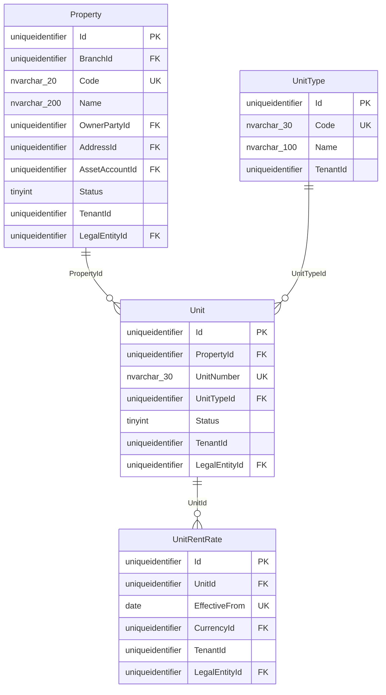
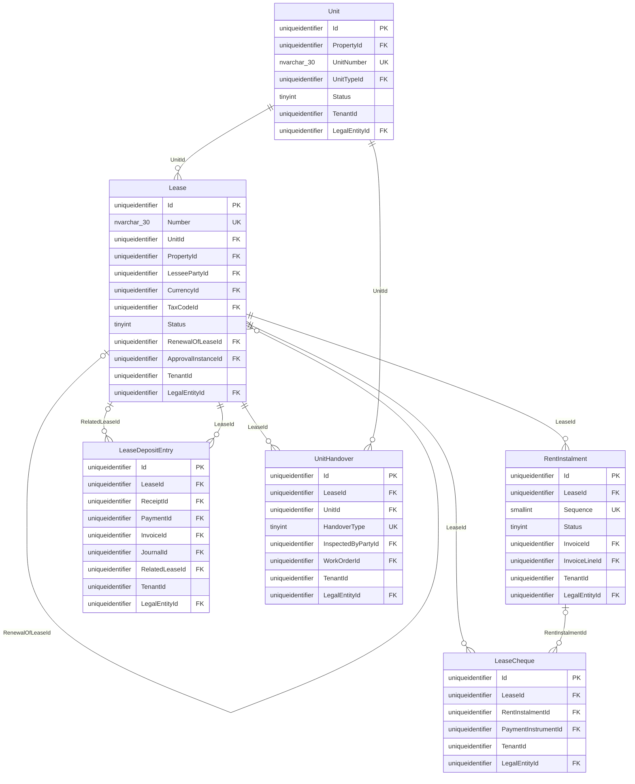
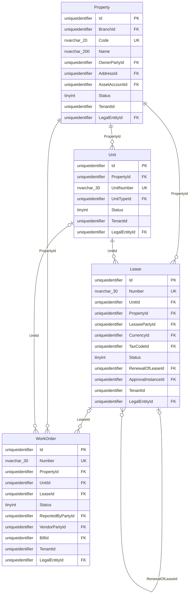
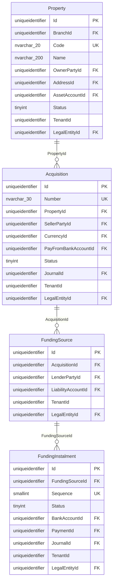
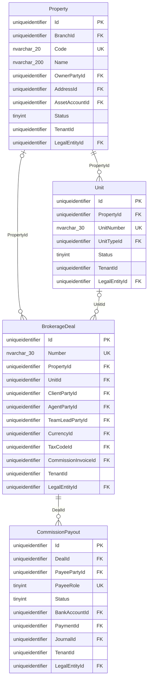

# Real-estate module schema (`re`)

Owner: DB Expert · Status: proposal for review · Depends on: [core-schema.md](core-schema.md), [architecture.md](architecture.md) §6 (module plug-in).

The table sections are generated from the database built by `sql/010_re_module.sql`, which itself is generated from the module's EF configuration (`ef-configurations/Configurations/RealEstate`). C#, SQL and this document come from one model.

---

## 0. Assumptions and conflicts

| # | Topic | Spec says | This design |
|---|---|---|---|
| R1 | Scope | "the reference demo" is **property management and leasing**: properties, units, leases, PDCs, rent invoices and receipts, work orders, acquisitions and financing, brokerage (spec 4.5–4.16, 4.24, 5.1–5.7). There are no plots, phases or off-plan sales. | The module covers exactly the spec. Developer/off-plan sales is an **unbuilt proposal** in Appendix A (no C#, no SQL). **Q2.** |
| R2 | Tenant vs lessee | "Tenant" means the person renting a unit. | SaaS isolation keeps `TenantId`. The renter is the **lessee**: `re.Lease.LesseePartyId` → `mdm.Party` with PartyRole `re.Lessee` (spec 4.8 "Tenants & customers" maps to Parties). |
| R3 | Unit type | Free text ("2BR", "Office"). | Lookup `re.UnitType` per tenant (code, name, default usage, default bedrooms), so occupancy-by-type reports group reliably. |
| R4 | PDC register | Spec 4.10 PDC register lives under leases. | The cheque itself is the generic core `fin.PaymentInstrument`. `re.LeaseCheque` adds the lease, the instalment it pays, and the security-deposit flag. The PDC lifecycle (held → deposited → cleared / bounced → replaced) is core behaviour. |
| R5 | Rent VAT | Spec 5.10: residential rent is exempt, commercial rent is standard-rated at 5 %. | `re.Lease.TaxCodeId` is NULL = derive from `Unit.Usage` through tenant settings (`re.tax.residentialRent`, `re.tax.commercialRent` → tax codes). An explicit value overrides. No VAT logic is hard-coded in the schema, so the UAE pack supplies the codes. |
| R6 | Registration | Ejari (Dubai), Tawtheeq (Abu Dhabi). | `Lease.RegistrationAuthority` (1 Ejari, 2 Tawtheeq, 9 Other) + `RegistrationNo`. Generic enough for other emirates. A non-UAE deployment leaves it NULL. Moving it to an `ae.LeaseProfile` pack table is an option if the module must be completely country-neutral. **Q10.** |
| R7 | Money | `decimal(18,2)`. | `decimal(19,4)` like core. Area is `decimal(10,2)` sq ft (spec shows sq ft). |
| R8 | Posting | Spec 5.10 posting table. | The RE module never writes `fin.*` directly. It calls the core posting service, which creates a Draft journal and calls `fin.usp_PostJournal`. Rent goes through `ar.Invoice` (billing run) and receipts through `ar.Receipt`, so ageing, statements and VAT come from core. |
| R9 | Property and unit dimensions | Expense lines carry property and unit. | RE seeds `fin.DimensionDefinition` slots for the tenant: Dim1 = `re.Property`, Dim2 = `re.Unit`, Dim3 = `re.Lease` (the tenant may remap). JournalLine, InvoiceLine and BillLine carry the IDs in those slots, and `IX_JournalLine_Dim1` serves the portfolio P&L (spec 6.10). |

---

## 1. How the module plugs into core

* **Own schema and context.**
  * Schema: `re`. Context: `ReDbContext`. Migrations history: `re.__EFMigrationsHistory`.
  * `ReDbContext` maps the core entities it references with `ExcludeFromMigrations()`, so navigations and FKs work but core tables are never created or altered by RE migrations.
  * One `SaveChanges` and one transaction can span core and `re` rows (same connection, same database).
* **FKs only into core, only by Id.** There are no FKs from core to `re`. Core references to RE records are soft (`fin.Journal.SourceType = 're.Lease'` with `SourceId`, `core.Attachment.EntityType`, `fin.DimensionDefinition` slots).
* **Entity scoping.**
  * Every `re` table except `re.UnitType` is `LegalEntityScopedEntity`, so the legal-entity filter applies.
  * `Unit.LegalEntityId` is copied from its property. `Lease` copies from its unit. The service validates consistency.
* **RLS.** `010_re_module.sql` ends with `EXEC rls.usp_ApplyTenantPolicy @Schema = N're'`, so every new `re` table gets filter and block predicates.
* **Shared platform services.**

| Core service | How RE uses it |
|---|---|
| `mdm.Party` + `PartyRole` | Lessees (`re.Lessee`), owners for managed properties (`re.Owner`), sellers, lenders (`re.Lender`), agents (`Employee` or `re.ExternalAgent`), maintenance vendors (`Vendor`) |
| `core.NumberSequence` | Document types `re.Lease` (LSE-2026-0001), `re.WorkOrder`, `re.Acquisition`, `re.BrokerageDeal`. Seeded per tenant by the RE installer. |
| `wf.Approval*` | `re.Lease` activation (`Lease.ApprovalInstanceId`), and acquisitions above threshold |
| `ar.Invoice` / `ar.Receipt` | Rent, other income and commission invoices. Rent and deposit receipts. |
| `ap.Bill` / `ap.Payment` | Work-order vendor bills, financing instalments, commission payouts, deposit refunds |
| `fin.PaymentInstrument` | PDCs (via `re.LeaseCheque`) |
| `fin.Journal` | Acquisition completion, financing instalments, deposit movements, payouts |
| `core.Attachment` | Lease contract, Ejari certificate, handover photos. Categories are RE-defined codes such as `re.lease-contract`. |
| `core.CustomFieldDefinition` | `re.Property`, `re.Unit`, `re.Lease`, `re.WorkOrder`, `re.Acquisition` and `re.BrokerageDeal` implement `IHasCustomFields` |

---

## 2. Portfolio: properties, unit types, units, rent rates

* **Property** (spec 4.5) belongs to one legal entity and optionally a branch.
  * `OwnershipType`: 1 Owned, or 2 ManagedForOwner, which requires `OwnerPartyId` (`CK_Property_Ownership`).
  * Location: `Region`, `Community`, `PlotNumber`, `AddressId` → `mdm.Address`.
  * `AssetAccountId` is the investment-property GL account (spec 1500), used by acquisition posting.
* **Unit** (spec 4.6) is the lettable inventory, unique per property by `UnitNumber`.
  * `Usage` (1 Residential, 2 Commercial) drives rent VAT.
  * `Status`: 1 Vacant, 2 Reserved, 3 Occupied, 4 Unavailable. It is maintained by lease activation and ending.
  * `IX_Unit_Entity_Status` serves the occupancy report (spec 6.9) and the "vacant units" picker.
* **UnitRentRate** is the effective-dated asking-rent history (`UX_UnitRentRate_Unit_From`). `Unit.AskingRent` is the current value, kept for list speed.

<!-- BEGIN GEN erd tables=re.Property,re.UnitType,re.Unit,re.UnitRentRate -->

References outside this diagram: `fin.Account`, `fin.Currency`, `mdm.Address`, `mdm.Party`, `org.Branch`, `org.LegalEntity`. Diagrams show the key, FK, unique and headline columns only; the full column list is in the table sections.
<!-- END GEN -->

---

## 3. Leasing: leases, rent schedule, cheques, deposits, handovers

* **Lease** (spec 4.9, 5.1). Lifecycle: `0 Draft → 1 Active → 2 Ended | 3 Renewed | 4 Terminated`, plus `5 HoldingOver` (occupying after expiry).
  * **One occupying lease per unit.** `UX_Lease_OneOccupyingPerUnit` is a filtered unique index on (TenantId, UnitId) `WHERE Status IN (1, 5) AND IsDeleted = 0`. Double-letting is impossible even under concurrent activations.
  * **Renewals.** Renewals chain through `RenewalOfLeaseId`, with at most one renewal per lease (`UX_Lease_OneRenewal`).
  * **Activation.** Activation allocates `Number` and stamps `ActivatedAt` (`CK_Lease_Activated`), generates the rent schedule, sets the unit to Occupied, and posts nothing (rent is billed by instalment).
  * **Expiry.** `IX_Lease_Entity_Status_End` serves the lease-expiry report (spec 6.11) and renewal reminders.
  * **Payment frequency.** `PaymentFrequency` is the number of instalments per year: 1, 2, 4, 6 or 12 (`CK_Lease_PaymentFrequency`).
* **RentInstalment** is the rent schedule (spec 4.9 "Payment schedule").
  * Each row has a sequence, a service period, a due date, an amount, and `Status` (0 Scheduled, 1 Invoiced, 2 Cancelled).
  * The billing run (Hangfire daily) reads `IX_RentInstalment_BillingRun` (TenantId, DueDate) `WHERE Status = 0` and creates `ar.Invoice` lines. It stamps `InvoiceId`/`InvoiceLineId`, and `UX_RentInstalment_InvoiceLine` stops double billing.
  * The rent roll (spec 6.8) reads leases with their instalments.
* **LeaseCheque** links `fin.PaymentInstrument` to the lease and optionally to the instalment it pays (`UX_LeaseCheque_Instrument`: a cheque belongs to one lease). `IsSecurityDeposit` marks deposit cheques. The bounce/replace flow updates the core instrument and re-links the replacement here.
* **LeaseDepositEntry** is the security-deposit ledger.
  * `EntryType`: 1 Received, 2 Refunded, 3 AppliedToArrears, 4 Forfeited, 5 TransferredIn, 6 TransferredOut. The amount is always positive and the sign comes from the type.
  * The held balance is the signed sum, which matches GL 2200 "Tenant security deposits held".
  * Each entry links the document that moved the money (`ReceiptId`, `PaymentId`, `InvoiceId` or `JournalId`) and, for transfers on renewal, the `RelatedLeaseId`.
* **UnitHandover** records move-in and move-out (one of each per lease: `UX_UnitHandover_Lease_Type`): keys, meter readings (JSON), condition, inspector, and an optional work order for damages.

<!-- BEGIN GEN erd tables=re.Lease,re.RentInstalment,re.LeaseCheque,re.LeaseDepositEntry,re.UnitHandover,re.Unit -->

References outside this diagram: `ap.Payment`, `ar.Invoice`, `ar.InvoiceLine`, `ar.Receipt`, `fin.Currency`, `fin.Journal`, `fin.PaymentInstrument`, `fin.TaxCode`, `mdm.Party`, `org.LegalEntity`, `re.Property`, `re.UnitType`, `re.WorkOrder`, `wf.ApprovalInstance`. Diagrams show the key, FK, unique and headline columns only; the full column list is in the table sections.
<!-- END GEN -->

---

## 4. Maintenance: work orders

`WorkOrder` (spec 4.16, 5.5) belongs to a property and optionally a unit and lease. It carries the issue, a category, `Priority` (1–4), and `Status` (0 New … 4 Completed, 5 Closed, 6 Cancelled; completion requires `CompletedOn`). It records who reported it (user or party), the vendor, the schedule, and estimated and actual cost. The vendor's cost is an `ap.Bill` (`BillId`) whose expense lines carry the property and unit dimensions, which feeds the maintenance-cost report (spec 6.14). The open-orders board reads `IX_WorkOrder_Open` (filtered on open statuses).

<!-- BEGIN GEN erd tables=re.WorkOrder,re.Property,re.Unit,re.Lease -->

References outside this diagram: `ap.Bill`, `fin.Account`, `fin.Currency`, `fin.TaxCode`, `mdm.Address`, `mdm.Party`, `org.Branch`, `org.LegalEntity`, `re.UnitType`, `wf.ApprovalInstance`. Diagrams show the key, FK, unique and headline columns only; the full column list is in the table sections.
<!-- END GEN -->

---

## 5. Acquisitions and funding

* **Acquisition** (spec 4.7) is the purchase of a property: price, down payment, transfer fees and other costs, with the seller as a party or free text.
  * On completion, the posting service posts Dr asset (price + fees + costs), Cr Bank (cash part), Cr financing payable (per funding source). It then stamps `JournalId`, `Number` and `CompletedAt` (`CK_Acquisition_Completed`).
* **FundingSource** is a mortgage or developer payment plan. It records the lender, principal, rate, term, monthly amount and the liability account (spec 2600).
* **FundingInstalment** is the amortization schedule (principal and interest split).
  * Paying an instalment posts Dr financing payable (principal) + Dr finance costs (interest) / Cr Bank, through an `ap.Payment` or a direct journal.
  * The cash forecast (spec 6.13) reads `Status = 0` instalments.

<!-- BEGIN GEN erd tables=re.Acquisition,re.FundingSource,re.FundingInstalment,re.Property -->

References outside this diagram: `ap.Payment`, `fin.Account`, `fin.BankAccount`, `fin.Currency`, `fin.Journal`, `mdm.Address`, `mdm.Party`, `org.Branch`, `org.LegalEntity`. Diagrams show the key, FK, unique and headline columns only; the full column list is in the table sections.
<!-- END GEN -->

---

## 6. Brokerage: deals and commission payouts

* **BrokerageDeal** (spec 4.24, 5.7) is a sale or lease deal.
  * It optionally points to our own property and unit, or uses a free-text `UnitReference` for third-party stock.
  * It records the client, agent, team lead, `Stage` (0 Lead … 6 AgentPaid, 9 Lost), deal value, commission % and tax code, agent and team-lead share %, and the computed gross commission.
  * At the Invoiced stage it creates an `ar.Invoice` (`CommissionInvoiceId`): Dr AR / Cr commission income + VAT.
* **CommissionPayout** is one row per payee (agent, team lead, external agent), allowed only once the commission invoice is paid (service rule). It is paid through `ap.Payment` or a journal (payroll-linked payouts in a future HR module).

<!-- BEGIN GEN erd tables=re.BrokerageDeal,re.CommissionPayout,re.Property,re.Unit -->

References outside this diagram: `ap.Payment`, `ar.Invoice`, `fin.Account`, `fin.BankAccount`, `fin.Currency`, `fin.Journal`, `fin.TaxCode`, `mdm.Address`, `mdm.Party`, `org.Branch`, `org.LegalEntity`, `re.UnitType`. Diagrams show the key, FK, unique and headline columns only; the full column list is in the table sections.
<!-- END GEN -->

---

## 7. Posting rules (spec 5.10) mapped to core documents

Account codes are the spec's demo chart. In the system they are resolved through `fin.Account.SystemKey` (e.g. `re.rentalIncome`, `re.depositsHeld`) seeded by the RE installer, so no code is hard-wired.

| Event | RE source row | Core document | Dr | Cr |
|---|---|---|---|---|
| Rent invoice, residential | `RentInstalment` → billing run | `ar.Invoice` (tax code from unit usage, exempt) | 1100 AR | 4000 Rental income |
| Rent invoice, commercial | same | `ar.Invoice` (standard 5 %) | 1100 AR (gross) | 4000 (net), 2100 VAT payable |
| Receipt (rent) | – | `ar.Receipt` + `ReceiptAllocation` | Bank | 1100 |
| Security deposit received | `LeaseDepositEntry` (1) | `ar.Receipt` (`Purpose` deposit, `ContraAccountId` 2200) | Bank | 2200 Deposits held |
| Deposit refunded / applied / forfeited | `LeaseDepositEntry` (2/3/4) | `ap.Payment` / allocation / journal | 2200 | Bank / 1100 / income |
| PDC received / deposited | `LeaseCheque` + `fin.PaymentInstrument` (Held/Presented) | none (memo only) | – | – |
| PDC cleared | instrument → Cleared | auto `ar.Receipt` (`PaymentInstrument.ReceiptId`) | Bank | 1100 |
| PDC bounced after clearing | instrument → Bounced | receipt void (`VoidJournalId`, reversal) | 1100 | Bank |
| Work-order vendor bill | `WorkOrder.BillId` | `ap.Bill` (lines with Dim1/Dim2) | Expense (+ blocked VAT), 1200 VAT recoverable | 2000 AP |
| Acquisition completed | `Acquisition` | `fin.Journal` (`SourceType` `re.Acquisition`) | 1500 Investment property | Bank, 2600 Financing payable |
| Financing instalment paid | `FundingInstalment` | `ap.Payment` or `fin.Journal` | 2600 (principal), 7000 Finance costs (interest) | Bank |
| Commission invoice | `BrokerageDeal` (Invoiced) | `ar.Invoice` | 1100 | 4200 Commission income, 2100 |
| Agent payout | `CommissionPayout` | `ap.Payment` / journal | Commission expense / payable | Bank |

---

## 8. Reports and their access paths

| Report (spec) | Served by |
|---|---|
| Rent roll (6.8) | `IX_Lease_Entity_Status_End` + `UX_RentInstalment_Lease_Seq` + `ar.Invoice.BalanceAmount` |
| Occupancy (6.9) | `IX_Unit_Entity_Status` (TenantId, LegalEntityId, Status, PropertyId) |
| Portfolio performance (6.10) | `IX_JournalLine_Dim1` (posted lines by property) |
| Lease expiries (6.11) | `IX_Lease_Entity_Status_End` |
| Cash forecast (6.13) | `IX_RentInstalment_BillingRun`, `fin.IX_PaymentInstrument_Maturity`, `FundingInstalment` (Status 0), AP open bills |
| Maintenance costs (6.14) | `ap.BillLine` / `fin.JournalLine` Dim1–Dim2 + `IX_WorkOrder_Property` |
| Brokerage commissions (6.15) | `re.BrokerageDeal` by stage + `CommissionPayout` |

---

## 9. Tables

<!-- BEGIN GEN tables schemas=re -->
#### `re.Acquisition`

property purchase; completion capitalises to 1500 and books financing.

| Column | SQL type | Null | Default / computed | FK → | Notes |
|---|---|---|---|---|---|
| Id | uniqueidentifier | NOT NULL | (newsequentialid()) |  | PK, clustered. Sequential GUID set by the app; NEWSEQUENTIALID() default for raw inserts. |
| Number | nvarchar(30) | NULL |  |  | ACQ-2026-000001 |
| PropertyId | uniqueidentifier | NOT NULL |  | re.Property |  |
| SellerPartyId | uniqueidentifier | NULL |  | mdm.Party |  |
| SellerName | nvarchar(200) | NOT NULL |  |  |  |
| PurchaseDate | date | NOT NULL |  |  |  |
| SpaReference | nvarchar(50) | NULL |  |  | SPA-RBR-2026-014 |
| CurrencyId | uniqueidentifier | NOT NULL |  | fin.Currency |  |
| PurchasePrice | decimal(19,4) | NOT NULL |  |  |  |
| DownPayment | decimal(19,4) | NOT NULL |  |  |  |
| TransferFees | decimal(19,4) | NOT NULL |  |  |  |
| OtherCosts | decimal(19,4) | NOT NULL |  |  |  |
| PayFromBankAccountId | uniqueidentifier | NULL |  | fin.BankAccount |  |
| Status | tinyint | NOT NULL |  |  | enum AcquisitionStatus: 0 Draft, 1 Completed |
| CompletedAt | datetime2(3) | NULL |  |  |  |
| JournalId | uniqueidentifier | NULL |  | fin.Journal |  |
| Notes | nvarchar(2000) | NULL |  |  |  |
| CustomFields | nvarchar(max) | NULL |  |  |  |
| LegalEntityId | uniqueidentifier | NOT NULL |  | org.LegalEntity |  |
| *base columns* | | | | | TenantId, CreatedAt, CreatedBy, ModifiedAt, ModifiedBy, IsDeleted, DeletedAt, DeletedBy, RowVersion (see §Base columns) |

Indexes: `IX_Acquisition_JournalId` (TenantId, JournalId); `IX_Acquisition_PayFromBankAccountId` (TenantId, PayFromBankAccountId); `IX_Acquisition_Property` (TenantId, PropertyId) WHERE ([IsDeleted]=(0)); `IX_Acquisition_SellerPartyId` (TenantId, SellerPartyId); `UX_Acquisition_Entity_Number` UNIQUE (TenantId, LegalEntityId, Number) WHERE ([IsDeleted]=(0) AND [Number] IS NOT NULL).

Checks: `CK_Acquisition_Amounts` ([PurchasePrice]>(0) AND [DownPayment]>=(0) AND [DownPayment]<=[PurchasePrice] AND [TransferFees]>=(0) AND [OtherCosts]>=(0)); `CK_Acquisition_Completed` ([Status]=(0) OR [JournalId] IS NOT NULL AND [CompletedAt] IS NOT NULL AND [Number] IS NOT NULL); `CK_Acquisition_CustomFields_IsJson` ([CustomFields] IS NULL OR isjson([CustomFields])=(1)); `CK_Acquisition_Status` ([Status]=(1) OR [Status]=(0)).

#### `re.BrokerageDeal`

sale/lease deal with commission split.

| Column | SQL type | Null | Default / computed | FK → | Notes |
|---|---|---|---|---|---|
| Id | uniqueidentifier | NOT NULL | (newsequentialid()) |  | PK, clustered. Sequential GUID set by the app; NEWSEQUENTIALID() default for raw inserts. |
| Number | nvarchar(30) | NULL |  |  | DEAL-2026-000004 |
| DealType | tinyint | NOT NULL |  |  | enum DealType: 1 Sale, 2 Lease |
| PropertyId | uniqueidentifier | NULL |  | re.Property |  |
| UnitId | uniqueidentifier | NULL |  | re.Unit |  |
| UnitReference | nvarchar(100) | NULL |  |  | listing ref when not managed |
| ClientPartyId | uniqueidentifier | NULL |  | mdm.Party |  |
| ClientName | nvarchar(200) | NOT NULL |  |  |  |
| AgentPartyId | uniqueidentifier | NULL |  | mdm.Party | employee party |
| ExternalAgentName | nvarchar(200) | NULL |  |  |  |
| TeamLeadPartyId | uniqueidentifier | NULL |  | mdm.Party |  |
| DealDate | date | NOT NULL |  |  |  |
| Stage | tinyint | NOT NULL |  |  | enum DealStage: 0 Lead, 1 Viewing, 2 Negotiation, 3 Agreed, 4 Invoiced, 5 Collected, 6 AgentPaid, 9 Lost |
| DealValue | decimal(19,4) | NOT NULL |  |  |  |
| CurrencyId | uniqueidentifier | NOT NULL |  | fin.Currency |  |
| CommissionRatePercent | decimal(9,4) | NOT NULL |  |  |  |
| TaxCodeId | uniqueidentifier | NULL |  | fin.TaxCode | VAT on commission |
| AgentSharePercent | decimal(9,4) | NOT NULL |  |  |  |
| TeamLeadSharePercent | decimal(9,4) | NOT NULL |  |  |  |
| GrossCommission | decimal(19,4) | NOT NULL |  |  | value × rate, rounded by the app |
| CommissionInvoiceId | uniqueidentifier | NULL |  | ar.Invoice |  |
| LostReason | nvarchar(500) | NULL |  |  |  |
| Notes | nvarchar(2000) | NULL |  |  |  |
| CustomFields | nvarchar(max) | NULL |  |  |  |
| LegalEntityId | uniqueidentifier | NOT NULL |  | org.LegalEntity |  |
| *base columns* | | | | | TenantId, CreatedAt, CreatedBy, ModifiedAt, ModifiedBy, IsDeleted, DeletedAt, DeletedBy, RowVersion (see §Base columns) |

Indexes: `IX_BrokerageDeal_AgentPartyId` (TenantId, AgentPartyId); `IX_BrokerageDeal_ClientPartyId` (TenantId, ClientPartyId); `IX_BrokerageDeal_CommissionInvoiceId` (TenantId, CommissionInvoiceId); `IX_BrokerageDeal_Pipeline` (TenantId, LegalEntityId, Stage, DealDate) INCLUDE (AgentPartyId, DealValue, GrossCommission) WHERE ([IsDeleted]=(0)); `IX_BrokerageDeal_PropertyId` (TenantId, PropertyId); `IX_BrokerageDeal_TeamLeadPartyId` (TenantId, TeamLeadPartyId); `IX_BrokerageDeal_UnitId` (TenantId, UnitId); `UX_BrokerageDeal_Entity_Number` UNIQUE (TenantId, LegalEntityId, Number) WHERE ([IsDeleted]=(0) AND [Number] IS NOT NULL).

Checks: `CK_BrokerageDeal_CustomFields_IsJson` ([CustomFields] IS NULL OR isjson([CustomFields])=(1)); `CK_BrokerageDeal_Invoiced` (NOT ([Stage]=(6) OR [Stage]=(5) OR [Stage]=(4)) OR [CommissionInvoiceId] IS NOT NULL); `CK_BrokerageDeal_Lost` ([Stage]<>(9) OR [LostReason] IS NOT NULL); `CK_BrokerageDeal_Percents` ([CommissionRatePercent]>=(0) AND [CommissionRatePercent]<=(100) AND [AgentSharePercent]>=(0) AND [TeamLeadSharePercent]>=(0) AND ([AgentSharePercent]+[TeamLeadSharePercent])<=(100)); `CK_BrokerageDeal_Stage` ([Stage]=(9) OR [Stage]=(6) OR [Stage]=(5) OR [Stage]=(4) OR [Stage]=(3) OR [Stage]=(2) OR [Stage]=(1) OR [Stage]=(0)); `CK_BrokerageDeal_Type` ([DealType]=(2) OR [DealType]=(1)); `CK_BrokerageDeal_Values` ([DealValue]>=(0) AND [GrossCommission]>=(0)).

#### `re.CommissionPayout`

agent / team-lead payout, allowed once the commission invoice is paid.

| Column | SQL type | Null | Default / computed | FK → | Notes |
|---|---|---|---|---|---|
| Id | uniqueidentifier | NOT NULL | (newsequentialid()) |  | PK, clustered. Sequential GUID set by the app; NEWSEQUENTIALID() default for raw inserts. |
| DealId | uniqueidentifier | NOT NULL |  | re.BrokerageDeal |  |
| PayeePartyId | uniqueidentifier | NULL |  | mdm.Party |  |
| PayeeName | nvarchar(200) | NOT NULL |  |  |  |
| PayeeRole | tinyint | NOT NULL |  |  | enum PayeeRole: 1 Agent, 2 TeamLead, 3 ExternalAgent |
| SharePercent | decimal(9,4) | NOT NULL |  |  |  |
| Amount | decimal(19,4) | NOT NULL |  |  |  |
| Status | tinyint | NOT NULL |  |  | enum PayoutStatus: 0 Pending, 1 Paid, 2 Cancelled |
| PaidOn | date | NULL |  |  |  |
| BankAccountId | uniqueidentifier | NULL |  | fin.BankAccount |  |
| PaymentId | uniqueidentifier | NULL |  | ap.Payment |  |
| JournalId | uniqueidentifier | NULL |  | fin.Journal |  |
| LegalEntityId | uniqueidentifier | NOT NULL |  | org.LegalEntity |  |
| *base columns* | | | | | TenantId, CreatedAt, CreatedBy, ModifiedAt, ModifiedBy, IsDeleted, DeletedAt, DeletedBy, RowVersion (see §Base columns) |

Indexes: `IX_CommissionPayout_BankAccountId` (TenantId, BankAccountId); `IX_CommissionPayout_JournalId` (TenantId, JournalId); `IX_CommissionPayout_PayeePartyId` (TenantId, PayeePartyId); `IX_CommissionPayout_PaymentId` (TenantId, PaymentId); `UX_CommissionPayout_Deal_Payee` UNIQUE (TenantId, DealId, PayeeRole, PayeePartyId) WHERE ([IsDeleted]=(0)).

Checks: `CK_CommissionPayout_Paid` ([Status]<>(1) OR [PaidOn] IS NOT NULL AND [JournalId] IS NOT NULL); `CK_CommissionPayout_Role` ([PayeeRole]>=(1) AND [PayeeRole]<=(3)); `CK_CommissionPayout_Status` ([Status]>=(0) AND [Status]<=(2)); `CK_CommissionPayout_Values` ([SharePercent]>=(0) AND [SharePercent]<=(100) AND [Amount]>=(0)).

#### `re.FundingInstalment`

amortisation schedule row; payment posts Dr 2600 + Dr 7000 / Cr Bank.

| Column | SQL type | Null | Default / computed | FK → | Notes |
|---|---|---|---|---|---|
| Id | uniqueidentifier | NOT NULL | (newsequentialid()) |  | PK, clustered. Sequential GUID set by the app; NEWSEQUENTIALID() default for raw inserts. |
| FundingSourceId | uniqueidentifier | NOT NULL |  | re.FundingSource |  |
| Sequence | smallint | NOT NULL |  |  |  |
| DueDate | date | NOT NULL |  |  |  |
| PrincipalAmount | decimal(19,4) | NOT NULL |  |  |  |
| InterestAmount | decimal(19,4) | NOT NULL |  |  |  |
| Status | tinyint | NOT NULL |  |  | enum FundingInstalmentStatus: 0 Scheduled, 1 Paid, 2 Cancelled |
| PaidOn | date | NULL |  |  |  |
| BankAccountId | uniqueidentifier | NULL |  | fin.BankAccount |  |
| PaymentId | uniqueidentifier | NULL |  | ap.Payment |  |
| JournalId | uniqueidentifier | NULL |  | fin.Journal |  |
| LegalEntityId | uniqueidentifier | NOT NULL |  | org.LegalEntity |  |
| *base columns* | | | | | TenantId, CreatedAt, CreatedBy, ModifiedAt, ModifiedBy, IsDeleted, DeletedAt, DeletedBy, RowVersion (see §Base columns) |

Indexes: `IX_FundingInstalment_BankAccountId` (TenantId, BankAccountId); `IX_FundingInstalment_Due` (TenantId, LegalEntityId, DueDate) INCLUDE (FundingSourceId, InterestAmount, PrincipalAmount) WHERE ([IsDeleted]=(0) AND [Status]=(0)); `IX_FundingInstalment_JournalId` (TenantId, JournalId); `IX_FundingInstalment_PaymentId` (TenantId, PaymentId); `UX_FundingInstalment_Source_Seq` UNIQUE (TenantId, FundingSourceId, Sequence) WHERE ([IsDeleted]=(0)).

Checks: `CK_FundingInstalment_Amounts` ([PrincipalAmount]>=(0) AND [InterestAmount]>=(0)); `CK_FundingInstalment_Paid` ([Status]<>(1) OR [PaidOn] IS NOT NULL AND [JournalId] IS NOT NULL); `CK_FundingInstalment_Status` ([Status]>=(0) AND [Status]<=(2)).

#### `re.FundingSource`

mortgage or developer payment plan for an acquisition.

| Column | SQL type | Null | Default / computed | FK → | Notes |
|---|---|---|---|---|---|
| Id | uniqueidentifier | NOT NULL | (newsequentialid()) |  | PK, clustered. Sequential GUID set by the app; NEWSEQUENTIALID() default for raw inserts. |
| AcquisitionId | uniqueidentifier | NOT NULL |  | re.Acquisition |  |
| SourceType | tinyint | NOT NULL |  |  | enum FundingSourceType: 1 BankMortgage, 2 DeveloperPlan, 9 Other |
| LenderPartyId | uniqueidentifier | NULL |  | mdm.Party |  |
| LenderName | nvarchar(200) | NOT NULL |  |  |  |
| Principal | decimal(19,4) | NOT NULL |  |  |  |
| AnnualRatePercent | decimal(9,4) | NOT NULL |  |  | decimal(9,4) |
| TermMonths | smallint | NOT NULL |  |  |  |
| MonthlyAmount | decimal(19,4) | NOT NULL |  |  |  |
| FirstDueDate | date | NOT NULL |  |  |  |
| LiabilityAccountId | uniqueidentifier | NULL |  | fin.Account | 2600 Property financing payable |
| LegalEntityId | uniqueidentifier | NOT NULL |  | org.LegalEntity |  |
| *base columns* | | | | | TenantId, CreatedAt, CreatedBy, ModifiedAt, ModifiedBy, IsDeleted, DeletedAt, DeletedBy, RowVersion (see §Base columns) |

Indexes: `IX_FundingSource_Acquisition` (TenantId, AcquisitionId) WHERE ([IsDeleted]=(0)); `IX_FundingSource_LenderPartyId` (TenantId, LenderPartyId); `IX_FundingSource_LiabilityAccountId` (TenantId, LiabilityAccountId).

Checks: `CK_FundingSource_Type` ([SourceType]=(9) OR [SourceType]=(2) OR [SourceType]=(1)); `CK_FundingSource_Values` ([Principal]>(0) AND [AnnualRatePercent]>=(0) AND [TermMonths]>(0) AND [MonthlyAmount]>=(0)).

#### `re.Lease`

tenancy contract (Ejari / Tawtheeq).

| Column | SQL type | Null | Default / computed | FK → | Notes |
|---|---|---|---|---|---|
| Id | uniqueidentifier | NOT NULL | (newsequentialid()) |  | PK, clustered. Sequential GUID set by the app; NEWSEQUENTIALID() default for raw inserts. |
| Number | nvarchar(30) | NULL |  |  | LSE-2026-000005 |
| UnitId | uniqueidentifier | NOT NULL |  | re.Unit |  |
| PropertyId | uniqueidentifier | NOT NULL |  | re.Property | denormalized from the unit |
| LesseePartyId | uniqueidentifier | NOT NULL |  | mdm.Party | mdm.Party with role Customer (category Tenant) |
| StartDate | date | NOT NULL |  |  |  |
| EndDate | date | NOT NULL |  |  |  |
| AnnualRent | decimal(19,4) | NOT NULL |  |  | excl. VAT |
| CurrencyId | uniqueidentifier | NOT NULL |  | fin.Currency |  |
| PaymentFrequency | tinyint | NOT NULL |  |  | 1, 2, 4, 6, 12 cheques/instalments per year |
| SecurityDepositAmount | decimal(19,4) | NOT NULL |  |  | agreed |
| TaxCodeId | uniqueidentifier | NULL |  | fin.TaxCode | NULL = derive from unit usage (commercial standard-rated, residential exempt). |
| RegistrationAuthority | tinyint | NULL |  |  | enum RegistrationAuthority: 1 Ejari, 2 Tawtheeq, 9 Other |
| RegistrationNo | nvarchar(30) | NULL |  |  | EJ-2026-0901377 / TW-2026-... |
| Status | tinyint | NOT NULL |  |  | enum LeaseStatus: 0 Draft, 1 Active, 2 Ended, 3 Renewed, 4 Terminated, 5 HoldingOver |
| ActivatedAt | datetime2(3) | NULL |  |  |  |
| ActivatedBy | uniqueidentifier | NULL |  |  |  |
| TerminationDate | date | NULL |  |  |  |
| TerminationReason | nvarchar(500) | NULL |  |  |  |
| RenewalOfLeaseId | uniqueidentifier | NULL |  | re.Lease |  |
| ApprovalInstanceId | uniqueidentifier | NULL |  | wf.ApprovalInstance |  |
| Notes | nvarchar(2000) | NULL |  |  |  |
| CustomFields | nvarchar(max) | NULL |  |  |  |
| LegalEntityId | uniqueidentifier | NOT NULL |  | org.LegalEntity |  |
| *base columns* | | | | | TenantId, CreatedAt, CreatedBy, ModifiedAt, ModifiedBy, IsDeleted, DeletedAt, DeletedBy, RowVersion (see §Base columns) |

Indexes: `IX_Lease_ApprovalInstanceId` (TenantId, ApprovalInstanceId); `IX_Lease_Entity_Status_End` (TenantId, LegalEntityId, Status, EndDate) INCLUDE (AnnualRent, LesseePartyId, Number, UnitId) WHERE ([IsDeleted]=(0)); `IX_Lease_Lessee` (TenantId, LesseePartyId) WHERE ([IsDeleted]=(0)); `IX_Lease_PropertyId` (TenantId, PropertyId); `UX_Lease_Entity_Number` UNIQUE (TenantId, LegalEntityId, Number) WHERE ([IsDeleted]=(0) AND [Number] IS NOT NULL); `UX_Lease_OneOccupyingPerUnit` UNIQUE (TenantId, UnitId) WHERE ([IsDeleted]=(0) AND ([Status] IN ((1), (5)))); `UX_Lease_OneRenewal` UNIQUE (TenantId, RenewalOfLeaseId) WHERE ([IsDeleted]=(0) AND [RenewalOfLeaseId] IS NOT NULL).

Checks: `CK_Lease_Activated` ([Status]=(0) OR [Number] IS NOT NULL AND [ActivatedAt] IS NOT NULL); `CK_Lease_Amounts` ([AnnualRent]>(0) AND [SecurityDepositAmount]>=(0)); `CK_Lease_CustomFields_IsJson` ([CustomFields] IS NULL OR isjson([CustomFields])=(1)); `CK_Lease_Dates` ([EndDate]>[StartDate]); `CK_Lease_NotSelfRenewal` ([RenewalOfLeaseId] IS NULL OR [RenewalOfLeaseId]<>[Id]); `CK_Lease_PaymentFrequency` ([PaymentFrequency]=(12) OR [PaymentFrequency]=(6) OR [PaymentFrequency]=(4) OR [PaymentFrequency]=(2) OR [PaymentFrequency]=(1)); `CK_Lease_Registration` ([RegistrationAuthority] IS NULL OR ([RegistrationAuthority]=(9) OR [RegistrationAuthority]=(2) OR [RegistrationAuthority]=(1))); `CK_Lease_Status` ([Status]>=(0) AND [Status]<=(5)); `CK_Lease_Terminated` ([Status]<>(4) OR [TerminationDate] IS NOT NULL); `CK_Lease_TerminationInTerm` ([TerminationDate] IS NULL OR [TerminationDate]>=[StartDate] AND [TerminationDate]<=[EndDate]).

#### `re.LeaseCheque`

links a core fin.PaymentInstrument (cheque, usually post-dated) to the lease and the rent instalment it pays. The instrument lifecycle (held → presented → cleared / bounced → replaced / returned) lives in core; this table only adds the real-estate context. FK direction is re → core only.

| Column | SQL type | Null | Default / computed | FK → | Notes |
|---|---|---|---|---|---|
| Id | uniqueidentifier | NOT NULL | (newsequentialid()) |  | PK, clustered. Sequential GUID set by the app; NEWSEQUENTIALID() default for raw inserts. |
| LeaseId | uniqueidentifier | NOT NULL |  | re.Lease |  |
| RentInstalmentId | uniqueidentifier | NULL |  | re.RentInstalment |  |
| PaymentInstrumentId | uniqueidentifier | NOT NULL |  | fin.PaymentInstrument |  |
| IsSecurityDeposit | bit | NOT NULL |  |  | security-deposit cheque rather than rent |
| LegalEntityId | uniqueidentifier | NOT NULL |  | org.LegalEntity |  |
| *base columns* | | | | | TenantId, CreatedAt, CreatedBy, ModifiedAt, ModifiedBy, IsDeleted, DeletedAt, DeletedBy, RowVersion (see §Base columns) |

Indexes: `IX_LeaseCheque_Instalment` (TenantId, RentInstalmentId) WHERE ([IsDeleted]=(0) AND [RentInstalmentId] IS NOT NULL); `IX_LeaseCheque_Lease` (TenantId, LeaseId) WHERE ([IsDeleted]=(0)); `UX_LeaseCheque_Instrument` UNIQUE (TenantId, PaymentInstrumentId) WHERE ([IsDeleted]=(0)).

#### `re.LeaseDepositEntry`

security-deposit ledger per lease (held balance = Σ signed entries).

| Column | SQL type | Null | Default / computed | FK → | Notes |
|---|---|---|---|---|---|
| Id | uniqueidentifier | NOT NULL | (newsequentialid()) |  | PK, clustered. Sequential GUID set by the app; NEWSEQUENTIALID() default for raw inserts. |
| LeaseId | uniqueidentifier | NOT NULL |  | re.Lease |  |
| EntryType | tinyint | NOT NULL |  |  | enum DepositEntryType: 1 Received, 2 Refunded, 3 AppliedToArrears, 4 Forfeited, 5 TransferredIn, 6 TransferredOut |
| EntryDate | date | NOT NULL |  |  |  |
| Amount | decimal(19,4) | NOT NULL |  |  | Always positive; sign is implied by EntryType (Received/TransferredIn increase the held balance). |
| ReceiptId | uniqueidentifier | NULL |  | ar.Receipt | Received |
| PaymentId | uniqueidentifier | NULL |  | ap.Payment | Refunded (ap.Payment with contra 2200) |
| InvoiceId | uniqueidentifier | NULL |  | ar.Invoice | AppliedToArrears (deduction invoice / allocation) |
| JournalId | uniqueidentifier | NULL |  | fin.Journal | Forfeited / transfer journals |
| RelatedLeaseId | uniqueidentifier | NULL |  | re.Lease | rollover to the renewal lease |
| Notes | nvarchar(500) | NULL |  |  |  |
| LegalEntityId | uniqueidentifier | NOT NULL |  | org.LegalEntity |  |
| *base columns* | | | | | TenantId, CreatedAt, CreatedBy, ModifiedAt, ModifiedBy, IsDeleted, DeletedAt, DeletedBy, RowVersion (see §Base columns) |

Indexes: `IX_LeaseDepositEntry_InvoiceId` (TenantId, InvoiceId); `IX_LeaseDepositEntry_JournalId` (TenantId, JournalId); `IX_LeaseDepositEntry_Lease` (TenantId, LeaseId, EntryDate) INCLUDE (Amount, EntryType) WHERE ([IsDeleted]=(0)); `IX_LeaseDepositEntry_PaymentId` (TenantId, PaymentId); `IX_LeaseDepositEntry_ReceiptId` (TenantId, ReceiptId); `IX_LeaseDepositEntry_RelatedLeaseId` (TenantId, RelatedLeaseId).

Checks: `CK_LeaseDepositEntry_Amount` ([Amount]>(0)); `CK_LeaseDepositEntry_Links` (([EntryType]<>(1) OR [ReceiptId] IS NOT NULL) AND ([EntryType]<>(2) OR [PaymentId] IS NOT NULL) AND (NOT ([EntryType]=(6) OR [EntryType]=(5)) OR [RelatedLeaseId] IS NOT NULL)); `CK_LeaseDepositEntry_Type` ([EntryType]>=(1) AND [EntryType]<=(6)).

#### `re.Property`

building, villa compound or commercial asset owned (or managed) by a legal entity.

| Column | SQL type | Null | Default / computed | FK → | Notes |
|---|---|---|---|---|---|
| Id | uniqueidentifier | NOT NULL | (newsequentialid()) |  | PK, clustered. Sequential GUID set by the app; NEWSEQUENTIALID() default for raw inserts. |
| BranchId | uniqueidentifier | NULL |  | org.Branch |  |
| Code | nvarchar(20) | NOT NULL |  |  | PROP-0001 |
| Name | nvarchar(200) | NOT NULL |  |  |  |
| PropertyType | tinyint | NOT NULL |  |  | enum PropertyType: 1 Residential, 2 Villa, 3 Commercial, 4 MixedUse, 5 Retail, 6 Industrial, 7 Land |
| OwnershipType | tinyint | NOT NULL |  |  | enum OwnershipType: 1 Owned, 2 ManagedForOwner |
| OwnerPartyId | uniqueidentifier | NULL |  | mdm.Party | third-party owner when ManagedForOwner |
| Region | nvarchar(100) | NULL |  |  | Emirate |
| Community | nvarchar(100) | NULL |  |  | Dubai Marina |
| AddressId | uniqueidentifier | NULL |  | mdm.Address |  |
| PlotNumber | nvarchar(50) | NULL |  |  |  |
| YearBuilt | smallint | NULL |  |  |  |
| TotalUnits | int | NOT NULL |  |  | total lettable (≥ registered) |
| IndicativeValue | decimal(19,4) | NOT NULL |  |  |  |
| AssetAccountId | uniqueidentifier | NULL |  | fin.Account | 1500 Investment property (default from settings) |
| Status | tinyint | NOT NULL |  |  | enum RecordStatus: 1 Active, 2 Inactive |
| Notes | nvarchar(2000) | NULL |  |  |  |
| CustomFields | nvarchar(max) | NULL |  |  |  |
| LegalEntityId | uniqueidentifier | NOT NULL |  | org.LegalEntity |  |
| *base columns* | | | | | TenantId, CreatedAt, CreatedBy, ModifiedAt, ModifiedBy, IsDeleted, DeletedAt, DeletedBy, RowVersion (see §Base columns) |

Indexes: `IX_Property_AddressId` (TenantId, AddressId); `IX_Property_AssetAccountId` (TenantId, AssetAccountId); `IX_Property_Entity_Status` (TenantId, LegalEntityId, Status) INCLUDE (IndicativeValue, Name, PropertyType, TotalUnits) WHERE ([IsDeleted]=(0)); `IX_Property_OwnerPartyId` (TenantId, OwnerPartyId); `UX_Property_Tenant_Code` UNIQUE (TenantId, Code) WHERE ([IsDeleted]=(0)).

Checks: `CK_Property_CustomFields_IsJson` ([CustomFields] IS NULL OR isjson([CustomFields])=(1)); `CK_Property_Ownership` (([OwnershipType]=(2) OR [OwnershipType]=(1)) AND ([OwnershipType]=(1) OR [OwnerPartyId] IS NOT NULL)); `CK_Property_Status` ([Status]=(2) OR [Status]=(1)); `CK_Property_Type` ([PropertyType]>=(1) AND [PropertyType]<=(7)); `CK_Property_Values` ([TotalUnits]>=(0) AND [IndicativeValue]>=(0)); `CK_Property_YearBuilt` ([YearBuilt] IS NULL OR [YearBuilt]>=(1800) AND [YearBuilt]<=(2200)).

#### `re.RentInstalment`

rent schedule row; billed by the billing run into ar.Invoice.

| Column | SQL type | Null | Default / computed | FK → | Notes |
|---|---|---|---|---|---|
| Id | uniqueidentifier | NOT NULL | (newsequentialid()) |  | PK, clustered. Sequential GUID set by the app; NEWSEQUENTIALID() default for raw inserts. |
| LeaseId | uniqueidentifier | NOT NULL |  | re.Lease |  |
| Sequence | smallint | NOT NULL |  |  |  |
| PeriodFrom | date | NOT NULL |  |  |  |
| PeriodTo | date | NOT NULL |  |  |  |
| DueDate | date | NOT NULL |  |  |  |
| Amount | decimal(19,4) | NOT NULL |  |  | excl. VAT; rounding remainder on the last row |
| Status | tinyint | NOT NULL |  |  | enum InstalmentStatus: 0 Scheduled, 1 Invoiced, 2 Cancelled |
| InvoiceId | uniqueidentifier | NULL |  | ar.Invoice |  |
| InvoiceLineId | uniqueidentifier | NULL |  | ar.InvoiceLine |  |
| LegalEntityId | uniqueidentifier | NOT NULL |  | org.LegalEntity |  |
| *base columns* | | | | | TenantId, CreatedAt, CreatedBy, ModifiedAt, ModifiedBy, IsDeleted, DeletedAt, DeletedBy, RowVersion (see §Base columns) |

Indexes: `IX_RentInstalment_BillingRun` (TenantId, DueDate) INCLUDE (Amount, LeaseId, LegalEntityId, PeriodFrom, PeriodTo) WHERE ([IsDeleted]=(0) AND [Status]=(0)); `IX_RentInstalment_InvoiceId` (TenantId, InvoiceId); `UX_RentInstalment_InvoiceLine` UNIQUE (TenantId, InvoiceLineId) WHERE ([IsDeleted]=(0) AND [InvoiceLineId] IS NOT NULL); `UX_RentInstalment_Lease_Seq` UNIQUE (TenantId, LeaseId, Sequence) WHERE ([IsDeleted]=(0)).

Checks: `CK_RentInstalment_Amount` ([Amount]>=(0)); `CK_RentInstalment_Invoiced` ([Status]<>(1) OR [InvoiceId] IS NOT NULL); `CK_RentInstalment_Period` ([PeriodTo]>=[PeriodFrom]); `CK_RentInstalment_Status` ([Status]>=(0) AND [Status]<=(2)).

#### `re.Unit`

lettable inventory. LegalEntityId is copied from the property for entity scoping.

| Column | SQL type | Null | Default / computed | FK → | Notes |
|---|---|---|---|---|---|
| Id | uniqueidentifier | NOT NULL | (newsequentialid()) |  | PK, clustered. Sequential GUID set by the app; NEWSEQUENTIALID() default for raw inserts. |
| PropertyId | uniqueidentifier | NOT NULL |  | re.Property |  |
| UnitNumber | nvarchar(30) | NOT NULL |  |  | 1406, Villa 12, Office 204 |
| UnitTypeId | uniqueidentifier | NOT NULL |  | re.UnitType |  |
| Usage | tinyint | NOT NULL |  |  | enum UnitUsage: 1 Residential, 2 Commercial |
| Floor | nvarchar(10) | NULL |  |  |  |
| Bedrooms | tinyint | NULL |  |  |  |
| AreaSqft | decimal(10,2) | NOT NULL |  |  | decimal(10,2) |
| AskingRent | decimal(19,4) | NOT NULL |  |  | annual |
| Status | tinyint | NOT NULL |  |  | enum UnitStatus: 1 Vacant, 2 Reserved, 3 Occupied, 4 Unavailable |
| UtilityPremiseNo | varchar(30) | NULL |  |  | DEWA / ADDC premise no. |
| Notes | nvarchar(2000) | NULL |  |  |  |
| CustomFields | nvarchar(max) | NULL |  |  |  |
| LegalEntityId | uniqueidentifier | NOT NULL |  | org.LegalEntity |  |
| *base columns* | | | | | TenantId, CreatedAt, CreatedBy, ModifiedAt, ModifiedBy, IsDeleted, DeletedAt, DeletedBy, RowVersion (see §Base columns) |

Indexes: `IX_Unit_Entity_Status` (TenantId, LegalEntityId, Status, PropertyId) INCLUDE (AreaSqft, AskingRent, UnitNumber, Usage) WHERE ([IsDeleted]=(0)); `UX_Unit_Property_Number` UNIQUE (TenantId, PropertyId, UnitNumber) WHERE ([IsDeleted]=(0)).

Checks: `CK_Unit_CustomFields_IsJson` ([CustomFields] IS NULL OR isjson([CustomFields])=(1)); `CK_Unit_Status` ([Status]>=(1) AND [Status]<=(4)); `CK_Unit_Usage` ([Usage]=(2) OR [Usage]=(1)); `CK_Unit_Values` ([AreaSqft]>=(0) AND [AskingRent]>=(0)).

#### `re.UnitHandover`

move-in / move-out inspection (spec 5.1 step 12, inferred).

| Column | SQL type | Null | Default / computed | FK → | Notes |
|---|---|---|---|---|---|
| Id | uniqueidentifier | NOT NULL | (newsequentialid()) |  | PK, clustered. Sequential GUID set by the app; NEWSEQUENTIALID() default for raw inserts. |
| LeaseId | uniqueidentifier | NOT NULL |  | re.Lease |  |
| UnitId | uniqueidentifier | NOT NULL |  | re.Unit |  |
| HandoverType | tinyint | NOT NULL |  |  | enum HandoverType: 1 MoveIn, 2 MoveOut |
| HandoverDate | date | NOT NULL |  |  |  |
| KeysCount | tinyint | NOT NULL |  |  |  |
| MeterReadings | nvarchar(max) | NULL |  |  | JSON {"electricity":12345,"water":678} |
| ConditionNotes | nvarchar(4000) | NULL |  |  |  |
| InspectedByPartyId | uniqueidentifier | NULL |  | mdm.Party |  |
| WorkOrderId | uniqueidentifier | NULL |  | re.WorkOrder | turnover job raised from the inspection |
| LegalEntityId | uniqueidentifier | NOT NULL |  | org.LegalEntity |  |
| *base columns* | | | | | TenantId, CreatedAt, CreatedBy, ModifiedAt, ModifiedBy, IsDeleted, DeletedAt, DeletedBy, RowVersion (see §Base columns) |

Indexes: `IX_UnitHandover_InspectedByPartyId` (TenantId, InspectedByPartyId); `IX_UnitHandover_UnitId` (TenantId, UnitId); `IX_UnitHandover_WorkOrderId` (TenantId, WorkOrderId); `UX_UnitHandover_Lease_Type` UNIQUE (TenantId, LeaseId, HandoverType) WHERE ([IsDeleted]=(0)).

Checks: `CK_UnitHandover_MeterReadings_IsJson` ([MeterReadings] IS NULL OR isjson([MeterReadings])=(1)); `CK_UnitHandover_Type` ([HandoverType]=(2) OR [HandoverType]=(1)).

#### `re.UnitRentRate`

asking-rent history (price list per unit, effective dated).

| Column | SQL type | Null | Default / computed | FK → | Notes |
|---|---|---|---|---|---|
| Id | uniqueidentifier | NOT NULL | (newsequentialid()) |  | PK, clustered. Sequential GUID set by the app; NEWSEQUENTIALID() default for raw inserts. |
| UnitId | uniqueidentifier | NOT NULL |  | re.Unit |  |
| EffectiveFrom | date | NOT NULL |  |  |  |
| AnnualRent | decimal(19,4) | NOT NULL |  |  |  |
| CurrencyId | uniqueidentifier | NOT NULL |  | fin.Currency |  |
| Reason | nvarchar(200) | NULL |  |  |  |
| LegalEntityId | uniqueidentifier | NOT NULL |  | org.LegalEntity |  |
| *base columns* | | | | | TenantId, CreatedAt, CreatedBy, ModifiedAt, ModifiedBy, IsDeleted, DeletedAt, DeletedBy, RowVersion (see §Base columns) |

Indexes: `UX_UnitRentRate_Unit_From` UNIQUE (TenantId, UnitId, EffectiveFrom DESC) INCLUDE (AnnualRent) WHERE ([IsDeleted]=(0)).

Checks: `CK_UnitRentRate_Amount` ([AnnualRent]>=(0)).

#### `re.UnitType`

lookup ("Studio", "2 Bedroom", "Office", "Retail") with default usage.

| Column | SQL type | Null | Default / computed | FK → | Notes |
|---|---|---|---|---|---|
| Id | uniqueidentifier | NOT NULL | (newsequentialid()) |  | PK, clustered. Sequential GUID set by the app; NEWSEQUENTIALID() default for raw inserts. |
| Code | nvarchar(30) | NOT NULL |  |  |  |
| Name | nvarchar(100) | NOT NULL |  |  |  |
| DefaultUsage | tinyint | NOT NULL |  |  | enum UnitUsage: 1 Residential, 2 Commercial |
| DefaultBedrooms | tinyint | NULL |  |  |  |
| IsActive | bit | NOT NULL |  |  |  |
| *base columns* | | | | | TenantId, CreatedAt, CreatedBy, ModifiedAt, ModifiedBy, IsDeleted, DeletedAt, DeletedBy, RowVersion (see §Base columns) |

Indexes: `UX_UnitType_Tenant_Code` UNIQUE (TenantId, Code) WHERE ([IsDeleted]=(0)).

Checks: `CK_UnitType_Usage` ([DefaultUsage]=(2) OR [DefaultUsage]=(1)).

#### `re.WorkOrder`

maintenance request; vendor cost flows through ap.Bill to property expenses.

| Column | SQL type | Null | Default / computed | FK → | Notes |
|---|---|---|---|---|---|
| Id | uniqueidentifier | NOT NULL | (newsequentialid()) |  | PK, clustered. Sequential GUID set by the app; NEWSEQUENTIALID() default for raw inserts. |
| Number | nvarchar(30) | NULL |  |  | WO-2026-000002 |
| PropertyId | uniqueidentifier | NOT NULL |  | re.Property |  |
| UnitId | uniqueidentifier | NULL |  | re.Unit | NULL = common area |
| LeaseId | uniqueidentifier | NULL |  | re.Lease |  |
| Issue | nvarchar(300) | NOT NULL |  |  |  |
| Category | nvarchar(50) | NULL |  |  | HVAC, Elevators, Turnover ... |
| Priority | tinyint | NOT NULL |  |  | enum Priority: 1 Low, 2 Normal, 3 High, 4 Critical |
| Status | tinyint | NOT NULL |  |  | enum WorkOrderStatus: 0 New, 1 Assigned, 2 InProgress, 3 OnHold, 4 Completed, 5 Closed, 6 Cancelled |
| ReportedOn | date | NOT NULL |  |  |  |
| ReportedBy | nvarchar(100) | NULL |  |  |  |
| ReportedByPartyId | uniqueidentifier | NULL |  | mdm.Party | portal tenant |
| VendorPartyId | uniqueidentifier | NULL |  | mdm.Party |  |
| Technician | nvarchar(100) | NULL |  |  |  |
| ScheduledFor | date | NULL |  |  |  |
| CompletedOn | date | NULL |  |  |  |
| EstimatedCost | decimal(19,4) | NOT NULL |  |  |  |
| ActualCost | decimal(19,4) | NULL |  |  |  |
| BillId | uniqueidentifier | NULL |  | ap.Bill |  |
| Details | nvarchar(4000) | NULL |  |  |  |
| ResolutionNotes | nvarchar(4000) | NULL |  |  |  |
| CustomFields | nvarchar(max) | NULL |  |  |  |
| LegalEntityId | uniqueidentifier | NOT NULL |  | org.LegalEntity |  |
| *base columns* | | | | | TenantId, CreatedAt, CreatedBy, ModifiedAt, ModifiedBy, IsDeleted, DeletedAt, DeletedBy, RowVersion (see §Base columns) |

Indexes: `IX_WorkOrder_BillId` (TenantId, BillId); `IX_WorkOrder_LeaseId` (TenantId, LeaseId); `IX_WorkOrder_Open` (TenantId, LegalEntityId, Status, Priority) INCLUDE (PropertyId, ReportedOn, UnitId, VendorPartyId) WHERE ([IsDeleted]=(0) AND ([Status] IN ((0), (1), (2), (3)))); `IX_WorkOrder_Property` (TenantId, PropertyId, ReportedOn) WHERE ([IsDeleted]=(0)); `IX_WorkOrder_ReportedByPartyId` (TenantId, ReportedByPartyId); `IX_WorkOrder_UnitId` (TenantId, UnitId); `IX_WorkOrder_VendorPartyId` (TenantId, VendorPartyId); `UX_WorkOrder_Entity_Number` UNIQUE (TenantId, LegalEntityId, Number) WHERE ([IsDeleted]=(0) AND [Number] IS NOT NULL).

Checks: `CK_WorkOrder_Completed` (NOT ([Status]=(5) OR [Status]=(4)) OR [CompletedOn] IS NOT NULL); `CK_WorkOrder_Costs` ([EstimatedCost]>=(0) AND ([ActualCost] IS NULL OR [ActualCost]>=(0))); `CK_WorkOrder_CustomFields_IsJson` ([CustomFields] IS NULL OR isjson([CustomFields])=(1)); `CK_WorkOrder_Priority` ([Priority]>=(1) AND [Priority]<=(4)); `CK_WorkOrder_Status` ([Status]>=(0) AND [Status]<=(6)).
<!-- END GEN -->

---

## Appendix A — Off-plan / developer sales (proposal only, not built)

This appendix is included because "real estate ERP" often means developer sales, which the spec does not cover. It is a sketch for scoping **Q2**. It would be a second module (`res`, "real-estate sales") or an extension of `re`, sharing `re.Property`/`re.Unit` as inventory.

| Table | Purpose | Key columns / rules |
|---|---|---|
| `res.Project` | Master development / project | LegalEntityId, Code, Name, Developer, escrow `BankAccountId` (UAE: RERA escrow per project), launch and completion dates |
| `res.Phase` / `res.Block` | Phases, buildings, plots | ProjectId, Code, `PlannedHandover`, construction % (for milestone instalments) |
| `re.Unit` (reused) | Saleable inventory | add `SaleStatus` (Available, Blocked, Reserved, Booked, Sold, Handed over) in a `res.UnitSaleProfile` 1:1 table, so leasing tables stay untouched |
| `res.PriceList` / `res.PriceListLine` | Versioned prices per unit/type/floor/view | effective dates, approval, `UX` one active price per unit |
| `res.PaymentPlanTemplate` / `…Step` | e.g. 10 % booking, 40 % during construction (milestones), 50 % on handover | step type: date / milestone / % of construction |
| `res.Reservation` | Hold on a unit with an expiry and token amount | filtered unique: one active reservation per unit (same pattern as `UX_Lease_OneOccupyingPerUnit`) |
| `res.SalesBooking` (SPA) | Sale contract: buyer party(ies), unit, price, discount, plan, broker, Oqood/registration no. | one active booking per unit, number sequence `res.Booking`, approval |
| `res.BookingBuyer` | Joint buyers with ownership % | Σ % = 100 (service + deferred check) |
| `res.SaleInstalment` | The buyer's schedule, billed to `ar.Invoice`, paid by receipts and PDCs (`fin.PaymentInstrument` via `res.BookingCheque`) | same billing-run pattern as `RentInstalment` |
| `res.Milestone` | Construction milestone certification that triggers milestone instalments | |
| `res.Transfer` / `res.Cancellation` | Resale before handover (buyer change, fees), cancellation with forfeiture/refund rules | posts through AR/AP + journals |

Revenue recognition (IFRS 15 over time vs. at handover), escrow accounting and unbilled receivables would need finance-design input before building.
