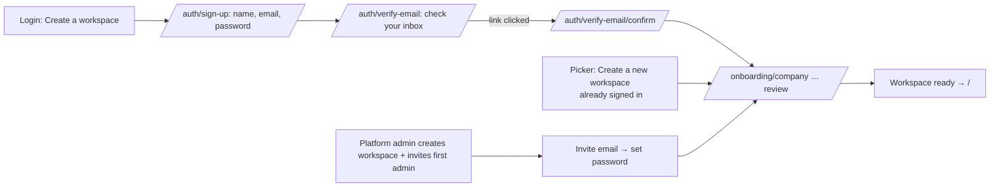

# 01a · Sign up (self-service workspace creation) and platform-admin creation

Routes: `/auth/sign-up`, `/auth/verify-email` (pending screen), `/auth/verify-email/confirm?token=…` (link target), then `/onboarding/*` (03).
Not in the spec (its demo workspace is pre-seeded). This is **new design** per the coordinator's decision: new workspaces are created by **self sign-up through onboarding**, or by a **platform admin**.
Entry points: "New here? **Create a workspace**" on the login card (01 §A), "+ Create a new workspace" in the workspace picker (01 §B), and an optional marketing-site CTA (`/auth/sign-up?plan=…`).

## Flow


## A. Create your account — `/auth/sign-up`
Uses the login split layout (01 §A). The card:

```
┌──────────────────────────────────┐
│ Create your workspace            │
│ Start with your account. You'll  │
│ set up your company next.        │
│ Full name                        │
│ [Jamal Ahmed                  ]  │
│ Work email                       │
│ [✉ jamal@acme.com             ]  │
│ Password                         │
│ [🔒 ••••••••••            👁 ]   │
│ ✓ At least 10 characters         │
│ ✓ An upper-case letter           │
│ ✗ A lower-case letter            │
│ ✓ A digit                        │
│ ✓ Not the same as your email     │
│ [ ] I agree to the Terms and     │
│     Privacy Policy               │
│ [     Create account      ]      │
│ Already have an account? Sign in │
└──────────────────────────────────┘
```

| Label | Type | Control | Req. | Validation | Placeholder / help |
|---|---|---|---|---|---|
| Full name | text | `nz-input` `autocomplete="name"` | Yes | 2–100 chars | — |
| Work email | email | `nz-input-group` (mail icon) `autocomplete="email"` | Yes | Valid email format. **Never reveals whether an account exists (resolved S1).** Submitting an email that already has an account behaves exactly like a new one. The UI goes to §B with the same neutral text and timing. The backend emails the existing owner a "You already have an account. Sign in or reset your password" message instead of a verification link. | "you@company.com" |
| Password | password | `nz-input-group` + eye toggle, `autocomplete="new-password"` | Yes | **Approved policy:** minimum 10 characters, with at least one upper-case letter, one lower-case letter and one digit, and not equal to the email | Helper text under the label: "At least 10 characters, with upper- and lower-case letters and a digit. Can't be your email." A live checklist (5 rules) sits under the field. Each item shows ✓/✗ plus a text state ("met" / "not met") for screen readers, and is updated as the user types, debounced 300 ms. |
| I agree to the Terms and Privacy Policy | checkbox | `nz-checkbox` with links (open in a new tab) | Yes | Must be checked | — |

| Action | Kind | Behaviour |
|---|---|---|
| Create account | Primary block, `nzLoading` | `POST /auth/sign-up {name, email, password}` (**proposed**). It creates an **unverified** user with no workspace and sends a verification email, then goes to §B. |
| Sign in | Link | `/auth/login` |

States: default (name field focused) · loading · field validation (inline errors plus the checklist; on submit, focus moves to the first failing field) · rate limited (alert with countdown) · network error (`nz-alert warning`) · success → §B. There is **no** "email already registered" state (S1).

## B. Verify your email — `/auth/verify-email`
```
┌──────────────────────────────────┐
│  (✉ nz-result info)              │
│ Verify your email                │
│ If this email can be used, we sent│
│ a link to j***@acme.com. Open it │
│ to continue. Links expire in 24 h.│
│ Already have an account? Sign in │
│ [ Open email app ▾ ]  (optional) │
│ Didn't get it? Resend (0:30)     │
│ Wrong email? Start again         │
└──────────────────────────────────┘
```
| Item | Behaviour |
|---|---|
| Resend | Link, disabled with a **30 s** countdown after each send (approved). Neutral toast: "If this email can be used, we sent a new link." |
| Start again | Goes back to §A with the fields kept, except the password. The unverified account is replaced. |
| Polling | The page checks verification status every 10 s while it is visible. Once the user verifies in another tab, it continues automatically to §C. |
| Verification link (`/auth/verify-email/confirm?token=`) | States: **verifying** (`nz-spin`) → **success**, which signs the user in and redirects to `/onboarding/company` with the toast "Email verified"; **expired / used** (`nz-result warning` "This link has expired or was already used." + **Send a new link**); **already verified** (redirect to login or to onboarding). The verification link lasts **24 h** (approved). The 30-minute single-use rule applies to *password-reset* tokens. |

## C. Onboarding hand-off
* After verification, the user creates the workspace in the **onboarding wizard (03)**. Step 1 creates the `Organization` record, and the user becomes its **Workspace admin**.
* An existing signed-in user ("Create a new workspace" from the picker) starts at `/onboarding/company` directly, with no account step.
* Until setup completes, the new workspace appears in the picker with the tag "Setup in progress" (01 §B).

## D. Platform-admin creation path (no UI in this pack)
* A platform (super-admin) back office, outside the customer app, can create a workspace and invite its first Workspace admin by email. **The back office is out of scope for now (resolved S2).** Only the invitee's experience in the customer app is specified below.
* Invitee experience in the customer app:
  * **New email:** invitation email → `/auth/accept-invite?token=` → a "Set up your account" card (Full name prefilled, Password with the same policy checklist) → `/onboarding/company`, with any fields the platform admin pre-filled shown already completed.
  * **Existing email:** invitation email → sign in → the invitation appears in the workspace picker under **Pending invitations** (01 §B). The inviting admin sees the same confirmation either way (04 §B), so an invite never reveals whether the account exists.
* Invitation links: expired or used links show `nz-result warning` "This invitation has expired. Ask the person who invited you to send a new one."
