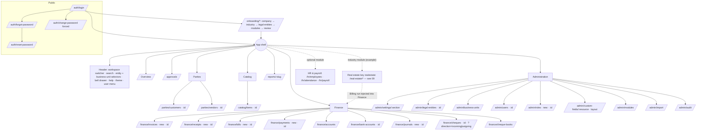

# 08 · Navigation and information architecture (core + pluggable modules)

Spec: §1 (sidebar areas), §3.3 (grouped menu), §7.1 (permission keys), §10.2 (lazy-loaded feature routes, standalone components), §12 (API by module), §13 (roadmap order).
Project-owner constraint: **core is industry-neutral.** Every industry-specific screen comes from a pluggable module. Real estate is one example module, documented separately in 09-module-example-real-estate.md.

## 1. Principles
1. **Core = what every business needs:** workspace and legal entities, parties, items, finance (including invoices, receipts, bills, payments and cheques), approvals, reports framework, administration.
2. **Modules add capabilities**, not exceptions. They register menu entries, routes, permissions, settings sections, search providers, dashboard widgets, reports, record-type extensions and industry descriptors through one manifest (§5).
3. **Three levels of navigation:** sider (where can I go), page header and tabs (what is this record and its related records), and global search (jump anywhere).
4. **Scope is global:** the legal-entity switcher scopes every entity-scoped page. Navigation itself never changes with scope; only data does.
5. **Labels are neutral and configurable.** Modules may relabel core concepts for their own screens only (e.g. RE shows Customers as "Tenants & customers" inside the RE group). Core menu labels never change.

## 2. Route and naming conventions
| Thing | Convention | Example |
|---|---|---|
| Core area routes | `/<area>/<resource>` (kebab-case, plural resource) | `/finance/journals`, `/finance/invoices`, `/parties/customers`, `/admin/users` |
| Core singletons | `/` (Overview), `/approvals`, `/search`, `/reports/:slug`, `/onboarding/*`, `/auth/*` | |
| Module routes | `/<routePrefix>/<resource>`. The route prefix is the kebab-case form of the module key (QA-9: key `realestate` → `/real-estate/`). Reserved words that modules can't use: `admin`, `auth`, `finance`, `parties`, `catalog`, `hr`, `reports`, `approvals`, `search`, `onboarding`, `print`, `m` | `/real-estate/leases`, `/real-estate/leases/:id` |
| List / new / detail / edit | `…/<resource>`, `…/<resource>/new` (full-page forms only), `…/<resource>/:id`, `…/<resource>/:id/edit` (full-page forms only). Drawer forms use query params `?drawer=new|edit|view&id=` (06 §6). | `/finance/journals/new` |
| Detail sub-tabs | `…/:id/<tab>` (child routes, so deep links work) | `/parties/customers/:id/documents` |
| Print | `/print/<moduleKey or area>/<resource>/:id` (no shell) | `/print/finance/invoices/:id` |
| Core API base | `/api/v1/<resource>` (spec §12) | `/api/v1/journals`, `/api/v1/cheques` |
| **Module API base (approved)** | `/api/v1/m/{moduleKey}/<resource>`, with the lowercase module key. The manifest exposes it as `apiBase`. | `/api/v1/m/realestate/leases`, `/api/v1/m/realestate/leases/{id}/cheques` |
| Route name (`data.routeId`) | `<moduleKey|core>.<resource>.<view>` | `core.journal.detail`, `realestate.property.list` |
| Permission key (**approved, Q4; QA-6**) | `<module>.<resource>.<action>`, all lower case, as in the BA catalogue (`../ba/core-domain.md` §3.3). Module = `core`, `finance`, `hr` or the module key (`realestate`); resource = plural, no separators. No two-part keys, no `area.read/write`, no `admin.*`, no `customization.*` (04 §D). | `core.users.manage`, `finance.journals.create`, `finance.cheques.deposit`, `realestate.leases.activate` |
| Resource key / record type (fields, views, extensions) | `<moduleKey|core>.<recordtype>`, singular, lower case (Q12) | `core.party`, `core.cheque`, `realestate.unit` |
| Module DB schema | One schema per module, named by the backend (QA-9) | `re` for real estate |
| i18n keys | `<moduleKey>.<resource>.<label>` | `realestate.property.title` |

**Spec compatibility:** the spec's flat routes (`/properties`, `/invoices`, `/entities`, `/users`…, §10.2) become the namespaced routes above. **Assumption:** there are no legacy URLs to preserve. If any are needed, add redirect routes.

Route `data` contract (every route):
```ts
data: { routeId: 'core.journal.list', title: 'Journals', breadcrumb: 'Journals',
        permission: 'finance.journals.read', entityScoped: true, module: 'core' }
```
Guards: `authGuard` → `setupCompleteGuard` → `moduleEnabledGuard(module)` → `permissionGuard(permission)`. Failing the module guard gives a 404-style `nz-result` ("This feature isn't enabled for your workspace" + link for admins to Settings → Modules). Failing the permission guard gives `nz-result 403`.

## 3. Core vs module split (approved)

| Spec area (§1) | Placement in the generic ERP | Rationale |
|---|---|---|
| Workspace: Overview, Approvals | **Core** | Dashboard is a widget host; approvals engine is generic (spec §5.8). |
| Administration: Settings, Users & roles, Audit log | **Core** | Generic |
| Legal entities | **Core → Administration** | Accounting boundary (spec §10.3); RE adds columns/KPIs via extension |
| Finance: Chart of accounts, Bank & cash, Journals | **Core → Finance** | Generic double-entry ledger |
| Billing & collections: Invoices, Receipts | **Core → Finance** (`/finance/invoices`, `/finance/receipts`; `finance.invoices.*`, `finance.receipts.*`) — **resolved QA-7** | Generic. The RE module **does not own** invoices or receipts; it adds a "Billing run" item (`realestate.billingrun.execute`) that creates core invoices from leases, plus source links via extension (09). |
| Payables: Vendor bills, Payments | **Core → Finance** (`/finance/bills`, `/finance/payments`; `finance.bills.*`, `finance.payments.*`) — **resolved QA-7**. Vendors live under Parties. | Generic |
| Tenants & customers | **Core → Parties → Customers**. RE adds the "Tenant" category, Emirates-ID-style fields via the country pack, and a module menu shortcut. | Customers are shared across entities (spec §2.2) |
| HR & payroll: Employees, Attendance, Payroll | **Optional core module "HR & payroll"** (industry-neutral, installable). WPS/MOHRE specifics come from the UAE country pack. | Not industry-specific, but not every business needs it |
| Reports hub | **Core** framework. Financial statements, VAT, ageing and treasury are core reports. Rent roll, occupancy, portfolio performance, lease expiries, maintenance costs and brokerage commissions are **RE module** reports. | Module reports register via manifest |
| PDC register (spec §4.10) | **Core → Finance → Cheques** (`/finance/cheques`, permissions `finance.cheques.*`) — **resolved QA-8** | **Approved change to D1.** A cheque (including a post-dated cheque) is a generic payment instrument. Custody, deposit, clear, bounce, replace and return are core finance actions. The real-estate module only **links** cheques to leases and instalments (09 §5). |
| Property & asset (Properties, Units, Acquisitions & funding), Leasing (Leases), Facilities (Work orders), CRM & brokerage (Deals) | **Real-estate module** (09) — **approved (D1)** | Industry-specific |
| Items / catalog | **Core → Catalog → Items** (**new, not in spec**) | A general ERP needs a neutral item master. It is used as the master-data example in 06. |
| Business units | **Core → Administration** (**approved for v1 as data plus a selector**; strict scoping later) | A neutral way to organise records (05 §D, 07 §2) |
| Custom fields, Modules, Import data | **Core → Administration** (new; spec §9) | |

## 4. Core menu tree (sider)
Order bands: core groups use `order` 0–99, and modules use 100–899 (inserted between Finance and Reports by default). There are no separate Sales or Purchases groups (QA-7). Administration is always last (900+).

| Group (order) | Item | Route | Permission | Notes |
|---|---|---|---|---|
| **Workspace** (10) | Overview | `/` | any signed-in | Widgets filtered by permission and modules |
| | Approvals | `/approvals` | any (deciding needs `core.approvals.decide`) | Badge = pending for me |
| **Parties** (20) | Customers | `/parties/customers` | `core.parties.read` | |
| | Vendors | `/parties/vendors` | `core.parties.read` | |
| **Catalog** (25) | Items | `/catalog/items` | `core.items.read` | **New** |
| **Finance** (50) | Invoices | `/finance/invoices` | `finance.invoices.read` | Core; modules add source links only |
| | Receipts | `/finance/receipts` | `finance.receipts.read` | |
| | Bills | `/finance/bills` | `finance.bills.read` | Vendor bills |
| | Payments | `/finance/payments` | `finance.payments.read` | |
| | Chart of accounts | `/finance/accounts` | `finance.accounts.read` | |
| | Bank & cash | `/finance/bank-accounts` | `finance.bankaccounts.read` | |
| | Journals | `/finance/journals` | `finance.journals.read` | |
| | Cheques | `/finance/cheques` · `/:id` (`?direction=incoming|outgoing`) · `/finance/cheque-books` (tab) | `finance.cheques.read` | Spec §4.10 PDC register, core (BA §8). Covers **incoming** cheques (from customers) **and outgoing** cheques (to vendors) (resolved Q-C1). See §4a. |
| *(modules 100–899)* | *e.g. Real estate groups* | `/real-estate/*` | `realestate.*` | See 09. A module may inject up to 3 items into Finance (e.g. Billing run). |
| **HR & payroll** (optional module, 600) | Employees · Attendance · Payroll | `/hr/employees` · `/hr/attendance` · `/hr/payroll` | `hr.*` | Shown only when enabled |
| **Reports** (890) | Reports | `/reports` → `/reports/:slug` | `<module>.reports.read` + per-report | Left nav inside the hub, grouped (spec §4.20). Module reports appear in their own groups. |
| **Administration** (900) | Workspace settings | `/admin/settings` | `core.settings.manage` | 05 |
| | Legal entities | `/admin/legal-entities` | `core.legalentities.read` | 05 |
| | Business units | `/admin/business-units` | `core.businessunits.read` | v1: data + selector (05 §D) |
| | Users & roles | `/admin/users`, `/admin/roles` | `core.users.manage` / `core.roles.manage` | 04 |
| | Custom fields | `/admin/custom-fields` | `core.customfields.manage` | custom-fields.md |
| | Modules | `/admin/modules` | `core.settings.manage` | 05 §C |
| | Import data | `/admin/import` | the target resource's `create` | spec §9 |
| | Audit log | `/admin/audit` | `core.audit.read` | spec §4.27 |

### 4a. Core Finance → Cheques coverage (incoming and outgoing)
One register for both directions. It uses the master-data pattern (06) with `resourceKey: 'core.cheque'`, API `/api/v1/cheques` (BA FIN-CHQ-FR-18). Lifecycles, numbering and actions follow BA `core-domain.md` §8 exactly.

| Aspect | Incoming (from customers) | Outgoing (to vendors) |
|---|---|---|
| **Direction field** | `direction = incoming` — `nz-radio-group` "Received / Issued" on create, read-only after save | `direction = outgoing` |
| Created from | Manual entry, Receipts ("Cheque" method), or module links (e.g. lease cheques, 09 §5) | Vendor payment with method "Cheque" (spec §4.15), or manual entry |
| Register no. | `CHQ-YYYY-000000` | `CHO-YYYY-000000` |
| Party field | Drawer (`core.parties` lookup, customer role) | Payee (`core.parties` lookup, vendor role) |
| Bank field | Drawee bank + branch; custodian; deposit bank account on deposit | Our bank account + **cheque book** leaf (assigned automatically on issue) |
| Statuses (BA §8.2–8.3) | In custody → Deposited → Cleared; Deposited → Bounced → Deposited (re-present) / Replaced / Returned; In custody → Replaced / Returned | Issued → Cleared / Stopped / Voided / Bounced / Stale / Replaced |
| Row / detail actions | Deposit to bank, Mark cleared (creates the receipt and allocates via the source-link hook), Mark bounced, Re-present, Replace, Return to drawer, Transfer custody, Edit / Delete (In custody only) | Issue (from a payment with method Cheque; print), Mark presented/cleared, Stop, Void (spoiled leaf), Mark stale, Re-issue (Replace) |
| Bulk actions | Bulk register (series), Bulk deposit | — |
| Alert | "Cheques due for deposit within N days" (legal entity's cheque-due alert days, default 7) | "Post-dated cheques maturing within N days" and stale cheques (BA FIN-CHQ-FR-14) |

* **List UI:** an `nz-segmented` control at the top switches between **Incoming / Outgoing / All**, and is stored in the URL and in saved views. In the Incoming view, a secondary segmented control "To deposit / All" keeps the spec behaviour. In the Outgoing view, the secondary control is "To clear / All".
* **Columns:** Direction (an icon plus the text "In" or "Out"; shown in the All view), Cheque no. + register no., Party (customer or vendor), Bank, Cheque date (red "Due for deposit" or "Due to clear" when within the window), Amount, Status, Linked document (receipt or payment; module links such as a lease appear as extra columns via extensions), ⋮.
* **Filters:** Direction, Status (options depend on direction), Party, Bank / bank account, Cheque-date range, Amount range, Legal entity (header), plus **Source module** and module-provided source filters (e.g. Lease, via the source-link hook; there is no Lease column on the core cheque).
* **Permissions (`finance.cheques.*`, BA §3.3, with `read` per QA):** `read`, `create`, `edit`, `delete`, `deposit`, `clear`, `bounce`, `replace`, `return`, `issue`, `stop`, `void`. Bulk deposit needs `deposit`; re-present needs `deposit`; mark stale needs `void`. Export uses `finance.reports.export`. Cheque books are managed with `finance.bankaccounts.manage`.
* **Menu:** a single **Cheques** item under Finance. There are no separate menu items per direction, so deep links use `?direction=`.
* **Global search:** the Cheques search provider covers both directions and shows the direction in the context line.

Permission-gated rendering: an item renders only if `moduleEnabled && (permission == null || perms.has(permission))`. Groups with zero visible items are hidden. Items whose module is not in the plan are **not** shown (no up-sell clutter in navigation). Up-sell lives in Settings → Modules.

## 5. How a module registers (manifest contract)

**Standard (alignment, round 3):** the module manifest is defined **once**, by the Advanced UI/UX expert, in [`../uiux-advanced/specs/app-shell.md` §2 "Module manifest contract"](../uiux-advanced/specs/app-shell.md#2-module-manifest-contract) (`ModuleManifest`, `NavContribution`, `NavItem`, `PermissionRequirement`, `PermissionArea`, `ResourceRegistration`, `SettingsSectionRegistration`, `SearchProviderRegistration`, `CommandRegistration`, `AlertTypeRegistration`, `TerminologyContribution`, `DashboardContribution`, `statusTones`, `industries`). This pack no longer keeps its own schema; its earlier names are retired: `menu` → `nav`, `alertDefinitions` → `alerts`, `dashboardWidgets` → `dashboard.widgets`, `PermissionResourceDef` → `PermissionArea { module, resource, actions }`, `MenuContribution` → `NavContribution`, `ErpModuleManifest` → `ModuleManifest`. Every file in this pack uses the standard names:

| This pack refers to | Field in `ModuleManifest` (app-shell.md §2) |
|---|---|
| menu entries (§4) | `nav: NavContribution[]` (`group`, `groupDef`, `items: NavItem[]`; item gating via `requires: PermissionRequirement`) |
| permission matrix rows (04 §D) | `permissions: PermissionArea[]` (`module`, `resource`, `label`, `actions`, `defaultRoles`) |
| onboarding industries (03) | `industries[]` (the only source of industries; Q9) |
| settings sections and alert rows (05) | `settingsSections[]`, `alerts[]` (`AlertTypeRegistration`) |
| record types for custom fields (custom-fields.md) | `resources[]` (`key`, `customizable`, `layoutLockedFields`, `numberingPrefix`) |
| global search groups (07) | `searchProviders[]`; command palette `commands[]` |
| status tags (00, 06) | `statusTones` (status → tone, never colours) |
| relabelling (principle 5) | `terminology` |
| Overview widgets / KPI cards | `dashboard.widgets`, `dashboard.kpis` |
| module API base (§2) | `apiBase` (default `/api/v1/m/${key}`) |
| role templates (04), approval types (05), reports hub (§4) | `roleTemplates`, `approvalDocumentTypes`, `reports` |
| extension points (06 §8) | `extensions[]` (`target`, `columns`, `kpis`, `rowActions`, `detailTabs`, `formSections`) |

**Values this pack requires** (decided in round 3; the standard file must be updated by its owner, see coordination-notes §C):
* `key: 'realestate'` (lowercase; also the permission module and API segment), with the routes mounted under the kebab-case prefix `/real-estate/` (QA-9). Proposed addition: `routePrefix?: string` (default = `key`), because the standard currently uses `key` as the URL prefix and has a separate `keyCamel`.
* `PermissionArea.module` and `resource` are **lower case** (`realestate`, `workorders`, `customfields`), matching the BA catalogue; there is no camelCase key.
* Core `NavContribution.group` ids are `workspace`, `parties`, `catalog`, `finance`, `reports`, `admin` (no `sales` / `purchases` groups, QA-7). A module injects at most 3 items into a core group.

Registration in the app:
```ts
// app.config.ts
provideErp({ modules: [CORE_MANIFEST, FINANCE_MANIFEST, HR_MANIFEST, REAL_ESTATE_MANIFEST] })
// → multi-provider ERP_MODULES; the shell builds routes as { path: m.routePrefix ?? m.key, loadChildren, canMatch: [moduleEnabled(m.key)] }
// → the nav service merges `nav` contributions, filters by GET /me { enabledModules, perms } (app-shell.md §2.1), sorts by order
```
* **Module HTTP:** a `ModuleHttpClient` (injected per module via `provideModuleApi(manifest)`) prefixes `apiBase`, e.g. `http.get('leases')` → `/api/v1/m/realestate/leases`. Core services keep `/api/v1/…`.
* **Enabled modules** come from `GET /me` (`enabledModules[]`, **proposed addition** to spec §12 `/me`).
* **Conflicts, uninstalled or disabled modules:** resolution rules are in app-shell.md §2.1 (routes `canMatch`-blocked, nav removed, search providers skipped, extensions not applied, data untouched).

## 6. Sitemap (core + an example module)


